# 11.2 การติดตั้ง MQTT Broker และการพัฒนา ESP-IDF MQTT Client (Broker Setup & ESP-IDF Client)

---

## 11.2.1 การติดตั้งและตั้งค่า Mosquitto MQTT Broker (Broker Setup on Windows & Linux)

ในการทดสอบระบบ MQTT ภายในห้องปฏิบัติการ เราสามารถจำลองเครื่องคอมพิวเตอร์ให้ทำหน้าที่เป็น **MQTT Broker** เพื่อทำหน้าที่เป็นตัวกลางรับส่งข้อมูลก่อนที่จะนำอุปกรณ์ขึ้นสู่คลาวด์สาธารณะ ซอฟต์แวร์ Broker ที่ได้รับความนิยมสูงสุดคือ **Eclipse Mosquitto** ซึ่งเป็นซอฟต์แวร์ Open Source มาตรฐานสูง ใช้งานทรัพยากรน้อย และรองรับ MQTT v3.1, v3.1.1 และ v5.0 อย่างสมบูรณ์

<p align="center"> </p>
<p align="center"><b>รูปที่ 11.2.1</b> องค์ประกอบของระบบในการทดลอง</p>

---

### 1. การติดตั้งบนระบบปฏิบัติการ Linux (Ubuntu / Debian / Raspberry Pi OS)

สามารถติดตั้งผ่าน Package Manager ได้โดยตรง

```bash
# อัปเดตแพ็กเกจระบบและติดตั้ง Mosquitto พร้อมเครื่องมือ CLI
sudo apt update
sudo apt install -y mosquitto mosquitto-clients

# ตรวจสอบเวอร์ชัน
mosquitto -h
```

หรือคอมไพล์จาก Source Code ตามหนังสือ ESP32-C3 Wireless Adventure
```bash
# ดาวน์โหลด Source code จาก mosquitto.org
wget https://mosquitto.org/files/source/mosquitto-2.0.12.tar.gz
tar -zxvf mosquitto-2.0.12.tar.gz
cd mosquitto-2.0.12
make
sudo make install
```

---

### 2. การติดตั้งบนระบบปฏิบัติการ Windows

1. ดาวน์โหลดไฟล์ติดตั้งตัวติดตั้งสำหรับ Windows (เช่น `mosquitto-2.x.x-install-windows-x64.exe`) จากเว็บไซต์ทางการ [mosquitto.org/download](https://mosquitto.org/download/)
2. รันตัวติดตั้งตามขั้นตอนปกติ (ไดเรกทอรีมาตรฐานมักอยู่ที่ `C:\Program Files\mosquitto\`)
3. เพิ่ม Path `C:\Program Files\mosquitto\` เข้าสู่ Environment Variables ของระบบ เพื่อให้สามารถเรียกใช้คำสั่ง `mosquitto`, `mosquitto_sub`, และ `mosquitto_pub` จาก PowerShell หรือ Command Prompt ได้จากทุกที่

---

### 3. การสร้างไฟล์คอนฟิกูเรชัน (`mosquitto.conf`)

ตั้งแต่ Mosquitto เวอร์ชัน 2.0 เป็นต้นไป มีการปรับเปลี่ยนนโยบายความปลอดภัยเริ่มต้น โดย Broker จะรับการเชื่อมต่อเฉพาะจากเครื่อง `localhost` เท่านั้น และไม่อนุญาตการเชื่อมต่อแบบไม่ระบุตัวตน (Anonymous) ดังนั้น เพื่อให้บอร์ด ESP32 ในวงแลนสามารถเชื่อมต่อเข้ามาได้ เราจำเป็นต้องสร้างไฟล์คอนฟิกูเรชันเฉพาะ

สร้างไฟล์ชื่อ `mosquitto.conf` โดยมีเนื้อหาดังนี้

```text
# กำหนดพอร์ตสำหรับฟังการเชื่อมต่อแบบไม่เข้ารหัส
listener 1883 0.0.0.0

# อนุญาตให้ Client ภายนอกเชื่อมต่อได้โดยไม่ต้องใช้รหัสผ่าน (สำหรับการทดลอง)
allow_anonymous true

# บันทึกประวัติการทำงาน (Logging)
log_type error
log_type warning
log_type notice
log_type information
```

### 4. การเปิดใช้งาน Broker ในโหมด Verbose (แสดงประวัติการทำงาน)

เปิดหน้าต่างเทอร์มินัลใหม่ แล้วรันคำสั่ง

```powershell
# บน Windows
mosquitto -c "C:\Program Files\mosquitto\mosquitto.conf" -v

# บน Linux
mosquitto -c mosquitto.conf -v
```

> [!TIP]
> พารามิเตอร์ `-v` (Verbose) จะทำให้ Broker พิมพ์ข้อมูลการเชื่อมต่อของ Client, หมายเลข Client ID, ข้อความที่ Publish, และการ Subscribe ออกมาทางหน้าจอทันที ทำให้สะดวกต่อการตรวจสอบและดีบักระบบอย่างมาก

---

## 11.2.2 การทดสอบ Broker ด้วยเครื่องมือ CLI (`mosquitto_sub` & `mosquitto_pub`)

Mosquitto มาพร้อมกับเครื่องมือบรรทัดคำสั่ง (CLI) 2 ตัวที่ทรงพลังมากสำหรับการตรวจสอบระบบ

### 1. เครื่องมือบอกรับข้อมูล (`mosquitto_sub`)
เปิดเทอร์มินัลที่ 1 เพื่อรอรับข้อความในหัวข้อ `iot/device/+/status`
```powershell
# บน Windows / Linux
mosquitto_sub -h 127.0.0.1 -p 1883 -t "iot/device/+/status" -v
```

### 2. เครื่องมือเผยแพร่ข้อมูล (`mosquitto_pub`)
เปิดเทอร์มินัลที่ 2 เพื่อส่งข้อความ
```powershell
# ส่งข้อความทดสอบที่ระดับ QoS 1
mosquitto_pub -h 127.0.0.1 -p 1883 -t "iot/device/esp32_01/status" -m "{\"temperature\": 28.5, \"led\": true}" -q 1
```

ผลลัพธ์ในเทอร์มินัลที่ 1 จะปรากฏข้อความ
```text
iot/device/esp32_01/status {"temperature": 28.5, "led": true}
```

#### สรุปพารามิเตอร์ CLI สำคัญ

| พารามิเตอร์ | ความหมาย                                   | ตัวอย่างการใช้งาน              |
| :---------- | :----------------------------------------- | :----------------------------- |
| `-h`        | Broker Hostname หรือ IP Address            | `-h 192.168.1.100`             |
| `-p`        | Network Port                               | `-p 1883` หรือ `-p 8883` (TLS) |
| `-t`        | Topic หรือ Topic Filter                    | `-t "sensors/temperature"`     |
| `-m`        | Message Payload (ข้อความที่จะส่ง)          | `-m "ON"`                      |
| `-q`        | Quality of Service (0, 1 หรือ 2)           | `-q 1`                         |
| `-r`        | Retain Message (ให้ Broker เก็บข้อความไว้) | `-r`                           |
| `-v`        | Verbose (แสดงชื่อ Topic พร้อมกับข้อความ)   | `-v`                           |
| `-u`, `-P`  | Username และ Password                      | `-u admin -P secret123`        |

---

## 11.2.3 โครงสร้างคอมโพเนนต์ `esp-mqtt` ใน ESP-IDF

เฟรมเวิร์ก ESP-IDF มีคอมโพเนนต์สำหรับ MQTT ไคลเอนต์ทางการชื่อ **`esp-mqtt`** (Header file: `mqtt_client.h`) ซึ่งพัฒนาขึ้นบนสแตก LwIP TCP/IP และ FreeRTOS มีจุดเด่นคือ
* รองรับโปรโตคอล MQTT v3.1.1 และ v5.0
* รองรับการเชื่อมต่อผ่าน TCP ปกติ (`mqtt://`), TLS เข้ารหัส (`mqtts://`), และ WebSocket (`ws://`, `wss://`)
* มีระบบจัดการ Reconnection อัตโนมัติเมื่อสัญญาณ Wi-Fi ขาดหาย
* จัดการส่งและรับข้อมูลใน FreeRTOS Task แยกต่างหากแบบ Asynchronous

### โครงสร้างการตั้งค่า (`esp_mqtt_client_config_t`)

ใน ESP-IDF v5.x และ v6.x มีการจัดหมวดหมู่คอนฟิกูเรชันเป็นกลุ่มโครงสร้างย่อย

```c
#include "mqtt_client.h"

esp_mqtt_client_config_t mqtt_cfg = {
    .broker = {
        .address = {
            .uri = "mqtt://192.168.1.100:1883", // ที่อยู่ของ Broker พร้อมพอร์ต
        },
    },
    .credentials = {
        .client_id = "ESP32C3_Controller_01",    // รหัสประจำตัว Client (ห้ามซ้ำกัน)
        .username = "iot_user",                  // บัญชีผู้ใช้ (ถ้ามี)
        .authentication = {
            .password = "iot_password",          // รหัสผ่าน (ถ้ามี)
        },
    },
    .session = {
        .keepalive = 60,                        // ช่วงเวลา Keep-Alive (วินาที)
        .last_will = {                          // กำหนด LWT (พินัยกรรมฉุกเฉิน)
            .topic = "devices/esp32/status",
            .msg = "offline",
            .msg_len = 7,
            .qos = 1,
            .retain = 1,
        },
    },
};
```

---

## 11.2.4 วงจรชีวิตและ State Machine ของ ESP-IDF MQTT Client

`esp-mqtt` ทำงานด้วยสถาปัตยกรรม **Event Loop (ESP Event System)** โดยจะแจ้งเหตุการณ์การเปลี่ยนแปลงสถานะของเครือข่ายเข้ามายังฟังก์ชัน Event Handler

<p align="center"></p>
<p align="center">  11.2.4 วงจรชีวิตและ State Machine ของ ESP-IDF MQTT Client</p>

<p align="center"><b>รูปที่ 11.2.2</b>  วงจรชีวิตและ State Machine ของ ESP-IDF MQTT Client</p>

### รายการ Event Types ที่สำคัญ (`esp_mqtt_event_id_t`)

| ค่า Event ID                  | คำอธิบายสถานะและการปฏิบัติงานที่แนะนำ                                                                                                                           |
| :---------------------------- | :-------------------------------------------------------------------------------------------------------------------------------------------------------------- |
| **`MQTT_EVENT_CONNECTED`**    | เชื่อมต่อ Broker สำเร็จ ขั้นตอนนี้แนะนำให้ทำการ **Subscribe** หัวข้อคำสั่งที่ต้องการรับฟังทันที และ Publish สถานะออนไลน์ (`status = "online"`)                  |
| **`MQTT_EVENT_DISCONNECTED`** | การเชื่อมต่อกับ Broker ขาดหาย ไคลเอนต์จะพยายามเชื่อมต่อใหม่ให้อัตโนมัติในเบื้องหลัง                                                                             |
| **`MQTT_EVENT_SUBSCRIBED`**   | Broker ยืนยันการบอกรับหัวข้อสำเร็จ (ได้รับ `SUBACK`) สามารถดึงค่า `event->msg_id` ตรวจสอบได้                                                                    |
| **`MQTT_EVENT_UNSUBSCRIBED`** | ยกเลิกการบอกรับหัวข้อสำเร็จ                                                                                                                                     |
| **`MQTT_EVENT_PUBLISHED`**    | ส่งข้อมูลสำเร็จ (สำหรับ QoS 1 และ 2 เมื่อได้รับ ACK จาก Broker)                                                                                                 |
| **`MQTT_EVENT_DATA`**         | **ได้รับข้อความข้อมูลใหม่จาก Broker** ข้อมูลหัวข้ออยู่ที่ `event->topic` (ยาว `event->topic_len`) และข้อมูลเนื้อหาอยู่ที่ `event->data` (ยาว `event->data_len`) |
| **`MQTT_EVENT_ERROR`**        | เกิดข้อผิดพลาดในระดับ Socket หรือโปรโตคอล TLS                                                                                                                   |

> [!CAUTION]
> สตริงใน `event->topic` และ `event->data` **ไม่ได้ลงท้ายด้วย Null-terminator (`'\0'`)** เสมอไป ดังนั้นห้ามใช้ฟังก์ชัน `printf("%s", event->data)` หรือ `strcmp()` ตรงๆ โดยเด็ดขาด มิฉะนั้นอาจเกิดปัญหา Memory Buffer Overflow ได้ ควรใช้การจองบัฟเฟอร์แล้วคัดลอกด้วย `memcpy()` พร้อมเติม `'\0'` ปิดท้าย หรือใช้ฟอร์แมต `printf("%.*s", event->data_len, event->data)`

---

## 11.2.5 ตัวอย่างการพัฒนาโค้ด ESP-IDF MQTT Client

ด้านล่างนี้คือตัวอย่างโค้ดมาตรฐานในการสร้างระบบรับส่งข้อความแบบครบวงจร
1. เชื่อมต่อ MQTT Broker ผ่านพอร์ต 1883
2. จัดการ Event Loop รับคำสั่งควบคุมเปิด-ปิด LED
3. สร้าง FreeRTOS Task เพื่อส่งข้อมูล Telemetry จำลองเป็น JSON ทุกๆ 5 วินาที

### โค้ดส่วนที่ 1 การจัดการ Event Handler

```c
#include <stdio.h>
#include <string.h>
#include "esp_log.h"
#include "driver/gpio.h"
#include "mqtt_client.h"
#include "cJSON.h"

#define LED_GPIO_PIN GPIO_NUM_8
static const char *TAG = "MQTT_EXAMPLE";
static esp_mqtt_client_handle_t s_mqtt_client = NULL;

static void mqtt_event_handler(void *handler_args, esp_event_base_t base, int32_t event_id, void *event_data)
{
    esp_mqtt_event_handle_t event = (esp_mqtt_event_handle_t)event_data;
    esp_mqtt_client_handle_t client = event->client;

    switch ((esp_mqtt_event_id_t)event_id) {
    case MQTT_EVENT_CONNECTED:
        ESP_LOGI(TAG, "MQTT Connected to Broker!");
        
        // 1. ส่งสถานะออนไลน์ (QoS 1, Retain = 1)
        esp_mqtt_client_publish(client, "iot/device/esp32/status", "online", 0, 1, 1);
        
        // 2. บอกรับหัวข้อคำสั่งควบคุม LED
        int msg_id = esp_mqtt_client_subscribe(client, "iot/device/esp32/control/led", 1);
        ESP_LOGI(TAG, "Subscribed to LED control topic, msg_id=%d", msg_id);
        break;

    case MQTT_EVENT_DISCONNECTED:
        ESP_LOGW(TAG, "MQTT Disconnected from Broker, waiting for auto-reconnect...");
        break;

    case MQTT_EVENT_DATA:
        ESP_LOGI(TAG, "Received Message:");
        ESP_LOGI(TAG, "TOPIC: %.*s", event->topic_len, event->topic);
        ESP_LOGI(TAG, "DATA: %.*s", event->data_len, event->data);

        // ตรวจสอบหัวข้อคำสั่งควบคุม LED
        if (strncmp(event->topic, "iot/device/esp32/control/led", event->topic_len) == 0) {
            // ถอดรหัสคำสั่ง (รองรับทั้ง "ON", "OFF" หรือ JSON {"state": 1})
            if (strncmp(event->data, "ON", event->data_len) == 0 || strstr(event->data, "\"state\":1") || strstr(event->data, "\"state\": 1")) {
                gpio_set_level(LED_GPIO_PIN, 1);
                ESP_LOGI(TAG, "Action: Turn ON LED");
                esp_mqtt_client_publish(client, "iot/device/esp32/state/led", "{\"led\": 1}", 0, 1, 0);
            } else if (strncmp(event->data, "OFF", event->data_len) == 0 || strstr(event->data, "\"state\":0") || strstr(event->data, "\"state\": 0")) {
                gpio_set_level(LED_GPIO_PIN, 0);
                ESP_LOGI(TAG, "Action: Turn OFF LED");
                esp_mqtt_client_publish(client, "iot/device/esp32/state/led", "{\"led\": 0}", 0, 1, 0);
            }
        }
        break;

    case MQTT_EVENT_ERROR:
        ESP_LOGE(TAG, "MQTT Error Occurred");
        break;

    default:
        break;
    }
}
```

### โค้ดส่วนที่ 2 FreeRTOS Task ส่งข้อมูล Telemetry (JSON Payload)

```c
static void telemetry_task(void *pvParameters)
{
    float simulated_temp = 25.0f;
    int simulated_adc = 1000;

    while (1) {
        vTaskDelay(pdMS_TO_TICKS(5000)); // หน่วงเวลา 5 วินาที

        if (s_mqtt_client != NULL) {
            // จำลองค่าเซนเซอร์
            simulated_temp += ((float)(esp_random() % 10) - 5.0f) * 0.1f;
            simulated_adc = 800 + (esp_random() % 1200);

            // สร้าง JSON Object ด้วย cJSON
            cJSON *root = cJSON_CreateObject();
            cJSON_AddStringToObject(root, "device_id", "esp32c3-node01");
            cJSON_AddNumberToObject(root, "temperature", simulated_temp);
            cJSON_AddNumberToObject(root, "adc_raw", simulated_adc);
            cJSON_AddNumberToObject(root, "uptime_sec", esp_log_timestamp() / 1000);

            char *json_str = cJSON_PrintUnformatted(root);
            if (json_str != NULL) {
                // Publish ข้อมูลที่ระดับ QoS 0
                esp_mqtt_client_publish(s_mqtt_client, "iot/device/esp32/telemetry", json_str, 0, 0, 0);
                ESP_LOGI(TAG, "Telemetry Published: %s", json_str);
                free(json_str);
            }
            cJSON_Delete(root); // คืนหน่วยความจำ cJSON เสมอ
        }
    }
}
```

### โค้ดส่วนที่ 3 ฟังก์ชันเริ่มต้นระบบ (App Main)

```c
void app_main(void)
{
    // กำหนดค่า GPIO สำหรับ LED
    gpio_reset_pin(LED_GPIO_PIN);
    gpio_set_direction(LED_GPIO_PIN, GPIO_MODE_OUTPUT);
    gpio_set_level(LED_GPIO_PIN, 0);

    // *หมายเหตุ: ต้องทำการเชื่อมต่อ Wi-Fi ในโหมด Station ให้ได้ IP ก่อนเริ่มต้น MQTT Client*

    // กำหนดค่า MQTT Client
    esp_mqtt_client_config_t mqtt_cfg = {
        .broker = {
            .address = {
                .uri = "mqtt://192.168.1.100:1883",
            },
        },
        .session = {
            .keepalive = 60,
            .last_will = {
                .topic = "iot/device/esp32/status",
                .msg = "offline",
                .msg_len = 7,
                .qos = 1,
                .retain = 1,
            },
        },
    };

    s_mqtt_client = esp_mqtt_client_init(&mqtt_cfg);
    esp_mqtt_client_register_event(s_mqtt_client, ESP_EVENT_ANY_ID, mqtt_event_handler, NULL);
    esp_mqtt_client_start(s_mqtt_client);

    // สร้าง FreeRTOS Task ส่งข้อมูล Telemetry
    xTaskCreate(telemetry_task, "telemetry_task", 4096, NULL, 5, NULL);
}
```

---

## 11.2.7 สถาปัตยกรรมก้าวหน้า Kestrel ในฐานะ All-in-One Multi-Protocol Bridge

แม้ว่าในบทนี้เราจะใช้ **Eclipse Mosquitto** เป็น Broker แบบ Standalone ตามหนังสืออ้างอิง แต่ในโลกของ **Industrial IoT Edge Gateway ยุคใหม่** มีแนวคิดที่กำลังได้รับความนิยมอย่างสูง คือการรวมศูนย์บริการทั้งหมดไว้ใน **Process เดียวกัน (Single Executable)** ผ่าน **Kestrel Web Server (.NET 8)** ที่นักศึกษาได้เรียนรู้ในสัปดาห์ที่ 8

<p align="center"> </p>
<p align="center"><b>รูปที่ 11.2.3</b> สถาปัตยกรรมKestrel ในฐานะ All-in-One Multi-Protocol Bridge</p>


### ทำไม Kestrel จึงเป็นทางเลือกที่ยอดเยี่ยมสำหรับ Local MQTT Gateway
1. **ไม่ต้องติดตั้งโปรแกรมคนกลางหลายตัว** แทนที่จะต้องเปิดทั้ง Mosquitto + Web Server + Background Script เพื่อเชื่อมต่อข้อมูล เราสามารถรันเพียงไฟล์ `.exe` หรือไฟล์ไบนารีเดียวของ Kestrel
2. **In-Memory Zero Latency** เมื่อ ESP32 ส่งข้อมูลเซนเซอร์ผ่าน MQTT เข้ามา ข้อมูลจะอยู่ในหน่วยความจำเดียวกันทันที สามารถสตรีมต่อไปยังหน้าจอ SVG Dashboard (จากสัปดาห์ที่ 8) ได้ในระดับไมโครวินาที
3. **ความปลอดภัยระดับ Enterprise** สามารถใช้ระบบ Authentication, X.509 TLS, และ Middleware ของ ASP.NET Core ควบคุมสิทธิ์การส่ง MQTT ได้อย่างครอบคลุม

*(หมายเหตุ สถาปัตยกรรมการรวมศูนย์ Kestrel Multi-Protocol Bridge นี้ จะได้รับการนำมาปฏิบัติการจริงใน **สัปดาห์ที่ 13** ซึ่งเป็นสัปดาห์สุดท้ายของการประมวลผลความรู้ทั้งระบบ)*

---
## สรุป
คอมโพเนนต์ `esp-mqtt` มอบโครงสร้างพื้นฐานที่มีประสิทธิภาพและเชื่อถือได้สูงสำหรับการพัฒนา Cloud IoT บนสถาปัตยกรรม ESP-IDF โดยการผสานการทำงานระหว่างระบบ **Event-driven Callback** เพื่อรับคำสั่ง และ **FreeRTOS Worker Task** เพื่อส่งข้อมูลเป็นจังหวะ ทำให้นักศึกษาสามารถออกแบบระบบควบคุมสองทาง (Bi-directional Control) ได้อย่างมีประสิทธิภาพ

