# 11.3 ความปลอดภัยของข้อมูล MQTT และโครงสร้างพื้นฐาน TLS/mTLS (MQTT Security & TLS Infrastructure)

---

## 11.3.1 ความสำคัญของความปลอดภัยใน Cloud IoT และความเสี่ยงของ Plaintext MQTT

ในการสื่อสารแบบคลาวด์ ข้อความและคำสั่งควบคุมจะต้องเดินทางผ่านเครือข่ายอินเทอร์เน็ตสาธารณะ (Public WAN) ซึ่งมีเราเตอร์ ชุมสาย และโฮสต์ที่ไม่น่าเชื่อถือคั่นกลางอยู่หลายจุด

หากเราใช้โปรโตคอล **MQTT แบบดั้งเดิม (พอร์ต 1883)** ซึ่งส่งข้อมูลแบบ **Plaintext (ข้อความธรรมดาที่ไม่เข้ารหัส)** ระบบจะตกอยู่ในความเสี่ยงด้านความปลอดภัยขั้นวิกฤต
1. **การดักรับและโจรกรรมข้อมูล (Eavesdropping & Packet Sniffing)**  
   ผู้ไม่หวังดีสามารถใช้โปรแกรมดักจับแพ็กเก็ต (เช่น Wireshark) อ่านข้อมูลเซนเซอร์ พิกัด อุณหภูมิ รวมถึงชื่อบัญชีและรหัสผ่าน (Username/Password) ที่ส่งไปกับแพ็กเก็ต `CONNECT` ได้อย่างง่ายดาย
2. **การปลอมแปลงและแก้ไขข้อความกลางทาง (Man-in-the-Middle & Message Tampering)**  
   ผู้โจมตีสามารถดักจับคำสั่งควบคุมแล้วแก้ไขข้อมูล เช่น เปลี่ยนจากคำสั่ง `"lock_door": true` เป็น `"lock_door": false` ก่อนส่งต่อไปยังอุปกรณ์
3. **การปลอมตัวเป็นอุปกรณ์ (Identity Spoofing & Rogue Devices)**  
   หากไม่มีการยืนยันตัวตนระดับฮาร์ดแวร์ ผู้บุกรุกสามารถเขียนสคริปต์สวมรอยใช้ Client ID เดียวกัน ส่งข้อมูลปลอมเข้าไปปั่นป่วนระบบส่วนกลางได้

เพื่อแก้ไขปัญหานี้ มาตรฐาน IoT ระดับสากลจึงกำหนดให้ยกระดับการสื่อสารเป็น **MQTTS (MQTT over TLS - พอร์ต 8883)** โดยนำโปรโตคอลความปลอดภัย **Transport Layer Security (TLS)** เข้ามาห่อหุ้มชั้นการสื่อสารทั้งหมด

---

## 11.3.2 พื้นฐานใบรับรองดิจิทัลและ Public Key Infrastructure (PKI)

ระบบความปลอดภัย TLS อาศัยวิทยาการรหัสลับแบบกุญแจอสมมาตร (**Asymmetric Cryptography**) ซึ่งทำงานร่วมกันเป็นคู่กุญแจ
* **กุญแจส่วนตัว (Private Key)** ต้องเก็บรักษาเป็นความลับสูงสุด ห้ามเปิดเผยเด็ดขาด ใช้สำหรับถอดรหัสข้อมูลและลงลายมือชื่อดิจิทัล (Digital Signature)
* **กุญแจสาธารณะ (Public Key)** สามารถแจกจ่ายให้ผู้อื่นได้อย่างเสรี ใช้สำหรับเข้ารหัสข้อมูลและตรวจสอบลายมือชื่อดิจิทัล

ทว่าในโลกเครือข่าย เราจะมั่นใจได้อย่างไรว่า Public Key ที่ได้รับมาจากคู่สนทนาเป็นของจริง ไม่ใช่ของแฮกเกอร์ที่ปลอมตัวมา? คำตอบคือต้องใช้ **ใบรับรองดิจิทัล (Digital Certificate)**


<p align="center"> </p>
<p align="center"><b>รูปที่ 11.3.1</b> การทำงานของใบรับรองดิจิทัล</p>


### 1. องค์กรรับรองความถูกต้อง (Certificate Authority - CA)
CA คือองค์กรหรือหน่วยงานที่ทำหน้าที่เป็น **"คนกลางที่ทุกคนไว้วางใจ (Trusted Third Party)"** 
* ผู้ขอใบรับรองจะส่ง Public Key พร้อมข้อมูลประจำตัวในรูปของ **Certificate Signing Request (CSR)** ไปให้ CA
* CA จะตรวจสอบความถูกต้อง แล้วใช้ **ca.key** ของตนเองประทับตรา **ลายมือชื่อดิจิทัล (Digital Signature)** ออกมาเป็นไฟล์ใบรับรอง (`.crt`)
* เมื่อ Client เชื่อมต่อเข้าไป Client จะนำ **ca.crt** มาตรวจสอบความถูกต้องของลายมือชื่อบนใบรับรองของ Server หากถูกต้อง แสดงว่า Server นั้นเป็นของจริง

### 2. มาตรฐานใบรับรอง X.509
ใบรับรองดิจิทัลในระบบอินเทอร์เน็ตและ IoT ใช้งานมาตรฐาน **ITU-T X.509** ซึ่งมีโครงสร้างข้อมูลสำคัญดังนี้
* **Version** เวอร์ชันของมาตรฐาน (ปัจจุบันคือ v3)
* **Serial Number** หมายเลขลำดับประจำใบรับรองที่ไม่ซ้ำกัน
* **Signature Algorithm** อัลกอริทึมที่ใช้ลงนาม เช่น SHA-256 with RSA
* **Issuer** ข้อมูลระบุตัวตนของ CA ผู้ออกใบรับรอง
* **Validity Period** ช่วงเวลาที่ใบรับรองมีผลใช้งาน (Not Before และ Not After)
* **Subject** ข้อมูลระบุตัวตนของผู้ถือใบรับรอง (รวมถึง **Common Name - CN**)
* **Subject Public Key Info** กุญแจสาธารณะของผู้ถือใบรับรองและอัลกอริทึมที่ใช้

### 3. รูปแบบไฟล์ PEM (Privacy Enhanced Mail)
ใบรับรองและกุญแจมักถูกจัดเก็บในรูปแบบไฟล์ **PEM (`.pem`, `.crt`, `.key`)** ซึ่งเป็นการเข้ารหัสข้อมูลไบนารีในรูปแบบข้อความตัวอักษร **Base64 ASCII** ประกบด้วย Header และ Footer

```text
-----BEGIN CERTIFICATE-----
MIIDazCCAlOgAwIBAgIUW6w... (ข้อมูล Base64) ...8u2Fk=
-----END CERTIFICATE-----
```

---

## 11.3.3 การสร้างใบรับรองในเครื่องด้วย OpenSSL (Generating Certificates Locally)

ในสภาพแวดล้อมการเรียนการสอนหรือระบบ IoT ปิด เราสามารถสร้าง **Local Private CA (Root CA ส่วนบุคคล)** ขึ้นมาใช้งานเองได้โดยใช้เครื่องมือ **OpenSSL** ตามแนวทางของหนังสือ ESP32-C3 Wireless Adventure

<p align="center">
<p align="center">  11.3.3 การสร้างใบรับรองในเครื่องด้วย OpenSSL (Generating Certificates Locally)</p>


---

### ขั้นตอนที่ 1 สร้าง Private Key สำหรับ CA, Server และ Client (2048-bit RSA)

```bash
# 1.1 สร้างกุญแจส่วนตัวของ CA
openssl genrsa -out ca.key 2048

# 1.2 สร้างกุญแจส่วนตัวของ Server (Broker)
openssl genrsa -out server.key 2048

# 1.3 สร้างกุญแจส่วนตัวของ Client (ESP32)
openssl genrsa -out client.key 2048
```

---

### ขั้นตอนที่ 2 สร้างไฟล์คำขอออกใบรับรอง (Certificate Signing Request - CSR)

```bash
# 2.1 สร้าง CSR สำหรับ Root CA
openssl req -out ca.csr -key ca.key -new -subj "/C=TH/ST=Bangkok/O=IoT Education CA/CN=IoT Root CA"

# 2.2 สร้าง CSR สำหรับ Server (Broker)
# **ข้อควรระวังสำคัญ** ค่า CN (Common Name) ต้องตรงกับหมายเลข IP หรือชื่อ Domain ของเครื่อง Broker!
openssl req -out server.csr -key server.key -new -subj "/C=TH/ST=Bangkok/O=IoT Broker Server/CN=192.168.1.100"

# 2.3 สร้าง CSR สำหรับ Client (ESP32)
openssl req -out client.csr -key client.key -new -subj "/C=TH/ST=Bangkok/O=IoT Device Node/CN=esp32c3-client"
```

---

### ขั้นตอนที่ 3 ลงนามออกใบรับรองดิจิทัล (Signing Certificates)

```bash
# 3.1 สร้างใบรับรอง Root CA แบบรับรองตนเอง (Self-signed) มีอายุ 5000 วัน
openssl x509 -req -in ca.csr -out ca.crt -sha256 -days 5000 -signkey ca.key

# 3.2 ใช้ CA ลงนามออกใบรับรอง Server (server.crt)
openssl x509 -req -in server.csr -out server.crt -sha256 -CA ca.crt -CAkey ca.key -CAcreateserial -days 5000

# 3.3 ใช้ CA ลงนามออกใบรับรอง Client (client.crt) สำหรับ Mutual Authentication
openssl x509 -req -in client.csr -out client.crt -sha256 -CA ca.crt -CAkey ca.key -CAcreateserial -days 5000
```

เมื่อเสร็จสิ้น เราจะได้ไฟล์สำคัญ 6 ไฟล์
* `ca.crt`  ใบรับรองของ Root CA (นำไปติดตั้งทั้งที่ Server และ Client)
* `server.crt` และ `server.key`  นำไปติดตั้งที่ Mosquitto Broker
* `client.crt` และ `client.key`  นำไปฝังลงในเฟิร์มแวร์ ESP32

---

## 11.3.4 การตั้งค่า Mosquitto MQTTS Broker (Port 8883)

เปิดไฟล์คอนฟิกูเรชัน `mosquitto.conf` แล้วกำหนดค่าให้ Broker เปิดรับการเชื่อมต่อผ่านพอร์ตความปลอดภัย **8883** พร้อมเปิดใช้งาน **Mutual Authentication (mTLS)**

```text
# เปิดฟังพอร์ต 8883 สำหรับ TLS
listener 8883 0.0.0.0

# กำหนดเส้นทางของไฟล์ใบรับรอง (ระบุ Absolute Path ให้ถูกต้อง)
cafile C:/mosquitto_certs/ca.crt
certfile C:/mosquitto_certs/server.crt
keyfile C:/mosquitto_certs/server.key

# บังคับให้ Client ทุกตัวต้องส่ง Client Certificate มายืนยันตัวตน (mTLS)
require_certificate true

# กำหนดให้ใช้เฉพาะเวอร์ชัน TLS 1.2 หรือสูงกว่า
tls_version tlsv1.2

# บันทึกประวัติการทำงาน
log_type all
```

สั่งรัน Mosquitto ด้วยคอนฟิกใหม่
```powershell
mosquitto -c "C:\mosquitto_certs\mosquitto.conf" -v
```

### การทดสอบด้วยเครื่องมือ CLI ผ่าน TLS

ทดสอบการบอกรับข้อมูลด้วย `mosquitto_sub` โดยส่งไฟล์ใบรับรองและกุญแจครบทั้ง 3 ไฟล์
```powershell
mosquitto_sub -h 192.168.1.100 -p 8883 -t "test/secure" --cafile ca.crt --cert client.crt --key client.key -v
```

ทดสอบส่งข้อมูลด้วย `mosquitto_pub`
```powershell
mosquitto_pub -h 192.168.1.100 -p 8883 -t "test/secure" -m "Hello Secure World!" --cafile ca.crt --cert client.crt --key client.key
```

---

## 11.3.5 การตั้งค่า ESP-IDF MQTT Client และการฝัง Certificate ลงใน Firmware

ใน ESP-IDF การเก็บใบรับรองดิจิทัลและกุญแจส่วนตัวไว้ในเฟิร์มแวร์ สามารถทำได้อย่างสะดวกผ่านระบบ **Binary Embedding** ของ CMake โดยไม่ต้องเขียนโค้ดอ่านไฟล์จาก Flash Storage เอง

### 1. การแก้ไขไฟล์ `CMakeLists.txt` ในโฟลเดอร์ `main`

นำไฟล์ `ca.crt`, `client.crt`, และ `client.key` ไปวางไว้ในโฟลเดอร์ `main/certs/` จากนั้นแก้ไขไฟล์ `main/CMakeLists.txt`

```cmake
idf_component_register(
    SRCS "main.c"
    INCLUDE_DIRS "."
    EMBED_TXTFILES 
        "certs/ca.crt"
        "certs/client.crt"
        "certs/client.key"
)
```

> [!NOTE]
> คำสั่ง `EMBED_TXTFILES` จะทำการแปลงไฟล์ Text/PEM ดังกล่าวให้กลายเป็นข้อมูลไบนารีและสร้างสัญลักษณ์ Assembler เชื่อมโยงเข้าสู่เฟิร์มแวร์ โดยอัตโนมัติ

---

### 2. การอ้างอิงสัญลักษณ์ในโค้ด C และการกำหนดค่า `esp_mqtt_client_config_t`

ในไฟล์ `main.c` เราสามารถเข้าถึงเนื้อหาของไฟล์ใบรับรองได้ผ่านตัวแปร `extern const uint8_t ... asm(...)`

```c
#include "mqtt_client.h"
#include "esp_log.h"

// อ้างอิงสัญลักษณ์ที่สร้างโดย CMake EMBED_TXTFILES
extern const uint8_t ca_crt_start[] asm("_binary_ca_crt_start");
extern const uint8_t ca_crt_end[]   asm("_binary_ca_crt_end");

extern const uint8_t client_crt_start[] asm("_binary_client_crt_start");
extern const uint8_t client_crt_end[]   asm("_binary_client_crt_end");

extern const uint8_t client_key_start[] asm("_binary_client_key_start");
extern const uint8_t client_key_end[]   asm("_binary_client_key_end");

void start_secure_mqtt(void)
{
    esp_mqtt_client_config_t mqtt_cfg = {
        .broker = {
            .address = {
                // ระบุโปรโตคอล mqtts:// และพอร์ต 8883
                .uri = "mqtts://192.168.1.100:8883",
            },
            .verification = {
                // ใบรับรอง CA สำหรับตรวจสอบความถูกต้องของ Broker Server
                .certificate = (const char *)ca_crt_start,
            },
        },
        .credentials = {
            .client_id = "esp32c3_secure_node",
            .authentication = {
                // ใบรับรอง Client และกุญแจส่วนตัวสำหรับยืนยันตัวตนแบบ mTLS
                .certificate = (const char *)client_crt_start,
                .key = (const char *)client_key_start,
            },
        },
    };

    esp_mqtt_client_handle_t client = esp_mqtt_client_init(&mqtt_cfg);
    esp_mqtt_client_register_event(client, ESP_EVENT_ANY_ID, mqtt_event_handler, NULL);
    esp_mqtt_client_start(client);
}
```

---

## 11.3.6 กลไกการตรวจสอบสิทธิ์สองทาง (Mutual TLS / mTLS Handshake)

กระบวนการเชื่อมต่อแบบ mTLS มีขั้นตอนการตรวจสอบสิทธิ์ที่เข้มงวดที่สุดในระบบเครือข่าย

<p align="center"> </p>
<p align="center"><b>รูปที่ 11.3.1</b> กลไกการตรวจสอบสิทธิ์สองทาง</p>

### ข้อดีของ Mutual Authentication (mTLS) ในระบบ IoT อุตสาหกรรม
1. **Zero Trust Authentication** เซิร์ฟเวอร์ไม่ยอมรับอุปกรณ์ใดๆ เว้นแต่อุปกรณ์นั้นจะถือใบรับรองที่ลงนามโดย Root CA ขององค์กรเท่านั้น แม้ผู้โจมตีจะทราบ IP และ Port ก็ไม่สามารถต่อเข้ามาได้
2. **ไม่เสี่ยงต่อการหลุดของรหัสผ่าน** อุปกรณ์ไม่ต้องเก็บรหัสผ่าน (Password) ที่อาจถูก Brute-force แต่ใช้คู่กุญแจ Cryptographic 2048-bit แทน
3. **การเพิกถอนสิทธิ์ระดับอุปกรณ์ (Certificate Revocation)** หากอุปกรณ์ใดสูญหายหรือถูกขโมย ผู้ดูแลระบบสามารถขึ้นบัญชีดำ (Revoke) เฉพาะใบรับรองของอุปกรณ์นั้นได้ทันทีโดยไม่กระทบอุปกรณ์ตัวอื่นในระบบ

---

## สรุป
การประยุกต์ใช้ **MQTTS** ร่วมกับ **Mutual TLS (mTLS)** และ **Public Key Infrastructure (PKI)** เป็นหัวใจสำคัญในการปกป้องข้อมูลของอุปกรณ์ IoT บนโครงข่ายคลาวด์สาธารณะ ด้วยการรองรับมาตรฐานระดับฮาร์ดแวร์บน **ESP-IDF** และระบบฝังไฟล์ใบรับรองของ CMake ทำให้นักศึกษาสามารถสร้างระบบสื่อสารที่มีความปลอดภัยเทียบเท่ามาตรฐานอุตสาหกรรมสากลได้อย่างง่ายดาย
