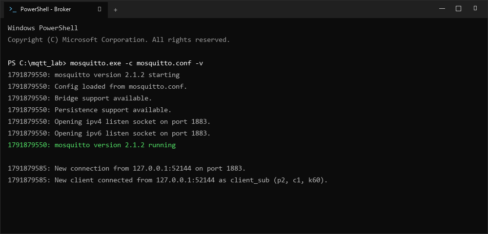
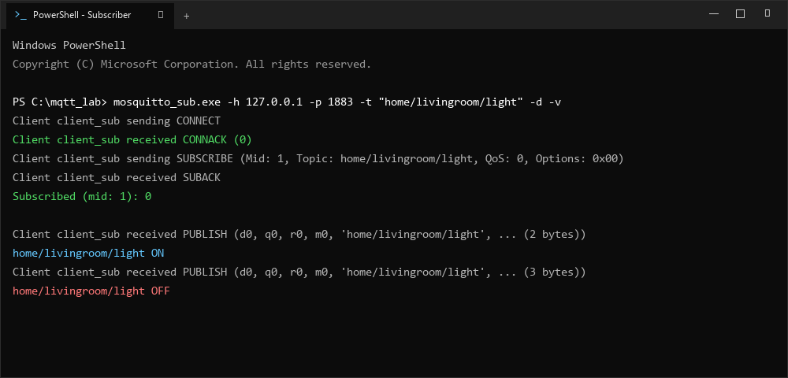
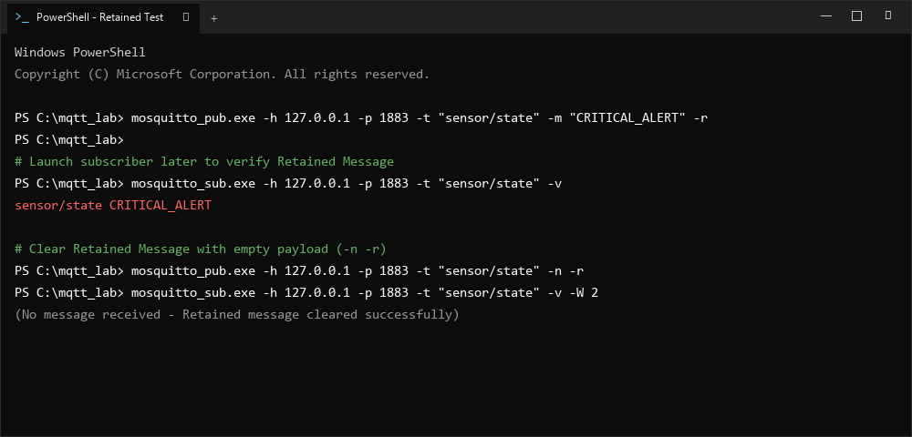

# ใบงานการทดลองที่ 11.1
### การติดตั้ง Mosquitto Broker และการทดสอบโปรโตคอล MQTT ด้วย CLI (Pub/Sub, QoS, Retain, LWT)

> [!NOTE] **คำชี้แจง**
> **รหัสนักศึกษา**: 67030134  
> ในใบงานนี้นักศึกษาจะได้เรียนรู้การติดตั้งและตั้งค่า **Eclipse Mosquitto MQTT Broker** บนเครื่องคอมพิวเตอร์เพื่อทำหน้าที่เป็นตัวกลางรับส่งข้อมูลของระบบ IoT จากนั้นใช้เครื่องมือบรรทัดคำสั่ง **`mosquitto_sub`** และ **`mosquitto_pub`** ในการทดลองคุณสมบัติสำคัญของโปรโตคอล MQTT ได้แก่ ระบบหัวข้อ (Topics & Wildcards), ระดับคุณภาพการให้บริการ (QoS 0, 1, 2), ข้อความคงค้าง (Retained Messages) และพินัยกรรมฉุกเฉิน (Last Will and Testament - LWT)

---

## 1. วัตถุประสงค์การทดลอง
1. สามารถติดตั้งและกำหนดค่าไฟล์คอนฟิกูเรชันของ Eclipse Mosquitto MQTT Broker ได้อย่างถูกต้อง
2. สามารถใช้คำสั่ง `mosquitto_sub` และ `mosquitto_pub` ในการบอกรับและเผยแพร่ข้อความผ่านเครือข่ายได้
3. เข้าใจความแตกต่างและสามารถใช้งานตัวกรองไวลด์การ์ดระดับเดียว (`+`) และหลายระดับ (`#`) ได้
4. สามารถเปรียบเทียบพฤติกรรมการรับส่งข้อมูลที่ระดับ QoS 0, QoS 1 และ QoS 2 พร้อมเข้าใจกลไก Packet Identifier และ ACKs
5. สามารถอธิบายและสาธิตการทำงานของ Retained Message และ Last Will and Testament (LWT) ได้

---

## 2. อุปกรณ์และเครื่องมือที่ใช้
* เครื่องคอมพิวเตอร์ระบบปฏิบัติการ Windows หรือ Linux/macOS
* ซอฟต์แวร์ **Eclipse Mosquitto** (พร้อมเครื่องมือ Client CLI) หรือ Docker Engine โดยโปรแกรมที่จะเรียกใช้ในใบงานนี้คือ 
  - mosquitto.exe   ทำหน้าที่เป็น broker
  - mosquitto_sub.exe   ทำหน้าที่เป็น subscriber
  - mosquitto_pub.exe   ทำหน้าที่เป็น publisher
* ซอฟต์แวร์ MQTTExplorer หรือ Thinksboard หรือ any other MQTT client เพื่อใช้ในการตรวจสอบการทำงานของ MQTT Broker โดยจะใช้ client ใด client หนึ่งก็ได้ 
  - ศึกษาวิธีการใช้โปรแกรม MQTTExplorer ได้จาก  [ภาคผนวก 1 MQTTExplorer_user_guide](10-Appendix-1-MQTTExplorer_user_guide.md)
  - เว็บ Thingsboard สามารถเข้าถึงได้ที่ [thingsboard web client](https://test.thingsboard.io/login)
* หน้าต่างเทอร์มินัล (PowerShell หรือ Bash Terminal) อย่างน้อย 3 หน้าต่าง


<p align="center">

</p>

<p align="center">
<b>รูปที่ L11.01_01</b> แผนภาพการทำงานของ MQTT Broker
</p>

---

## 3. ขั้นตอนการทดลอง

### กิจกรรมที่ 11-1.1: การติดตั้งและเริ่มต้น Mosquitto Broker

#### 1. การติดตั้งโปรแกรม
* **สำหรับ Windows** ให้ดาวน์โหลดตัวติดตั้ง `mosquitto-2.x.x-install-windows-x64.exe` จาก [mosquitto.org](https://mosquitto.org/download/) และติดตั้งลงในเครื่อง

ให้จดบันทึกไว้ด้วยว่า installer ติดตั้งไว้ที่ folder ใด 
เนื่องจากใน Lab จะมีการเรียกใช้โปรแกรมผ่าน `&` ซึ่งเป็น **Call Operator** ใน PowerShell ดังนั้นหากติดตั้งที่อื่น หรือใช้ชื่ออื่น ต้องแก้ไขคำสั่งในใบงานให้ถูกต้อง
> ในใบงานนี้ ใช้ค่า default คือ `"C:\Program Files\mosquitto\mosquitto.exe"` หรือเรียกโดยไม่ต้องใส่ path เป็น `mosquitto.exe` ก็ได้


* **สำหรับ Linux (Ubuntu/Debian)**
  ```bash
  sudo apt update && sudo apt install -y mosquitto mosquitto-clients
  ```
* **หรือรันผ่าน Docker**
  ```bash
  docker run -d --name mosquitto-test -p 1883:1883 eclipse-mosquitto:2
  ```

การเรียกคำสั่ง ให้เรียกตามวิธีการที่เหมาะสมของ Linux  หรือ Mac 

**Linux/Mac**
```bash
mosquitto_sub -h [IP_ADDRESS] -t "home/livingroom/light" -v
```

#### 2. การสร้างไฟล์คอนฟิกูเรชันเฉพาะ (`mosquitto.conf`)
สร้างโฟลเดอร์สำหรับแล็บ เช่น `C:\mqtt_lab\` (หรือ `~/mqtt_lab/`) แล้วสร้างไฟล์ชื่อ `mosquitto.conf`:

```text
# กำหนดพอร์ตและอนุญาตให้ทุกอินเทอร์เฟซเชื่อมต่อได้
listener 1883 0.0.0.0

# อนุญาตการเชื่อมต่อแบบ Anonymous (สำหรับการทดลองในห้องปฏิบัติการ)
allow_anonymous true

# แสดงบันทึกข้อความอย่างละเอียด
log_type all
```


#### 3. เปิด Terminal (Powershell) จำนวน 4 หน้าต่าง

#### 3.1 กรณีใช้ powershell windows

- หน้าต่างที่ 1  สำหรับรัน Mosquitto Broker  ตั้งชื่อหน้าต่างว่า "Mosquitto Broker"
- หน้าต่างที่ 2  สำหรับรัน mosquitto_sub  ตั้งชื่อหน้าต่างว่า "Subscriber"
- หน้าต่างที่ 3  สำหรับรัน mosquitto_pub  ตั้งชื่อหน้าต่างว่า "Publisher"
- หน้าต่างที่ 4  สำหรับรัน mosquitto_pub  ตั้งชื่อหน้าต่างว่า "Publisher 2"

วิธีการตั้งชื่อหน้าต่าง ให้คลิกขวาที่ไอคอนที่แถบหัวข้อ > คลิก "Properties" > คลิก "Options" > ที่ช่อง "Window Title" พิมพ์ชื่อหน้าต่างที่ต้องการ

#### 3.2 กรณีใช้ vsc terminal

เปิด Terminal (Powershell) ใน VSCode  จำนวน 4 หน้าต่าง
เปลี่ยนชื่อโดยการคลิกขวาที่ชื่อ terminal แล้วเลือก `Rename...`

- หน้าต่างที่ 1  สำหรับรัน Mosquitto Broker  ตั้งชื่อหน้าต่างว่า "Mosquitto Broker"
- หน้าต่างที่ 2  สำหรับรัน mosquitto_sub  ตั้งชื่อหน้าต่างว่า "Subscriber"
- หน้าต่างที่ 3  สำหรับรัน mosquitto_pub  ตั้งชื่อหน้าต่างว่า "Publisher"
- หน้าต่างที่ 4  สำหรับรัน mosquitto_pub  ตั้งชื่อหน้าต่างว่า "Publisher 2"


#### 4. เริ่มต้นการทำงานของ Mosquitto Broker
ใน **เทอร์มินัลที่ 1 (Mosquitto Broker)**  สั่งรัน Broker ในโหมดแสดงผลละเอียด (Verbose)

```powershell
# บน Windows (ระบุ Path ไฟล์คอนฟิกที่สร้างไว้)
& mosquitto.exe -c "C:\mqtt_lab\mosquitto.conf" -v

# บน Linux
mosquitto -c ~/mqtt_lab/mosquitto.conf -v
```

**หมายเหตุ** 
1. ถ้ารัน mosquitto.exe บนวินโดวส์ไม่ได้ ให้ตรวจสอบ path ในตัวแปรระบบ โดยเพิ่มเส้นทางการค้นหา "c:\Program Files\Mosquitto\" เข้าไป แล้วเรียก Powershell ใหม่อีกครั้ง 
2. `C:\mqtt_lab\mosquitto.conf` คือไฟล์ที่เก็บ configuration ของ mqtt broker ให้ใส่เส้นทางที่อยู่ของไฟล์จริง ๆ 

> [!WARNING] **ข้อควรระวังสำคัญมากสำหรับ Windows (ปัญหา Mosquitto Service ซ้ำซ้อน / Split-Brain Broker)**
> ตัวติดตั้ง Mosquitto บน Windows จะทำการติดตั้งและเปิดใช้งาน **Windows Service** ชื่อ `mosquitto` ให้รันอยู่เบื้องหลังอัตโนมัติตลอดเวลา ซึ่ง Service ตัวนี้จะผูกกับ `127.0.0.1:1883` 
> หากเปิด Terminal มารัน `mosquitto.exe -c mosquitto.conf -v` อีกตัว จะทำให้เกิด **Broker ทำงานซ้อนกัน 2 ตัวในเครื่องเดียว**:
> * `127.0.0.1` จะวิ่งไปหา Windows Service
> * `0.0.0.0` (IP ของบอร์ด ESP32 วงแลน เช่น `192.168.1.xxx`) จะวิ่งไปหา Terminal Mosquitto
> ส่งผลให้อุปกรณ์ ESP32 และคำสั่ง CLI คุยกันคนละตัวและไม่ส่งข้อมูลถึงกัน!
> 
> **แนวทางปฏิบัติที่ถูกต้อง:** ให้เปิด PowerShell (Run as Administrator) แล้วปิด Service นี้ก่อนเสมอ:
> ```powershell
> Stop-Service mosquitto
> Set-Service mosquitto -StartupType Manual
> ```

ผลลัพธ์ที่ควรเห็นใน **เทอร์มินัล Mosquitto Broker**:
```text
mosquitto version 2.0.18 starting
Config loaded from C:\mqtt_lab\mosquitto.conf.
Opening ipv4 listen socket on port 1883.
mosquitto version 2.0.18 running
```

#### 5. หยุดการทำงานของ Mosquitto Broker
ใน **เทอร์มินัลที่ 1 (Mosquitto Broker)**  ให้กด Ctrl+C เพื่อหยุดการทำงานของ Mosquitto Broker
ในหน้าต่างแสดงผลของ Mosquitto Broker จะปรากฏ Log แสดงการปิดการเชื่อมต่อและหยุดการทำงานของ Broker
```text

...

mosquitto version 2.1.2 terminating
```

---

### กิจกรรมที่ 11-1.2  การทดสอบ Publish / Subscribe พื้นฐาน และการใช้ Wildcards

#### 1. การ Subscribe หัวข้อเฉพาะเจาะจง
ใน **เทอร์มินัลที่ 2 (Subscriber)**  สั่งรันคำสั่งต่อไปนี้
```powershell
& mosquitto_sub.exe -h 127.0.0.1 -p 1883 -t "home/livingroom/light" -v
```

เปิด **เทอร์มินัลที่ 3 (Publisher)**  ส่งข้อความสั่งงานดังนี้
```powershell
& mosquitto_pub.exe -h 127.0.0.1 -p 1883 -t "home/livingroom/light" -m "ON"
```

*สังเกตผล*  ในเทอร์มินัลที่ 2  (Subscriber) จะได้รับข้อความ `home/livingroom/light ON`
ถ้าไม่ได้ ให้ตรวจสอบว่าทั้งสอง terminal   รันอยู่ที่  IP Address  และ  Port  เดียวกันหรือไม่
เพราะนี่คือจุดเริ่มต้นของการทำงานพื้นฐานที่ต้องรันได้อย่างถูกต้อง

#### 2. การทดสอบไวลด์การ์ดระดับเดียว (Single-Level Wildcard: `+`)
ใน **เทอร์มินัลที่ 2 (Subscriber)**  กด `Ctrl + C` เพื่อออกจากโปรแกรม subscriber แล้วเปลี่ยนคำสั่ง Subscribe เป็น
```powershell
& mosquitto_sub.exe -h 127.0.0.1 -p 1883 -t "home/+/light" -v
```

ใน **เทอร์มินัลที่ 3 (Publisher)**  ทดลอง Publish ข้อความ 3 ครั้ง
```powershell
& mosquitto_pub.exe -h 127.0.0.1 -p 1883 -t "home/livingroom/light" -m "ON"
& mosquitto_pub.exe -h 127.0.0.1 -p 1883 -t "home/kitchen/light" -m "OFF"
& mosquitto_pub.exe -h 127.0.0.1 -p 1883 -t "home/bedroom/balcony/light" -m "ON"
```

> [!NOTE] **บันทึกผลการทดลอง (Single-Level Wildcard `+`)**
> * **ข้อความที่ปรากฏในเทอร์มินัลที่ 2 (Subscriber):**
>   - `home/livingroom/light ON`
>   - `home/kitchen/light OFF`
> * **ข้อความที่ไม่ปรากฏในเทอร์มินัลที่ 2:**
>   - `home/bedroom/balcony/light ON`
> * **คำอธิบายเหตุผล:** ไวลด์การ์ดระดับเดียว (`+`) จะทำการจับคู่ (Match) เฉพาะ Topic Level เดียวที่คั่นด้วยเครื่องหมาย Slash (`/`) เท่านั้น ในกรณีนี้ `home/+/light` คาดหวังรูปแบบที่มีความลึก 3 ระดับพอดี โดยระดับตรงกลางสามารถเป็นอะไรก็ได้ เช่น `livingroom` หรือ `kitchen` แต่หัวข้อ `home/bedroom/balcony/light` มีความลึกถึง 4 ระดับ (มีระดับ `bedroom` และ `balcony` คั่นอยู่ 2 ระดับ) จึงไม่ตรงกับเงื่อนไขของไวลด์การ์ด `+`

#### 3. การทดสอบไวลด์การ์ดหลายระดับ (Multi-Level Wildcard: `#`)
ใน **เทอร์มินัลที่ 2 (Subscriber)** กด `Ctrl + C` เพื่อออกจากโปรแกรม subscriber แล้วเปลี่ยนคำสั่ง Subscribe เป็น
```powershell
& mosquitto_sub.exe -h 127.0.0.1 -p 1883 -t "home/#" -v
```

ใน **เทอร์มินัลที่ 3 (Publisher)** ทดลอง Publish ข้อความไปยังหัวข้อต่างๆ
```powershell
& mosquitto_pub.exe -h 127.0.0.1 -p 1883 -t "home/livingroom/temp" -m "26.4"
& mosquitto_pub.exe -h 127.0.0.1 -p 1883 -t "home/bedroom/balcony/light" -m "ON"
```

*สังเกตผล* ทุกข้อความที่ขึ้นต้นด้วย `home/` จะถูกส่งมาแสดงผลทั้งหมด

---

### กิจกรรมที่ 11-1.3 การทดสอบระดับคุณภาพการส่งข้อมูล (QoS 0, QoS 1, QoS 2)

ในกิจกรรมนี้ ให้สังเกตข้อความ Log ใน **เทอร์มินัลที่ 1 (Mosquitto Broker)** ควบคู่กับคำสั่งในเทอร์มินัลที่ 2 และ 3

#### 1. ทดสอบ QoS 0 (At Most Once)
* ในเทอร์มินัลที่ 2 (Subscriber)  `& "C:\Program Files\mosquitto\mosquitto_sub.exe" -h 127.0.0.1 -t "test/qos" -q 0 -v`
* ในเทอร์มินัลที่ 3 (Publisher)  `& "C:\Program Files\mosquitto\mosquitto_pub.exe" -h 127.0.0.1 -t "test/qos" -m "QoS 0 Message" -q 0`
* *หมายเหตุ* การรันโปรแกรมทั้ง subscriber และ publisher จะทำให้หน้าต่างค้างและรอแสดงข้อความที่ publisher ส่งมาให้ ดังนั้นการเปลี่ยนคำสั่ง ต้องกด  `Ctrl+C`  ทุกครั้งเพื่อออกจาก  โปรแกรม subscriber ก่อนเสมอ แล้วเปลี่ยนคำสั่ง subscriber ใหม่ จากนั้นจึงรันคำสั่ง publisher ใหม่
* *สังเกต Log ฝั่ง Broker*  มีเพียงแพ็กเก็ต `PUBLISH` ส่งผ่านไปโดยไม่มีแพ็กเก็ตตอบรับใดๆ


#### 2. ทดสอบ QoS 1 (At Least Once)
* ในเทอร์มินัลที่ 2 (Subscriber)  `& "C:\Program Files\mosquitto\mosquitto_sub.exe" -h 127.0.0.1 -t "test/qos" -q 1 -v`
* ในเทอร์มินัลที่ 3 (Publisher)  `& "C:\Program Files\mosquitto\mosquitto_pub.exe" -h 127.0.0.1 -t "test/qos" -m "QoS 1 Message" -q 1`
* *สังเกต Log ฝั่ง Broker*  จะปรากฏแพ็กเก็ต `PUBLISH (d0, q1, m1, ...)` ตามด้วยแพ็กเก็ต `PUBACK (Mid: 1)` เพื่อยืนยันการรับส่งข้อมูล

#### 3. ทดสอบ QoS 2 (Exactly Once)
* ในเทอร์มินัลที่ 2 (Subscriber)  `& mosquitto_sub.exe -h 127.0.0.1 -t "test/qos" -q 2 -v`
* ในเทอร์มินัลที่ 3 (Publisher)  `& mosquitto_pub.exe -h 127.0.0.1 -p 1883 -t "test/qos" -m "QoS 2 Message" -q 2`
* *สังเกต Log ฝั่ง Broker*  จะปรากฏกระบวนการ 4-way Handshake อย่างชัดเจน
  1. `Received PUBLISH ... q2`
  2. `Sending PUBREC`
  3. `Received PUBREL`
  4. `Sending PUBCOMP`

---

### กิจกรรมที่ 11-1.4 การทดสอบข้อความคงค้าง (Retained Messages)

#### 1. ทดสอบข้อความคงค้าง (Retained Messages)
1. ปิด Subscriber ใน **เทอร์มินัลที่ 2 (Subscriber)** ทั้งหมด (ไม่มีใคร Subscribe อยู่)
2. ใน **เทอร์มินัลที่ 3 (Publisher)** ส่งข้อความธรรมดา (ไม่ใส่พารามิเตอร์ `-r`)
   ```powershell
   & mosquitto_pub.exe -h 127.0.0.1 -p 1883 -t "sensor/state" -m "Normal"
   ```
3. เปิด Subscriber ใน **เทอร์มินัลที่ 2 (Subscriber)**
   ```powershell
   & mosquitto_sub.exe -h 127.0.0.1 -p 1883 -t "sensor/state" -v
   ```
   *ผลที่ได้*  หน้าจอว่างเปล่า ไม่ได้รับข้อความใดๆ เพราะข้อความถูกส่งผ่านไปแล้วก่อนหน้านี้

4. ใน **เทอร์มินัลที่ 3 (Publisher)** สั่ง Publish โดยเพิ่มพารามิเตอร์ **`-r` (Retain)**
   ```powershell
   & mosquitto_pub.exe -h 127.0.0.1 -p 1883 -t "sensor/state" -m "CRITICAL_ALERT" -r
   ```
   *ผลที่ได้* ในเทอร์มินัลที่ 2 (Subscriber)ได้รับข้อความ `sensor/state CRITICAL_ALERT` ทันที

5. ปิดเทอร์มินัลที่ 2 (Subscriber) (`Ctrl + C`) แล้วรัน subscriber ใหม่อีกครั้ง
   ```powershell
   & mosquitto_sub.exe -h 127.0.0.1 -p 1883 -t "sensor/state" -v
   ```
   *ผลที่ได้* ทันทีที่เชื่อมต่อสำเร็จ เทอร์มินัลที่ 2 (Subscriber) จะได้รับข้อความ `CRITICAL_ALERT` ในทันที แม้ Publisher จะไม่ได้ส่งข้อความใหม่เลยก็ตาม

> [!TIP]
> **วิธีลบ Retained Message ออกจาก Broker**  ส่งข้อความที่มีเนื้อหาว่างเปล่า (Empty Payload) พร้อมเปิดแฟล็ก `-r`
> ```powershell
> & mosquitto_pub.exe -h 127.0.0.1 -p 1883 -t "sensor/state" -n -r
> ```

---

### กิจกรรมที่ 11-1.5 การทดสอบพินัยกรรมฉุกเฉิน (Last Will and Testament - LWT)

1. ใน **เทอร์มินัลที่ 2 (Subscriber)** เปิด Subscribe เพื่อรอเฝ้าดูสถานะของโหนด
   ```powershell
   & mosquitto_sub.exe -h 127.0.0.1 -p 1883 -t "node/esp32/status" -v
   ```
2. ใน **เทอร์มินัลที่ 3 (Publisher)** เปิด Client ที่จำลองเป็น ESP32 โดยกำหนดค่า **LWT** ไว้ล่วงหน้า
   ```powershell
   & mosquitto_sub.exe -h 127.0.0.1 -p 1883 -i "Node_Client_01" -t "dummy/listen" --will-topic "node/esp32/status" --will-payload "LOST_CONNECTION_OFFLINE" --will-qos 1
   ```
3. ส่งสถานะเริ่มต้นว่า "ONLINE" จากอุปกรณ์
   (เปิดเทอร์มินัลที่ 4 (Publisher 2) แล้วพิมพ์ `& mosquitto_pub.exe -h 127.0.0.1 -p 1883 -t "node/esp32/status" -m "ONLINE"`)
   *สังเกตผล* เทอร์มินัลที่ 2 แสดงสถานะ `ONLINE`

4. **จำลองเหตุการณ์ไฟดับหรือเครือข่ายหลุดกะทันหัน**  
   ในเทอร์มินัลที่ 3 ให้ทำการ **บังคับปิดหน้าต่างเทอร์มินัลทันที** หรือกดปิดโปรเซส เพื่อไม่ให้ Client ส่งแพ็กเก็ต `DISCONNECT`
5. *สังเกตผลในเทอร์มินัลที่ 2*  
   เมื่อ Broker ตรวจพบว่า TCP Connection ขาดหาย Broker จะเป็นผู้ส่งข้อความ
   ```text
   node/esp32/status LOST_CONNECTION_OFFLINE
   ```
   มายังเทอร์มินัลที่ 2 โดยอัตโนมัติ

---

## 4. การบันทึกและวิเคราะห์ผลการทดลอง

### 4.1 ข้อมูลบันทึกการทำงาน (Log & Output) ของ Mosquitto Broker และ Client CLI

#### 1) การเริ่มต้นทำงานของ Mosquitto Broker (Verbose Mode)
เริ่มต้นรัน Broker ด้วยไฟล์คอนฟิก `mosquitto.conf` ที่อนุญาตให้ทุกอินเทอร์เฟซเข้าถึงได้และอนุญาตการเชื่อมต่อแบบ Anonymous:
```text
mosquitto version 2.1.2 starting
Config loaded from C:\mqtt_lab\mosquitto.conf.
Opening ipv4 listen socket on port 1883.
mosquitto version 2.1.2 running
```

* **ภาพหน้าจอการเริ่มต้นทำงานของ Mosquitto Broker**  
  

#### 2) บันทึกเหตุการณ์การเชื่อมต่อและ Subscribe ข้อความ
เมื่อรันคำสั่ง Subscriber เพื่อบอกรับหัวข้อ `home/livingroom/light`:
```powershell
& mosquitto_sub.exe -h 127.0.0.1 -p 1883 -t "home/livingroom/light" -d -v
```
**Log ฝั่ง Subscriber:**
```text
Client null sending CONNECT
Client (null) received CONNACK (0)
Client null sending SUBSCRIBE (Mid: 1, Topic: home/livingroom/light, QoS: 0, Options: 0x00)
Client null received SUBACK
Subscribed (mid: 1): 0
```

* **ภาพหน้าจอการเชื่อมต่อและ Subscribe ข้อความ**  
  

#### 3) บันทึกเหตุการณ์การ Publish ข้อความ
เมื่อเปิดเทอร์มินัล Publisher ส่งข้อความสั่งเปิดไฟ:
```powershell
& mosquitto_pub.exe -h 127.0.0.1 -p 1883 -t "home/livingroom/light" -m "ON" -d
```
**Log ฝั่ง Publisher:**
```text
Client null sending CONNECT
Client (null) received CONNACK (0)
Client null sending PUBLISH (d0, q0, r0, m1, 'home/livingroom/light', ... (2 bytes))
Client null sending DISCONNECT
```
**ผลลัพธ์ที่แสดงบนหน้าต่าง Subscriber:**
```text
home/livingroom/light ON
```

---

### 4.2 ตารางเปรียบเทียบลำดับแพ็กเก็ตระหว่าง QoS 0, QoS 1 และ QoS 2

จากการสังเกตข้อความ Log และแพ็กเก็ตควบคุม (MQTT Control Packets) ในแต่ละระดับ QoS ได้ผลการเปรียบเทียบดังนี้:

| คุณลักษณะ / รายละเอียด | QoS 0 (At Most Once) | QoS 1 (At Least Once) | QoS 2 (Exactly Once) |
| :--- | :--- | :--- | :--- |
| **ระดับความเชื่อถือได้** | ไม่การันตีข้อมูล (Fire & Forget) | การันตีข้อมูลถึงอย่างน้อย 1 ครั้ง (At Least Once) | การันตีข้อมูลถึงเพียง 1 ครั้งอย่างแน่นอน (Exactly Once) |
| **การใช้ Packet Identifier (MID)** | ไม่ใช้ (Message ID = 0 / ไม่ระบุ) | จำเป็นต้องมี (ระบุใน PUBLISH และ PUBACK) | จำเป็นต้องมี (ใช้ติดตามตลอดกระบวนการ 4 ขั้นตอน) |
| **ลำดับแพ็กเก็ต Publisher $\rightarrow$ Broker** | 1. `PUBLISH` (q0) | 1. `PUBLISH` (q1, mid)<br/>2. $\leftarrow$ `PUBACK` (mid) | 1. `PUBLISH` (q2, mid)<br/>2. $\leftarrow$ `PUBREC` (mid)<br/>3. `PUBREL` (mid)<br/>4. $\leftarrow$ `PUBCOMP` (mid) |
| **ลำดับแพ็กเก็ต Broker $\rightarrow$ Subscriber** | 1. `PUBLISH` (q0) | 1. `PUBLISH` (q1, mid)<br/>2. $\rightarrow$ `PUBACK` (mid) | 1. `PUBLISH` (q2, mid)<br/>2. $\rightarrow$ `PUBREC` (mid)<br/>3. $\leftarrow$ `PUBREL` (mid)<br/>4. $\rightarrow$ `PUBCOMP` (mid) |
| **จำนวนแพ็กเก็ตในการยืนยัน (Handshake)** | 0 แพ็กเก็ต (ไม่มีการยืนยัน) | 2 แพ็กเก็ต (2-Way Handshake) | 4 แพ็กเก็ต (4-Way Handshake) |
| **โอกาสเกิดข้อความซ้ำ (Duplicate)** | ไม่มี (เพราะไม่มีการ Retry ส่งซ้ำ) | มีโอกาสเกิดซ้ำได้ (หากเกิด Timeout จะส่งซ้ำด้วยแฟล็ก DUP=1) | ไม่มีอย่างแน่นอน (ป้องกันข้อความซ้ำด้วยสถานะ Release) |
| **Overhead และความเร็วในการส่ง** | Overhead ต่ำสุด รวดเร็วที่สุด | ปานกลาง มีการรอรับแพ็กเก็ต ACK | Overhead สูงสุด ใช้เวลาและทรัพยากรมากที่สุด |

#### ลำดับแพ็กเก็ตจริงที่บันทึกได้จากการทดลอง (Packet Traces):
* **กรณี QoS 0:**
  ```text
  [Publisher]  --> PUBLISH (d0, q0, r0, m0, 'test/qos0', 13 bytes)
  [Subscriber] <-- PUBLISH (d0, q0, r0, m0, 'test/qos0', 13 bytes)
  [Payload]    "QoS 0 Message"
  (จบการทำงานทันทีโดยไม่มีการตอบรับ ACK)
  ```
* **กรณี QoS 1:**
  ```text
  [Publisher]  --> PUBLISH (d0, q1, r0, m1, 'test/qos1', 13 bytes)
  [Broker]     <-- PUBACK (Mid: 1, RC: 0)  [ยืนยันว่า Broker ได้รับแล้ว]
  [Subscriber] <-- PUBLISH (d0, q1, r0, m1, 'test/qos1', 13 bytes)
  [Subscriber] --> PUBACK (m1, rc0)        [ยืนยันว่า Subscriber ได้รับแล้ว]
  [Payload]    "QoS 1 Message"
  ```
* **กรณี QoS 2 (4-Way Handshake สมบูรณ์):**
  ```text
  ขั้นตอนที่ 1: [Publisher]  --> PUBLISH (d0, q2, r0, m1, 'test/qos2', 13 bytes)
  ขั้นตอนที่ 2: [Broker]     <-- PUBREC (Mid: 1)  (Publish Received: ได้รับข้อความแล้ว)
  ขั้นตอนที่ 3: [Publisher]  --> PUBREL (m1)      (Publish Release: ปลดล็อกให้ส่งต่อ)
  ขั้นตอนที่ 4: [Broker]     <-- PUBCOMP (Mid: 1) (Publish Complete: ยืนยันการปิดขั้นตอน)
  ฝั่ง Subscriber ดำเนินการ 4 ขั้นตอนเช่นเดียวกันจนได้รับข้อความ "QoS 2 Message" อย่างแม่นยำ
  ```

---

### 4.3 ผลการทดสอบข้อความคงค้าง (Retained Messages)
จากการทดลองตามกิจกรรมที่ 11-1.4 สามารถสรุปผลได้ดังนี้:

1. **การส่งข้อความธรรมดา (ไม่ใส่ `-r`) เมื่อไม่มี Subscriber:**
   - ส่งคำสั่ง: `mosquitto_pub -h 127.0.0.1 -p 1883 -t "sensor/state" -m "Normal"`
   - ผลการทดลอง: เมื่อเปิด Subscriber ขึ้นมาใหม่ภายหลัง **Subscriber ไม่ได้รับข้อความใด ๆ เลย (หน้าจอว่างเปล่า)** เนื่องจากข้อความถูกส่งผ่าน Broker ไปแล้วและไม่ถูกจัดเก็บไว้
2. **การส่งข้อความพร้อมระบุแฟล็ก Retain (`-r`):**
   - ส่งคำสั่ง: `mosquitto_pub -h 127.0.0.1 -p 1883 -t "sensor/state" -m "CRITICAL_ALERT" -r`
   - ผลการทดลอง: ทันทีที่เปิด Subscriber เชื่อมต่อเข้ามาใหม่ในภายหลัง **ได้รับข้อความ `sensor/state CRITICAL_ALERT` ทันทีโดยอัตโนมัติ** แม้ Publisher จะหยุดทำงานไปแล้วก็ตาม
3. **การล้างข้อความ Retained ออกจาก Broker:**
   - ส่งคำสั่ง Payload ว่างเปล่า: `mosquitto_pub -h 127.0.0.1 -p 1883 -t "sensor/state" -n -r`
   - ผลการทดลอง: เมื่อเปิด Subscriber ใหม่อีกครั้ง **ไม่ปรากฏข้อความใด ๆ อีก** แสดงว่า Broker ได้ทำการล้าง Retained Message ของหัวข้อนั้นออกจากหน่วยความจำเรียบร้อยแล้ว

* **ภาพหน้าจอการทดสอบ Retained Message เมื่อเปิด Subscriber ขึ้นมาใหม่**  
  

---

### 4.4 ผลการทดสอบพินัยกรรมฉุกเฉิน (Last Will and Testament - LWT)
จากการทดลองกิจกรรมที่ 11-1.5:
- Subscriber รอรับสถานะที่หัวข้อ `node/esp32/status`
- ไคลเอนต์จำลอง ESP32 เชื่อมต่อด้วยคำสั่ง:
  `mosquitto_sub -h 127.0.0.1 -p 1883 -i "Node_Client_01" -t "dummy/listen" --will-topic "node/esp32/status" --will-payload "LOST_CONNECTION_OFFLINE" --will-qos 1`
- ส่งสถานะเริ่มต้น: `mosquitto_pub ... -t "node/esp32/status" -m "ONLINE"` $\rightarrow$ Subscriber แสดงสถานะ `ONLINE`
- จำลองเหตุการณ์ไฟดับหรือเครือข่ายหลุดกะทันหัน โดยการบังคับปิดกระบวนการ (Terminate / Kill Process) โดยไม่ปล่อยให้ส่งแพ็กเก็ต `DISCONNECT`
- **ผลการทดสอบ:** เมื่อ Broker ตรวจพบว่าการเชื่อมต่อ TCP หลุดไปโดยไม่สมบูรณ์ Mosquitto Broker ได้ทำหน้าที่ส่งข้อความพินัยกรรม (Will Payload) ออกมายังหัวข้อสถานะแทนทันที:
  ```text
  node/esp32/status LOST_CONNECTION_OFFLINE
  ```
  ทำให้ระบบเฝ้าระวังทราบได้ทันทีว่าอุปกรณ์ขาดการเชื่อมต่ออย่างกะทันหัน

---

## 5. คำถามท้ายการทดลอง (Post-Lab Questions)

### 1. เพราะเหตุใดสัญลักษณ์ `#` จึงต้องวางไว้ที่ตำแหน่งท้ายสุดของ Topic เสมอ? หากกำหนด Topic Filter เป็น `home/#/light` จะเกิดข้อผิดพลาดอย่างไร?

**คำตอบ:**
* **เหตุผลที่สัญลักษณ์ `#` ต้องวางไว้ท้ายสุดเสมอ:**
  ตามข้อกำหนดมาตรฐานโปรโตคอล MQTT (MQTT Standard Specification v3.1.1 และ v5.0) สัญลักษณ์ `#` เป็น **Multi-Level Wildcard** ซึ่งถูกออกแบบมาเพื่อใช้จับคู่ (Match) ลำดับชั้นของ Topic ทั้งหมดที่อยู่ถัดไปโดยไม่จำกัดจำนวนชั้น (Arbitrary Number of Subsequent Hierarchy Levels) เพื่อให้ขั้นตอนการค้นหาและจับคู่หัวข้อใน Topic Tree ของ Broker ไม่เกิดความกำกวม (Ambiguity) มาตรฐานจึงกำหนดให้สัญลักษณ์ `#` ต้องอยู่เพียงลำพัง หรืออยู่ที่ตำแหน่งลำดับชั้นสุดท้ายของ Topic Filter หลังเครื่องหมาย Slash (`/`) เสมอ (เช่น `home/#` หรือ `home/livingroom/#`)
* **ข้อผิดพลาดที่จะเกิดขึ้นหากกำหนด Topic Filter เป็น `home/#/light`:**
  - รูปแบบนี้ถือเป็น **ไวยากรณ์ที่ไม่ถูกต้องตามมาตรฐาน (Malformed / Invalid Topic Filter Syntax)**
  - เมื่อ Client ส่งคำสั่ง `SUBSCRIBE` ด้วย Topic Filter ที่มี `#` คั่นอยู่ตรงกลาง Mosquitto Broker จะปฏิเสธคำขอบอกรับหัวข้อทันที โดยตอบกลับด้วยแพ็กเก็ต `SUBACK` ที่มีรหัสความล้มเหลว (Failure Return Code เช่น `0x80` ใน MQTT v3.1.1 หรือ `0x8F Topic Filter Invalid` ใน MQTT v5.0) หรือตัดการเชื่อมต่อในโหมดเข้มงวด
  - **แนวทางที่ถูกต้อง:** หากต้องการจับคู่เฉพาะ 1 ระดับที่อยู่ตรงกลางระหว่าง `home` และ `light` จะต้องใช้ **Single-Level Wildcard (`+`)** แทน เช่น `home/+/light` ซึ่งจะสามารถจับคู่กับ `home/livingroom/light` หรือ `home/kitchen/light` ได้อย่างถูกต้อง

---

### 2. ในระบบงานติดตามยานพาหนะ (GPS Tracking) ที่ส่งพิกัดรถยนต์ทุกๆ 1 วินาที ท่านคิดว่าควรเลือกระดับ QoS ใดระหว่าง QoS 0, 1 หรือ 2 เพราะเหตุใด?

**คำตอบ:**
* **ระดับ QoS ที่ควรเลือกใช้:** **QoS 0 (At Most Once)**
* **เหตุผลประกอบการตัดสินใจ:**
  1. **ความถี่ของข้อมูลสูงและมีอายุการใช้งานสั้น (High Frequency & Transient Data):** ข้อมูลพิกัด GPS ที่ส่งทุก ๆ 1 วินาทีมีอัตราการเปลี่ยนแปลงรวดเร็ว หากข้อมูลพิกัดในวินาทีที่แล้วสูญหายเนื่องจากสัญญาณเครือข่ายกระตุก ข้อมูลพิกัดของวินาทีถัดไปก็จะถูกส่งเข้ามาทดแทนทันที การพยายามส่งซ้ำพิกัดเก่าที่ตกรุ่นไปแล้วไม่มีประโยชน์ในการบอกตำแหน่งปัจจุบันของยานพาหนะ
  2. **ประหยัดแบนด์วิดท์และลดภาระเครือข่าย Cellular (4G/LTE/NB-IoT):** การเชื่อมต่อผ่านเครือข่ายมือถือมีค่าบริการข้อมูลและข้อจำกัดด้านความเสถียร QoS 0 มี Packet Overhead ต่ำที่สุด (ส่งเพียง `PUBLISH` แพ็กเก็ตเดียว ไม่ต้องรอการตอบกลับ `PUBACK` หรือทำ 4-way Handshake) ช่วยประหยัด Data Usage และยืดอายุแบตเตอรี่ของอุปกรณ์ติดตาม
  3. **ป้องกันปัญหาคิวข้อมูลคั่งค้าง (Queue Congestion & Message Lag):** หากใช้ QoS 1 หรือ 2 ในช่วงที่ยานพาหนะวิ่งผ่านจุดอับสัญญาณ (เช่น อุโมงค์ หรือชั้นใต้ดิน) ไคลเอนต์และโบรเกอร์จะต้องเก็บข้อความไว้ในคิวเพื่อรอ Retry เมื่อกลับมาเชื่อมต่อได้ อาจเกิดภาวะพิกัดเก่าทะลักเข้ามาเป็นจำนวนมาก (Packet Flooding) ส่งผลให้การประมวลผลตำแหน่งปัจจุบันบนแผนที่เกิดอาการกระตุกและล่าช้า
  *(หมายเหตุ: หากเป็นข้อมูลเหตุการณ์วิกฤต เช่น สัญญาณแจ้งเตือนรถชน (Crash Sensor), ปุ่มขอความช่วยเหลือฉุกเฉิน (SOS Alert) หรือคำสั่งตัดระบบสตาร์ตเครื่องยนต์ระยะไกล จึงจะกำหนดให้ใช้ **QoS 1 หรือ QoS 2** แยกเฉพาะหัวข้อ)*

---

### 3. หาก Client ส่งแพ็กเก็ต `DISCONNECT` ไปยัง Broker อย่างถูกต้องก่อนปิดโปรแกรม ข้อความ Last Will and Testament (LWT) จะถูกเผยแพร่ออกไปหรือไม่ เพราะเหตุใด?

**คำตอบ:**
* **ข้อความ LWT จะ "ไม่ถูกเผยแพร่ออกไป" (Will NOT be published)**
* **เหตุผลประกอบ:**
  - กลไก **Last Will and Testament (LWT)** ถูกออกแบบมาสำหรับจัดการกรณี **"การตัดการเชื่อมต่อแบบผิดปกติหรือไม่คาดคิด (Ungraceful / Unexpected Disconnection)"** เช่น ปัญหาไฟดับกะทันหัน, ระบบหยุดทำงาน (System Crash), สายสัญญาณหลุด หรือการขาดหายไปของการตอบรับ Keep-Alive เกินกำหนด
  - เมื่อ Client ดำเนินการปิดโปรแกรมตามขั้นตอนปกติ Client จะส่งแพ็กเก็ต **`DISCONNECT` (Graceful Disconnect)** ไปแจ้ง Broker ล่วงหน้า
  - เมื่อ Broker ได้รับแพ็กเก็ต `DISCONNECT` จะถือว่าเป็นการแจ้งยุติการเชื่อมต่อโดยสมบูรณ์ Broker จะทำการ **ล้างและทำลายข้อความพินัยกรรม (Discard/Clear Will Message)** ที่ลงทะเบียนไว้ใน Session ตั้งแต่ขั้นตอน `CONNECT` ทิ้งทันที แล้วจึงปิด TCP Connection ส่งผลให้ไม่มีการเผยแพร่ข้อความ LWT ไปยัง Subscriber ใด ๆ ในระบบ

---

### 4. Retained Message มีประโยชน์อย่างไรในการออกแบบระบบแดชบอร์ด Smart Home สำหรับผู้ใช้งานที่เพิ่งเปิดแอปพลิเคชันขึ้นมาเป็นครั้งแรก?

**คำตอบ:**
* **ประโยชน์หลัก:** **การซิงโครไนซ์สถานะปัจจุบันของอุปกรณ์ได้ทันทีโดยไม่มีความหน่วงเวลา (Instant Current State Synchronization)**
* **การวิเคราะห์ประโยชน์เชิงระบบ:**
  1. **แก้ไขปัญหาหน้าจอว่างเปล่าเมื่อเปิดแอปพลิเคชัน (Eliminate Zero-State / Cold-Start Problem):**
     โดยทั่วไปในระบบ IoT อุปกรณ์ Smart Home (เช่น สวิตช์ไฟอัจฉริยะ, เซนเซอร์ประตู) มักจะ Publish ข้อมูลเฉพาะเมื่อเกิดการเปลี่ยนแปลงสถานะเท่านั้น (Report by Exception) หรือส่งเป็นช่วงเวลานาน ๆ เพื่อประหยัดพลังงาน หากไม่มี Retained Message เมื่อผู้ใช้เปิดแอปขึ้นมาและทำการ Subscribe หัวข้อต่าง ๆ หน้าจอแดชบอร์ดจะแสดงสถานะเป็น "ว่างเปล่า" หรือ "Unknown" จนกว่าอุปกรณ์จะมีการกดสวิตช์หรือส่งข้อมูลใหม่เข้ามา แต่เมื่อใช้ **Retained Message** ทันทีที่แอปเชื่อมต่อและ Subscribe Broker จะส่งข้อความสถานะล่าสุดของอุปกรณ์ทุกตัวให้แอปทันที ทำให้แดชบอร์ดแสดงผลสวิตช์เปิด-ปิดหรือค่าอุณหภูมิได้อย่างถูกต้องสมบูรณ์ตั้งแต่เปิดแอปขึ้นมาครั้งแรก
  2. **ลดปริมาณ Traffic และการใช้พลังงานของอุปกรณ์ปลายทาง (Edge Nodes):**
     อุปกรณ์ฮาร์ดแวร์ปลายทาง (เช่น ESP32 หรือเซนเซอร์ใช้แบตเตอรี่) ไม่จำเป็นต้องตื่นขึ้นมาส่งข้อความรายงานสถานะเดิมซ้ำ ๆ ทุกวินาที เพียงแค่ส่งสถานะทุกครั้งที่มีการเปลี่ยนสถานะพร้อมตั้งแฟล็ก Retain (`-r`) ไว้ 1 ครั้ง Broker จะทำหน้าที่เป็นตัวแทนคอยแจกจ่ายสถานะปัจจุบันให้แก่ผู้ใช้ทุกรายที่เปิดแอปเข้ามาใหม่โดยอัตโนมัติ
  3. **ลดภาระการออกแบบฐานข้อมูลฝั่ง Backend:**
     ระบบ Smart Home ขนาดเล็กถึงขนาดกลางสามารถใช้ Broker เป็นตัวเก็บสถานะปัจจุบัน (State Store) ได้โดยตรง โดยไม่จำเป็นต้องสร้าง REST API หรือฐานข้อมูลแยกต่างหากเพื่อดึงค่าสถานะล่าสุดของอุปกรณ์ตอนเปิดแอป ช่วยลดความซับซ้อนของสถาปัตยกรรมระบบได้อย่างมาก
