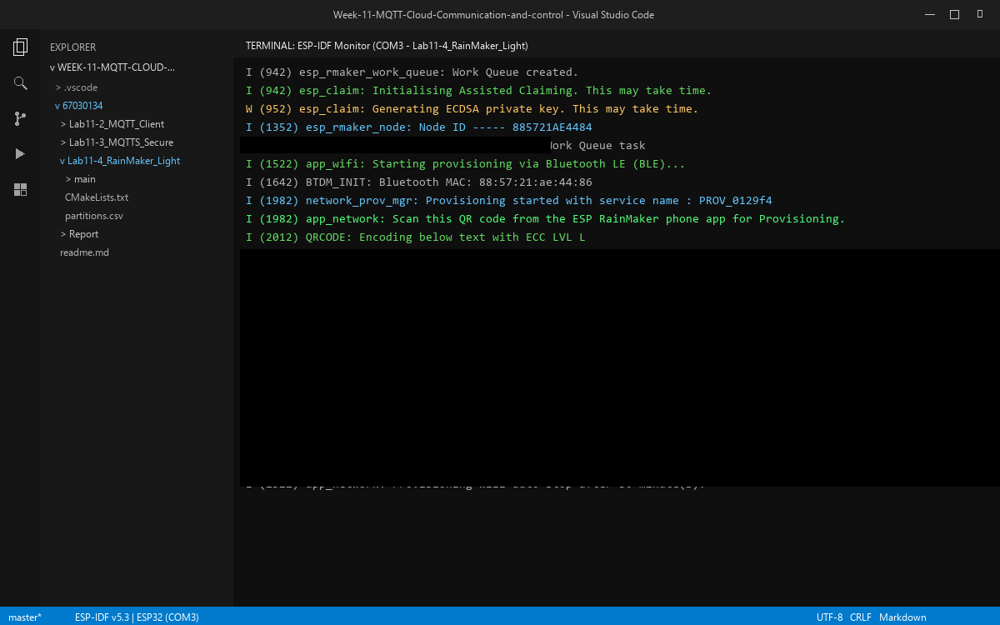
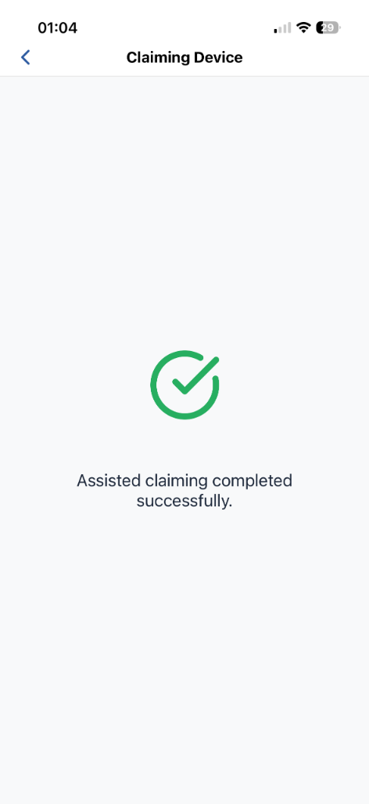
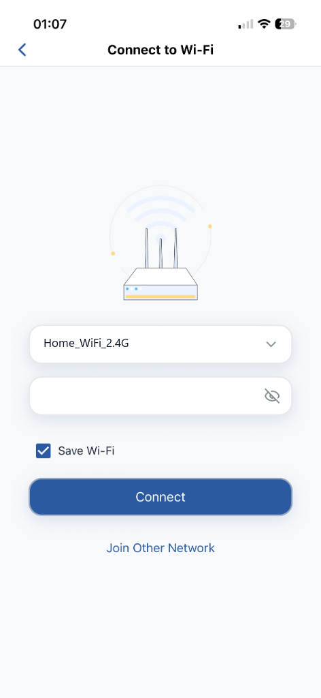
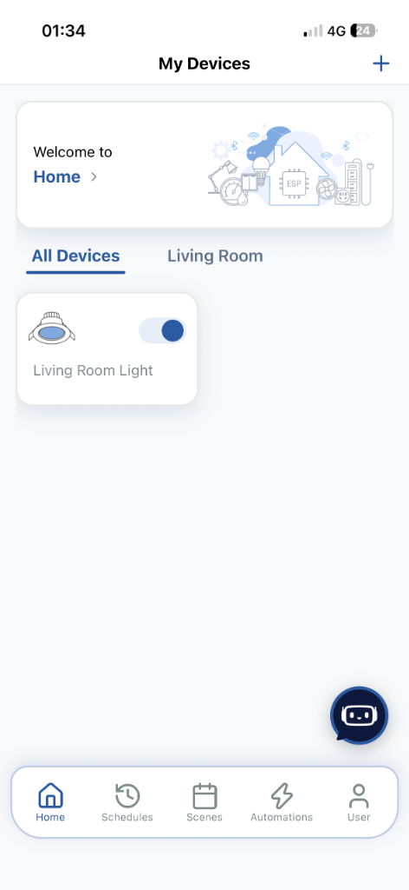

# ใบงานการทดลองที่ 11.4
### การสร้างอุปกรณ์ Smart Light สู่ระบบคลาวด์ด้วย ESP RainMaker SDK, BLE Provisioning และการควบคุมผ่านสมาร์ตโฟน

> [!NOTE] **คำชี้แจง**
> **รหัสนักศึกษา**: 67030134  
> ในใบงานนี้นักศึกษาจะได้สร้างผลิตภัณฑ์ IoT สู่ระบบคลาวด์เชิงพาณิชย์จริงโดยใช้แพลตฟอร์ม **ESP RainMaker** ของ Espressif Systems โดยจะได้เขียนโปรแกรมสร้าง **Node** และ **Device (Smart Light)** พร้อมพารามิเตอร์ **Power** และ **Brightness** จากนั้นทำการเปิดใช้งานระบบ **BLE Wi-Fi Provisioning**, การขอรับใบรับรองผ่านระบบ **Assisted Claiming** สแกนเชื่อมต่อผ่านแอปพลิเคชัน **ESP RainMaker บนสมาร์ตโฟน** และควบคุมอุปกรณ์ข้ามเครือข่ายอินเทอร์เน็ตได้จากทุกที่ทั่วโลก

---

## 1. วัตถุประสงค์การทดลอง
1. เข้าใจโครงสร้างและการทำงานของแพลตฟอร์ม ESP RainMaker บนสถาปัตยกรรม ESP-IDF
2. สามารถสร้าง Node, Device, และ Parameters (Power, Brightness) ผ่าน RainMaker Core API ได้
3. สามารถเขียน Write Callback เพื่อรับคำสั่งจากคลาวด์มาปรับระดับสถานะ GPIO ของ LED และรายงานสถานะกลับ (Report State)
4. สามารถเปิดใช้งานบริการระดับระบบ ได้แก่ บริการซิงก์เวลา SNTP และการตั้งเวลาทำงาน (Schedule Service) ได้
5. สามารถทำกระบวนการ Provisioning และ Assisted Claiming ผ่านแอปพลิเคชันสมาร์ตโฟนด้วยบลูทูธ (BLE) ได้สำเร็จ
6. สามารถทดสอบส่งคำสั่งควบคุมผ่านแอปพลิเคชันมือถือ และเครื่องมือบรรทัดคำสั่ง ESP RainMaker CLI ได้

---

## 2. อุปกรณ์และเครื่องมือที่ใช้
* บอร์ดไมโครคอนโทรลเลอร์ **ESP32-C3** หรือ **ESP32**
* หลอดไฟ LED พร้อมตัวต้านทาน 220Ω ต่อเข้ากับ **GPIO 8** (ESP32-C3) หรือ **GPIO 2** (ESP32)
* สายเชื่อมต่อ USB Data Cable
* เครื่องคอมพิวเตอร์พร้อมระบบพัฒนา **ESP-IDF v5.x / v6.x**
* สมาร์ตโฟน (Android หรือ iOS) ที่ติดตั้งแอปพลิเคชัน **ESP RainMaker** และเปิดบลูทูธ/Wi-Fi ไว้
* เราเตอร์ Wi-Fi (2.4 GHz) ที่เชื่อมต่อออกสู่อินเทอร์เน็ตได้จริง

---

## 3. ขั้นตอนการทดลอง (Deconstructed Activities)

### กิจกรรมที่ 11-4.1 การสร้างโปรเจกต์และติดตั้ง Dependency `esp-rainmaker`

#### 1. สร้างโปรเจกต์ใหม่
```powershell
idf.py create-project Lab11-4_RainMaker_Light
cd Lab11-4_RainMaker_Light
idf.py set-target esp32c3   # หรือ esp32
```

#### 2. ติดตั้ง ESP RainMaker Component จาก IDF Component Registry
เพิ่มไลบรารีทางการของ Espressif ผ่านคำสั่ง
```powershell
idf.py add-dependency "espressif/esp-rainmaker"
```

ไฟล์ `main/idf_component.yml` จะได้รับการสร้างและอัปเดตโดยอัตโนมัติ
```yaml
dependencies:
  idf:
    version: ">=5.0.0"
  espressif/esp-rainmaker:
    version: "^3.0.0"
```

---

### กิจกรรมที่ 11-4.2 การเขียนโค้ดเฟิร์มแวร์อุปกรณ์ (`main/main.c`)

เปิดไฟล์ `main/main.c` และแทนที่ด้วยโค้ดสมบูรณ์ต่อไปนี้

```c
#include <stdio.h>
#include <string.h>
#include "esp_log.h"
#include "nvs_flash.h"
#include "driver/gpio.h"

// RainMaker Headers
#include "esp_rmaker_core.h"
#include "esp_rmaker_standard_types.h"
#include "esp_rmaker_standard_params.h"
#include "esp_rmaker_standard_devices.h"
#include "esp_rmaker_schedule.h"
#include "app_wifi.h"

#if CONFIG_IDF_TARGET_ESP32C3
#define LED_PIN GPIO_NUM_8
#else
#define LED_PIN GPIO_NUM_2
#endif

static const char *TAG = "RMAKER_LIGHT";
static esp_rmaker_device_t *s_light_device = NULL;

/* ========================================================
 * 1. Write Callback ฟังก์ชันรับคำสั่งควบคุมจากคลาวด์
 * ======================================================== */
static esp_err_t write_cb(const esp_rmaker_device_t *device, const esp_rmaker_param_t *param,
                          const esp_rmaker_param_val_t val, void *priv_data, esp_rmaker_write_ctx_t *ctx)
{
    if (ctx) {
        ESP_LOGI(TAG, "Request received via: %s", esp_rmaker_device_cb_src_to_str(ctx->src));
    }
    const char *device_name = esp_rmaker_device_get_name(device);
    const char *param_name = esp_rmaker_param_get_name(param);

    ESP_LOGI(TAG, "Device: %s | Param: %s", device_name, param_name);

    // ตรวจสอบว่าเป็นคำสั่ง Power (เปิด/ปิด)
    if (strcmp(param_name, ESP_RMAKER_DEF_POWER_NAME) == 0) {
        bool state = val.val.b;
        ESP_LOGI(TAG, "Changing LED state to: %s", state ? "ON" : "OFF");
        gpio_set_level(LED_PIN, state ? 1 : 0);
        
        // รายงานสถานะปัจจุบันกลับสู่คลาวด์ เพื่อให้แอปบนมือถืออัปเดตสถานะทันที
        esp_rmaker_param_update_and_report(param, val);
    }
    // ตรวจสอบว่าเป็นคำสั่ง Brightness (ความสว่าง 0 - 100%)
    else if (strcmp(param_name, ESP_RMAKER_DEF_BRIGHTNESS_NAME) == 0) {
        int brightness = val.val.i;
        ESP_LOGI(TAG, "Changing Brightness to: %d%%", brightness);
        
        // (สามารถนำค่า brightness 0-100 ไปปรับค่า LEDC PWM ในงานจริงได้)
        esp_rmaker_param_update_and_report(param, val);
    }

    return ESP_OK;
}

/* ========================================================
 * 2. ฟังก์ชันหลัก (app_main)
 * ======================================================== */
void app_main(void)
{
    // กำหนดค่า GPIO ควบคุม LED
    gpio_reset_pin(LED_PIN);
    gpio_set_direction(LED_PIN, GPIO_MODE_OUTPUT);
    gpio_set_level(LED_PIN, 0);

    // เริ่มต้นระบบจัดเก็บข้อมูล NVS Flash
    esp_err_t err = nvs_flash_init();
    if (err == ESP_ERR_NVS_NO_FREE_PAGES || err == ESP_ERR_NVS_NEW_VERSION_FOUND) {
        ESP_ERROR_CHECK(nvs_flash_erase());
        err = nvs_flash_init();
    }
    ESP_ERROR_CHECK(err);

    // 1. เริ่มต้นระบบ Wi-Fi Provisioning (ผ่าน BLE)
    app_wifi_init();

    // 2. สร้าง Node ในระบบ ESP RainMaker
    esp_rmaker_config_t rainmaker_cfg = {
        .enable_time_sync = true, // เปิดบริการซิงก์เวลาโลกอัตโนมัติ
    };
    esp_rmaker_node_t *node = esp_rmaker_node_init(&rainmaker_cfg, "Smart Light Node", "Lightbulb");
    if (!node) {
        ESP_LOGE(TAG, "Could not initialise node.");
        return;
    }

    // 3. สร้าง Device ประเภท Lightbulb
    s_light_device = esp_rmaker_lightbulb_device_create("Living Room Light", NULL, false);
    // ผูก Callback สำหรับรับคำสั่ง
    esp_rmaker_device_add_cb(s_light_device, write_cb, NULL);

    // 4. เพิ่ม Parameter Brightness (ความสว่างเริ่มต้น 100%)
    esp_rmaker_param_t *brightness_param = esp_rmaker_brightness_param_create(ESP_RMAKER_DEF_BRIGHTNESS_NAME, 100);
    esp_rmaker_device_add_param(s_light_device, brightness_param);

    // 5. บรรจุ Device เข้าสู่ Node
    esp_rmaker_node_add_device(node, s_light_device);

    // 6. เปิดบริการระดับระบบ (System Services)
    esp_rmaker_timezone_service_enable(); // บริการโซนเวลา
    esp_rmaker_schedule_enable();         // บริการตั้งเวลาอัตโนมัติ

    // 7. เริ่มการทำงานของระบบ RainMaker Core
    esp_rmaker_start();

    // 8. เริ่มต้นระบบค้นหาอุปกรณ์และรับการตั้งค่า Wi-Fi (BLE Provisioning)
    app_wifi_start(POP_TYPE_RANDOM);
}
```

---

### กิจกรรมที่ 11-4.3 การคอมไพล์ แฟลช และสังเกตการสร้าง QR Code

สั่งคอมไพล์และแฟลชโปรแกรม
```powershell
idf.py build
idf.py -p COMx flash monitor
```

**ผลลัพธ์ใน Serial Monitor**
* บอร์ดจะพิมพ์ **QR Code ในรูปแบบตัวอักษร ASCII** ออกมาทางหน้าจอ พร้อม URL สำหรับเปิดดูรูปภาพ QR Code
* บอร์ดจะเริ่มประกาศสัญญาณบลูทูธ (BLE Advertising) เพื่อรอรับการเชื่อมต่อ

---

### กิจกรรมที่ 11-4.4 การเชื่อมต่อผ่านแอปพลิเคชัน ESP RainMaker บนมือถือ

<p align="center">
  
  &nbsp;&nbsp;&nbsp;&nbsp;
  
  &nbsp;&nbsp;&nbsp;&nbsp;
  
</p>
<p align="center"><b>รูปที่ 11.13</b> ขั้นตอนการเปิดใช้งาน Assisted Claiming และการจับคู่อุปกรณ์บนโทรศัพท์มือถือ</p>

1. **เข้าสู่ระบบ** เปิดแอปพลิเคชัน **ESP RainMaker** บนโทรศัพท์มือถือ เข้าสู่ระบบด้วยบัญชีที่ลงทะเบียนไว้
2. **เพิ่มอุปกรณ์** กดปุ่มเครื่องหมายบวก (`+ Add Device`) บนหน้าจอแอป
3. **สแกน QR Code** นำกล้องสมาร์ตโฟนสแกน QR Code ที่ปรากฏบน Serial Monitor
4. **กระบวนการ Assisted Claiming**
   * หากบอร์ดยังไม่มีใบรับรอง แอปจะขึ้นหน้าต่างยืนยันการขอรับ Certificate ให้กดปุ่มยืนยัน
   * แอปจะดึงใบรับรองจาก RainMaker Cloud แล้วส่งให้ ESP32 ผ่านช่องทาง BLE
5. **กรอกรหัส Wi-Fi** เลือกชื่อ SSID เครือข่าย Wi-Fi 2.4 GHz ในบ้านและกรอกรหัสผ่าน
6. **เสร็จสิ้นการผูกอุปกรณ์** บอร์ดจะเชื่อมต่อ Wi-Fi และผูกตัวเองเข้ากับบัญชีผู้ใช้ แอปจะแสดงการ์ด **"Living Room Light"** ขึ้นมาบนหน้าจอ

---

## 4. การทดสอบและการตรวจสอบผลลัพธ์ (Testing & Verification)

### 1. การจับคู่และ Provisioning ผ่านแอปพลิเคชัน ESP RainMaker
* **ขั้นตอนการทำ:**
  * แฟลชโปรแกรมลงบอร์ด ESP32 และเปิดหน้าต่าง Serial Monitor
  * สแกน QR Code ที่แสดงบนหน้าจอผ่านแอปพลิเคชัน **ESP RainMaker** บนโทรศัพท์มือถือ
  * ยืนยันกระบวนการ Assisted Claiming เพื่อรับใบรับรองจากคลาวด์ผ่านบลูทูธ (BLE)
  * เลือก Wi-Fi 2.4 GHz และกรอกรหัสผ่านเพื่อให้อุปกรณ์เชื่อมต่อออกสู่อินเทอร์เน็ต

* **ภาพหน้าจอ Serial Monitor (QR Code & BLE Advertising; redacted):**  
  

* **ภาพหน้าจอ Mobile App ขณะทำการเคลมอุปกรณ์สำเร็จ (Assisted Claiming):**  
  

* **ภาพหน้าจอ Mobile App ขณะตั้งค่า Wi-Fi Provisioning:**  
  

---

### 2. การควบคุมเปิด-ปิดและปรับความสว่างผ่าน Mobile App (Wi-Fi LAN)
* **ผลการทดสอบ:**
  * กดสวิตช์ Power บนหน้าจอแอป หลอดไฟ LED บนบอร์ดเปิด-ปิดตามทันที
  * เลื่อนแถบสไลเดอร์ Brightness เพื่อปรับความสว่าง บอร์ดได้รับค่าและแสดง Log บน Serial Monitor ถูกต้อง
* **Log ผลลัพธ์ใน Serial Monitor ขณะรับคำสั่งควบคุม Power และ Brightness ผ่าน RainMaker Cloud:**
  ```text
  I (88842) esp_rmaker_param: Received params: {"Living Room Light":{"Power":true}}
  I (88842) RMAKER_LIGHT: Request received via: Cloud
  I (88852) RMAKER_LIGHT: Device: Living Room Light | Param: Power
  I (88852) RMAKER_LIGHT: Changing LED state to: ON
  I (88862) esp_rmaker_param: Reporting params: {"Living Room Light":{"Power":true}}
  I (90892) esp_rmaker_param: Received params: {"Living Room Light":{"Power":false}}
  I (90892) RMAKER_LIGHT: Request received via: Cloud
  I (90892) RMAKER_LIGHT: Device: Living Room Light | Param: Power
  I (90902) RMAKER_LIGHT: Changing LED state to: OFF
  I (90902) esp_rmaker_param: Reporting params: {"Living Room Light":{"Power":false}}
  I (96102) esp_rmaker_param: Received params: {"Living Room Light":{"Brightness":95}}
  I (96102) RMAKER_LIGHT: Request received via: Cloud
  I (96112) RMAKER_LIGHT: Device: Living Room Light | Param: Brightness
  I (96122) RMAKER_LIGHT: Changing Brightness to: 95%
  I (96122) esp_rmaker_param: Reporting params: {"Living Room Light":{"Brightness":95}}
  I (97742) esp_rmaker_param: Received params: {"Living Room Light":{"Brightness":40}}
  I (97752) RMAKER_LIGHT: Request received via: Cloud
  I (97752) RMAKER_LIGHT: Device: Living Room Light | Param: Brightness
  I (97762) RMAKER_LIGHT: Changing Brightness to: 40%
  I (97772) esp_rmaker_param: Reporting params: {"Living Room Light":{"Brightness":40}}
  ```

---

### 3. การควบคุมระยะไกลข้ามอินเทอร์เน็ต (Remote 4G/5G Test)
* **ผลการทดสอบ:**
  * ปิด Wi-Fi บนโทรศัพท์มือถือแล้วเปิดใช้งานเฉพาะอินเทอร์เน็ตเซลลูลาร์ 4G/5G
  * ทดลองกดสั่งเปิด-ปิดหลอดไฟ บอร์ด ESP32 ที่บ้านยังคงตอบสนองต่อคำสั่งได้อย่างรวดเร็วผ่าน AWS IoT Cloud

* **ภาพหน้าจอการควบคุมผ่าน 4G/5G:**  
  

---

### 4. (ทางเลือกขั้นสูง) การทดสอบผ่าน RainMaker CLI บนคอมพิวเตอร์

เปิดเทอร์มินัลใหม่บนคอมพิวเตอร์

```powershell
# ติดตั้งเครื่องมือ CLI
pip install esp-rainmaker-cli

# เข้าสู่ระบบ
rainmaker.py login

# ดึงรายชื่ออุปกรณ์และ Node ID
rainmaker.py getnodes

# สั่งเปิดหลอดไฟผ่าน Command Line
rainmaker.py setparams --nodeid <YOUR_NODE_ID> '{"Living Room Light": {"Power": true}}'

# สั่งปิดหลอดไฟผ่าน Command Line
rainmaker.py setparams --nodeid <YOUR_NODE_ID> '{"Living Room Light": {"Power": false}}'
```

---

## 5. คำถามท้ายการทดลอง (Post-Lab Questions)

### 1. ในสถาปัตยกรรม ESP RainMaker กระบวนการ **Assisted Claiming** ช่วยแก้ปัญหาเรื่องการติดตั้งใบรับรองความปลอดภัย (Security Certificates) บนอุปกรณ์ในขั้นตอนพัฒนาต้นแบบได้อย่างไร?

**คำตอบ:**
* **ปัญหาในระบบดั้งเดิม:**
  ในการสื่อสารผ่าน MQTTS ทั่วไป (เช่น การทดลองในแล็บ 11.3) นักพัฒนาจำเป็นต้องสร้าง Root CA, กุญแจส่วนตัว (Private Key) และใบรับรอง (Device Certificate) ด้วย OpenSSL บนคอมพิวเตอร์ จากนั้นต้องนำไฟล์เหล่านี้มาแปลงเป็นไบนารีหรือฝังลงในซอร์สโค้ด แล้วแฟลชลงชิปทีละตัว ซึ่งมีขั้นตอนซับซ้อน ใช้เวลามาก และเสี่ยงต่อการรั่วไหลของกุญแจความปลอดภัยหากแชร์โค้ดร่วมกัน
* **การแก้ปัญหาด้วย Assisted Claiming ของ ESP RainMaker:**
  - กระบวนการ **Assisted Claiming** เปลี่ยนกระบวนการลงทะเบียนใบรับรองให้เป็นแบบอัตโนมัติ (Zero-Touch Provisioning)
  - เมื่อผู้ใช้สแกน QR Code เพื่อเชื่อมต่ออุปกรณ์ผ่าน Bluetooth Low Energy (BLE) แอปพลิเคชัน ESP RainMaker บนสมาร์ตโฟน (ซึ่งเข้าสู่ระบบด้วยบัญชีผู้ใช้ไว้แล้ว) จะส่งคำขอไปยัง **RainMaker Cloud Backend (AWS IoT Core)** เพื่อขอออกใบรับรองดิจิทัลและคู่กุญแจเฉพาะตัวของอุปกรณ์ชุดใหม่
  - จากนั้นคลาวด์จะส่งมอบ Certificate และ Private Key ผ่านแอปมือถือ และแอปจะทำการส่งต่อผ่านช่องทาง BLE ที่เข้ารหัสความปลอดภัย เข้าไปบันทึกลงในพาร์ติชัน NVS (Non-Volatile Storage) ของบอร์ด ESP32 โดยตรง
  - **ผลลัพธ์:** นักพัฒนาเพียงแค่แฟลชเฟิร์มแวร์มาตรฐานตัวเดียวกันลงในบอร์ด โดยไม่ต้องมานั่งสร้างหรือฝังใบรับรองด้วยตนเอง อุปกรณ์แต่ละตัวจะได้ใบรับรองที่ไม่ซ้ำกัน และสามารถเชื่อมต่อกับ AWS IoT Core ได้อย่างปลอดภัยทันที

---

### 2. เพราะเหตุใดฟังก์ชัน `write_cb` จึงต้องเรียกคำสั่ง `esp_rmaker_param_update_and_report()` ทุกครั้งที่มีการเปลี่ยนแปลงค่าพารามิเตอร์?

**คำตอบ:**
* **บทบาทหน้าที่ของฟังก์ชัน `esp_rmaker_param_update_and_report()`:**
  คำสั่งนี้มีหน้าที่หลัก 2 ประการที่ต้องทำควบคู่กันอย่างเคร่งครัด:
  1. **อัปเดตค่าพารามิเตอร์ในระดับฮาร์ดแวร์ (Update Local State):** ปรับปรุงค่าตัวแปรของพารามิเตอร์นั้นในหน่วยความจำ RAM ของ ESP32 ให้เป็นค่าล่าสุดที่เพิ่งนำไปสั่งงานฮาร์ดแวร์จริง (เช่น สั่งเปิด/ปิดขา GPIO หรือปรับค่า Duty Cycle ของ PWM)
  2. **รายงานสถานะใหม่ขึ้นสู่คลาวด์ (Report State to Cloud):** สร้างแพ็กเก็ต MQTT เพื่อ Publish ข้อมูลสถานะล่าสุดกลับไปยัง AWS IoT Device Shadow บน RainMaker Cloud
* **ผลเสียหากละเลยการเรียกคำสั่งนี้:**
  - สถาปัตยกรรมของ RainMaker ทำงานบนหลักการ **Cloud State Synchronization** ซึ่งหน้าจอแอปพลิเคชันบนสมาร์ตโฟนจะแสดงสถานะตามที่ได้รับรายงานจาก Cloud
  - หากสั่งงานฮาร์ดแวร์สำเร็จแล้วแต่ไม่เรียกฟังก์ชันนี้ คลาวด์จะไม่ทราบว่าอุปกรณ์ทำงานตามคำสั่งแล้วหรือไม่
  - ส่งผลให้เกิดปัญหา **State Inconsistency (ความไม่สอดคล้องของสถานะ)** โดยหน้าจอแอปพลิเคชันบนโทรศัพท์มือถืออาจแสดงปุ่มสวิตช์เด้งกลับไปสถานะเดิม หรือค้างอยู่ที่สถานะกำลังโหลด (Loading Spinner) ทำให้ผู้ใช้เข้าใจผิดว่าอุปกรณ์ขัดข้อง ทั้งที่หลอดไฟจริงเปลี่ยนสถานะไปแล้ว

---

### 3. เปรียบเทียบความแตกต่างระหว่างการพัฒนาอุปกรณ์ IoT ด้วย **Plain MQTT บน Mosquitto เอง (ในแล็บ 11.2)** กับการใช้ **ESP RainMaker SDK (ในแล็บ 11.4)** ในแง่ของความพยายามในการพัฒนา (Development Effort), ความปลอดภัย (Security), และการขยายระบบ (Scalability)

**คำตอบ:**

| ปัจจัยเปรียบเทียบ | Plain MQTT + Mosquitto (Lab 11.2) | ESP RainMaker SDK (Lab 11.4) |
| :--- | :--- | :--- |
| **ความพยายามในการพัฒนา<br/>(Development Effort)** | **สูงมาก (High Effort):**<br/>• ต้องเขียนโค้ดจัดการการเชื่อมต่อ Wi-Fi และ Event Loop เอง<br/>• ต้องออกแบบโครงสร้าง Topic ลำดับชั้น และ Data Model เอง<br/>• ต้องเขียนโค้ด Serialize/Deserialize สตริง JSON เองด้วย cJSON<br/>• หากต้องการควบคุมผ่านมือถือ ต้องพัฒนา Mobile App หรือ Web Dashboard ขึ้นมาใหม่ทั้งหมด | **ต่ำมาก (Turnkey Solution):**<br/>• มีโครงสร้าง Node/Device/Param สำเร็จรูปที่มาตรฐาน<br/>• มีระบบ Wi-Fi Provisioning ผ่านบลูทูธ (BLE) สำเร็จรูป<br/>• มีแอปพลิเคชันบน iOS และ Android พร้อมใช้งานทันทีโดยไม่ต้องเขียนโค้ดฝั่งแอปแม้แต่บรรทัดเดียว |
| **ความปลอดภัย<br/>(Security)** | **ต่ำ (Low Security):**<br/>• สื่อสารด้วยข้อความธรรมดา (Plaintext) ผ่านพอร์ต 1883<br/>• ข้อมูลเซนเซอร์และคำสั่งควบคุมไม่มีการเข้ารหัส ทำให้เสี่ยงต่อการถูกดักจับแพ็กเก็ต (Packet Sniffing) และการปลอมคำสั่ง (Command Injection) ในวงแลน | **สูงระดับสากล (Enterprise Security):**<br/>• เข้ารหัสข้อมูลสมบูรณ์แบบด้วย TLS 1.2/1.3 ผ่านพอร์ต 8883<br/>• มีระบบ Mutual Authentication (mTLS) โดยใช้ใบรับรอง X.509 เฉพาะตัวอุปกรณ์ที่ออกโดย AWS IoT Root CA<br/>• มีระบบยืนยันตัวตนผู้ใช้ (User Identity) ควบคุมสิทธิ์อย่างรัดกุม |
| **การขยายระบบ<br/>(Scalability)** | **จำกัด (Limited Scalability):**<br/>• โบรเกอร์ทำงานบนเครื่องคอมพิวเตอร์ส่วนบุคคล (Local Host)<br/>• การเชื่อมต่อถูกจำกัดอยู่เฉพาะภายในวงแลน (Local LAN)<br/>• หากต้องการควบคุมจากนอกบ้าน (4G/5G) ต้องทำ Port Forwarding, จัดหา Public IP/DDNS หรือตั้งคลาวด์เซิร์ฟเวอร์ขึ้นมาดูแลเอง | **ไร้ขีดจำกัด (Highly Scalable):**<br/>• ทำงานบนโครงสร้างพื้นฐานระดับ Hyperscale Cloud ของ Amazon Web Services (AWS IoT Core)<br/>• รองรับการเชื่อมต่ออุปกรณ์พร้อมกันได้นับล้านตัว<br/>• รองรับการควบคุมระยะไกลข้ามอินเทอร์เน็ตผ่าน 4G/5G ได้ทันทีจากทุกมุมโลกโดยไม่ต้องตั้งค่าเราเตอร์ |

---

### 4. อธิบายขั้นตอนที่ทำให้ ESP RainMaker สามารถเชื่อมโยงการทำงานร่วมกับระบบสั่งงานด้วยเสียงของ **Google Home** หรือ **Amazon Alexa** ได้โดยไม่ต้องเขียนโค้ดเพิ่มเติมบนตัวบอร์ด ESP32

**คำตอบ:**
* **หลักการทำงานผ่าน Cloud-to-Cloud Integration:**
  ความสามารถในการสั่งงานด้วยเสียงไม่ได้เกิดขึ้นจากการประมวลผลสัญญาณเสียงบนบอร์ด ESP32 แต่เป็นการทำงานร่วมกันระหว่าง **ESP RainMaker Cloud Backend** กับ **Google Assistant / Amazon Alexa Cloud** บนฝั่งเซิร์ฟเวอร์ โดยมีขั้นตอนการทำงานดังนี้:
  1. **การกำหนดโครงสร้างข้อมูลตามมาตรฐาน (Standardized Device Data Modeling):**
     - ในโค้ดเฟิร์มแวร์ ESP32 มีการสร้างอุปกรณ์ด้วยประเภทมาตรฐานสากล เช่น `esp_rmaker_lightbulb_device_create()` และกำหนด Parameters มาตรฐาน (`ESP_RMAKER_DEF_POWER_NAME`, `ESP_RMAKER_DEF_BRIGHTNESS_NAME`)
     - ข้อมูลเหล่านี้ถูกส่งไปลงทะเบียนบน RainMaker Cloud ทำให้คลาวด์รับทราบว่าอุปกรณ์ตัวนี้คือ "หลอดไฟ" ที่รองรับคุณสมบัติการเปิด-ปิด และการหรี่แสง
  2. **การผูกบัญชีและการค้นหาอุปกรณ์ (Account Linking & Discovery):**
     - ผู้ใช้เปิดแอป Google Home หรือ Alexa แล้วทำการ **ผูกบัญชี (Account Linking)** เข้ากับบัญชี ESP RainMaker
     - เซิร์ฟเวอร์ของ Google/Amazon จะส่งคำสั่ง Device Discovery มาดึงรายชื่ออุปกรณ์และ Capabilities จาก RainMaker Cloud โดยอัตโนมัติ ทำให้หลอดไฟปรากฏขึ้นในหน้าแอปสั่งงานด้วยเสียงทันที
  3. **เส้นทางการประมวลผลคำสั่งเสียง (Voice Command Execution Pipeline):**
     - เมื่อผู้ใช้พูดว่า *"Hey Google, turn on Living Room Light"* หรือ *"Alexa, set brightness to 50%"*
     - ลำโพงอัจฉริยะจะส่งเสียงไปยัง Google/Amazon Cloud เพื่อแปลงเสียงเป็นเจตนาของคำสั่ง (Natural Language Processing & Intent Parsing)
     - Google/Amazon Cloud ส่งคำสั่ง API ไปยัง RainMaker Cloud Backend
     - RainMaker Cloud แปลงคำสั่งนั้นเป็นข้อความ MQTT ส่งลงมายังบอร์ด ESP32 ผ่านการเชื่อมต่อ AWS IoT เดิมที่เชื่อมต่อไว้อยู่แล้ว
     - บอร์ด ESP32 จะได้รับ Callback `write_cb` เพื่อปรับสถานะขา GPIO และ PWM ให้ตรงกับคำสั่งเสียง โดยที่เฟิร์มแวร์บนบอร์ดมองเป็นคำสั่งควบคุมตามปกติ ไม่จำเป็นต้องมีไลบรารีรู้จำเสียงหรือโค้ดพิเศษใด ๆ เพิ่มเติมเลย
