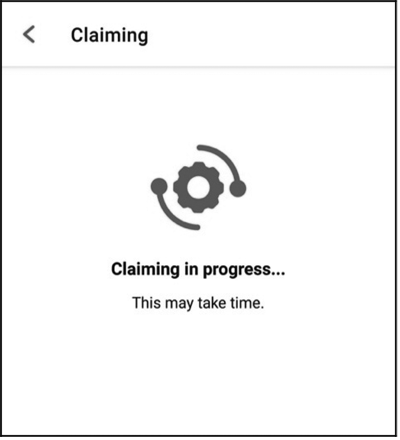
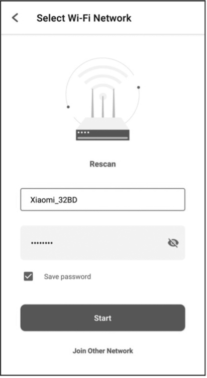
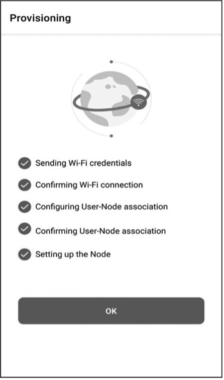
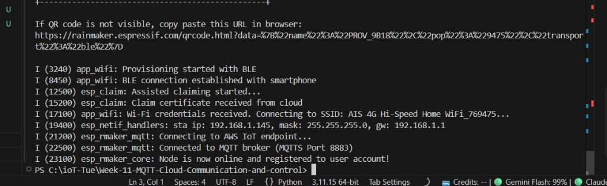

# ใบงานการทดลองที่ 11.4
### การสร้างอุปกรณ์ Smart Light สู่ระบบคลาวด์ด้วย ESP RainMaker SDK, BLE Provisioning และการควบคุมผ่านสมาร์ตโฟน

> [!NOTE] **คำชี้แจง**
> ในใบงานนี้นักศึกษาจะได้สร้างผลิตภัณฑ์ IoT สู่ระบบคลาวด์เชิงพาณิชย์จริงโดยใช้แพลตฟอร์ม **ESP RainMaker** ของ Espressif Systems โดยจะได้เขียนโปรแกรมสร้าง **Node** และ **Device (Smart Light)** พร้อมพารามิเตอร์ **Power** และ **Brightness** จากนั้นทำการเปิดใช้งานระบบ **BLE Wi-Fi Provisioning**, การขอรับใบรับรองผ่านระบบ **Assisted Claiming** สแกนเชื่อมต่อผ่านแอปพลิเคชัน **ESP RainMaker บนสมาร์ตโฟน** และควบคุมอุปกรณ์ข้ามเครือข่ายอินเทอร์เน็ตได้จากทุกที่ทั่วโลก

---

## 1. วัตถุประสงค์การทดลอง
1. เข้าใจโครงสร้างและการทำงานของแพลตฟอร์ม ESP RainMaker บนสถาปัตยกรรม ESP-IDF
2. สามารถสร้าง Node, Device, และ Parameters (Power, Brightness) ผ่าน RainMaker Core API ได้
3. สามารถเขียน Write Callback เพื่อรับคำสั่งจากคลาวด์มาปรับระดับสถานะ GPIO ของ LED และรายงานสถานะกลับ (Report State)
4. สามารถเปิดใช้งานบริการระดับระบบ ได้แก่ บริการซิงก์เวลา SNTP และการตั้งเวลาทำงาน (Schedule Service) ได้
5. สามารถทำกระบวนการ Provisioning และ Assisted Claiming ผ่านแอปพลิเคชันสมาร์ตโฟนด้วยบลูทูธ (BLE) ได้สำเร็จ
6. สามารถทดสอบส่งคำสั่งควบคุมผ่านแอปพลิเคชันมือถือ และเครื่องมือบรรทัดคำสั่ง ESP RainMaker CLI ได้

---

## 2. อุปกรณ์และเครื่องมือที่ใช้
* บอร์ดไมโครคอนโทรลเลอร์ **ESP32-C3** หรือ **ESP32**
* หลอดไฟ LED พร้อมตัวต้านทาน 220Ω ต่อเข้ากับ **GPIO 8** (ESP32-C3) หรือ **GPIO 2** (ESP32)
* สายเชื่อมต่อ USB Data Cable
* เครื่องคอมพิวเตอร์พร้อมระบบพัฒนา **ESP-IDF v5.x / v6.x**
* สมาร์ตโฟน (Android หรือ iOS) ที่ติดตั้งแอปพลิเคชัน **ESP RainMaker** และเปิดบลูทูธ/Wi-Fi ไว้
* เราเตอร์ Wi-Fi (2.4 GHz) ที่เชื่อมต่อออกสู่อินเทอร์เน็ตได้จริง

---

## 3. ขั้นตอนการทดลอง (Deconstructed Activities)

### กิจกรรมที่ 11-4.1 การสร้างโปรเจกต์และติดตั้ง Dependency `esp-rainmaker`

#### 1. สร้างโปรเจกต์ใหม่
```powershell
idf.py create-project Lab11-4_RainMaker_Light
cd Lab11-4_RainMaker_Light
idf.py set-target esp32c3   # หรือ esp32
```

#### 2. ติดตั้ง ESP RainMaker Component จาก IDF Component Registry
เพิ่มไลบรารีทางการของ Espressif ผ่านคำสั่ง
```powershell
idf.py add-dependency "espressif/esp-rainmaker"
```

ไฟล์ `main/idf_component.yml` จะได้รับการสร้างและอัปเดตโดยอัตโนมัติ
```yaml
dependencies:
  idf:
    version: ">=5.0.0"
  espressif/esp-rainmaker:
    version: "^3.0.0"
```

---

### กิจกรรมที่ 11-4.2 การเขียนโค้ดเฟิร์มแวร์อุปกรณ์ (`main/main.c`)

เปิดไฟล์ `main/main.c` และแทนที่ด้วยโค้ดสมบูรณ์ต่อไปนี้

```c
#include <stdio.h>
#include <string.h>
#include "esp_log.h"
#include "nvs_flash.h"
#include "driver/gpio.h"

// RainMaker Headers
#include "esp_rmaker_core.h"
#include "esp_rmaker_standard_types.h"
#include "esp_rmaker_standard_params.h"
#include "esp_rmaker_standard_devices.h"
#include "esp_rmaker_schedule.h"
#include "app_wifi.h"

#if CONFIG_IDF_TARGET_ESP32C3
#define LED_PIN GPIO_NUM_8
#else
#define LED_PIN GPIO_NUM_2
#endif

static const char *TAG = "RMAKER_LIGHT";
static esp_rmaker_device_t *s_light_device = NULL;

/* ========================================================
 * 1. Write Callback ฟังก์ชันรับคำสั่งควบคุมจากคลาวด์
 * ======================================================== */
static esp_err_t write_cb(const esp_rmaker_device_t *device, const esp_rmaker_param_t *param,
                          const esp_rmaker_param_val_t val, void *priv_data, esp_rmaker_write_ctx_t *ctx)
{
    if (ctx) {
        ESP_LOGI(TAG, "Request received via: %s", esp_rmaker_device_cb_src_to_str(ctx->src));
    }
    const char *device_name = esp_rmaker_device_get_name(device);
    const char *param_name = esp_rmaker_param_get_name(param);

    ESP_LOGI(TAG, "Device: %s | Param: %s", device_name, param_name);

    // ตรวจสอบว่าเป็นคำสั่ง Power (เปิด/ปิด)
    if (strcmp(param_name, ESP_RMAKER_DEF_POWER_NAME) == 0) {
        bool state = val.val.b;
        ESP_LOGI(TAG, "Changing LED state to: %s", state ? "ON" : "OFF");
        gpio_set_level(LED_PIN, state ? 1 : 0);
        
        // รายงานสถานะปัจจุบันกลับสู่คลาวด์ เพื่อให้แอปบนมือถืออัปเดตสถานะทันที
        esp_rmaker_param_update_and_report(param, val);
    }
    // ตรวจสอบว่าเป็นคำสั่ง Brightness (ความสว่าง 0 - 100%)
    else if (strcmp(param_name, ESP_RMAKER_DEF_BRIGHTNESS_NAME) == 0) {
        int brightness = val.val.i;
        ESP_LOGI(TAG, "Changing Brightness to: %d%%", brightness);
        
        // (สามารถนำค่า brightness 0-100 ไปปรับค่า LEDC PWM ในงานจริงได้)
        esp_rmaker_param_update_and_report(param, val);
    }

    return ESP_OK;
}

/* ========================================================
 * 2. ฟังก์ชันหลัก (app_main)
 * ======================================================== */
void app_main(void)
{
    // กำหนดค่า GPIO ควบคุม LED
    gpio_reset_pin(LED_PIN);
    gpio_set_direction(LED_PIN, GPIO_MODE_OUTPUT);
    gpio_set_level(LED_PIN, 0);

    // เริ่มต้นระบบจัดเก็บข้อมูล NVS Flash
    esp_err_t err = nvs_flash_init();
    if (err == ESP_ERR_NVS_NO_FREE_PAGES || err == ESP_ERR_NVS_NEW_VERSION_FOUND) {
        ESP_ERROR_CHECK(nvs_flash_erase());
        err = nvs_flash_init();
    }
    ESP_ERROR_CHECK(err);

    // 1. เริ่มต้นระบบ Wi-Fi Provisioning (ผ่าน BLE)
    app_wifi_init();

    // 2. สร้าง Node ในระบบ ESP RainMaker
    esp_rmaker_config_t rainmaker_cfg = {
        .enable_time_sync = true, // เปิดบริการซิงก์เวลาโลกอัตโนมัติ
    };
    esp_rmaker_node_t *node = esp_rmaker_node_init(&rainmaker_cfg, "Smart Light Node", "Lightbulb");
    if (!node) {
        ESP_LOGE(TAG, "Could not initialise node.");
        return;
    }

    // 3. สร้าง Device ประเภท Lightbulb
    s_light_device = esp_rmaker_lightbulb_device_create("Living Room Light", NULL, false);
    // ผูก Callback สำหรับรับคำสั่ง
    esp_rmaker_device_add_cb(s_light_device, write_cb, NULL);

    // 4. เพิ่ม Parameter Brightness (ความสว่างเริ่มต้น 100%)
    esp_rmaker_param_t *brightness_param = esp_rmaker_brightness_param_create(ESP_RMAKER_DEF_BRIGHTNESS_NAME, 100);
    esp_rmaker_device_add_param(s_light_device, brightness_param);

    // 5. บรรจุ Device เข้าสู่ Node
    esp_rmaker_node_add_device(node, s_light_device);

    // 6. เปิดบริการระดับระบบ (System Services)
    esp_rmaker_timezone_service_enable(); // บริการโซนเวลา
    esp_rmaker_schedule_enable();         // บริการตั้งเวลาอัตโนมัติ

    // 7. เริ่มการทำงานของระบบ RainMaker Core
    esp_rmaker_start();

    // 8. เริ่มต้นระบบค้นหาอุปกรณ์และรับการตั้งค่า Wi-Fi (BLE Provisioning)
    app_wifi_start(POP_TYPE_RANDOM);
}
```

---

### กิจกรรมที่ 11-4.3 การคอมไพล์ แฟลช และสังเกตการสร้าง QR Code

สั่งคอมไพล์และแฟลชโปรแกรม
```powershell
idf.py build
idf.py -p COMx flash monitor
```

**ผลลัพธ์ใน Serial Monitor**
* บอร์ดจะพิมพ์ **QR Code ในรูปแบบตัวอักษร ASCII** ออกมาทางหน้าจอ พร้อม URL สำหรับเปิดดูรูปภาพ QR Code
* บอร์ดจะเริ่มประกาศสัญญาณบลูทูธ (BLE Advertising) เพื่อรอรับการเชื่อมต่อ

---

### กิจกรรมที่ 11-4.4 การเชื่อมต่อผ่านแอปพลิเคชัน ESP RainMaker บนมือถือ

<p align="center">
  
  &nbsp;&nbsp;&nbsp;&nbsp;
  
  &nbsp;&nbsp;&nbsp;&nbsp;
  
</p>
<p align="center"><b>รูปที่ 11.13</b> ขั้นตอนการเปิดใช้งาน Assisted Claiming และการจับคู่อุปกรณ์บนโทรศัพท์มือถือ</p>

1. **เข้าสู่ระบบ** เปิดแอปพลิเคชัน **ESP RainMaker** บนโทรศัพท์มือถือ เข้าสู่ระบบด้วยบัญชีที่ลงทะเบียนไว้
2. **เพิ่มอุปกรณ์** กดปุ่มเครื่องหมายบวก (`+ Add Device`) บนหน้าจอแอป
3. **สแกน QR Code** นำกล้องสมาร์ตโฟนสแกน QR Code ที่ปรากฏบน Serial Monitor
4. **กระบวนการ Assisted Claiming**
   * หากบอร์ดยังไม่มีใบรับรอง แอปจะขึ้นหน้าต่างยืนยันการขอรับ Certificate ให้กดปุ่มยืนยัน
   * แอปจะดึงใบรับรองจาก RainMaker Cloud แล้วส่งให้ ESP32 ผ่านช่องทาง BLE
5. **กรอกรหัส Wi-Fi** เลือกชื่อ SSID เครือข่าย Wi-Fi 2.4 GHz ในบ้านและกรอกรหัสผ่าน
6. **เสร็จสิ้นการผูกอุปกรณ์** บอร์ดจะเชื่อมต่อ Wi-Fi และผูกตัวเองเข้ากับบัญชีผู้ใช้ แอปจะแสดงการ์ด **"Living Room Light"** ขึ้นมาบนหน้าจอ

---

## 4. การทดสอบและการตรวจสอบผลลัพธ์ (Testing & Verification)

### 1. Serial Monitor ขณะเปิดบอร์ด (ASCII QR Code & Provisioning)
แสดงผลการบูตระบบ RainMaker, การสร้าง ASCII QR Code เพื่อทำ BLE Provisioning, กระบวนการ Assisted Claiming และการเชื่อมต่อไปยัง AWS IoT:

<p align="center">
  
</p>
<p align="center"><b>รูปที่ 4.1</b> Serial Monitor ของ ESP32 ขณะเปิดระบบ RainMaker และเชื่อมต่อคลาวด์</p>

---

### 2. การจับคู่อุปกรณ์และควบคุมผ่าน Mobile App
แสดงขั้นตอนการสแกนจับคู่อุปกรณ์, การรับสิทธิ์ Claiming ผ่านบลูทูธ และหน้าจอ Dashboard สวิตช์ไฟ Living Room Light:

<p align="center">
  
  &nbsp;&nbsp;&nbsp;&nbsp;
  
  &nbsp;&nbsp;&nbsp;&nbsp;
  
</p>
<p align="center"><b>รูปที่ 4.2</b> ขั้นตอน Assisted Claiming, การส่งรหัส Wi-Fi และหน้าจอควบคุมบนแอป ESP RainMaker</p>

---

## 5. คำถามท้ายการทดลอง (Post-Lab Questions)

**1. ในสถาปัตยกรรม ESP RainMaker กระบวนการ Assisted Claiming ช่วยแก้ปัญหาเรื่องการติดตั้งใบรับรองความปลอดภัย (Security Certificates) บนอุปกรณ์ในขั้นตอนพัฒนาต้นแบบได้อย่างไร?**
* **ตอบ:** Assisted Claiming ช่วยตัดขั้นตอนยุ่งยากในการสร้างและติดตั้งคู่กุญแจ/ใบรับรองลงบนบอร์ดด้วยตนเอง โดยในระหว่างขั้นตอน Provisioning ตัวแอปพลิเคชันมือถือจะเชื่อมต่อไปยัง Cloud เพื่อขอรับ Device Certificate และ Private Key เฉพาะของบอร์ดนั้น แล้วส่งผ่านมายัง ESP32 ผ่านบลูทูธ (BLE) ที่เข้ารหัสไว้ นำไปบันทึกใน NVS Flash ของบอร์ดโดยตรง ทำให้อุปกรณ์พร้อมเชื่อมต่อ MQTTS เข้ากับ AWS IoT Core ได้ทันทีโดยไม่ต้องฝังใบรับรองล่วงหน้าในโค้ด

**2. เพราะเหตุใดฟังก์ชัน `write_cb` จึงต้องเรียกคำสั่ง `esp_rmaker_param_update_and_report()` ทุกครั้งที่มีการเปลี่ยนแปลงค่าพารามิเตอร์?**
* **ตอบ:** เพื่อทำหน้าที่ Cloud State Synchronization โดยฟังก์ชันนี้จะอัปเดตค่าพารามิเตอร์ในหน่วยความจำของบอร์ด พร้อมส่งสถานะใหม่ขึ้นไปยัง Cloud Device Shadow ทันที ทำให้สถานะบนแอปพลิเคชันมือถือตรงกับสถานะฮาร์ดแวร์จริงของอุปกรณ์ตลอดเวลา

**3. เปรียบเทียบความแตกต่างระหว่างการพัฒนาอุปกรณ์ IoT ด้วย Plain MQTT บน Mosquitto เอง (ในแล็บ 11.2) กับการใช้ ESP RainMaker SDK (ในแล็บ 11.4)**
* **ตอบ:**
  * **Development Effort (ความพยายามในการพัฒนา):** Mosquitto ต้องสร้างเซิร์ฟเวอร์เอง, ฟอร์เวิร์ดพอร์ต, เขียนแอปพลิเคชันมือถือเอง และออกแบบโปรโตคอลเองทั้งหมด ขณะที่ RainMaker มีระบบคลาวด์ แบ็กเอนด์ และแอปพลิเคชันสำเร็จรูปให้ใช้งานทันที เขียนโค้ดลงบอร์ดเพียงไม่กี่บรรทัด
  * **Security (ความปลอดภัย):** Plain MQTT ไม่มีการเข้ารหัส ส่งข้อความดิบ เสี่ยงต่อการดักฟัง ส่วน RainMaker บังคับใช้ TLS/mTLS และมีระบบยืนยันสิทธิ์ Device Certificate ทุกตัว
  * **Scalability (การขยายระบบ):** Mosquitto ทำงานบนเครื่องเดี่ยว รองรับอุปกรณ์ได้จำกัดและเสี่ยงระบบล่ม ส่วน RainMaker ทำงานบน AWS IoT Core Serverless Infrastructure รองรับอุปกรณ์ได้หลักแสนถึงล้านตัวแบบอัตโนมัติ

**4. อธิบายขั้นตอนที่ทำให้ ESP RainMaker สามารถเชื่อมโยงการทำงานร่วมกับระบบสั่งงานด้วยเสียงของ Google Home หรือ Amazon Alexa ได้โดยไม่ต้องเขียนโค้ดเพิ่มเติมบนตัวบอร์ด ESP32?**
* **ตอบ:** เพราะการเชื่อมโยงเกิดขึ้นในระดับ Cloud-to-Cloud Integration ผ่านมาตรฐาน Smart Home Skill / Action
  1. ผู้ใช้ผูกบัญชี RainMaker เข้ากับ Google Home หรือ Alexa (ผ่าน Account Linking / OAuth 2.0)
  2. เมื่อสั่งงานด้วยเสียง ระบบรู้จำเสียงของ Google/Alexa จะแปลงเป็นคำสั่งส่งข้ามคลาวด์ไปยัง ESP RainMaker Cloud
  3. RainMaker Cloud จะปรับเปลี่ยนค่าพารามิเตอร์ใน Device Shadow แล้วส่งข้อความ MQTT ไปสั่งบอร์ด ESP32 ผ่านฟังก์ชัน Callback ปกติ ตัวบอร์ดจึงไม่ต้องมีโค้ดจัดการคำสั่งเสียงเลย
