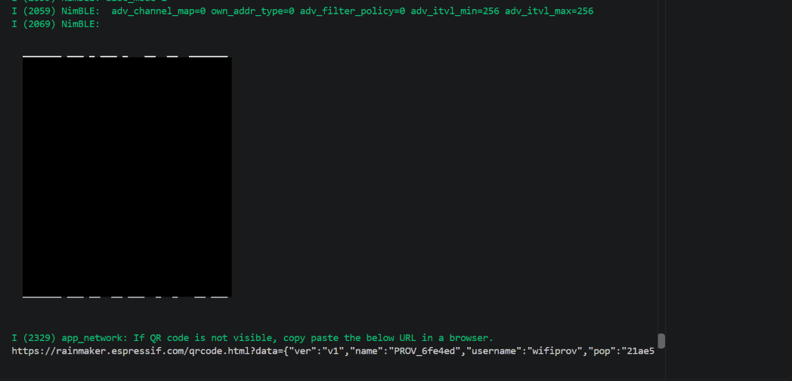
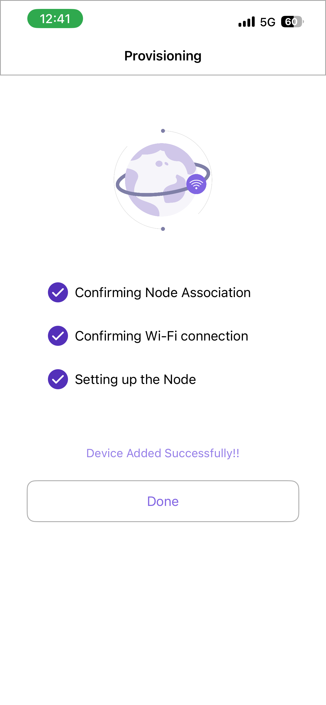
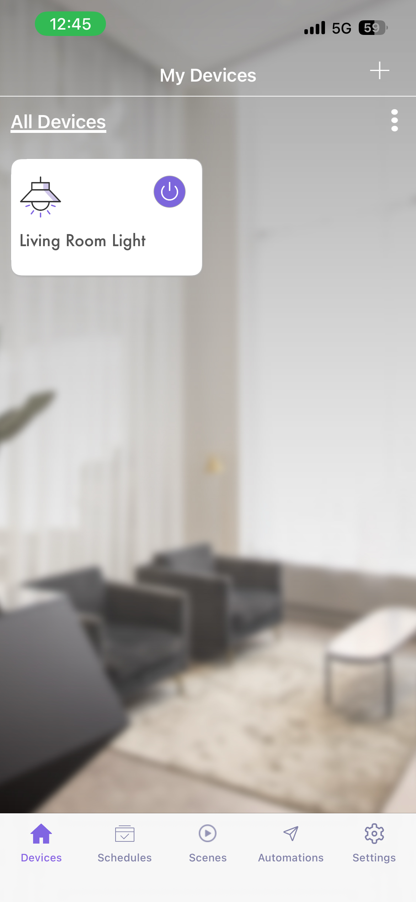
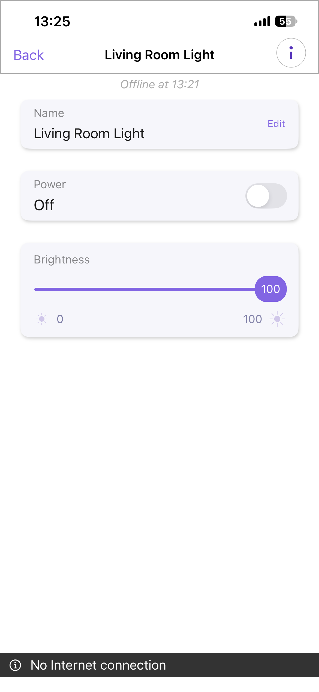

# ใบงานการทดลองที่ 11.4
### การสร้างอุปกรณ์ Smart Light สู่ระบบคลาวด์ด้วย ESP RainMaker SDK, BLE Provisioning และการควบคุมผ่านสมาร์ตโฟน

> [!NOTE] **คำชี้แจง**
> ในใบงานนี้นักศึกษาจะได้สร้างผลิตภัณฑ์ IoT สู่ระบบคลาวด์เชิงพาณิชย์จริงโดยใช้แพลตฟอร์ม **ESP RainMaker** ของ Espressif Systems โดยจะได้เขียนโปรแกรมสร้าง **Node** และ **Device (Smart Light)** พร้อมพารามิเตอร์ **Power** และ **Brightness** จากนั้นทำการเปิดใช้งานระบบ **BLE Wi-Fi Provisioning**, การขอรับใบรับรองผ่านระบบ **Assisted Claiming** สแกนเชื่อมต่อผ่านแอปพลิเคชัน **ESP RainMaker บนสมาร์ตโฟน** และควบคุมอุปกรณ์ข้ามเครือข่ายอินเทอร์เน็ตได้จากทุกที่ทั่วโลก

---

## 1. วัตถุประสงค์การทดลอง
1. เข้าใจโครงสร้างและการทำงานของแพลตฟอร์ม ESP RainMaker บนสถาปัตยกรรม ESP-IDF
2. สามารถสร้าง Node, Device, และ Parameters (Power, Brightness) ผ่าน RainMaker Core API ได้
3. สามารถเขียน Write Callback เพื่อรับคำสั่งจากคลาวด์มาปรับระดับสถานะ GPIO ของ LED และรายงานสถานะกลับ (Report State)
4. สามารถเปิดใช้งานบริการระดับระบบ ได้แก่ บริการซิงก์เวลา SNTP และการตั้งเวลาทำงาน (Schedule Service) ได้
5. สามารถทำกระบวนการ Provisioning และ Assisted Claiming ผ่านแอปพลิเคชันสมาร์ตโฟนด้วยบลูทูธ (BLE) ได้สำเร็จ
6. สามารถทดสอบส่งคำสั่งควบคุมผ่านแอปพลิเคชันมือถือ และเครื่องมือบรรทัดคำสั่ง ESP RainMaker CLI ได้

---

## 2. อุปกรณ์และเครื่องมือที่ใช้
* บอร์ดไมโครคอนโทรลเลอร์ **ESP32-C3** หรือ **ESP32**
* หลอดไฟ LED พร้อมตัวต้านทาน 220Ω ต่อเข้ากับ **GPIO 8** (ESP32-C3) หรือ **GPIO 2** (ESP32)
* สายเชื่อมต่อ USB Data Cable
* เครื่องคอมพิวเตอร์พร้อมระบบพัฒนา **ESP-IDF v5.x / v6.x**
* สมาร์ตโฟน (Android หรือ iOS) ที่ติดตั้งแอปพลิเคชัน **ESP RainMaker** และเปิดบลูทูธ/Wi-Fi ไว้
* เราเตอร์ Wi-Fi (2.4 GHz) ที่เชื่อมต่อออกสู่อินเทอร์เน็ตได้จริง

---

## 3. ขั้นตอนการทดลอง (Deconstructed Activities)

### กิจกรรมที่ 11-4.1 การตั้งค่าโปรเจกต์และ Dependency `esp_rainmaker`

เตรียมโปรเจกต์ตัวอย่างไว้ที่ `Example_project\Lab11-4_RainMaker_Light` แล้ว เปิด **ESP-IDF Terminal** ใน VS Code และเข้าโฟลเดอร์โปรเจกต์ โครงสร้างนี้ตั้งค่า BLE/NimBLE, พาร์ทิชัน `esp_secure_cert`/`nvs_key` สำหรับใบรับรอง RainMaker และ `fctry` สำหรับข้อมูลโรงงานไว้แล้ว โดยกำหนดขนาด Flash 4 MB
```powershell
cd Example_project\Lab11-4_RainMaker_Light
idf.py set-target esp32     # ใช้ esp32c3 แทน หากบอร์ดเป็น ESP32-C3
```

ไฟล์ `main/idf_component.yml` ระบุเวอร์ชัน ESP RainMaker และตัวช่วย BLE/network provisioning จาก Component Registry ไว้แล้ว
```yaml
dependencies:
  idf:
    version: ">=5.1"
  espressif/esp_rainmaker: "^1.17.0"
  espressif/rmaker_app_network: "^1.4.5"
```

---

### กิจกรรมที่ 11-4.2 การเขียนโค้ดเฟิร์มแวร์อุปกรณ์ (`main/main.c`)

โค้ดเฟิร์มแวร์พร้อมใช้งานอยู่ใน [main.c](../Example_project/Lab11-4_RainMaker_Light/main/main.c) โดยใช้ `rmaker_app_network` สำหรับ BLE provisioning (แทน `app_wifi.h` รุ่นเดิม) และ LEDC PWM เพื่อให้ตัวเลื่อน Brightness ปรับความสว่าง LED ได้จริง การเริ่มต้น provisioning ตั้ง PoP แบบสุ่มเป็นค่าเริ่มต้น

> ตรวจสอบว่าบอร์ดมี Flash อย่างน้อย 4 MB ก่อน build หากไม่แน่ใจให้ตรวจรุ่นบอร์ด/ขนาด Flash แล้วปรับ `partitions.csv` และ `sdkconfig.defaults` ให้ตรงกัน

---

### กิจกรรมที่ 11-4.3 การคอมไพล์ แฟลช และสังเกตการสร้าง QR Code

สั่งคอมไพล์และแฟลชโปรแกรม
```powershell
idf.py menuconfig    # ตรวจ ESP RainMaker App Wi-Fi Provisioning ว่าเลือก BLE ไว้
idf.py build
idf.py -p COMx flash monitor
```

**ผลลัพธ์ใน Serial Monitor**
* บอร์ดจะพิมพ์ **QR Code ในรูปแบบตัวอักษร ASCII** ออกมาทางหน้าจอ พร้อม URL สำหรับเปิดดูรูปภาพ QR Code
* บอร์ดจะเริ่มประกาศสัญญาณบลูทูธ (BLE Advertising) เพื่อรอรับการเชื่อมต่อ

---

### กิจกรรมที่ 11-4.4 การเชื่อมต่อผ่านแอปพลิเคชัน ESP RainMaker บนมือถือ

<p align="center">
  
  &nbsp;&nbsp;&nbsp;&nbsp;
  
  &nbsp;&nbsp;&nbsp;&nbsp;
  
</p>
<p align="center"><b>รูปที่ 11.13</b> ขั้นตอนการเปิดใช้งาน Assisted Claiming และการจับคู่อุปกรณ์บนโทรศัพท์มือถือ</p>

1. **เข้าสู่ระบบ** เปิดแอปพลิเคชัน **ESP RainMaker** บนโทรศัพท์มือถือ เข้าสู่ระบบด้วยบัญชีที่ลงทะเบียนไว้
2. **เพิ่มอุปกรณ์** กดปุ่มเครื่องหมายบวก (`+ Add Device`) บนหน้าจอแอป
3. **สแกน QR Code** นำกล้องสมาร์ตโฟนสแกน QR Code ที่ปรากฏบน Serial Monitor
4. **กระบวนการ Assisted Claiming**
   * หากบอร์ดยังไม่มีใบรับรอง แอปจะขึ้นหน้าต่างยืนยันการขอรับ Certificate ให้กดปุ่มยืนยัน
   * แอปจะดึงใบรับรองจาก RainMaker Cloud แล้วส่งให้ ESP32 ผ่านช่องทาง BLE
5. **กรอกรหัส Wi-Fi** เลือกชื่อ SSID เครือข่าย Wi-Fi 2.4 GHz ในบ้านและกรอกรหัสผ่าน
6. **เสร็จสิ้นการผูกอุปกรณ์** บอร์ดจะเชื่อมต่อ Wi-Fi และผูกตัวเองเข้ากับบัญชีผู้ใช้ แอปจะแสดงการ์ด **"Living Room Light"** ขึ้นมาบนหน้าจอ

---

## 4. การทดสอบและการตรวจสอบผลลัพธ์ (Testing & Verification)

### 1. การควบคุมเปิด-ปิดผ่าน Mobile App
* กดสวิตช์ Power บนหน้าจอแอป สังเกตว่าหลอดไฟ LED บนบอร์ดเปิดและปิดทันทีตามการสั่งการ
* ทดลองเลื่อนแถบสไลเดอร์ Brightness สังเกตข้อความ Log บน Serial Monitor ว่าได้รับค่าความสว่างใหม่กี่เปอร์เซ็นต์








Video : https://drive.google.com/file/d/1nmKPN4MtEsqgY3qaewTp8eHBWoXtQOuX/view?usp=sharing
### 2. การควบคุมระยะไกลข้ามอินเทอร์เน็ต (Remote 4G/5G Test)
* **ปิดสัญญาณ Wi-Fi บนสมาร์ตโฟน** แล้วเปิดใช้งานเฉพาะ **สัญญาณอินเทอร์เน็ตมือถือ (4G/5G)**
* กดสั่งเปิด-ปิดหลอดไฟอีกครั้ง สังเกตว่าบอร์ด ESP32 ที่บ้านยังคงตอบสนองต่อคำสั่งได้อย่างรวดเร็ว แสดงถึงพลังของสถาปัตยกรรม Cloud Control

Video : https://drive.google.com/file/d/1kPPvg09gltF9FgiS53W-JDn13c5yTrfQ/view?usp=sharing
---

### 3. (ทางเลือกขั้นสูง) การทดสอบผ่าน RainMaker CLI บนคอมพิวเตอร์

เปิดเทอร์มินัลใหม่บนคอมพิวเตอร์

```powershell
# ติดตั้งเครื่องมือ CLI
pip install esp-rainmaker-cli

# เข้าสู่ระบบ
rainmaker.py login

# ดึงรายชื่ออุปกรณ์และ Node ID
rainmaker.py getnodes

# สั่งเปิดหลอดไฟผ่าน Command Line
rainmaker.py setparams --nodeid <YOUR_NODE_ID> '{"Living Room Light": {"Power": true}}'

# สั่งปิดหลอดไฟผ่าน Command Line
rainmaker.py setparams --nodeid <YOUR_NODE_ID> '{"Living Room Light": {"Power": false}}'
```

---

## 5. คำถามท้ายการทดลอง (Post-Lab Questions)
1. ในสถาปัตยกรรม ESP RainMaker กระบวนการ **Assisted Claiming** ช่วยแก้ปัญหาเรื่องการติดตั้งใบรับรองความปลอดภัย (Security Certificates) บนอุปกรณ์ในขั้นตอนพัฒนาต้นแบบได้อย่างไร?

   **ตอบ:** ในการพัฒนาต้นแบบ ผู้พัฒนาไม่จำเป็นต้องเตรียมและเขียนใบรับรองเฉพาะอุปกรณ์ลงบอร์ดด้วยตนเองก่อนใช้งาน ผู้ใช้เริ่มเพิ่มอุปกรณ์ผ่านแอป ESP RainMaker แอปจะช่วยประสานการ Claim กับระบบคลาวด์และส่งข้อมูลที่จำเป็นให้อุปกรณ์ผ่านช่องทาง BLE ที่ผ่านการรักษาความปลอดภัย จากนั้นอุปกรณ์จึงใช้ข้อมูลประจำตัวดังกล่าวยืนยันตัวตนและเชื่อมต่อกับ RainMaker Cloud ได้ วิธีนี้ลดขั้นตอนการสร้างและติดตั้งใบรับรองในช่วงทดลอง แต่ระบบใช้งานจริงยังต้องจัดการข้อมูลประจำตัวและกระบวนการผลิตอย่างปลอดภัย ไม่ควรใช้ข้อมูลทดสอบร่วมกันทุกอุปกรณ์

2. เพราะเหตุใดฟังก์ชัน `write_cb` จึงต้องเรียกคำสั่ง `esp_rmaker_param_update_and_report()` ทุกครั้งที่มีการเปลี่ยนแปลงค่าพารามิเตอร์?

   **ตอบ:** เมื่อ callback รับคำสั่ง เช่น Power หรือ Brightness แล้วนำไปปรับสถานะจริงของอุปกรณ์ คำสั่ง `esp_rmaker_param_update_and_report()` จะปรับค่าพารามิเตอร์ในสถานะของอุปกรณ์และรายงานค่าใหม่กลับไปยัง RainMaker Cloud ทำให้แอปและระบบคลาวด์เห็นสถานะตรงกับอุปกรณ์ หากไม่รายงาน ค่าในแอปอาจไม่อัปเดตหรือแสดงสถานะเก่า อย่างไรก็ตาม ควรเรียกหลังจากอุปกรณ์เปลี่ยนสถานะสำเร็จ และไม่ควรรายงานค่าที่ฮาร์ดแวร์ไม่ได้ทำงานตามนั้น

3. เปรียบเทียบความแตกต่างระหว่างการพัฒนาอุปกรณ์ IoT ด้วย **Plain MQTT บน Mosquitto เอง (ในแล็บ 11.2)** กับการใช้ **ESP RainMaker SDK (ในแล็บ 11.4)** ในแง่ของความพยายามในการพัฒนา (Development Effort), ความปลอดภัย (Security), และการขยายระบบ (Scalability)

   **ตอบ:**

   | ประเด็น | Plain MQTT + Mosquitto (แล็บ 11.2) | ESP RainMaker SDK (แล็บ 11.4) |
   |---|---|---|
   | **ความพยายามในการพัฒนา** | ต้องออกแบบ topic และรูปแบบข้อความ รวมถึงทำระบบผู้ใช้/สิทธิ์ การ Provisioning แอปควบคุม และการดูแล Broker เอง จึงยืดหยุ่นแต่ต้องเขียนและประกอบระบบหลายส่วน | SDK มีรูปแบบ Node/Device/Parameter, การ Provisioning, แอป และบริการคลาวด์เตรียมไว้ ช่วยลดงานโครงสร้างพื้นฐาน แต่ต้องเรียนรู้ API และทำตามรูปแบบ/บริการของ RainMaker |
   | **ความปลอดภัย** | ผู้พัฒนารับผิดชอบการตั้งค่า TLS, การยืนยันตัวตน, ACL, การเก็บกุญแจ และการอัปเดต Broker เอง หากเปิด Broker หรือกำหนดสิทธิ์ผิดอาจทำให้ข้อมูลและคำสั่งถูกเข้าถึง | มีการเชื่อมต่อกับคลาวด์ผ่านช่องทางที่ปลอดภัยและมีกระบวนการ Claim/ข้อมูลประจำตัวอุปกรณ์ให้ แต่ยังต้องปกป้องอุปกรณ์ บัญชีผู้ใช้ และข้อมูลรับรอง รวมทั้งตั้งค่าระบบให้เหมาะสม |
   | **การขยายระบบ** | ขยายได้ตามการออกแบบ แต่ผู้ดูแลต้องวางแผนกำลัง Broker, ความทนทาน, การสำรองข้อมูล, Monitoring และการรองรับผู้ใช้/อุปกรณ์เพิ่ม | ใช้บริการคลาวด์และรูปแบบอุปกรณ์มาตรฐาน จึงสะดวกต่อการจัดการอุปกรณ์และผู้ใช้จำนวนมาก โดยขึ้นกับขีดจำกัดและความพร้อมใช้งานของแพลตฟอร์ม รวมถึงผูกกับระบบนิเวศของผู้ให้บริการ |

4. อธิบายขั้นตอนที่ทำให้ ESP RainMaker สามารถเชื่อมโยงการทำงานร่วมกับระบบสั่งงานด้วยเสียงของ **Google Home** หรือ **Amazon Alexa** ได้โดยไม่ต้องเขียนโค้ดเพิ่มเติมบนตัวบอร์ด ESP32

   **ตอบ:** เฟิร์มแวร์ประกาศอุปกรณ์และพารามิเตอร์ด้วยรูปแบบมาตรฐานของ RainMaker เช่น Lightbulb พร้อม Power และ Brightness แล้วอุปกรณ์เชื่อมต่อกับ RainMaker Cloud ผู้ใช้เชื่อมบัญชี RainMaker กับบริการ/Skill ของ Google Home หรือ Amazon Alexa และอนุญาตให้ค้นหาอุปกรณ์ เมื่อแพลตฟอร์มพบอุปกรณ์ที่รองรับ ก็แสดงเป็นอุปกรณ์ควบคุมในแอปบ้านอัจฉริยะ คำสั่งเสียงจะถูกส่งจากผู้ช่วยเสียงไปยังบริการคลาวด์ที่เชื่อมบัญชีกัน แล้ว RainMaker Cloud ส่งคำสั่งต่อไปยังบอร์ดผ่านการเชื่อมต่อของ RainMaker จึงไม่ต้องเพิ่มโค้ดสื่อสารกับ Google หรือ Amazon โดยตรงบน ESP32 ทั้งนี้การใช้งานขึ้นกับการรองรับในภูมิภาค บัญชี และบริการที่เชื่อมต่อ
