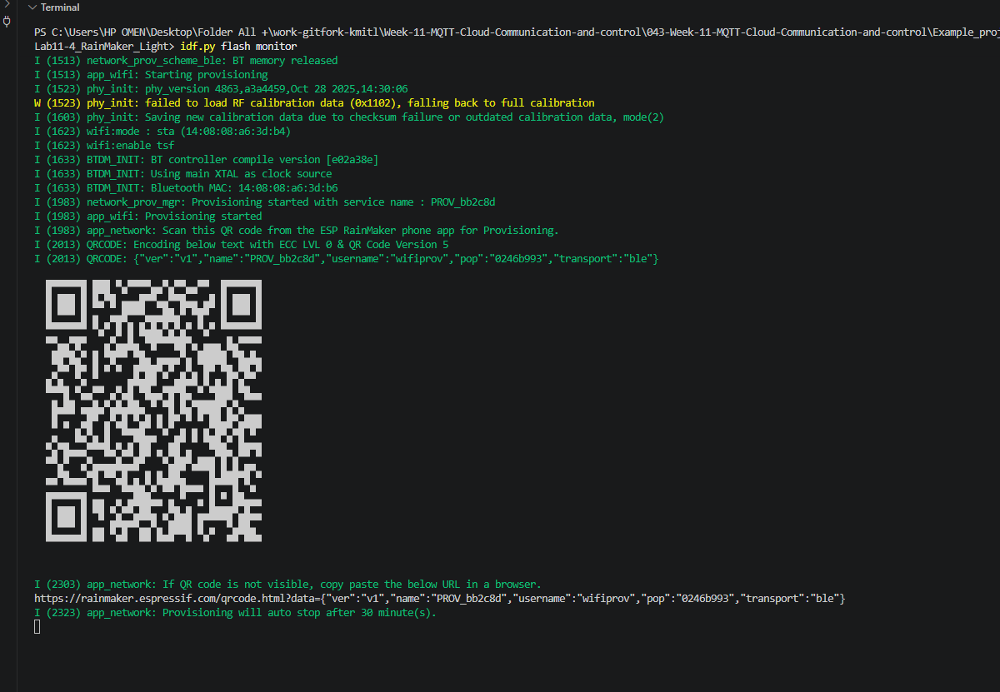
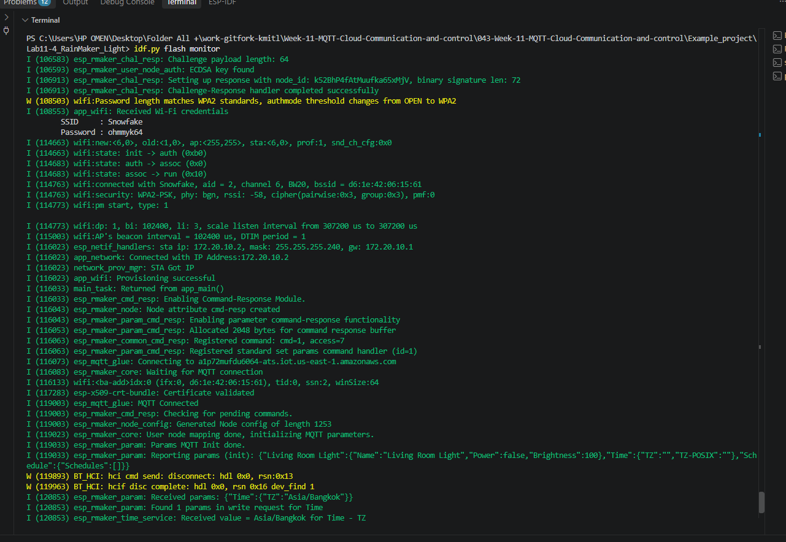
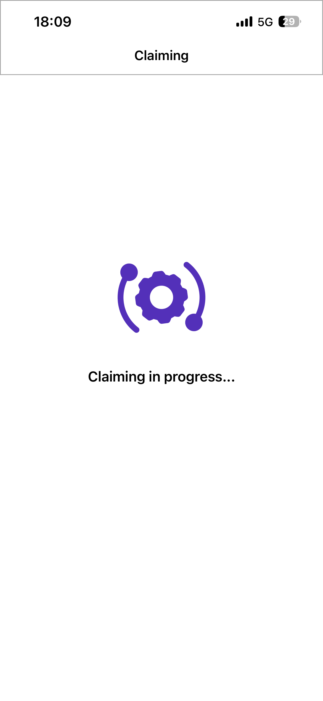
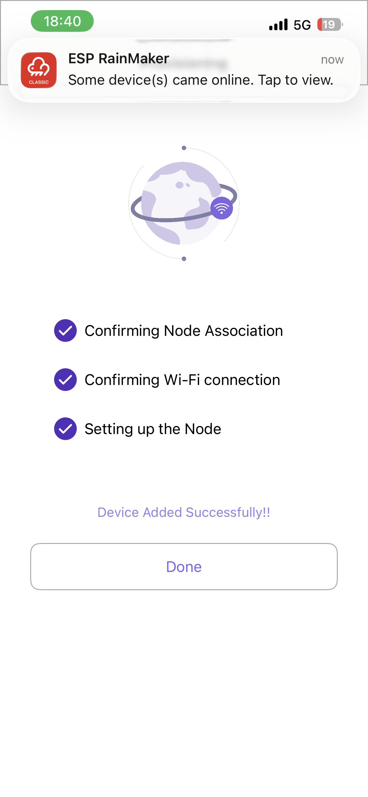
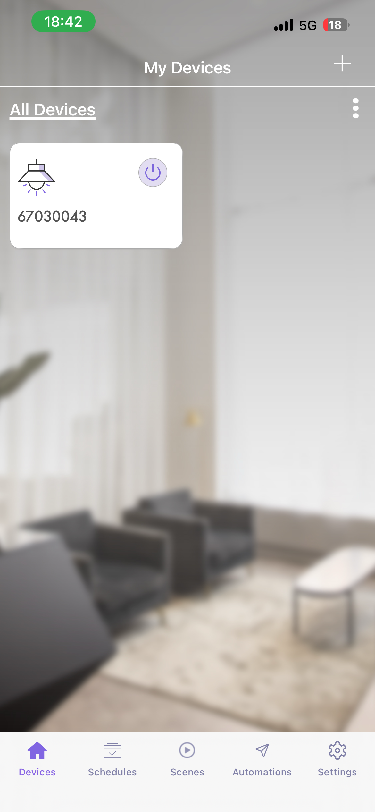
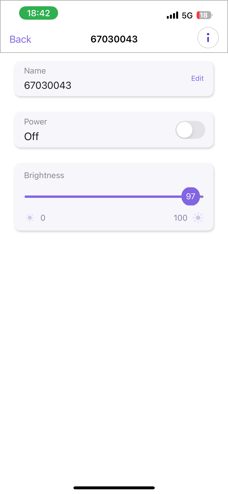

# ใบงานการทดลองที่ 11.4
### การสร้างอุปกรณ์ Smart Light สู่ระบบคลาวด์ด้วย ESP RainMaker SDK, BLE Provisioning และการควบคุมผ่านสมาร์ตโฟน

> [!NOTE] **คำชี้แจง**
> ในใบงานนี้นักศึกษาจะได้สร้างผลิตภัณฑ์ IoT สู่ระบบคลาวด์เชิงพาณิชย์จริงโดยใช้แพลตฟอร์ม **ESP RainMaker** ของ Espressif Systems โดยจะได้เขียนโปรแกรมสร้าง **Node** และ **Device (Smart Light)** พร้อมพารามิเตอร์ **Power** และ **Brightness** จากนั้นทำการเปิดใช้งานระบบ **BLE Wi-Fi Provisioning**, การขอรับใบรับรองผ่านระบบ **Assisted Claiming** สแกนเชื่อมต่อผ่านแอปพลิเคชัน **ESP RainMaker บนสมาร์ตโฟน** และควบคุมอุปกรณ์ข้ามเครือข่ายอินเทอร์เน็ตได้จากทุกที่ทั่วโลก

---

## 1. วัตถุประสงค์การทดลอง
1. เข้าใจโครงสร้างและการทำงานของแพลตฟอร์ม ESP RainMaker บนสถาปัตยกรรม ESP-IDF
2. สามารถสร้าง Node, Device, และ Parameters (Power, Brightness) ผ่าน RainMaker Core API ได้
3. สามารถเขียน Write Callback เพื่อรับคำสั่งจากคลาวด์มาปรับระดับสถานะ GPIO ของ LED และรายงานสถานะกลับ (Report State)
4. สามารถเปิดใช้งานบริการระดับระบบ ได้แก่ บริการซิงก์เวลา SNTP และการตั้งเวลาทำงาน (Schedule Service) ได้
5. สามารถทำกระบวนการ Provisioning และ Assisted Claiming ผ่านแอปพลิเคชันสมาร์ตโฟนด้วยบลูทูธ (BLE) ได้สำเร็จ
6. สามารถทดสอบส่งคำสั่งควบคุมผ่านแอปพลิเคชันมือถือ และเครื่องมือบรรทัดคำสั่ง ESP RainMaker CLI ได้

---

## 2. อุปกรณ์และเครื่องมือที่ใช้
* บอร์ดไมโครคอนโทรลเลอร์ **ESP32-C3** หรือ **ESP32**
* หลอดไฟ LED พร้อมตัวต้านทาน 220Ω ต่อเข้ากับ **GPIO 8** (ESP32-C3) หรือ **GPIO 2** (ESP32)
* สายเชื่อมต่อ USB Data Cable
* เครื่องคอมพิวเตอร์พร้อมระบบพัฒนา **ESP-IDF v5.x / v6.x**
* สมาร์ตโฟน (Android หรือ iOS) ที่ติดตั้งแอปพลิเคชัน **ESP RainMaker** และเปิดบลูทูธ/Wi-Fi ไว้
* เราเตอร์ Wi-Fi (2.4 GHz) ที่เชื่อมต่อออกสู่อินเทอร์เน็ตได้จริง

---

## 3. ขั้นตอนการทดลอง (Deconstructed Activities)

### กิจกรรมที่ 11-4.1 การสร้างโปรเจกต์และติดตั้ง Dependency `esp-rainmaker`

#### 1. สร้างโปรเจกต์ใหม่
```powershell
idf.py create-project Lab11-4_RainMaker_Light
cd Lab11-4_RainMaker_Light
idf.py set-target esp32c3   # หรือ esp32
```

#### 2. ติดตั้ง ESP RainMaker Component จาก IDF Component Registry
เพิ่มไลบรารีทางการของ Espressif ผ่านคำสั่ง
```powershell
idf.py add-dependency "espressif/esp_rainmaker"
idf.py add-dependency "espressif/rmaker_app_network"
```

ไฟล์ `main/idf_component.yml` จะได้รับการสร้างและอัปเดตโดยอัตโนมัติ
```yaml
dependencies:
  idf:
    version: ">=5.0.0"
  espressif/esp_rainmaker:
    version: "^1.17.0"
  espressif/rmaker_app_network:
    version: "^1.4.5"
```

---

### กิจกรรมที่ 11-4.2 การเขียนโค้ดเฟิร์มแวร์อุปกรณ์ (`main/main.c`)

เปิดไฟล์ `main/main.c` และแทนที่ด้วยโค้ดสมบูรณ์ต่อไปนี้

```c
#include <stdio.h>
#include <string.h>
#include "esp_log.h"
#include "nvs_flash.h"
#include "driver/gpio.h"

// RainMaker Headers
#include "esp_rmaker_core.h"
#include "esp_rmaker_standard_types.h"
#include "esp_rmaker_standard_params.h"
#include "esp_rmaker_standard_devices.h"
#include "esp_rmaker_schedule.h"
#include "app_network.h"

#if CONFIG_IDF_TARGET_ESP32C3
#define LED_PIN GPIO_NUM_8
#else
#define LED_PIN GPIO_NUM_2
#endif

static const char *TAG = "RMAKER_LIGHT";
static esp_rmaker_device_t *s_light_device = NULL;

/* ========================================================
 * 1. Write Callback ฟังก์ชันรับคำสั่งควบคุมจากคลาวด์
 * ======================================================== */
static esp_err_t write_cb(const esp_rmaker_device_t *device, const esp_rmaker_param_t *param,
                          const esp_rmaker_param_val_t val, void *priv_data, esp_rmaker_write_ctx_t *ctx)
{
    if (ctx) {
        ESP_LOGI(TAG, "Request received via: %s", esp_rmaker_device_cb_src_to_str(ctx->src));
    }
    const char *device_name = esp_rmaker_device_get_name(device);
    const char *param_name = esp_rmaker_param_get_name(param);

    ESP_LOGI(TAG, "Device: %s | Param: %s", device_name, param_name);

    // ตรวจสอบว่าเป็นคำสั่ง Power (เปิด/ปิด)
    if (strcmp(param_name, ESP_RMAKER_DEF_POWER_NAME) == 0) {
        bool state = val.val.b;
        ESP_LOGI(TAG, "Changing LED state to: %s", state ? "ON" : "OFF");
        gpio_set_level(LED_PIN, state ? 1 : 0);
        
        // รายงานสถานะปัจจุบันกลับสู่คลาวด์ เพื่อให้แอปบนมือถืออัปเดตสถานะทันที
        esp_rmaker_param_update_and_report(param, val);
    }
    // ตรวจสอบว่าเป็นคำสั่ง Brightness (ความสว่าง 0 - 100%)
    else if (strcmp(param_name, ESP_RMAKER_DEF_BRIGHTNESS_NAME) == 0) {
        int brightness = val.val.i;
        ESP_LOGI(TAG, "Changing Brightness to: %d%%", brightness);
        
        // (สามารถนำค่า brightness 0-100 ไปปรับค่า LEDC PWM ในงานจริงได้)
        esp_rmaker_param_update_and_report(param, val);
    }

    return ESP_OK;
}

/* ========================================================
 * 2. ฟังก์ชันหลัก (app_main)
 * ======================================================== */
void app_main(void)
{
    // กำหนดค่า GPIO ควบคุม LED
    gpio_reset_pin(LED_PIN);
    gpio_set_direction(LED_PIN, GPIO_MODE_OUTPUT);
    gpio_set_level(LED_PIN, 0);

    // เริ่มต้นระบบจัดเก็บข้อมูล NVS Flash
    esp_err_t err = nvs_flash_init();
    if (err == ESP_ERR_NVS_NO_FREE_PAGES || err == ESP_ERR_NVS_NEW_VERSION_FOUND) {
        ESP_ERROR_CHECK(nvs_flash_erase());
        err = nvs_flash_init();
    }
    ESP_ERROR_CHECK(err);

    // 1. เริ่มต้นระบบ Wi-Fi Provisioning (ผ่าน BLE)
    app_network_init();

    // 2. สร้าง Node ในระบบ ESP RainMaker
    esp_rmaker_config_t rainmaker_cfg = {
        .enable_time_sync = true, // เปิดบริการซิงก์เวลาโลกอัตโนมัติ
    };
    esp_rmaker_node_t *node = esp_rmaker_node_init(&rainmaker_cfg, "Smart Light Node", "Lightbulb");
    if (!node) {
        ESP_LOGE(TAG, "Could not initialise node.");
        return;
    }

    // 3. สร้าง Device ประเภท Lightbulb
    s_light_device = esp_rmaker_lightbulb_device_create("Living Room Light", NULL, false);
    // ผูก Callback สำหรับรับคำสั่ง
    esp_rmaker_device_add_cb(s_light_device, write_cb, NULL);

    // 4. เพิ่ม Parameter Brightness (ความสว่างเริ่มต้น 100%)
    esp_rmaker_param_t *brightness_param = esp_rmaker_brightness_param_create(ESP_RMAKER_DEF_BRIGHTNESS_NAME, 100);
    esp_rmaker_device_add_param(s_light_device, brightness_param);

    // 5. บรรจุ Device เข้าสู่ Node
    esp_rmaker_node_add_device(node, s_light_device);

    // 6. เปิดบริการระดับระบบ (System Services)
    esp_rmaker_timezone_service_enable(); // บริการโซนเวลา
    esp_rmaker_schedule_enable();         // บริการตั้งเวลาอัตโนมัติ

    // 7. เริ่มการทำงานของระบบ RainMaker Core
    esp_rmaker_start();

    // 8. เริ่มต้นระบบค้นหาอุปกรณ์และรับการตั้งค่า Wi-Fi (BLE Provisioning)
    ESP_ERROR_CHECK(app_network_start(POP_TYPE_RANDOM));
}
```

---

### กิจกรรมที่ 11-4.3 การคอมไพล์ แฟลช และสังเกตการสร้าง QR Code

สั่งคอมไพล์และแฟลชโปรแกรม
```powershell
idf.py build
idf.py -p COMx flash monitor
```

**ผลลัพธ์ใน Serial Monitor**
* บอร์ดจะพิมพ์ **QR Code ในรูปแบบตัวอักษร ASCII** ออกมาทางหน้าจอ พร้อม URL สำหรับเปิดดูรูปภาพ QR Code
* บอร์ดจะเริ่มประกาศสัญญาณบลูทูธ (BLE Advertising) เพื่อรอรับการเชื่อมต่อ

---

### กิจกรรมที่ 11-4.4 การเชื่อมต่อผ่านแอปพลิเคชัน ESP RainMaker บนมือถือ

<p align="center">
  
  &nbsp;&nbsp;&nbsp;&nbsp;
  
  &nbsp;&nbsp;&nbsp;&nbsp;
  
</p>
<p align="center"><b>รูปที่ 11.13</b> ขั้นตอนการเปิดใช้งาน Assisted Claiming และการจับคู่อุปกรณ์บนโทรศัพท์มือถือ</p>

1. **เข้าสู่ระบบ** เปิดแอปพลิเคชัน **ESP RainMaker** บนโทรศัพท์มือถือ เข้าสู่ระบบด้วยบัญชีที่ลงทะเบียนไว้
2. **เพิ่มอุปกรณ์** กดปุ่มเครื่องหมายบวก (`+ Add Device`) บนหน้าจอแอป
3. **สแกน QR Code** นำกล้องสมาร์ตโฟนสแกน QR Code ที่ปรากฏบน Serial Monitor
4. **กระบวนการ Assisted Claiming**
   * หากบอร์ดยังไม่มีใบรับรอง แอปจะขึ้นหน้าต่างยืนยันการขอรับ Certificate ให้กดปุ่มยืนยัน
   * แอปจะดึงใบรับรองจาก RainMaker Cloud แล้วส่งให้ ESP32 ผ่านช่องทาง BLE
5. **กรอกรหัส Wi-Fi** เลือกชื่อ SSID เครือข่าย Wi-Fi 2.4 GHz ในบ้านและกรอกรหัสผ่าน
6. **เสร็จสิ้นการผูกอุปกรณ์** บอร์ดจะเชื่อมต่อ Wi-Fi และผูกตัวเองเข้ากับบัญชีผู้ใช้ แอปจะแสดงการ์ด **"Living Room Light"** ขึ้นมาบนหน้าจอ

---

## 4. การทดสอบและการตรวจสอบผลลัพธ์ (Testing & Verification)

### 1. การควบคุมเปิด-ปิดผ่าน Mobile App
  
 
 
                                
### Linnk การทดลอง ปิด-เปิดไฟ 67030043 : https://youtube.com/shorts/dxhML7FBFg8?feature=share
### Linnk การทดลอง ปรับแสงไฟ 67030043 : https://youtube.com/shorts/eapLZ4ilLVg?feature=share

* กดสวิตช์ Power บนหน้าจอแอป สังเกตว่าหลอดไฟ LED บนบอร์ดเปิดและปิดทันทีตามการสั่งการ
* ทดลองเลื่อนแถบสไลเดอร์ Brightness สังเกตข้อความ Log บน Serial Monitor ว่าได้รับค่าความสว่างใหม่กี่เปอร์เซ็นต์
Lin
### 2. การควบคุมระยะไกลข้ามอินเทอร์เน็ต (Remote 4G/5G Test)
* **ปิดสัญญาณ Wi-Fi บนสมาร์ตโฟน** แล้วเปิดใช้งานเฉพาะ **สัญญาณอินเทอร์เน็ตมือถือ (4G/5G)**
* กดสั่งเปิด-ปิดหลอดไฟอีกครั้ง สังเกตว่าบอร์ด ESP32 ที่บ้านยังคงตอบสนองต่อคำสั่งได้อย่างรวดเร็ว แสดงถึงพลังของสถาปัตยกรรม Cloud Control


---

### 3. (ทางเลือกขั้นสูง) การทดสอบผ่าน RainMaker CLI บนคอมพิวเตอร์

เปิดเทอร์มินัลใหม่บนคอมพิวเตอร์

```powershell
# ติดตั้งเครื่องมือ CLI
pip install esp-rainmaker-cli

# เข้าสู่ระบบ
rainmaker.py login

# ดึงรายชื่ออุปกรณ์และ Node ID
rainmaker.py getnodes

# สั่งเปิดหลอดไฟผ่าน Command Line
rainmaker.py setparams --nodeid <YOUR_NODE_ID> '{"Living Room Light": {"Power": true}}'

# สั่งปิดหลอดไฟผ่าน Command Line
rainmaker.py setparams --nodeid <YOUR_NODE_ID> '{"Living Room Light": {"Power": false}}'
```

---

## 5. คำถามท้ายการทดลอง (Post-Lab Questions)

1. ในสถาปัตยกรรม ESP RainMaker กระบวนการ **Assisted Claiming** ช่วยแก้ปัญหาเรื่องการติดตั้งใบรับรองความปลอดภัย (Security Certificates) บนอุปกรณ์ในขั้นตอนพัฒนาต้นแบบได้อย่างไร?

   **ตอบ:** การเชื่อมต่อ RainMaker Cloud ใช้ MQTT over TLS แบบ mTLS ซึ่งอุปกรณ์แต่ละตัวต้องมี Client Certificate และ Private Key เฉพาะตัว ตามปกติผู้พัฒนาต้องสร้างและติดตั้งใบรับรองลงอุปกรณ์เอง ซึ่งยุ่งยากและเสี่ยงผิดพลาดในขั้นตอนพัฒนาต้นแบบ

   **Assisted Claiming** แก้ปัญหานี้โดยใช้สมาร์ตโฟนเป็นตัวกลาง ดังนี้
   1. บอร์ดสร้าง Private Key และ CSR ขึ้นเองบนตัวอุปกรณ์ (Private Key ไม่ถูกส่งออกจากบอร์ด)
   2. แอปบนมือถือรับ CSR ผ่าน BLE แล้วส่งไปขอ Certificate จาก RainMaker Cloud (มือถือใช้อินเทอร์เน็ตของตนเอง)
   3. Cloud ออก Certificate ให้ แอปส่ง Certificate กลับไปยังบอร์ดผ่าน BLE
   4. บอร์ดบันทึก Certificate ลง NVS แล้วใช้เชื่อมต่อ Cloud ด้วย mTLS ได้ทันที

   ผลคือไม่ต้องสร้าง ฝัง หรือจัดการใบรับรองด้วยตนเอง ไม่ต้องมี Provisioning ล่วงหน้าจากโรงงาน และไม่ต้องให้บอร์ดมีอินเทอร์เน็ตตั้งแต่ต้น ทำให้พัฒนาต้นแบบได้รวดเร็ว (ในเชิงพาณิชย์จะใช้ Self Claiming หรือฝัง Certificate ตอนผลิตแทน)

2. เพราะเหตุใดฟังก์ชัน `write_cb` จึงต้องเรียกคำสั่ง `esp_rmaker_param_update_and_report()` ทุกครั้งที่มีการเปลี่ยนแปลงค่าพารามิเตอร์?

   **ตอบ:** เมื่อ Cloud ส่งคำสั่งเขียนค่ามา `write_cb` ทำหน้าที่ควบคุมฮาร์ดแวร์จริง (เช่น เปลี่ยนระดับ GPIO) แต่ค่าพารามิเตอร์ที่เก็บในหน่วยความจำของ RainMaker และสถานะบนคลาวด์ (Device Shadow) ยังไม่ถูกอัปเดต `esp_rmaker_param_update_and_report()` จึงมีหน้าที่
   - **อัปเดตค่าในหน่วยความจำ** ของพารามิเตอร์ให้ตรงกับสถานะจริงของอุปกรณ์
   - **รายงานสถานะกลับสู่ Cloud** ทาง MQTT เพื่อยืนยันว่าอุปกรณ์ทำตามคำสั่งแล้ว
   - **ให้ทุกไคลเอนต์ซิงก์ตรงกัน** เช่น แอปมือถือหลายเครื่อง, Alexa/Google Home หรือ Schedule ที่เห็นสถานะล่าสุดเสมอ

   หากไม่เรียก สถานะบนแอปอาจไม่ตรงกับสถานะจริงของ LED (เช่น สวิตช์ในแอปแสดง OFF ทั้งที่ไฟติด) หรือกลับไปเป็นค่าเดิมเมื่อรีเฟรช

3. เปรียบเทียบความแตกต่างระหว่างการพัฒนาอุปกรณ์ IoT ด้วย **Plain MQTT บน Mosquitto เอง (ในแล็บ 11.2)** กับการใช้ **ESP RainMaker SDK (ในแล็บ 11.4)** ในแง่ของความพยายามในการพัฒนา (Development Effort), ความปลอดภัย (Security), และการขยายระบบ (Scalability)

   **ตอบ:**

   | ประเด็น | Plain MQTT + Mosquitto (แล็บ 11.2) | ESP RainMaker SDK (แล็บ 11.4) |
   |---|---|---|
   | ความพยายามในการพัฒนา | ต้องติดตั้งและตั้งค่า Broker เอง ออกแบบ Topic และรูปแบบข้อมูล เขียนโค้ด Wi-Fi/MQTT และสร้างแอปควบคุมเอง | มี Cloud, แอปมือถือ, Provisioning ผ่าน BLE ให้พร้อม เขียนเพียงสร้าง Node/Device/Parameter และ Callback |
   | ความปลอดภัย | ต้องตั้งค่า TLS, ใบรับรอง, ACL และผู้ใช้เอง หากตั้งค่าผิดหรือใช้ Plain MQTT จะไม่ปลอดภัย | mTLS ต่ออุปกรณ์, Provisioning แบบ Security 2 (SRP6a), ระบบบัญชีผู้ใช้และการผูกอุปกรณ์กับผู้ใช้จัดการให้ |
   | การขยายระบบ | ต้องดูแลเซิร์ฟเวอร์เอง รองรับอุปกรณ์จำนวนมากต้องทำ Clustering, Load Balancing, Monitoring และการจัดการผู้ใช้เอง | Cloud รองรับอุปกรณ์จำนวนมาก มี OTA, Schedule, การแชร์อุปกรณ์ และการเชื่อม Voice Assistant ในตัว |
   | ความยืดหยุ่น/การควบคุม | ควบคุมได้เต็มที่ ไม่ผูกกับผู้ให้บริการ ไม่มีค่าบริการคลาวด์ | ผูกกับระบบนิเวศของ Espressif และมีข้อจำกัดตามบริการ |

   สรุป: Mosquitto เหมาะกับการเรียนรู้และระบบเล็กที่ต้องการควบคุมเอง ส่วน RainMaker ลดเวลาพัฒนาและเหมาะกับผลิตภัณฑ์ที่ต้องขยายเป็นจำนวนมาก

4. อธิบายขั้นตอนที่ทำให้ ESP RainMaker สามารถเชื่อมโยงการทำงานร่วมกับระบบสั่งงานด้วยเสียงของ **Google Home** หรือ **Amazon Alexa** ได้โดยไม่ต้องเขียนโค้ดเพิ่มเติมบนตัวบอร์ด ESP32

   **ตอบ:** การเชื่อมต่อทำที่ฝั่ง Cloud ไม่ใช่ที่ฝั่งเฟิร์มแวร์ โดยมีขั้นตอนดังนี้
   1. อุปกรณ์ถูกสร้างด้วยชนิดมาตรฐาน (เช่น `esp_rmaker_lightbulb_device_create` พร้อมพารามิเตอร์ Power และ Brightness) ซึ่งมี Device Type และ Parameter Type ตามมาตรฐานของ RainMaker
   2. ผู้ใช้เปิดแอป Alexa หรือ Google Home เลือกเพิ่ม Skill/Action ของ **ESP RainMaker** แล้วล็อกอินด้วยบัญชี RainMaker เดียวกัน (Account Linking ผ่าน OAuth)
   3. Cloud ของ RainMaker ดึงรายการอุปกรณ์ในบัญชีและแปลงชนิดอุปกรณ์/พารามิเตอร์มาตรฐาน ให้ตรงกับ Capability ของ Alexa หรือ Google Home (เช่น Power เป็น On/Off, Brightness เป็นระดับความสว่าง)
   4. เมื่อผู้ใช้สั่งด้วยเสียง เช่น "เปิดไฟห้องนั่งเล่น" Voice Assistant ส่งคำสั่งมายัง RainMaker Cloud
   5. RainMaker Cloud ส่งคำสั่งต่อมายังบอร์ดทาง MQTT ซึ่งเข้าสู่ `write_cb` เดิมที่เขียนไว้แล้ว และบอร์ดรายงานสถานะกลับด้วย `esp_rmaker_param_update_and_report()`

   เพราะบอร์ดสื่อสารกับ RainMaker Cloud เพียงช่องทางเดียวเสมอ การเพิ่มช่องทางควบคุม (แอปมือถือ, เสียง, CLI, Schedule) จึงไม่ต้องแก้โค้ดบนบอร์ด
