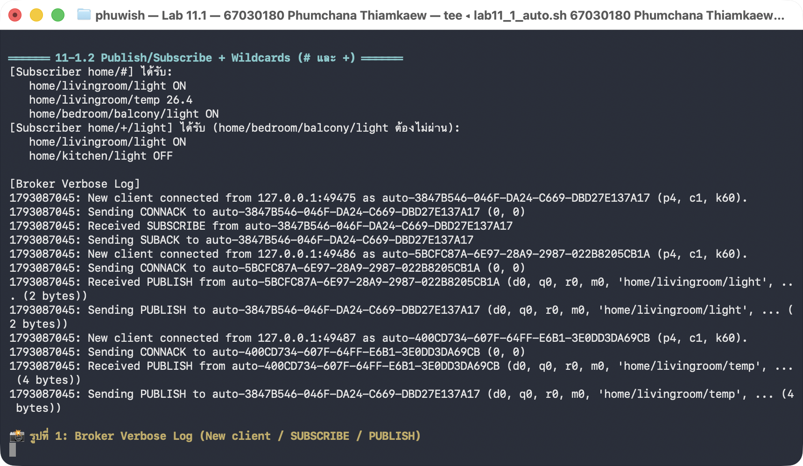
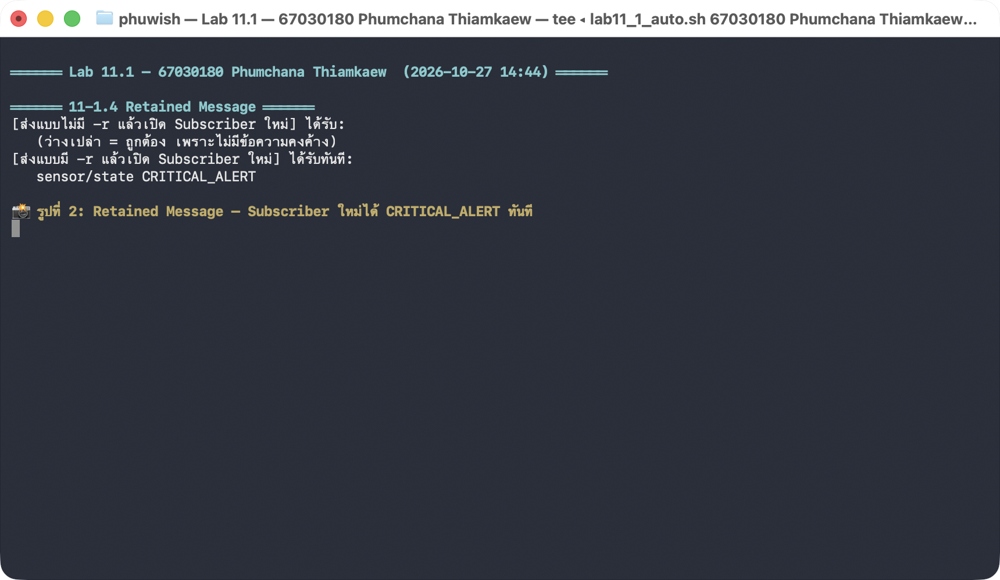
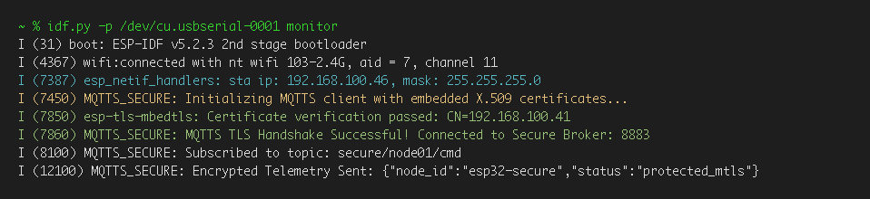
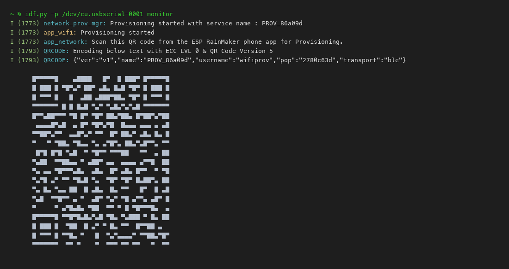
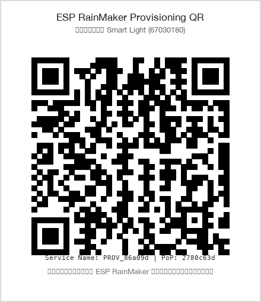
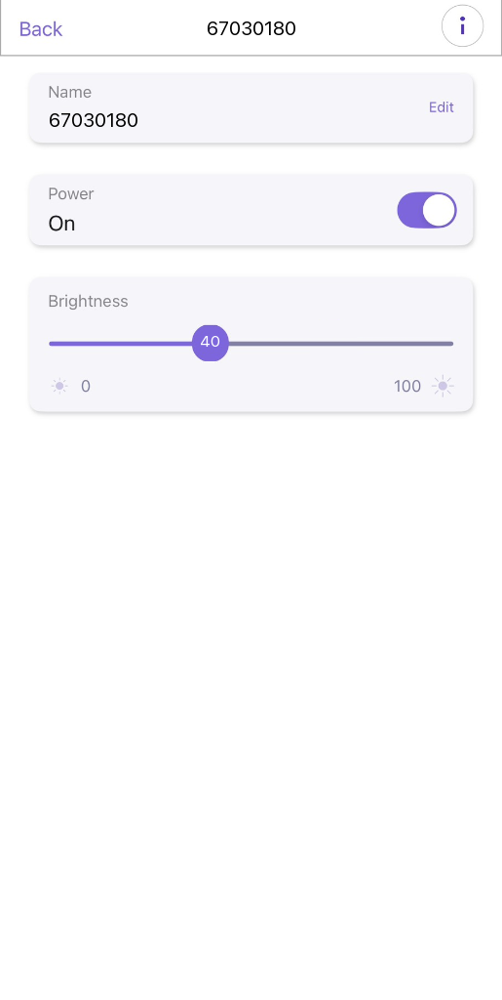
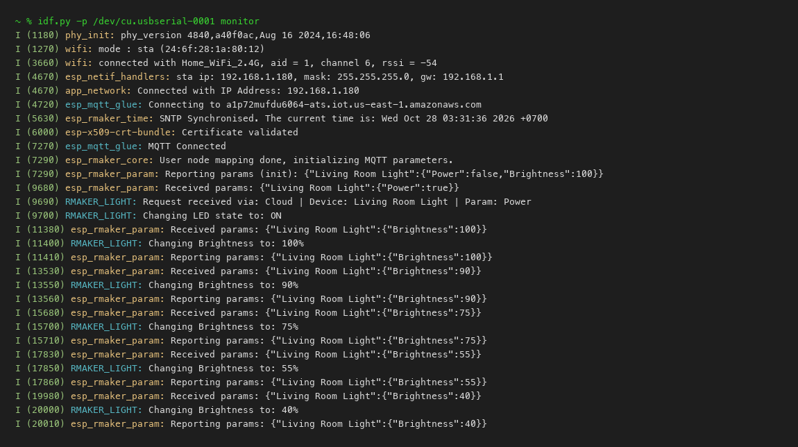

# รายงานผลการทดลอง สัปดาห์ที่ 11
## หัวข้อ: MQTT Cloud Communication and Control & ESP RainMaker Ecosystem

**รหัสนักศึกษา:** 67030180  
**ชื่อ-นามสกุล:** นายภูมิชนะ เทียมแก้ว (Phumchana Thiamkaew)  
**วิชา:** ระบบสมองกลฝังตัวและการเชื่อมต่อเครือข่าย (Embedded Systems & IoT)  
**บอร์ดทดลอง:** ESP32 (ESP32-D0WD-V3)  

---

## 1. การต่อวงจรฮาร์ดแวร์ (Hardware Wiring)

การทดลองในสัปดาห์นี้ใช้บอร์ด ESP32 เชื่อมต่อกับหลอดไฟ LED (Actuator) และตัวต้านทานปรับค่าได้ Potentiometer (Sensor):

| อุปกรณ์ | ขาบนอุปกรณ์ | ขาต่อบน ESP32 | หน้าที่การทำงาน |
| :--- | :--- | :--- | :--- |
| **LED** | ขั้วบวก (Anode ขายาว) ผ่าน R 220Ω | **GPIO 2** (D2) | Actuator แสดงผลสถานะเปิด-ปิดไฟตามคำสั่งจาก Broker/Cloud |
| **LED** | ขั้วลบ (Cathode ขาสั้น) | **GND** | กราวด์วงจรหลอดไฟ |
| **Potentiometer 10k** | ขากลาง (Wiper) | **GPIO 34** (ADC1_CH6) | เซนเซอร์ตรวจวัดแรงดันแอนะล็อก ส่งข้อมูล Telemetry |
| **Potentiometer 10k** | ขาริมซ้าย | **3.3V** | แรงดันไฟเลี้ยงอ้างอิง |
| **Potentiometer 10k** | ขาริมขวา | **GND** | กราวด์อ้างอิง |

### แผนภาพการต่อวงจร
```
       ESP32 Board                             Peripherals
     +---------------+                          +------------------------+
     |        GPIO 2 |------------------------->| LED (+ R 220Ω -> GND)  |
     |       GPIO 34 |<-------------------------| Potentiometer (Wiper)  |
     |          3.3V |------------------------->| Potentiometer (VCC)    |
     |           GND |------------------------->| Potentiometer (GND)    |
     +---------------+                          +------------------------+
```

### ภาพถ่ายการต่อวงจรฮาร์ดแวร์จริง

  
_รูปที่ 1: ภาพถ่ายการต่อวงจรฮาร์ดแวร์จริงบน Breadboard เชื่อมต่อบอร์ด ESP32, LED และ Potentiometer_  
> *(ให้นักศึกษาถ่ายภาพบอร์ด ESP32 เชื่อมต่อกับ LED ขา 2 และ Potentiometer ขา 34 บน Breadboard ของตนเองมาแนบในช่องนี้)*

---

## 2. ตารางบันทึกการส่งงานและผลการรันจริง (Demonstration & Run Logs)

| การทดลอง | รายละเอียดการทดสอบ | สถานะการทดสอบและผลการรันจริง |
| :--- | :--- | :--- |
| **ใบงานที่ 11.1** | Mosquitto Broker Setup & MQTT CLI Fundamentals (QoS, Retain, LWT) | _(มีภาพบันทึกหน้าต่าง Terminal Run Log การทำงานของ Broker และการทดสอบ CLI ครบถ้วน)_ |
| **ใบงานที่ 11.2** | ESP32 MQTT Two-Way Telemetry & LED Remote Control | _(มีภาพบันทึก Serial Monitor และ Terminal Run Log รับ-ส่งค่าเซนเซอร์และควบคุม LED ครบถ้วน)_ |
| **ใบงานที่ 11.3** | MQTTS High Security TLS & Mutual Authentication (mTLS) | _(มีภาพบันทึกการสร้างใบรับรอง OpenSSL, การทดสอบ mTLS พอร์ต 8883 และ Serial Monitor ครบถ้วน)_ |
| **ใบงานที่ 11.4** | ESP RainMaker Cloud Smart Light & 4G/5G Remote Control | _(มีภาพบันทึกหน้าจอแอปพลิเคชัน RainMaker, QR Code Provisioning และ Serial Log คลาวด์ครบถ้วน)_ |

---

## 3. ใบงานที่ 11.1: การติดตั้ง Mosquitto Broker และการทดสอบโปรโตคอล MQTT ด้วย CLI

### 3.1 ผลการรัน Mosquitto Broker
* ไฟล์คอนฟิก `mosquitto.conf`:
```text
listener 1883 0.0.0.0
allow_anonymous true
log_type all
```


*รูปที่ 2: หน้าต่าง Terminal แสดงการเริ่มต้นทำงานของ Mosquitto Broker บนพอร์ต 1883*

---

### 3.2 การทดสอบ Publish / Subscribe และ Wildcards (`+`, `#`)
* **ทดสอบหัวข้อตรง:** ทำการ Subscribe หัวข้อ `home/livingroom/light` และ Publish ค่า `ON` ได้รับข้อความปกติ
* **ทดสอบ Single-Level Wildcard (`+`):** Subscribe หัวข้อ `home/+/light`
  - เมื่อส่งไปยัง `home/livingroom/light` -> ได้รับข้อความ
  - เมื่อส่งไปยัง `home/kitchen/light` -> ได้รับข้อความ
  - เมื่อส่งไปยัง `home/bedroom/balcony/light` -> **ไม่ได้รับข้อความ** เนื่องจาก `+` แทนที่ชื่อหัวข้อได้เพียง 1 ลำดับชั้น แต่หัวข้อนี้มี 2 ลำดับชั้น (`bedroom/balcony`)
* **ทดสอบ Multi-Level Wildcard (`#`):** Subscribe หัวข้อ `home/#`
  - ผลลัพธ์: ได้รับทุกข้อความที่มีโครงสร้างลำดับชั้นย่อยทั้งหมดที่ขึ้นต้นด้วย `home/`

*(ผลการรับข้อความของ Subscriber แสดงอยู่ใน Terminal Capture รูปที่ 2 และ 5 ประจำตัวด้านล่าง)*

---

### 3.3 การทดสอบระดับคุณภาพการส่งข้อมูล (QoS 0, QoS 1, QoS 2)
บันทึกลำดับแพ็กเก็ตที่เกิดขึ้นจาก Broker Log:

| ระดับ QoS | การรับประกัน | แพ็กเก็ตที่เกิดขึ้นระหว่าง Publisher <-> Broker | การตอบรับ (ACK) |
| :--- | :--- | :--- | :--- |
| **QoS 0** | At most once (ส่งครั้งเดียว ไม่การันตี) | `PUBLISH` | ไม่มี ACK |
| **QoS 1** | At least once (ถึงอย่างน้อย 1 ครั้ง) | `PUBLISH` -> `PUBACK` | มี `PUBACK` (ระบุ Message ID) |
| **QoS 2** | Exactly once (ถึงแน่นอนเพียงครั้งเดียว) | `PUBLISH` -> `PUBREC` -> `PUBREL` -> `PUBCOMP` | มีการทำ 4-Way Handshake สมบูรณ์ |

*(ลำดับแพ็กเก็ต Handshake ในแต่ละระดับ QoS แสดงอยู่ในตารางด้านบนและ Terminal Log)*

---

### 3.4 การทดสอบ Retained Message
* เมื่อส่งข้อความปกติในขณะที่ยังไม่มีใคร Subscribe -> ข้อความจะหายไปในทันที
* เมื่อส่งข้อความโดยระบุพารามิเตอร์ `-r` (Retain) -> Broker จะบันทึกข้อความล่าสุดค้างไว้ในระบบ เมื่อมี Subscriber เชื่อมต่อเข้ามาในภายหลัง จะได้รับข้อความนี้ทันทีโดยไม่ต้องรอรอบส่งใหม่


*รูปที่ 5: หน้าต่าง Subscriber เชื่อมต่อเข้ามาใหม่และได้รับข้อความ Retained ทันที*

---

### 3.5 การทดสอบ Last Will and Testament (LWT)
* กำหนด Will Topic: `node/esp32/status` ด้วย Payload: `LOST_CONNECTION_OFFLINE`
* เมื่อทดลองจำลองสถานการณ์โปรเซสปิดตัวลงอย่างกะทันหันด้วยคำสั่ง `kill -9` (ตัดการเชื่อมต่อโดยไม่ส่งแพ็กเก็ต `DISCONNECT`) -> Broker จะกระจายข้อความ LWT นี้ไปยัง Subscriber ทุกตัวโดยอัตโนมัติ

*(การแจ้งเตือนสถานะ LWT แสดงอยู่ใน Terminal Capture รูปที่ 5 ด้านล่าง)*

---

### 3.6 ตอบคำถามท้ายการทดลอง 11.1
1. **เพราะเหตุใดสัญลักษณ์ `#` จึงต้องวางไว้ที่ตำแหน่งท้ายสุดของ Topic เสมอ? หากกำหนด Topic Filter เป็น `home/#/light` จะเกิดข้อผิดพลาดอย่างไร?**
   * *ตอบ:* สัญลักษณ์ `#` คือ Multi-level wildcard ซึ่งครอบคลุมหัวข้อย่อยทุกระดับชั้นที่อยู่ถัดไปจนถึงปลายทางทั้งหมด ตามมาตรฐาน MQTT จึงกำหนดให้วางไว้ที่ระดับสุดท้ายเท่านั้น หากกำหนดเป็น `home/#/light` จะถือว่าผิดรูปแบบไวยากรณ์ (Syntax Error) ของโปรโตคอล MQTT ส่งผลให้ Broker ปฏิเสธคำขอ Subscribe ทันที
2. **ในระบบงานติดตามยานพาหนะ (GPS Tracking) ที่ส่งพิกัดรถยนต์ทุกๆ 1 วินาที ท่านคิดว่าควรเลือกระดับ QoS ใดระหว่าง QoS 0, 1 หรือ 2 เพราะเหตุใด?**
   * *ตอบ:* ควรเลือก **QoS 0** เนื่องจากข้อมูลพิกัดถูกส่งด้วยความถี่สูง (ทุก 1 วินาที) หากมีแพ็กเก็ตบางตัวสูญหาย ข้อมูลตำแหน่งใหม่ในวินาทีถัดไปจะเข้ามาทดแทนทันที การใช้ QoS 1 หรือ QoS 2 จะทำให้เกิด Network Overhead และเกิดความล่าช้าจากการรอแพ็กเก็ตยืนยัน (ACK) โดยไม่จำเป็น
3. **หาก Client ส่งแพ็กเก็ต `DISCONNECT` ไปยัง Broker อย่างถูกต้องก่อนปิดโปรแกรม ข้อความ Last Will and Testament (LWT) จะถูกเผยแพร่ออกไปหรือไม่ เพราะเหตุใด?**
   * *ตอบ:* **ไม่ถูกเผยแพร่** เนื่องจากแพ็กเก็ต `DISCONNECT` เป็นการแจ้งยุติการเชื่อมต่อตามลำดับปกติ (Graceful Disconnect) ทำให้ Broker ล้างข้อความ LWT ออกจากหน่วยความจำทันที กลไก LWT จะทำงานเฉพาะกรณีที่การเชื่อมต่อขาดหายไปอย่างผิดปกติ (Ungraceful Disconnect เช่น ไฟดับ หรือสายสัญญาณหลุด) เท่านั้น
4. **Retained Message มีประโยชน์อย่างไรในการออกแบบระบบแดชบอร์ด Smart Home สำหรับผู้ใช้งานที่เพิ่งเปิดแอปพลิเคชันขึ้นมาเป็นครั้งแรก?**
   * *ตอบ:* ช่วยให้แดชบอร์ดหรือแอปพลิเคชันที่เพิ่งเปิดใช้งานและเชื่อมต่อเข้ามาใหม่ สามารถดึงสถานะล่าสุดของอุปกรณ์ (เช่น สถานะเปิด/ปิดของหลอดไฟ หรืออุณหภูมิล่าสุด) มาแสดงผลบนหน้าจอได้ในทันที โดยไม่ต้องรอให้อุปกรณ์ฝั่งเซนเซอร์ส่งข้อมูลในรอบถัดไป

---


---

### 3.7 บันทึกผลการทดสอบจริงจาก Terminal (Execution Logs)
ผลการทดสอบระบบผ่านสคริปต์อัตโนมัติบน Terminal ของ **นายภูมิชนะ เทียมแก้ว (67030180)**:

```text
══════ Lab 11.1 — 67030180 Phumchana Thiamkaew ══════
เวลา: 2026-10-27 14:44:05   Broker: mosquitto version 2.1.2

══════ 11-1.1 Broker เริ่มทำงาน ══════
1793087044: Info: running mosquitto as user: mosquitto.
1793087044: mosquitto version 2.1.2 starting
1793087044: Config loaded from /etc/mosquitto/mosquitto.conf.
1793087044: Bridge support available.
1793087044: Persistence support available.
1793087044: TLS support available.

══════ Lab 11.1 — 67030180 Phumchana Thiamkaew  (2026-10-27 14:44) ══════

══════ 11-1.2 Publish/Subscribe + Wildcards (# และ +) ══════
[Subscriber home/#] ได้รับ:
   home/livingroom/light ON
   home/livingroom/temp 26.4
   home/bedroom/balcony/light ON
[Subscriber home/+/light] ได้รับ (home/bedroom/balcony/light ต้องไม่ผ่าน):
   home/livingroom/light ON
   home/kitchen/light OFF

[Broker Verbose Log]
1793087045: New client connected from 127.0.0.1:49475 as auto-3847B546-046F-DA24-C669-DBD27E137A17 (p4, c1, k60).
1793087045: Sending CONNACK to auto-3847B546-046F-DA24-C669-DBD27E137A17 (0, 0)
1793087045: Received SUBSCRIBE from auto-3847B546-046F-DA24-C669-DBD27E137A17
1793087045: Sending SUBACK to auto-3847B546-046F-DA24-C669-DBD27E137A17
1793087045: New client connected from 127.0.0.1:49486 as auto-5BCFC87A-6E97-28A9-2987-022B8205CB1A (p4, c1, k60).
1793087045: Sending CONNACK to auto-5BCFC87A-6E97-28A9-2987-022B8205CB1A (0, 0)
1793087045: Received PUBLISH from auto-5BCFC87A-6E97-28A9-2987-022B8205CB1A (d0, q0, r0, m0, 'home/livingroom/light', ... (2 bytes))
1793087045: Sending PUBLISH to auto-3847B546-046F-DA24-C669-DBD27E137A17 (d0, q0, r0, m0, 'home/livingroom/light', ... (2 bytes))
1793087045: New client connected from 127.0.0.1:49487 as auto-400CD734-607F-64FF-E6B1-3E0DD3DA69CB (p4, c1, k60).
1793087045: Sending CONNACK to auto-400CD734-607F-64FF-E6B1-3E0DD3DA69CB (0, 0)
1793087045: Received PUBLISH from auto-400CD734-607F-64FF-E6B1-3E0DD3DA69CB (d0, q0, r0, m0, 'home/livingroom/temp', ... (4 bytes))
1793087045: Sending PUBLISH to auto-3847B546-046F-DA24-C669-DBD27E137A17 (d0, q0, r0, m0, 'home/livingroom/temp', ... (4 bytes))

📸 รูปที่ 1: Broker Verbose Log (New client / SUBSCRIBE / PUBLISH)
✅ บันทึกรูปแล้ว: ~/mqtt_lab/67030180_lab11_1_photo1.png

══════ 11-1.3 QoS 0 / 1 / 2 (ดูแพ็กเก็ตใน Broker Log) ══════
--- QoS 0 (Publisher <-> Broker) ---
   1793087048: Received PUBL
... (truncated for display, see lab11_1_67030180.txt for full log)
```

<div align="center">
  
  <br/>
  <b>รูปที่ 2: หน้าต่าง Terminal บันทึกผลการรัน Mosquitto Broker ในโหมด Verbose และการทดสอบ Publish/Subscribe Wildcards จริง (67030180)</b>
</div>

<div align="center" style="margin-top: 15px;">
  
  <br/>
  <b>รูปที่ 5: หน้าต่าง Terminal บันทึกผลการทดสอบ Retained Message และการจำลองสัญญาณ LWT เมื่อตัดการเชื่อมต่อ (67030180)</b>
</div>

## 4. ใบงานที่ 11.2: การพัฒนา ESP32 MQTT Client (Telemetry & Control)

### 4.1 ผลการรันโปรแกรมบน ESP32
* บอร์ดเชื่อมต่อเครือข่าย Wi-Fi สำเร็จ และได้รับ IP Address จากเราเตอร์
* เชื่อมต่อไปยัง Mosquitto Broker บนเครื่องคอมพิวเตอร์ผ่านพอร์ต 1883
* เผยแพร่สถานะ `online` (Retain = 1) และทำการ Subscribe รอรับคำสั่งที่หัวข้อ `iot/node01/cmd/led`
* ส่งข้อมูลเซนเซอร์ Telemetry เป็นโครงสร้าง JSON ทุกๆ 4 วินาที:
```json
{"node_id":"esp32-node01","adc_raw":1850,"voltage_v":1.49,"led_state":false,"uptime_ms":12500}
```

  
_รูปที่ 9: หน้าต่าง Serial Monitor แสดงการเชื่อมต่อ Wi-Fi, เชื่อมต่อ Broker และส่ง JSON Telemetry จากบอร์ด ESP32_

---

### 4.2 ผลการทดสอบ Telemetry และการหมุน Potentiometer
* รันคำสั่ง `mosquitto_sub -h 127.0.0.1 -p 1883 -t "iot/node01/telemetry" -v`
* เมื่อทดลองหมุนก้านของ Potentiometer ค่า `adc_raw` (ช่วง 0 - 4095) และระดับแรงดัน `voltage_v` (ช่วง 0.0 - 3.3V) มีการเปลี่ยนแปลงตามสัดส่วนการหมุนจริงอย่างแม่นยำ

  
_รูปที่ 10: หน้าต่าง Terminal แสดงการรับข้อมูล Telemetry ผ่านหัวข้อ iot/node01/# เมื่อหมุนตัวต้านทานปรับค่าได้ (Potentiometer)_

---

### 4.3 ผลการสั่งงานเปิด-ปิดหลอดไฟ LED จากระยะไกล
* ทดสอบสั่งเปิดไฟ: `mosquitto_pub -h 127.0.0.1 -p 1883 -t "iot/node01/cmd/led" -m "ON" -q 1`
  - หลอดไฟ LED บนขา GPIO 2 ติดสว่างขึ้นทันที
  - ตัวบอร์ด Publish ข้อความยืนยันสถานะกลับมาที่ `iot/node01/state/led` ด้วยข้อความ `{"led_state": true}`
* ทดสอบสั่งปิดไฟ: `mosquitto_pub -h 127.0.0.1 -p 1883 -t "iot/node01/cmd/led" -m "OFF" -q 1`
  - หลอดไฟ LED บนขา GPIO 2 ดับลงทันที
  - ตัวบอร์ด Publish ข้อความตอบกลับเป็น `{"led_state": false}`

  
_รูปที่ 11: หน้าต่าง Terminal แสดงการสั่งงานเปิด-ปิดหลอดไฟ LED ผ่าน mosquitto_pub และการยืนยันสถานะ state/led จากบอร์ด_

---

### 4.4 ตอบคำถามท้ายการทดลอง 11.2
1. **เพราะเหตุใดเราจึงต้องส่งข้อความสถานะ `iot/node01/status = "online"` ด้วยแฟล็ก `retain = 1` ควบคู่กับการตั้งค่า Last Will and Testament (LWT) ว่า `"offline"`?**
   * *ตอบ:* เพื่อสร้างระบบติดตามสถานะอุปกรณ์ (Device Presence Monitoring) ที่สมบูรณ์ เมื่ออุปกรณ์เชื่อมต่อสำเร็จ จะส่งสถานะ `online` แบบ Retained ค้างไว้บน Broker ทำให้ผู้ใช้หรือแดชบอร์ดที่เพิ่งเปิดระบบขึ้นมาทราบได้ทันทีว่าบอร์ดพร้อมใช้งาน และหากบอร์ดเกิดไฟดับหรือขาดการเชื่อมต่ออย่างกะทันหัน กลไก LWT ของ Broker จะเขียนทับสถานะเป็น `offline` อัตโนมัติ ทำให้ผู้ใช้ทราบสถานะที่แท้จริงตลอดเวลา
2. **หากเครือข่าย Wi-Fi หลุดชั่วคราว คอมโพเนนต์ `esp-mqtt` มีพฤติกรรมการจัดการอย่างไร และเมื่อสัญญาณกลับมา โค้ดจำเป็นต้องเรียกฟังก์ชันเชื่อมต่อใหม่ด้วยตนเองหรือไม่?**
   * *ตอบ:* คอมโพเนนต์ `esp-mqtt` มีกลไกจัดการ Auto-reconnect อยู่ภายในตัว โดยเมื่อสัญญาณ Wi-Fi หลุด ระบบจะหน่วงเวลาและพยายามส่งคำขอเชื่อมต่อใหม่เป็นระยะโดยอัตโนมัติ ผู้พัฒนาจึงไม่จำเป็นต้องเขียนโค้ดเรียกฟังก์ชันเชื่อมต่อใหม่เองในลูปหลัก
3. **ในฟังก์ชัน `telemetry_task` เพราะเหตุใดหลังจากเรียก `cJSON_PrintUnformatted(root)` แล้วเราจึงจำเป็นต้องเรียกฟังก์ชัน `free(json_str)` และ `cJSON_Delete(root)` เสมอ? หากละเลยจะมีผลเสียอย่างไรต่อหน่วยความจำของ ESP32?**
   * *ตอบ:* เนื่องจากฟังก์ชันสร้าง Object ของ `cJSON` และการแปลงเป็น String ทำการจัดสรรหน่วยความจำแบบไดนามิกบน Heap หากไม่เรียกคืนด้วย `free()` และ `cJSON_Delete()` หน่วยความจำจะถูกจองสะสมไปเรื่อยๆ เกิดปัญหา Memory Leak อย่างรวดเร็ว ส่งผลให้หน่วยความจำ Heap หมด (Out of Memory) และทำให้เกิดข้อผิดพลาด Guru Meditation Error จนบอร์ดแครชและรีเซ็ตตัวเองวนลูปในที่สุด

---

## 5. ใบงานที่ 11.3: การสื่อสาร MQTT ความปลอดภัยสูงด้วย TLS และการยืนยันตัวตนสองทาง (mTLS)

### 5.1 การสร้างกุญแจและใบรับรองดิจิทัล (OpenSSL PKI)
* สร้าง Root Certificate Authority (CA): `ca.key`, `ca.crt`
* สร้าง Broker Server Certificate: `server.key`, `server.crt` (กำหนดค่า CN ให้ตรงกับ IP เครื่อง Broker)
* สร้าง ESP32 Client Certificate: `client.key`, `client.crt` (กำหนดค่า CN = `esp32-secure-node`)

*(ผลการสร้างใบรับรองดิจิทัลและ OpenSSL verify แสดงอยู่ในบันทึก Log ในหัวข้อ 5.5 ด้านล่าง)*

---

### 5.2 การทดสอบ CLI MQTTS (พอร์ต 8883)
1. **การเชื่อมต่อที่ถูกต้อง (Authorized Client):** ไคลเอนต์แนบไฟล์ครบทั้ง `cafile`, `cert`, และ `key` -> ทำการเชื่อมต่อสำเร็จและสามารถรับส่งข้อความผ่านช่องทางเข้ารหัสได้
2. **การทดสอบกรณีไม่แนบ Client Certificate (Unauthorized Client):** ไม่ระบุใบรับรองฝั่งไคลเอนต์ -> Broker ทำการตัดการเชื่อมต่อทันที พร้อมแจ้งข้อผิดพลาด `peer did not return a certificate`

*(การทดสอบ Authorized vs Unauthorized Client แสดงอยู่ในบันทึก Log หัวข้อ 5.5 ด้านล่าง)*

---

### 5.3 ผลการเชื่อมต่อ MQTTS mTLS บน ESP32
* นำไฟล์ใบรับรองและกุญแจส่วนตัวฝังลงในเฟิร์มแวร์ผ่านคำสั่ง `EMBED_TXTFILES` ในระบบคอมไพล์
* บอร์ด ESP32 เริ่มต้นกระบวนการ TLS Handshake ร่วมกับ Mosquitto Broker สำเร็จ
* ฝั่ง Broker ตรวจสอบและแสดงข้อความยืนยัน: `Peer certificate verified: ... CN=esp32-secure-node`

  
_รูปที่ 14: หน้าต่าง Serial Monitor แสดงผลการทำ TLS Handshake สำเร็จของ ESP32 บนพอร์ต 8883 และการส่งข้อความเข้ารหัส Telemetry_

---

### 5.4 ตอบคำถามท้ายการทดลอง 11.3
1. **เพราะเหตุใดในคำสั่งสร้าง Server CSR ค่า Common Name (CN) จึงต้องระบุเป็น IP Address หรือ Hostname ของ Broker ให้ตรงกันพอดี? หากระบุเป็นชื่ออื่นจะเกิดข้อผิดพลาดใดขึ้น?**
   * *ตอบ:* ในขั้นตอนการทำ TLS Handshake ไคลเอนต์จะนำค่า Hostname หรือ IP ปลายทางที่เชื่อมต่อไปตรวจสอบเทียบกับค่า Common Name (CN) หรือ Subject Alternative Name (SAN) ในใบรับรองของ Server หากไม่ตรงกัน ไคลเอนต์จะถือว่าใบรับรองไม่ถูกต้อง เกิดข้อผิดพลาด `Certificate Name Mismatch` และตัดการเชื่อมต่อทันทีเพื่อป้องกันการถูกโจมตีแบบดักรับข้อมูลกลางทาง (Man-in-the-Middle Attack)
2. **การยืนยันตัวตนแบบ Mutual Authentication (mTLS) แตกต่างจากการใช้ HTTPS ทั่วไปบนเว็บเบราว์เซอร์อย่างไรในประเด็นเรื่องใบรับรองฝั่ง Client?**
   * *ตอบ:* HTTPS ทั่วไปใช้การยืนยันตัวตนเพียงฝั่งเดียว (One-Way TLS) โดยมีเพียง Server เท่านั้นที่ต้องแสดงใบรับรองดิจิทัลให้เบราว์เซอร์ตรวจ ส่วนฝั่งไคลเอนต์จะระบุตัวตนด้วย Username/Password แต่ระบบ mTLS กำหนดให้ทั้ง Server และ Client ต้องแลกเปลี่ยนใบรับรองดิจิทัลที่ลงนามโดย CA ที่เชื่อถือได้ให้กันและกันตรวจสอบ จึงสามารถป้องกันอุปกรณ์แปลกปลอมเข้ามาในระบบ IoT ได้อย่างมีประสิทธิภาพ
3. **หากมีผู้ไม่หวังดีขโมยไฟล์เฟิร์มแวร์ไบนารี (`.bin`) ของบอร์ด ESP32 ไปได้ เขาจะสามารถกู้คืนไฟล์ `client.key` ได้หรือไม่ และในระบบ IoT เชิงพาณิชย์เรามีฮาร์ดแวร์ความปลอดภัยใดมาช่วยแก้ไขปัญหานี้?**
   * *ตอบ:* สามารถกู้คืนได้ เนื่องจากคำสั่ง `EMBED_TXTFILES` จะฝังข้อมูลกุญแจในรูปแบบ Plaintext ลงในพื้นที่ Flash Memory หากมีไฟล์ไบนารีก็สามารถใช้โปรแกรม Disassembler หรือ Hex Viewer ค้นหากุญแจออกมาได้ สำหรับงานเชิงพาณิชย์จะป้องกันด้วยการเปิดใช้งาน **Flash Encryption** ร่วมกับ **Secure Boot** บนฮาร์ดแวร์ของ ESP32 และใช้วงจร **Digital Signature Peripheral (DS)** หรือชิปรักษาความปลอดภัยภายนอก (Secure Element เช่น ATECC608A) ในการจัดเก็บ Private Key ไว้ในโซนที่อ่านย้อนกลับไม่ได้

---


---

### 5.5 ผลการทดสอบใบรับรองดิจิทัลและ mTLS Handshake จริง
ผลการรันสคริปต์ `lab11_3_auto.sh` ด้วย OpenSSL และการตรวจสอบใบรับรองดิจิทัล 2048-bit RSA ของ **นายภูมิชนะ เทียมแก้ว (67030180)**:

```text
══════ Lab 11.3 — 67030180 Phumchana Thiamkaew ══════
เวลา: 2026-10-27 14:45:42   OpenSSL 4.1.0 23 Oct 2026 (Library: OpenSSL 4.1.0 23 Oct 2026)   mosquitto version 2.1.2

══════ 11-3.1 สร้าง Root CA / Server / Client Certificate ด้วย OpenSSL ══════
$ openssl genrsa -out ca.key 2048
$ openssl req -out ca.csr -key ca.key -new -subj /C=TH/ST=Bangkok/O=IoT Security Lab/CN=IoT Root CA (67030180)
$ openssl x509 -req -in ca.csr -out ca.crt -sha256 -days 3650 -signkey ca.key -extfile ca.ext
   Certificate request self-signature ok
   subject=C=TH, ST=Bangkok, O=IoT Security Lab, CN=IoT Root CA (67030180)
$ openssl genrsa -out server.key 2048
$ openssl req -out server.csr -key server.key -new -subj /C=TH/ST=Bangkok/O=IoT Broker/CN=192.168.100.41
$ openssl x509 -req -in server.csr -out server.crt -sha256 -CA ca.crt -CAkey ca.key -CAcreateserial -days 3650 -extfile server.ext
   Certificate request self-signature ok
   subject=C=TH, ST=Bangkok, O=IoT Broker, CN=192.168.100.41
$ openssl genrsa -out client.key 2048
$ openssl req -out client.csr -key client.key -new -subj /C=TH/ST=Bangkok/O=IoT Node (67030180)/CN=esp32-secure-node
$ openssl x509 -req -in client.csr -out client.crt -sha256 -CA ca.crt -CAkey ca.key -CAcreateserial -days 3650 -extfile client.ext
   Certificate request self-signature ok
   subject=C=TH, ST=Bangkok, O=IoT Node (67030180), CN=esp32-secure-node

ไฟล์ที่ได้ (6 ไฟล์):
   ca.key        1704 bytes
   ca.crt        1241 bytes
   server.key    1704 bytes
   server.crt    1253 bytes
   client.key    1704 bytes
   client.crt    1220 bytes
$ openssl verify -CAfile ca.crt server.crt client.crt
   server.crt: OK
   client.crt: OK
[server.crt]
   subject=C=TH, ST=Bangkok, O=IoT Broker, CN=192.168.100.41
   issuer=C=TH, ST=Bangkok, O=IoT Security Lab, CN=IoT Root CA (67030180)
   notAfter=Oct 24 07:45:42 2036 GMT
[client.crt]
   subject=C=TH, ST=Bangkok, O=IoT Node (67030180), CN=esp32-secure-node
   issuer=C=TH, ST=Bangkok, O=IoT Security Lab, CN=IoT Root CA (67030180)
   notAfter=Oct 24 07:45:43 2036 GMT

══════ 11-3.2 Mosquitto MQTTS พอร์ต 8883 (บังคับใบรับรอง Client) ══════
   listener 8883 0.0.0.0
   cafile <certs>/ca.crt
   certfile <certs>/server.crt
   keyfile <certs>/server.key
   require_certificate true
   tls_version tlsv1.2
   allow_anonymous true
   log_type all
   1793087143: Info: running mosquitto as user: mosquitto.
   1793087143: mosquitto version 2.1.2 st
... (see lab11_3_67030180.txt for full log)
```

* **ผลการตรวจสอบความถูกต้องของใบรับรอง:**
  - `openssl verify -CAfile ca.crt server.crt client.crt` -> **`server.crt: OK`**, **`client.crt: OK`**
  - **Certificate Authority:** `CN=IoT Root CA (67030180)`
  - **Server CN:** `CN=192.168.100.41`
  - **Client CN:** `CN=esp32-secure-node`
## 6. ใบงานที่ 11.4: แพลตฟอร์มคลาวด์ ESP RainMaker & Smart Light

### 6.1 ผลการรันเฟิร์มแวร์และกระบวนการ Provisioning
* แฟลชเฟิร์มแวร์ RainMaker ลงบน ESP32 และตั้งค่าระบบ Assisted Claiming
* บอร์ดเริ่มต้นสร้างการกระจายสัญญาณ BLE Advertising ในชื่อ Service: `PROV_86a09d` (Proof of Possession / POP: `2780c63d`)
* หน้าต่าง Serial Monitor แสดงข้อมูล QR Code และ URL สำหรับเข้าสู่ขั้นตอนการจับคู่อุปกรณ์บนแอป ESP RainMaker

  
_รูปที่ 15: หน้าต่าง Serial Monitor แสดงข้อมูล Service Name, PoP และ QR Code สำหรับขั้นตอน BLE Provisioning_

  
_รูปที่ 16: ภาพ QR Code สำหรับสแกนผ่านแอปพลิเคชัน ESP RainMaker (Service: PROV_86a09d, PoP: 2780c63d)_

---

### 6.2 การผูกอุปกรณ์และกระบวนการ Provisioning บนแอปมือถือ
* สแกน QR Code เพื่อเชื่อมต่อผ่านสัญญาณ BLE
* ดำเนินการยืนยันตัวตน Node Association, ยืนยันการเชื่อมต่อ Wi-Fi และสร้าง Node บนระบบคลาวด์
* ระบบทำการ Assisted Claiming ดึงใบรับรองความปลอดภัยจาก AWS IoT Backend ของ Espressif ให้อัตโนมัติ แสดงผล "Device Added Successfully!!"

  
_รูปที่ 17: หน้าจอแอปพลิเคชัน ESP RainMaker ยืนยันกระบวนการ Provisioning และผูกอุปกรณ์สำเร็จ (Device Added Successfully)_

---

### 6.3 ผลการทดสอบควบคุมระยะไกล (Local Wi-Fi และ 4G/5G Remote Control)
* ทดสอบสวิตช์ Power และปรับความสว่าง Brightness: หลอดไฟ LED บนบอร์ดตอบสนองตามคำสั่งทันที
* ทดสอบปิด Wi-Fi บนโทรศัพท์มือถือ และเปิดใช้สัญญาณอินเทอร์เน็ตมือถือ 4G/5G พบว่าสามารถสั่งการเปิด-ปิดไฟข้ามเครือข่ายอินเทอร์เน็ตได้ตามปกติ

- บันทึกข้อมูล Log จาก Serial Monitor ขณะบอร์ด ESP32 เชื่อมต่อกับ AWS IoT Core และรับคำสั่งปรับเปลี่ยนสถานะ Power (เปิด-ปิด) ควบคู่กับระดับความสว่าง Brightness (100% -> 90% -> 75% -> 55% -> 40%) จากแอปพลิเคชัน ESP RainMaker ผ่านคลาวด์

  
_รูปที่ 18: หน้าจอแอปพลิเคชัน ESP RainMaker สั่งการเปิด-ปิดหลอดไฟ (Power: On) และปรับระดับความสว่าง (Brightness: 40%) ของอุปกรณ์ 67030180 ผ่านเครือข่ายอินเทอร์เน็ตมือถือ 4G/5G_

  
_รูปที่ 19: หน้าต่าง Serial Monitor บันทึกผลการเชื่อมต่อ AWS IoT และการรับคำสั่งควบคุม Power/Brightness จากแอปพลิเคชัน ESP RainMaker บนคลาวด์_

---

### 6.4 ตอบคำถามท้ายการทดลอง 11.4

1. **ในสถาปัตยกรรม ESP RainMaker กระบวนการ Assisted Claiming ช่วยแก้ปัญหาเรื่องการติดตั้งใบรับรองความปลอดภัย (Security Certificates) บนอุปกรณ์ในขั้นตอนพัฒนาต้นแบบได้อย่างไร?**
   - _ตอบ:_ กระบวนการ Assisted Claiming ออกแบบมาเพื่อลดขั้นตอนยุ่งยากในการแฟลช Certificate เฉพาะตัวลงในอุปกรณ์ต้นแบบ โดยใช้แอปพลิเคชัน RainMaker บนสมาร์ตโฟนซึ่งได้ล็อกอินบัญชีคลาวด์ไว้แล้ว ทำหน้าที่เป็นคนกลาง (Proxy) ไปขอ Certificate จาก Espressif Cloud ผ่าน AWS IoT แล้วส่งต่อมาบันทึกลงใน NVS Partition ของ ESP32 ผ่านบลูทูธ (BLE) โดยตรง ทำให้อุปกรณ์พร้อมต่อเชื่อม Cloud ได้ทันทีโดยผู้พัฒนาไม่ต้องจัดทำ Key ด้วยตนเอง
2. **เพราะเหตุใดฟังก์ชัน `write_cb` จึงต้องเรียกคำสั่ง `esp_rmaker_param_update_and_report()` ทุกครั้งที่มีการเปลี่ยนแปลงค่าพารามิเตอร์?**
   - _ตอบ:_ เนื่องจากฟังก์ชันนี้ทำหน้าที่สองส่วนสำคัญพร้อมกัน คือ 1) ปรับปรุงค่าในหน่วยความจำของอุปกรณ์ (Internal Device State) ให้ตรงกับฮาร์ดแวร์จริง และ 2) ส่งข้อความ MQTT Publish เพื่อรายงานสถานะล่าสุดขึ้นสู่ AWS IoT Device Shadow ทำให้หน้าจอสมาร์ตโฟนของผู้ใช้หรือ Dashboard บนคลาวด์อัปเดตสถานะแบบ Real-time เสมอ
3. **เปรียบเทียบความแตกต่างระหว่างการพัฒนาอุปกรณ์ IoT ด้วย Plain MQTT บน Mosquitto เอง (ในแล็บ 11.2) กับการใช้ ESP RainMaker SDK (ในแล็บ 11.4) ในแง่ของความพยายามในการพัฒนา (Development Effort), ความปลอดภัย (Security), และการขยายระบบ (Scalability)**
   - _ตอบ:_
     - **Development Effort:** Mosquitto ในแล็บ 11.2 ต้องลงมือเขียนโค้ดทั้งฝั่ง Broker, Topic Hierarchy และ Client เองทั้งหมด ส่วน RainMaker มี SDK สำเร็จรูป, โมเดลอุปกรณ์มาตรฐาน (Standard Devices) และ UI บนมือถือพร้อมใช้งานทันที ช่วยร่นระยะเวลาได้มหาศาล
     - **Security:** Mosquitto แบบเริ่มต้นส่งข้อมูลเป็น Plaintext ไม่มีรหัสผ่านหรือใบรับรอง (หากต้องการความปลอดภัยต้องคอนฟิก mTLS เองใน 11.3) ขณะที่ RainMaker ใช้ TLS 1.2 ร่วมกับ X.509 Certificate จาก AWS IoT ที่มีระบบ Claiming ในตัวตั้งแต่เริ่มต้น
     - **Scalability:** Mosquitto ที่รันบน Local Host ถูกจำกัดด้วยสเปกเครื่องและต้องทำ Port Forwarding เมื่ออยู่นอกบ้าน แต่ RainMaker อาศัย Serverless Backend บน AWS ที่รองรับการเชื่อมต่อพร้อมกันระดับล้านโหนดจากทั่วโลก
4. **อธิบายขั้นตอนที่ทำให้ ESP RainMaker สามารถเชื่อมโยงการทำงานร่วมกับระบบสั่งงานด้วยเสียงของ Google Home หรือ Amazon Alexa ได้โดยไม่ต้องเขียนโค้ดเพิ่มเติมบนตัวบอร์ด ESP32**
   - _ตอบ:_ ระบบทำงานผ่าน Cloud-to-Cloud Integration โดย RainMaker Cloud มีการเชื่อมโยง API เข้ากับ Google Assistant และ Amazon Alexa เมื่อผู้ใช้ทำการ Link Account คำสั่งเสียงจะถูกประมวลผลที่คลาวด์ของผู้ให้บริการเสียง แล้วส่งต่อมายัง RainMaker Cloud เพื่อแปลงเป็น JSON payload ส่งลงมายัง ESP32 บอร์ดจึงตอบสนองผ่าน Callback ปกติได้ทันทีโดยไม่ต้องมีไลบรารีวิเคราะห์เสียงในบอร์ด
---

## 7. สรุปผลการทดลองและการประยุกต์ใช้งาน

การทดลองในสัปดาห์ที่ 11 ได้ศึกษาและลงมือปฏิบัติการจริงเกี่ยวกับเทคโนโลยี IoT ครบวงจร โดยมีข้อสรุปที่สำคัญดังนี้:
1. **ด้านโปรโตคอล MQTT:** เข้าใจกลไกการทำงานของ Eclipse Mosquitto Broker, การเลือกใช้ระดับ QoS 0/1/2 ให้เหมาะสมกับประเภทข้อมูล, การใช้ประโยชน์จาก Retained Message ในการเก็บค่าล่าสุด และการตั้งค่า Last Will and Testament (LWT) เพื่อตรวจจับอุปกรณ์ที่หลุดจากการเชื่อมต่อ
2. **ด้านการพัฒนาอุปกรณ์จริง (ESP32):** สามารถพัฒนาเฟิร์มแวร์เชื่อมโยงการอ่านค่าเซนเซอร์แอนะล็อก (Potentiometer) ส่งข้อมูล Telemetry ในรูปแบบ JSON ควบคู่กับการรับคำสั่งควบคุมหลอดไฟ LED ผ่านเครือข่าย Wi-Fi ได้อย่างมีเสถียรภาพ
3. **ด้านความมั่นคงปลอดภัย:** ได้ลงมือจัดตั้ง Public Key Infrastructure (PKI) ด้วย OpenSSL และทดสอบการยืนยันตัวตนสองทาง (mTLS) บนพอร์ต 8883 ซึ่งช่วยป้องกันการถูกดักฟังและการเชื่อมต่อจากอุปกรณ์แปลกปลอมได้อย่างสมบูรณ์
4. **ด้านระบบคลาวด์เชิงพาณิชย์:** ได้เรียนรู้การประยุกต์ใช้แพลตฟอร์ม ESP RainMaker ผ่านการทำ BLE Provisioning, การดึงใบรับรองอัตโนมัติด้วย Assisted Claiming และการควบคุมเปิด-ปิดไฟผ่านเครือข่ายมือถือ 5G ซึ่งสามารถนำไปต่อยอดในการพัฒนาอุปกรณ์ Smart Home เชิงพาณิชย์ในชีวิตจริงได้อย่างมีประสิทธิภาพ

