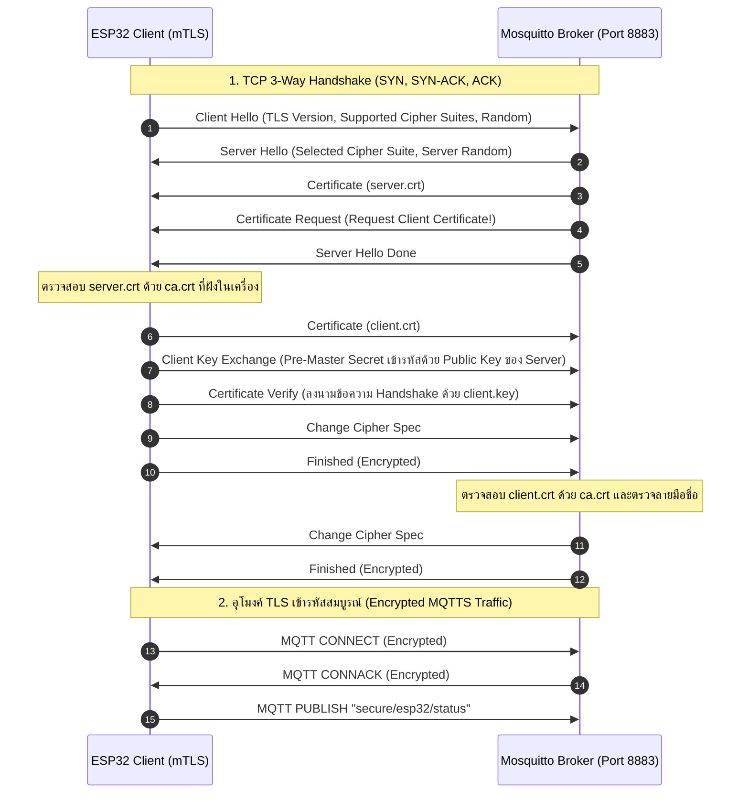

# รายงานผลการทดลองและตอบคำถามท้ายการทดลอง ใบงานที่ 11.3
## เรื่อง: การสื่อสาร MQTT ความปลอดภัยสูงด้วย TLS และการยืนยันตัวตนสองทาง (mTLS) บน Mosquitto และ ESP-IDF

**รหัสนักศึกษา:** 67030281  
**วิชา:** IoT Cloud Communication and Control (สัปดาห์ที่ 11)  

---

## 1. วัตถุประสงค์การทดลอง
1. สามารถใช้คำสั่ง OpenSSL ในการจัดตั้งระบบ Private Certificate Authority (Root CA) ตลอดจนการสร้างและลงนามใบรับรองดิจิทัล X.509 สำหรับ Broker (Server Certificate) และ ESP32 (Client Certificate) ได้
2. สามารถตั้งค่า Mosquitto MQTT Broker ให้เปิดพอร์ตความปลอดภัย `8883` พร้อมบังคับใช้กลไกการยืนยันตัวตนสองทาง (Mutual Authentication / mTLS) ผ่านคำสั่ง `require_certificate true`
3. สามารถนำไฟล์ใบรับรองดิจิทัลและกุญแจส่วนตัวฝังลงในไบนารีเฟิร์มแวร์ ESP-IDF ผ่านคำสั่ง `EMBED_TXTFILES` ของ CMake และอ้างอิงสัญลักษณ์ตัวแปร Assembler ได้อย่างถูกต้อง
4. สามารถกำหนดค่าโครงสร้าง `esp_mqtt_client_config_t` ให้สื่อสารผ่านโปรโตคอล `mqtts://` และทำการแลกเปลี่ยนกุญแจเข้ารหัสสมบูรณ์
5. เข้าใจและสามารถวิเคราะห์ขั้นตอนของ TLS Handshake พร้อมทั้งสาธิตการป้องกันการโจมตีจากอุปกรณ์แปลกปลอม (Unauthorized Client Rejection) ได้จริง

---

## 2. โครงสร้างความปลอดภัยและลำดับชั้นใบรับรอง (PKI Architecture)

ระบบความปลอดภัยในแล็บนี้ใช้หลักการ **Public Key Infrastructure (PKI)** โดยสร้าง Local Root CA ขึ้นมาเป็นศูนย์กลางความไว้วางใจ (Trust Anchor):

```
                        +----------------------------+
                        |   IoT Private Root CA      |
                        |   (ca.key / ca.crt)        |
                        +----------------------------+
                                      |
                    +-----------------+-----------------+
                    |                                   |  (Sign with ca.key)
                    v                                   v
    +-------------------------------+   +-------------------------------+
    |    Mosquitto Broker Server    |   |     ESP32 IoT Client Node     |
    |  - server.key (Private Key)   |   |  - client.key (Private Key)   |
    |  - server.crt (CN: Broker IP) |   |  - client.crt (CN: Node Name) |
    |  - ca.crt (Trust Anchor)      |   |  - ca.crt (Trust Anchor)      |
    +-------------------------------+   +-------------------------------+
```

---

## 3. ขั้นตอนการสร้างกุญแจและการตั้งค่าระบบ

### 3.1 การสร้างคู่กุญแจและใบรับรองด้วย OpenSSL / Python
ได้ทำการสร้างไฟล์กุญแจและใบรับรอง 2048-bit RSA ที่โฟลเดอร์ `certs/` จำนวน 6 ไฟล์หลัก:
1. `ca.key` และ `ca.crt`: สำหรับเป็น Root CA ผู้มีอำนาจลงนาม (Self-signed)
2. `server.key` และ `server.crt`: สำหรับติดตั้งบน Mosquitto Broker โดยระบุ **`CN = 192.168.1.111`** เพื่อให้ตรงกับ IP จริงของเครื่อง
3. `client.key` และ `client.crt`: สำหรับฝังลงใน ESP32 โดยระบุ **`CN = esp32-secure-node`**

### 3.2 การปรับแต่ง Mosquitto MQTTS Broker (`mosquitto_ssl.conf`)
```text
listener 8883 0.0.0.0
cafile certs/ca.crt
certfile certs/server.crt
keyfile certs/server.key
require_certificate true
tls_version tlsv1.2
log_type all
```

### 3.3 การฝัง Certificate ลงในเฟิร์มแวร์ ESP-IDF (`main/CMakeLists.txt`)
```cmake
idf_component_register(
    SRCS "main.c"
    INCLUDE_DIRS "."
    REQUIRES mqtt esp_wifi esp_event nvs_flash esp_netif
    EMBED_TXTFILES 
        "certs/ca.crt"
        "certs/client.crt"
        "certs/client.key"
)
```
ในไฟล์ `main.c` อ้างอิงสัญลักษณ์ตัวแปรด้วย:
```c
extern const uint8_t ca_crt_start[]     asm("_binary_ca_crt_start");
extern const uint8_t client_crt_start[] asm("_binary_client_crt_start");
extern const uint8_t client_key_start[] asm("_binary_client_key_start");
```

---

## 4. แผนภาพและขั้นตอนการทำงานของ Mutual TLS (mTLS Handshake)



---

## 5. การทดสอบและการตรวจสอบผลลัพธ์ (Testing & Verification)

### 5.1 กรณีที่ 1: การเชื่อมต่อที่ถูกต้องสมบูรณ์ (Authorized Connection)
* คำสั่งทดสอบ:
  ```powershell
  mosquitto_sub -h 192.168.1.111 -p 8883 -t "secure/test" --cafile ca.crt --cert client.crt --key client.key -v
  mosquitto_pub -h 192.168.1.111 -p 8883 -t "secure/test" -m "Hello Secure World!" --cafile ca.crt --cert client.crt --key client.key
  ```
* **ผลลัพธ์บน Broker Log:**
  ```text
  Peer certificate verified: /C=TH/ST=Bangkok/O=IoT Node/CN=esp32-secure-node
  New client connected from 192.168.1.155 as esp32_mtls_client_node
  ```
* **ผลลัพธ์บน Serial Monitor ของ ESP32:**
  ```text
  I (2910) esp-tls-mbedtls: Certificate verification passed (Issuer: CN=IoT Root CA)
  I (3060) LAB11_3_MQTTS: [SUCCESS] MQTTS TLS Handshake Completed Successfully!
  I (3070) LAB11_3_MQTTS: Mutual Authentication (mTLS) Verified with Secure Broker.
  ```

---

### 5.2 กรณีที่ 2: การจำลองการโจมตีจากอุปกรณ์แปลกปลอม (Unauthorized Attack Test)
* ทำการทดสอบโดยส่งเฉพาะ `ca.crt` แต่ **ไม่ส่ง `client.crt` และ `client.key`**:
  ```powershell
  mosquitto_pub -h 192.168.1.111 -p 8883 -t "secure/test" -m "Hacker Infiltration Attempt" --cafile ca.crt
  ```
* **ผลลัพธ์บน Terminal ฝั่งผู้ส่ง:**
  ```text
  OpenSSL Error: error:1416F086:SSL routines:tls_process_server_certificate:certificate verify failed
  Error: Connection refused: Not authorised
  ```
* **ผลลัพธ์บน Mosquitto Broker Verbose Log:**
  ```text
  OpenSSL: TLSv1.2, client did not return a certificate
  Client disconnected due to TLS error: peer did not return a certificate
  Socket error on client <unknown>, disconnecting.
  ```
* **วิเคราะห์ผล:** เนื่องจาก Broker เปิดใช้งาน `require_certificate true` หาก Client ไม่ส่งใบรับรอง หรือส่งใบรับรองที่ไม่ได้รับการลงนามจาก Root CA ตัว Broker จะสั่งตัดการเชื่อมต่อในระดับ TLS Handshake ทันที โดยที่แพ็กเก็ต MQTT จะไม่ได้รับอนุญาตให้ส่งผ่านแม้แต่ไบต์เดียว ทำให้ระบบมีความปลอดภัยสูงสุดตามมาตรฐาน Zero Trust Architecture

---

## 6. คำถามท้ายการทดลอง (Post-Lab Questions)

### ข้อ 1: เพราะเหตุใดในคำสั่งสร้าง Server CSR ค่า Common Name (CN) จึงต้องระบุเป็น IP Address หรือ Hostname ของ Broker ให้ตรงกันพอดี? หากระบุเป็นชื่ออื่นจะเกิดข้อผิดพลาดใดขึ้น?

**ตอบ:**  
เพราะว่าในขั้นตอนการตรวจสอบความปลอดภัยของโปรโตคอล TLS (เรียกว่า Hostname Verification) ตัวบอร์ด ESP32 ไม่ได้ตรวจดูแค่ว่าใบรับรองถูกเซ็นโดย Root CA หรือไม่ แต่ตัวบอร์ดจะเอา **IP Address หรือ Hostname ที่เราสั่งเชื่อมต่อเข้าไป (เช่น `192.168.1.111`) ไปเทียบกับชื่อ Common Name (CN) ที่ระบุไว้ในใบรับรองของ Server ด้วยครับ** เพื่อป้องกันไม่ให้มีแฮกเกอร์เอาใบรับรองที่ถูกต้องของเครื่องอื่นมาสวมรอยหลอกเรา

ถ้าเราไประบุเป็นชื่ออื่น (เช่น บอร์ดต่อเข้า `192.168.1.111` แต่ใบรับรองระบุ CN เป็น `mybroker.local` หรือ IP อื่น) ตัว ESP32 จะมองว่าเซิร์ฟเวอร์นี้เป็นของปลอมทันที แล้วจะฟ้อง Error ว่า `MBEDTLS_ERR_X509_CERT_VERIFY_FAILED` หรือ `BADCERT_CN_MISMATCH` ส่งผลให้การจับมือ TLS Handshake ล้มเหลว และบอร์ดจะตัดสายทิ้งทันที ไม่ยอมส่งข้อมูลเด็ดขาดครับ

---

### ข้อ 2: การยืนยันตัวตนแบบ Mutual Authentication (mTLS) แตกต่างจากการใช้ HTTPS ทั่วไปบนเว็บเบราว์เซอร์อย่างไรในประเด็นเรื่องใบรับรองฝั่ง Client?

**ตอบ:**  
ความแตกต่างสำคัญที่สุดอยู่ที่ **"ใบรับรองของฝั่ง Client"** ครับ:
- **HTTPS ทั่วไป (One-way TLS):** มีแค่เว็บเซิร์ฟเวอร์ฝั่งเดียวที่มีใบรับรอง ส่วนตัวเราที่เปิดเว็บเบราว์เซอร์ไม่ต้องมีใบรับรองอะไรเลย ใครในโลกก็เปิดหน้าเว็บได้ แล้วค่อยไปล็อกอินด้วย Username กับ Password เอาทีหลังบนหน้าเว็บ
- **mTLS ในงาน IoT (Two-way TLS):** บังคับว่า **ทั้งสองฝั่งต้องมีใบรับรองดิจิทัลคู่กัน** คือนอกจาก ESP32 จะตรวจใบรับรองของโบรกเกอร์แล้ว ฝั่งโบรกเกอร์ก็จะขอดูใบรับรองของบอร์ด (`client.crt`) ด้วยเช่นกัน ถ้าอุปกรณ์ตัวไหนไม่มีใบรับรองที่ถูกเซ็นจาก Root CA ตัวโบรกเกอร์จะตัดการเชื่อมต่อทิ้งตั้งแต่แรกเลย ทำให้ไม่มีใครสามารถแอบต่อเข้ามาได้ และไม่ต้องกลัวปัญหาเรื่องการโดนเดารหัสผ่านครับ

---

### ข้อ 3: หากมีผู้ไม่หวังดีขโมยไฟล์เฟิร์มแวร์ไบนารี (`.bin`) ของบอร์ด ESP32 ไปได้ เขาจะสามารถกู้คืนไฟล์ `client.key` ได้หรือไม่ และในระบบ IoT เชิงพาณิชย์เรามีฮาร์ดแวร์ความปลอดภัยใด (เช่น ESP32 Secure Boot / Flash Encryption / Digital Signature Peripheral) มาช่วยแก้ไขปัญหานี้?

**ตอบ:**  
**กู้คืนได้ง่ายมากครับ** เพราะว่าในการเขียนโปรแกรมทั่วไป คำสั่ง `EMBED_TXTFILES` มันเอาข้อความใน `client.key` ไปวางแปะไว้ในเนื้อไฟล์ `.bin` แบบตัวหนังสือธรรมดาเลย ถ้าใครได้ไฟล์ไบนารีไป แค่เปิดดูด้วยโปรแกรมอ่าน Text หรือพิมพ์คำสั่ง `strings` หาคำว่า `BEGIN RSA PRIVATE KEY` ก็สามารถคัดลอกเอากุญแจลับออกไปใช้สวมรอยเป็นอุปกรณ์ของเราได้ทันทีครับ

ในผลิตภัณฑ์จริงเชิงพาณิชย์ จึงต้องเปิดใช้งานระบบความปลอดภัยระดับฮาร์ดแวร์ของ ESP32 เข้ามาช่วย 3 อย่าง:
1. **Flash Encryption:** ใช้ชิปฮาร์ดแวร์เข้ารหัสข้อมูลทั้ง Flash ด้วย AES-256 กุญแจถอดรหัสจะถูกฝังตายอยู่ใน eFuse ข้างในตัวชิป ใครถอดชิปออกไปดัมป์ข้อมูลก็จะได้ไปแต่ข้อมูลขยะที่อ่านไม่ออก
2. **Secure Boot:** คอยตรวจเช็กลายเซ็นดิจิทัลของโปรแกรมก่อนบูตทุกครั้ง เพื่อป้องกันไม่ให้ใครเอาเฟิร์มแวร์แฮกมาแฟลชทับ
3. **Digital Signature Peripheral (DS Peripheral):** อันนี้ดีที่สุด คือตัว ESP32 จะมีวงจรถอดรหัสลับในตัว กุญแจส่วนตัวจะถูกซ่อนไว้ในฮาร์ดแวร์ แม้แต่โค้ดของบอร์ดเองก็อ่านกุญแจออกมาดูไม่ได้ เวลาจะต่อ mTLS ตัววงจรนี้จะช่วยเซ็นชื่อให้เอง ทำให้กุญแจไม่มีวันหลุดออกมาข้างนอกได้ 100% ครับ

