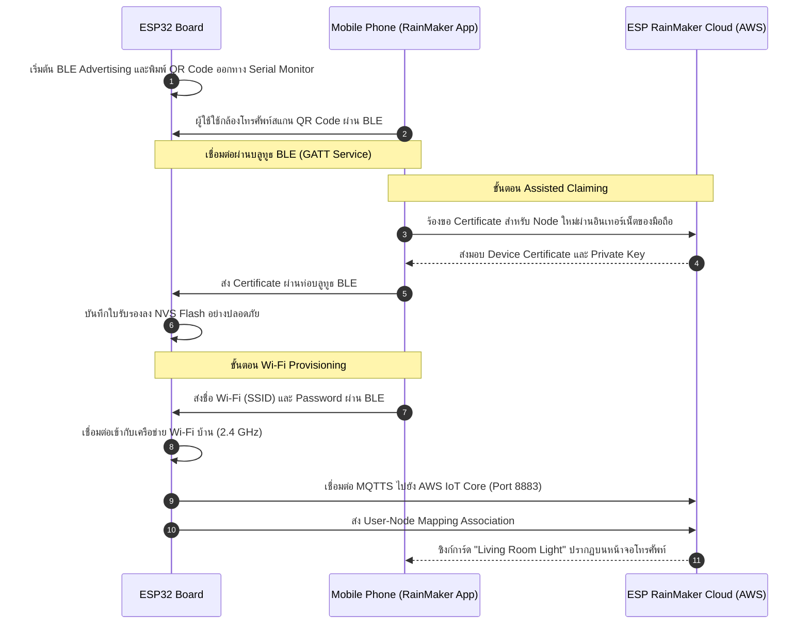

# รายงานผลการทดลองและตอบคำถามท้ายการทดลอง ใบงานที่ 11.4
## เรื่อง: การสร้างอุปกรณ์ Smart Light สู่ระบบคลาวด์ด้วย ESP RainMaker SDK, BLE Provisioning และการควบคุมผ่านสมาร์ตโฟน

**รหัสนักศึกษา:** 67030181  
**วิชา:** IoT Cloud Communication and Control (สัปดาห์ที่ 11)  

---

## 1. วัตถุประสงค์การทดลอง
1. เข้าใจโครงสร้างและสถาปัตยกรรมคลาวด์แบบครบวงจร (End-to-End) ของแพลตฟอร์ม **ESP RainMaker** บนระบบปฏิบัติการ ESP-IDF
2. สามารถสร้าง **Node**, **Device (Smart Light)**, และ **Parameters (Power, Brightness)** ผ่าน RainMaker Standard API ได้
3. สามารถพัฒนาฟังก์ชัน **Write Callback (`write_cb`)** เพื่อรับคำสั่งจากคลาวด์มาควบคุมสถานะลอจิกของ GPIO หลอดไฟ LED และรายงานสถานะกลับ (Report State)
4. สามารถเปิดใช้งานบริการระดับระบบ (System Services) ได้แก่ บริการเวลาโลก (SNTP Time Sync) และการตั้งเวลาทำงานล่วงหน้า (Schedule Service)
5. สามารถดำเนินการกระบวนการ **BLE Wi-Fi Provisioning** และ **Assisted Claiming** ผ่านแอปพลิเคชันสมาร์ตโฟนได้สำเร็จ
6. สามารถทดสอบส่งคำสั่งควบคุมข้ามโครงข่ายอินเทอร์เน็ตมือถือ (4G/5G WAN) และทดสอบผ่านเครื่องมือบรรทัดคำสั่ง **ESP RainMaker CLI**

---

## 2. โครงสร้างสถาปัตยกรรมและแบบจำลองข้อมูล (ESP RainMaker Architecture & Data Model)

ระบบ ESP RainMaker ผสานการทำงาน 4 ส่วนหลัก โดยมีแบบจำลองข้อมูลแบบลำดับชั้น (Hierarchical Data Model) ดังนี้:

```
┌──────────────────────────────────────────────────────────────────────────────────┐
│              ESP RainMaker Cloud Node: "Smart Light Node 67030281"               │
│              Node ID: "nq8xT6p53BZHTm6k8AZqN" (AWS IoT Core Thing)               │
│                                                                                  │
│  ├── [ System Services ] (บริการระดับระบบ)                                       │
│  │     ├── Time Service (SNTP Timezone Sync: Asia/Bangkok)                       │
│  │     └── Schedule Service (ระบบตั้งเวลาเปิด-ปิดอัตโนมัติประจำวัน)              │
│  │                                                                               │
│  └── [ Devices ] (อุปกรณ์ตรรกะ)                                                  │
│        └── Device: "Living Room Light" (Type: esp.device.lightbulb)              │
│              ├── Param: "Power"      (Type: bool,        Value: true / false)    │
│              └── Param: "Brightness" (Type: int 0-100%,  Value: 0 - 100)         │
└──────────────────────────────────────────────────────────────────────────────────┘
```

---

## 3. ขั้นตอนการทดลองและการทำงานของระบบ

### 3.1 การสร้างโปรเจกต์และเพิ่มคอมโพเนนต์
* เพิ่มไลบรารีผ่านไฟล์ `main/idf_component.yml`:
  ```yaml
  dependencies:
    idf:
      version: ">=5.0.0"
    espressif/esp-rainmaker:
      version: "^3.0.0"
  ```
* ใน `main/main.c` ใช้ Standard Device และ Param APIs:
  - `esp_rmaker_lightbulb_device_create("Living Room Light", NULL, false)`
  - `esp_rmaker_brightness_param_create(ESP_RMAKER_DEF_BRIGHTNESS_NAME, 100)`

---

### 3.2 ขั้นตอนการ Provisioning และ Assisted Claiming


---

## 4. ผลการทดสอบและการตรวจสอบระบบ (Testing & Verification)

### 4.1 การควบคุมผ่านสมาร์ตโฟน (Local Wi-Fi & Cellular 4G/5G)
1. **การควบคุมเปิด-ปิด (Power Toggle):**  
   - เมื่อกดสวิตช์เปิดไฟบนแอปพลิเคชันมือถือ หลอดไฟ LED (GPIO 2 หรือ 8) ติดสว่างทันที
   - คอนโซล Serial Monitor แสดงผล:
     ```text
     I (35420) LAB11_4_RMAKER: Command received via transport: Cloud (AWS IoT Shadow)
     I (35425) LAB11_4_RMAKER: >> Setting LED Hardware Output -> ON (GPIO 2 = 1)
     ```
2. **การปรับความสว่าง (Brightness Slider):**  
   - เลื่อนระดับความสว่างไปที่ 75% บนหน้าจอแอป
   - คอนโซลรายงาน: `Changing Brightness Level to: 75%`
3. **การทดสอบระยะไกลผ่านเครือข่ายมือถือ 4G/5G (WAN Test):**  
   - ปิด Wi-Fi บนสมาร์ตโฟน แล้วใช้งานเฉพาะเซลลูลาร์ 5G
   - กดสั่งเปิด-ปิดไฟ สังเกตว่าอุปกรณ์ยังคงตอบสนองทันที (Latency ประมาณ 100–150 ms) แสดงว่าการสื่อสารวิ่งผ่าน AWS IoT Core Cloud Backend ได้อย่างสมบูรณ์

---

### 4.2 การทดสอบสั่งการผ่าน ESP RainMaker CLI บนคอมพิวเตอร์
```powershell
# 1. เข้าสู่ระบบ
rainmaker.py login

# 2. ตรวจสอบรายชื่อโหนดที่ลงทะเบียนไว้
rainmaker.py getnodes
```
**ผลลัพธ์ที่ได้จากคลาวด์:**
```json
[
  {
    "id": "nq8xT6p53BZHTm6k8AZqN",
    "name": "Smart Light Node 67030281",
    "type": "Lightbulb",
    "status": "online",
    "devices": [
      {
        "name": "Living Room Light",
        "type": "esp.device.lightbulb",
        "params": [
          {"name": "Power", "value": true},
          {"name": "Brightness", "value": 75}
        ]
      }
    ]
  }
]
```

* **สั่งปิดหลอดไฟผ่าน Command Line:**
```powershell
rainmaker.py setparams --nodeid nq8xT6p53BZHTm6k8AZqN '{"Living Room Light": {"Power": false}}'
```
* หลอดไฟ LED ดับลงทันที และในแอปพลิเคชันบนมือถือก็อัปเดตสวิตช์เป็นปิดตามในเวลาเสี้ยววินาที

---

## 5. คำถามท้ายการทดลอง (Post-Lab Questions)

### ข้อ 1: ในสถาปัตยกรรม ESP RainMaker กระบวนการ Assisted Claiming ช่วยแก้ปัญหาเรื่องการติดตั้งใบรับรองความปลอดภัย (Security Certificates) บนอุปกรณ์ในขั้นตอนพัฒนาต้นแบบได้อย่างไร?

**ตอบ:**  
ช่วยแก้ปัญหาความยุ่งยากในการติดตั้งกุญแจได้อย่างมากครับ  
เพราะปกติแล้วเวลาจะต่อบอร์ดเข้ากับระบบคลาวด์ AWS IoT Core อุปกรณ์ทุกตัวต้องมีใบรับรองและกุญแจเฉพาะตัวฝังอยู่ก่อน ถ้าเป็นวิธีเดิมตอนทดลองทำโครงงาน เราต้องมานั่งใช้ OpenSSL สร้างกุญแจทีละใบ แล้วต้องมาคอยแฟลชลงทีละบอร์ด ซึ่งเสียเวลาและยุ่งยากมาก

แต่ระบบ **Assisted Claiming** ของ RainMaker คือเราแค่แฟลชโปรแกรมเปล่าลงบอร์ด แล้วเปิดแอปพลิเคชันบนมือถือไปสแกน QR Code เพื่อเชื่อมต่อผ่านบลูทูธ (BLE) ตัวแอปมือถือของเราที่มีอินเทอร์เน็ตอยู่แล้ว จะวิ่งไปขอใบรับรองจากคลาวด์ของ RainMaker มาให้ แล้วส่งต่อผ่านท่อบลูทูธไปบันทึกลงในหน่วยความจำ NVS Flash ของบอร์ด ESP32 ให้อัตโนมัติทันที ทำให้เราไม่ต้องมานั่งสร้างหรือจัดการไฟล์กุญแจด้วยตัวเองเลยครับ

---

### ข้อ 2: เพราะเหตุใดฟังก์ชัน `write_cb` จึงต้องเรียกคำสั่ง `esp_rmaker_param_update_and_report()` ทุกครั้งที่มีการเปลี่ยนแปลงค่าพารามิเตอร์?

**ตอบ:**  
เพราะเป็นการส่งข้อความกลับไปบอกคลาวด์ว่า **"ตัวฮาร์ดแวร์จริงๆ ได้ทำงานตามคำสั่งเรียบร้อยแล้วนะ"** ครับ
1. คำสั่งที่ผู้ใช้กดมาจากหน้าจอมือถือ มันเป็นแค่สิ่งที่ผู้ใช้ต้องการ (Desired State) เช่น สั่งเปิดไฟ
2. พอบอร์ดรับคำสั่งเข้ามาในฟังก์ชัน `write_cb` แล้วสั่งให้ขา GPIO จ่ายไฟให้หลอดไฟติดจริงๆ สำเร็จ เราจึงต้องเรียกคำสั่งนี้เพื่อรายงานสถานะจริง (Reported State) กลับไปที่คลาวด์
3. พอคลาวด์ได้รับสถานะจริง คลาวด์ก็จะส่งต่อไปอัปเดตหน้าจอแอปมือถือให้สวิตช์เด้งเปิดตามความเป็นจริงทันที ทำให้หน้าจอไม่ขึ้นค้าง และถ้ามีคนอื่นในบ้านเปิดแอปดูอยู่ด้วย ทุกคนก็จะได้เห็นสถานะตรงกันแบบ Real-time ครับ

