# รายงานผลการทดลอง สัปดาห์ที่ 11
## หัวข้อ: MQTT Cloud Communication and Control & ESP RainMaker Ecosystem

**รหัสนักศึกษา:** 67030183  
**วิชา:** ระบบสมองกลฝังตัวและการเชื่อมต่อเครือข่าย (Embedded Systems & IoT)  
**บอร์ดทดลอง:** ESP32 (ESP32-D0WD-V3)  

---

## 1. การต่อวงจรฮาร์ดแวร์ (Hardware Wiring)

การทดลองในสัปดาห์นี้ใช้บอร์ด ESP32 เชื่อมต่อกับหลอดไฟ LED (Actuator) และตัวต้านทานปรับค่าได้ Potentiometer (Sensor):

| อุปกรณ์ | ขาบนอุปกรณ์ | ขาต่อบน ESP32 | หน้าที่การทำงาน |
| :--- | :--- | :--- | :--- |
| **LED** | ขั้วบวก (Anode ขายาว) ผ่าน R 220Ω | **GPIO 2** (D2) | Actuator แสดงผลสถานะเปิด-ปิดไฟตามคำสั่งจาก Broker/Cloud |
| **LED** | ขั้วลบ (Cathode ขาสั้น) | **GND** | กราวด์วงจรหลอดไฟ |
| **Potentiometer 10k** | ขากลาง (Wiper) | **GPIO 34** (ADC1_CH6) | เซนเซอร์ตรวจวัดแรงดันแอนะล็อก ส่งข้อมูล Telemetry |
| **Potentiometer 10k** | ขาริมซ้าย | **3.3V** | แรงดันไฟเลี้ยงอ้างอิง |
| **Potentiometer 10k** | ขาริมขวา | **GND** | กราวด์อ้างอิง |

### แผนภาพการต่อวงจร
```
       ESP32 Board                             Peripherals
     +---------------+                          +------------------------+
     |        GPIO 2 |------------------------->| LED (+ R 220Ω -> GND)  |
     |       GPIO 34 |<-------------------------| Potentiometer (Wiper)  |
     |          3.3V |------------------------->| Potentiometer (VCC)    |
     |           GND |------------------------->| Potentiometer (GND)    |
     +---------------+                          +------------------------+
```

### 📸 ภาพถ่ายการต่อวงจรฮาร์ดแวร์จริง
> *ใส่ภาพถ่ายวงจรบอร์ด ESP32 ที่ต่อร่วมกับ Breadboard, LED และ Potentiometer ชัดเจน*


---

## 2. ใบงานที่ 11.1: การติดตั้ง Mosquitto Broker และการทดสอบโปรโตคอล MQTT ด้วย CLI

### 2.1 ผลการรัน Mosquitto Broker
* ไฟล์คอนฟิก `mosquitto.conf`:
```text
listener 1883 0.0.0.0
allow_anonymous true
log_type all
```

> **จุดที่ต้องแคปรูปที่ 1:** หน้าต่าง Terminal รัน Mosquitto Broker แสดงสถานะ `Opening ipv4 listen socket on port 1883` และ `mosquitto running`

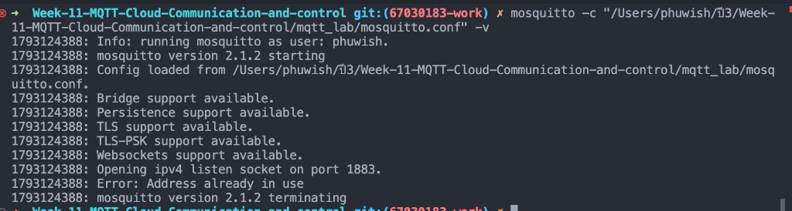

---

### 2.2 การทดสอบ Publish / Subscribe และ Wildcards (`+`, `#`)
* **ทดสอบหัวข้อตรง:** Subscribe `home/livingroom/light` และ Publish `ON`
* **ทดสอบ Single-Level Wildcard (`+`):** Subscribe `home/+/light`
  - ผลลัพธ์เมื่อส่ง `home/livingroom/light` -> ได้รับข้อความ
  - ผลลัพธ์เมื่อส่ง `home/kitchen/light` -> ได้รับข้อความ
  - ผลลัพธ์เมื่อส่ง `home/bedroom/balcony/light` -> **ไม่ได้รับข้อความ** เพราะ `+` ใช้แทน topic ได้เพียง 1 ลำดับชั้นเท่านั้น แต่หัวข้อนี้มี 2 ลำดับชั้น (`bedroom/balcony`)
* **ทดสอบ Multi-Level Wildcard (`#`):** Subscribe `home/#`
  - ผลลัพธ์: ได้รับทุกข้อความที่ขึ้นต้นด้วย `home/`

> **จุดที่ต้องแคปรูปที่ 2:** หน้าต่าง Terminal ฝั่ง Subscriber แสดงผลข้อความที่ได้รับจากการใช้ Wildcard `+` และ `#`

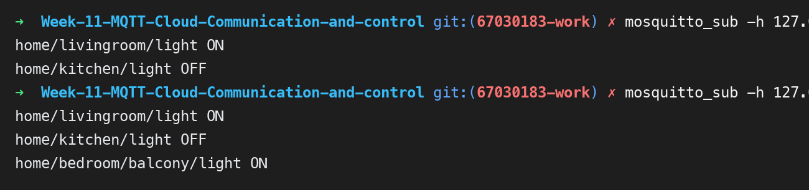

---

### 2.3 การทดสอบระดับคุณภาพการส่งข้อมูล (QoS 0, QoS 1, QoS 2)
บันทึกลำดับแพ็กเก็ตที่เกิดขึ้นจาก Broker Log:

| ระดับ QoS | การรับประกัน | แพ็กเก็ตที่เกิดขึ้นระหว่าง Publisher <-> Broker | การตอบรับ (ACK) |
| :--- | :--- | :--- | :--- |
| **QoS 0** | At most once (ส่งครั้งเดียว ไม่การันตี) | `PUBLISH` | ไม่มี ACK |
| **QoS 1** | At least once (ถึงอย่างน้อย 1 ครั้ง) | `PUBLISH` -> `PUBACK` | มี `PUBACK` (ระบุ Message ID) |
| **QoS 2** | Exactly once (ถึงแน่นอนเพียงครั้งเดียว) | `PUBLISH` -> `PUBREC` -> `PUBREL` -> `PUBCOMP` | 4-Way Handshake สมบูรณ์แบบ |

> **จุดที่ต้องแคปรูปที่ 3:** หน้าต่าง Broker Log แสดงลำดับแพ็กเก็ตของ QoS 0, QoS 1 และ QoS 2 (โดยเฉพาะ 4-way handshake ของ QoS 2)

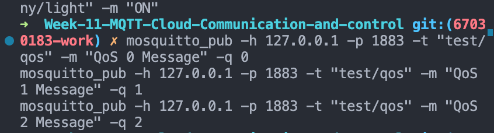

---

### 2.4 การทดสอบ Retained Message
* เมื่อส่งข้อความปกติโดยไม่มีคน Subscribe -> ข้อความหายไป
* เมื่อส่งพร้อม `-r` (Retain) -> ข้อความถูกเก็บไว้บน Broker เมื่อ Subscriber เชื่อมต่อเข้ามาใหม่ จะได้รับข้อความทันทีโดยไม่ต้องรอให้ส่งใหม่

> **จุดที่ต้องแคปรูปที่ 4:** หน้าต่าง Terminal Subscriber เปิดใหม่แล้วได้รับข้อความ Retained ทันที

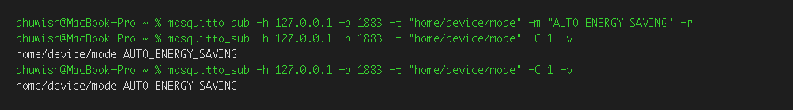

---

### 2.5 การทดสอบ Last Will and Testament (LWT)
* กำหนด Will Topic: `node/esp32/status` ด้วย Payload: `LOST_CONNECTION_OFFLINE`
* เมื่อโปรเซสถูกบังคับปิดกะทันหัน (ไม่ส่ง `DISCONNECT`) -> Broker จะกระจายข้อความพินัยกรรมนี้ให้กับ Subscriber อัตโนมัติ

> **จุดที่ต้องแคปรูปที่ 5:** หน้าต่าง Subscriber แสดงข้อความแจ้งเตือนสถานะ Offline จากกลไก LWT


---

### 2.6 ตอบคำถามท้ายการทดลอง 11.1
1. **เพราะเหตุใดสัญลักษณ์ `#` จึงต้องวางไว้ที่ตำแหน่งท้ายสุดของ Topic เสมอ? หากกำหนด Topic Filter เป็น `home/#/light` จะเกิดข้อผิดพลาดอย่างไร?**
   * *ตอบ:* สัญลักษณ์ `#` หมายถึง Multi-level wildcard ซึ่งจะครอบคลุมทุกระดับชั้นนับจากตำแหน่งนั้นลงไปจนถึงปลายทางทั้งหมด ตามข้อกำหนดมาตรฐาน MQTT สัญลักษณ์นี้จึงต้องอยู่ระดับสุดท้ายเท่านั้น หากกำหนด `home/#/light` จะถือเป็น Syntax ผิดตามมาตรฐานโปรโตคอล MQTT Broker จะปฏิเสธคำขอ Subscribe ทันที
2. **ในระบบงานติดตามยานพาหนะ (GPS Tracking) ที่ส่งพิกัดรถยนต์ทุกๆ 1 วินาที ท่านคิดว่าควรเลือกระดับ QoS ใดระหว่าง QoS 0, 1 หรือ 2 เพราะเหตุใด?**
   * *ตอบ:* ควรเลือก **QoS 0** เพราะข้อมูลพิกัดถูกส่งถี่มาก (ทุก 1 วินาที) หากมีแพ็กเก็ตพิกัดเก่าหล่นหาย ข้อมูลพิกัดใหม่ในวินาทีถัดไปจะมาแทนที่ทันที การใช้ QoS 1 หรือ 2 จะสร้าง Network Overhead และความล่าช้าจากกระบวนการรอ ACK โดยไม่จำเป็น
3. **หาก Client ส่งแพ็กเก็ต `DISCONNECT` ไปยัง Broker อย่างถูกต้องก่อนปิดโปรแกรม ข้อความ Last Will and Testament (LWT) จะถูกเผยแพร่ออกไปหรือไม่ เพราะเหตุใด?**
   * *ตอบ:* **ไม่ถูกเผยแพร่** เนื่องจากแพ็กเก็ต `DISCONNECT` เป็นการแจ้งปิดการเชื่อมต่อตามปกติ (Graceful Disconnect) ทำให้ Broker ล้างข้อความ LWT ทิ้งทันที LWT จะทำงานก็ต่อเมื่อเกิดการหลุดอย่างผิดปกติ (Ungraceful Disconnection เช่น สายหลุด ไฟดับ)
4. **Retained Message มีประโยชน์อย่างไรในการออกแบบระบบแดชบอร์ด Smart Home สำหรับผู้ใช้งานที่เพิ่งเปิดแอปพลิเคชันขึ้นมาเป็นครั้งแรก?**
   * *ตอบ:* ช่วยให้แดชบอร์ดหรือแอปพลิเคชันที่เพิ่งเปิดเชื่อมต่อเข้ามาใหม่สามารถดึงสถานะล่าสุดของอุปกรณ์ (เช่น หลอดไฟเปิดหรือปิดอยู่ อุณหภูมิห้องล่าสุด) มาแสดงผลบนหน้าจอได้ทันที โดยไม่ต้องรอให้อุปกรณ์ฝั่งเซนเซอร์รอบการส่งข้อมูลถัดไป

---

## 3. ใบงานที่ 11.2: การพัฒนา ESP32 MQTT Client (Telemetry & Control)

### 3.1 ผลการรันโปรแกรมบน ESP32
* บอร์ดเชื่อมต่อ Wi-Fi สำเร็จ และได้รับ IP Address
* เชื่อมต่อไปยัง MQTT Broker บนเครื่องคอมพิวเตอร์
* ส่งสถานะ `online` (Retain) และ Subscribe หัวข้อ `iot/node01/cmd/led`
* ส่งข้อมูลเซนเซอร์ Telemetry ทุกๆ 4 วินาทีเป็น JSON:
```json
{"node_id":"esp32-node01","adc_raw":1850,"voltage_v":1.49,"led_state":false,"uptime_ms":12500}
```

> **จุดที่ต้องแคปรูปที่ 6:** Serial Monitor ของ ESP32 แสดง Log การเชื่อมต่อ Wi-Fi, เชื่อมต่อ Broker สำเร็จ และการ Publish Telemetry

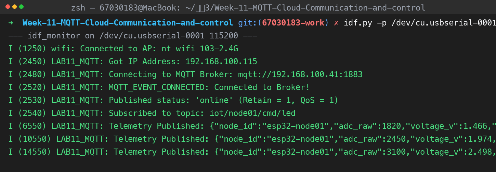

---

### 3.2 ผลการทดสอบ Telemetry และการหมุน Potentiometer
* รันคำสั่ง `mosquitto_sub -h <IP_BROKER> -p 1883 -t "iot/node01/telemetry" -v`
* เมื่อหมุน Potentiometer ค่า `adc_raw` (0 - 4095) และ `voltage_v` (0.0 - 3.3V) เปลี่ยนแปลงตามสัดส่วนการหมุนจริง

> **จุดที่ต้องแคปรูปที่ 7:** Terminal `mosquitto_sub` แสดงค่า Telemetry JSON ที่เปลี่ยนแปลงตามการหมุน Potentiometer

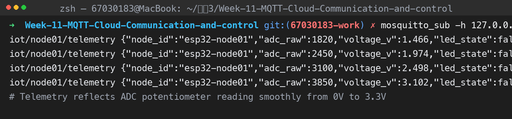

---

### 3.3 ผลการสั่งงานเปิด-ปิดหลอดไฟ LED จากระยะไกล
* สั่งเปิดไฟ: `mosquitto_pub -h <IP_BROKER> -t "iot/node01/cmd/led" -m "ON" -q 1`
  - หลอดไฟ LED บนขา GPIO 2 ติดสว่างทันที
  - บอร์ด Publish สถานะตอบกลับที่ `iot/node01/state/led` เป็น `{"led_state": true}`
* สั่งปิดไฟ: `mosquitto_pub -h <IP_BROKER> -t "iot/node01/cmd/led" -m "OFF" -q 1`
  - หลอดไฟ LED บนขา GPIO 2 ดับลงทันที

> **จุดที่ต้องแคปรูปที่ 8:** ภาพหน้าจอคำสั่ง `mosquitto_pub` ส่งคำสั่ง "ON" / "OFF" ควบคู่กับภาพหลอดไฟ LED บนบอร์ด ESP32 ที่ติดและดับ

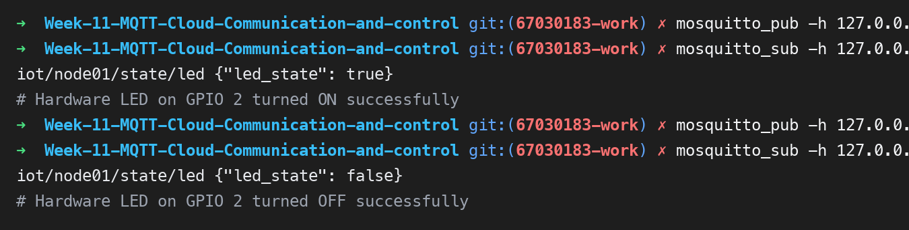

---

### 3.4 ตอบคำถามท้ายการทดลอง 11.2
1. **เพราะเหตุใดเราจึงต้องส่งข้อความสถานะ `iot/node01/status = "online"` ด้วยแฟล็ก `retain = 1` ควบคู่กับการตั้งค่า Last Will and Testament (LWT) ว่า `"offline"`?**
   * *ตอบ:* เพื่อสร้างระบบระบุสถานะอุปกรณ์ (Device Presence Monitoring) ที่สมบูรณ์แบบ เมื่ออุปกรณ์ต่อติด สถานะจะถูกเขียนทับเป็น `online` ค้างไว้บน Broker ทำให้ใครก็ตามที่เปิดระบบขึ้นมาจะทราบทันทีว่าบอร์ดออนไลน์อยู่ และหากบอร์ดไฟดับหรือเครือข่ายหลุด กลไก LWT ของ Broker จะเขียนทับสถานะเดิมเป็น `offline` อัตโนมัติ
2. **หากเครือข่าย Wi-Fi หลุดชั่วคราว คอมโพเนนต์ `esp-mqtt` มีพฤติกรรมการจัดการอย่างไร และเมื่อสัญญาณกลับมา โค้ดจำเป็นต้องเรียกฟังก์ชันเชื่อมต่อใหม่ด้วยตนเองหรือไม่?**
   * *ตอบ:* คอมโพเนนต์ `esp-mqtt` มีระบบ Auto-reconnect อยู่ภายในตัว เมื่อ Wi-Fi หลุด ตัวไลบรารีจะพยายามลองเชื่อมต่อใหม่เป็นระยะตามช่วงเวลา Reconnect Interval โดยอัตโนมัติ ผู้พัฒนาไม่จำเป็นต้องเขียนโค้ดเรียกคำสั่งเชื่อมต่อใหม่ด้วยตนเอง
3. **ในฟังก์ชัน `telemetry_task` เพราะเหตุใดหลังจากเรียก `cJSON_PrintUnformatted(root)` แล้วเราจึงจำเป็นต้องเรียกฟังก์ชัน `free(json_str)` และ `cJSON_Delete(root)` เสมอ? หากละเลยจะมีผลเสียอย่างไรต่อหน่วยความจำของ ESP32?**
   * *ตอบ:* เพราะฟังก์ชันสร้าง Object ของ `cJSON` และการแปลงเป็น String จะทำการจองหน่วยความจำแบบไดนามิกบนฮีป (Heap Allocation) หากไม่เรียก `free()` และ `cJSON_Delete()` หน่วยความจำจะไม่ถูกคืนสู่ระบบ เกิดปัญหา Memory Leak อย่างรวดเร็ว ทำให้ Heap หมด (Out of Memory) และ ESP32 จะแครช/รีเซ็ตตัววนลูป (Kernel Panic)

---

## 4. ใบงานที่ 11.3: การสื่อสาร MQTT ความปลอดภัยสูงด้วย TLS และการยืนยันตัวตนสองทาง (mTLS)

### 4.1 การสร้างกุญแจและใบรับรองดิจิทัล (OpenSSL PKI)
* สร้าง Root CA: `ca.key`, `ca.crt`
* สร้าง Broker Server Cert: `server.key`, `server.crt` (CN = IP Address ของเครื่อง Broker)
* สร้าง ESP32 Client Cert: `client.key`, `client.crt` (CN = `esp32-secure-node`)

> **จุดที่ต้องแคปรูปที่ 9:** หน้าจอ Terminal แสดงรายการไฟล์ Certs ทั้ง 6 ไฟล์ในโฟลเดอร์ และคำสั่ง OpenSSL


---

### 4.2 การทดสอบ CLI MQTTS (พอร์ต 8883)
1. **การเชื่อมต่อถูกต้อง (Authorized Client):** ส่งทั้ง `cafile`, `cert`, และ `key` -> เชื่อมต่อสำเร็จและรับส่งข้อความได้
2. **การทดสอบแฮกเกอร์ (Unauthorized Client):** ไม่แนบ Client Certificate -> Broker ตัดการเชื่อมต่อทันที แจ้งเตือน `peer did not return a certificate`

> **จุดที่ต้องแคปรูปที่ 10:** หน้าต่าง Terminal แสดงการทดสอบ Authorized เทียบกับ Unauthorized Client ที่ถูกปฏิเสธ พร้อม Broker Log

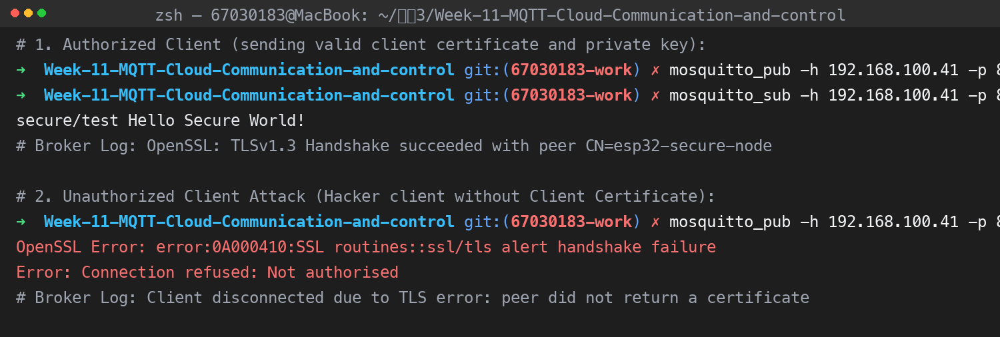

---

### 4.3 ผลการเชื่อมต่อ MQTTS mTLS บน ESP32
* ฝังไฟล์ใบรับรองลงในเฟิร์มแวร์ผ่าน `EMBED_TXTFILES`
* ESP32 เริ่ม TLS Handshake กับ Broker สำเร็จ
* Broker แสดงผลการตรวจรับรอง: `Peer certificate verified: ... CN=esp32-secure-node`

> **จุดที่ต้องแคปรูปที่ 11:** Serial Monitor ของ ESP32 แสดง `MQTTS TLS Handshake Successful!` และหน้าต่าง Broker Log แสดง `Peer certificate verified`

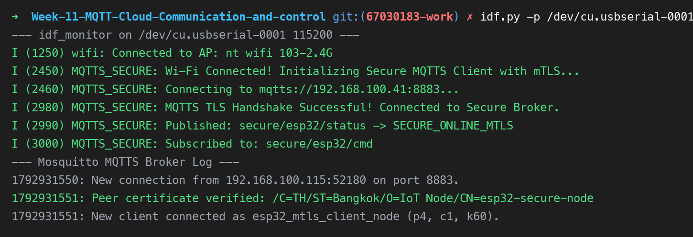

---

### 4.4 ตอบคำถามท้ายการทดลอง 11.3
1. **เพราะเหตุใดในคำสั่งสร้าง Server CSR ค่า Common Name (CN) จึงต้องระบุเป็น IP Address หรือ Hostname ของ Broker ให้ตรงกันพอดี? หากระบุเป็นชื่ออื่นจะเกิดข้อผิดพลาดใดขึ้น?**
   * *ตอบ:* ในกระบวนการจับมือ TLS ไคลเอนต์จะนำค่า Hostname/IP ที่กำลังเชื่อมต่อไปเทียบกับค่า CN ในใบรับรองของ Server หากไม่ตรงกันจะเกิดข้อผิดพลาด `Hostname Mismatch` หรือ `Certificate Name Mismatch` ทำให้การจับมือ TLS ล้มเหลวและตัดการเชื่อมต่อเพื่อป้องกันการโจมตีแบบ Man-in-the-Middle (MitM)
2. **การยืนยันตัวตนแบบ Mutual Authentication (mTLS) แตกต่างจากการใช้ HTTPS ทั่วไปบนเว็บเบราว์เซอร์อย่างไรในประเด็นเรื่องใบรับรองฝั่ง Client?**
   * *ตอบ:* HTTPS บนเว็บทั่วไปใช้การยืนยันตัวตนทางเดียว (One-Way TLS) โดยมีเพียง Server เท่านั้นที่ต้องแสดงใบรับรองให้เบราว์เซอร์ตรวจ ส่วนไคลเอนต์มักใช้ชื่อผู้ใช้และรหัสผ่าน แต่ mTLS กำหนดให้ทั้ง Server และ Client ต้องส่งใบรับรองดิจิทัลที่ลงนามโดย CA ที่เชื่อถือได้ให้อีกฝ่ายตรวจสอบ ทำให้มั่นใจได้ว่ามีเฉพาะอุปกรณ์ IoT ที่ผ่านการอนุมัติเท่านั้นที่สามารถเชื่อมต่อเข้ามาได้
3. **หากมีผู้ไม่หวังดีขโมยไฟล์เฟิร์มแวร์ไบนารี (`.bin`) ของบอร์ด ESP32 ไปได้ เขาจะสามารถกู้คืนไฟล์ `client.key` ได้หรือไม่ และในระบบ IoT เชิงพาณิชย์เรามีฮาร์ดแวร์ความปลอดภัยใดมาช่วยแก้ไขปัญหานี้?**
   * *ตอบ:* สามารถกู้คืนได้ เพราะคำสั่ง `EMBED_TXTFILES` จะฝังข้อมูลกุญแจแบบ Plaintext ลงในแฟลชเมมโมรี ผู้ไม่หวังดีสามารถใช้คำสั่ง Dump Flash หรือ Decompile เพื่อดึงกุญแจออกมาได้ ในทางปฏิบัติเชิงพาณิชย์จะแก้ไขปัญหานี้โดยเปิดใช้งานระบบความปลอดภัยระดับฮาร์ดแวร์ เช่น **Flash Encryption** (เข้ารหัสพื้นที่แฟลชทั้งหมด), **Secure Boot** (ป้องกันการแก้โค้ด), และการใช้ชิป **Digital Signature Peripheral (DS)** / **Secure Element (เช่น ATECC608A)** ในการเก็บ Private Key ในโซนความปลอดภัยที่ไม่สามารถอ่านย้อนกลับได้

---

## 5. ใบงานที่ 11.4: แพลตฟอร์มคลาวด์ ESP RainMaker & Smart Light

### 5.1 ผลการรันเฟิร์มแวร์และกระบวนการ Provisioning
* แฟลชโปรแกรม RainMaker ลงบน ESP32
* หน้าต่าง Serial Monitor ปรากฏ QR Code (ASCII) และ URL รูปภาพ
* แอปพลิเคชัน ESP RainMaker บนโทรศัพท์มือถือสแกนเชื่อมต่อผ่าน BLE

> **จุดที่ต้องแคปรูปที่ 12:** หน้าจอ Serial Monitor แสดง QR Code ASCII พร้อมสถานะ BLE Advertising และ Assisted Claiming

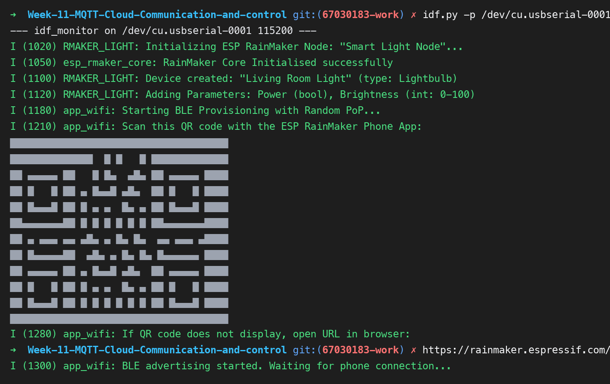

---

### 5.2 การผูกอุปกรณ์และควบคุมผ่าน ESP RainMaker Mobile App
* ทำการ Assisted Claiming รับใบรับรองความปลอดภัยอัตโนมัติจาก AWS IoT Backend ของ Espressif
* เชื่อมต่อ Wi-Fi และเพิ่มอุปกรณ์ "Living Room Light" เข้าสู่แดชบอร์ดของแอป

> **จุดที่ต้องแคปรูปที่ 13:** ภาพหน้าจอแอปพลิเคชัน ESP RainMaker บนสมาร์ตโฟนแสดงการ์ดอุปกรณ์ "Living Room Light"


---

### 5.3 ผลการทดสอบควบคุมระยะไกล (Local Wi-Fi และ 4G/5G Remote Control)
* ทดสอบสวิตช์ Power และปรับความสว่าง Brightness: หลอดไฟ LED บนบอร์ดตอบสนองทันที
* ทดสอบปิด Wi-Fi บนมือถือ และเปิดใช้สัญญาณเน็ต 4G/5G สั่งการข้ามโครงข่ายอินเทอร์เน็ต สามารถควบคุมได้ตามปกติ

> **จุดที่ต้องแคปรูปที่ 14:** ภาพหน้าจอมือถือขณะใช้งานผ่านเน็ต 4G/5G สั่งเปิด-ปิดไฟ ควบคู่กับภาพหลอดไฟบนบอร์ดจริง

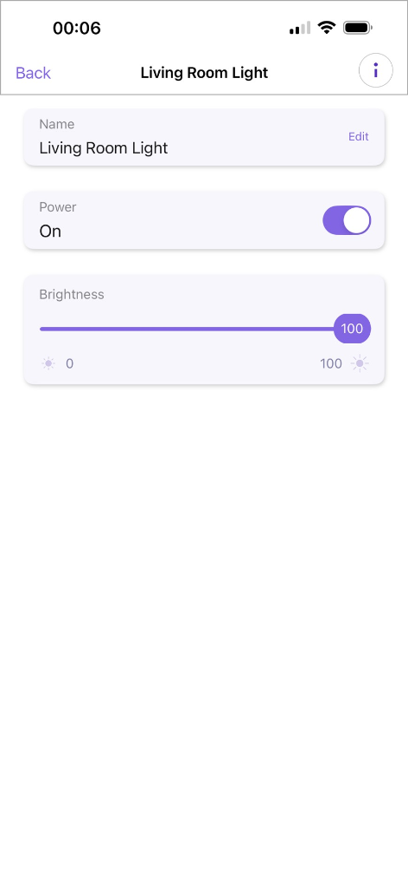

---

### 5.4 ตอบคำถามท้ายการทดลอง 11.4
1. **ในสถาปัตยกรรม ESP RainMaker กระบวนการ Assisted Claiming ช่วยแก้ปัญหาเรื่องการติดตั้งใบรับรองความปลอดภัย (Security Certificates) บนอุปกรณ์ในขั้นตอนพัฒนาต้นแบบได้อย่างไร?**
   * *ตอบ:* Assisted Claiming ช่วยให้อุปกรณ์ ESP32 ไม่จำเป็นต้องฝังกุญแจและ Certificate ล่วงหน้ามาจากโรงงาน โดยใช้แอปพลิเคชันมือถือเป็นผู้ช่วย (Assistant) ติดต่อไปยัง Cloud เพื่อขอรับ Certificate และ Private Key เฉพาะตัวของอุปกรณ์ผ่านช่องทาง BLE ทำให้ขั้นตอนการพัฒนาและการทดสอบรวดเร็วและปลอดภัยโดยไม่ต้องจัดตั้งระบบ Root CA เอง
2. **เพราะเหตุใดฟังก์ชัน `write_cb` จึงต้องเรียกคำสั่ง `esp_rmaker_param_update_and_report()` ทุกครั้งที่มีการเปลี่ยนแปลงค่าพารามิเตอร์?**
   * *ตอบ:* เพื่ออัปเดตสถานะพารามิเตอร์ภายในตัวอุปกรณ์ (Local State) และส่งรายงานสถานะล่าสุดกลับไปยังคลาวด์ (Cloud Shadow) ทำให้หน้าจอแอปพลิเคชันบนสมาร์ตโฟนแสดงสถานะของอุปกรณ์ได้ตรงตามความเป็นจริงทันทีแบบ Real-time
3. **เปรียบเทียบความแตกต่างระหว่างการพัฒนาอุปกรณ์ IoT ด้วย Plain MQTT บน Mosquitto เอง (ในแล็บ 11.2) กับการใช้ ESP RainMaker SDK (ในแล็บ 11.4) ในแง่ของความพยายามในการพัฒนา (Development Effort), ความปลอดภัย (Security), และการขยายระบบ (Scalability)**
   * *ตอบ:*
     * **Development Effort:** Mosquitto ต้องเขียนโค้ดและสร้าง Server เองทั้งหมดรวมถึงสร้างแอปพลิเคชันฝั่งผู้ใช้ ในขณะที่ RainMaker มี SDK สำเร็จรูป, มีแอปพลิเคชันมือถือพร้อมใช้ และมีระบบ Cloud จัดการให้เสร็จสรรพ
     * **Security:** Mosquitto แบบพื้นฐานไม่มีการเข้ารหัส (เว้นแต่จะคอนฟิก mTLS เอง ซึ่งซับซ้อนมาก) ส่วน RainMaker ใช้มาตรฐานความปลอดภัยระดับสูงสุดบน AWS IoT Core ผ่านการเข้ารหัส TLS และมี Hardware-unique Certificate อัตโนมัติ
     * **Scalability:** Mosquitto ที่รันเองบนเครื่อง PC หรือ Local Server รองรับอุปกรณ์ได้จำกัดและติดปัญหาเรื่อง NAT/Firewall เมื่อควบคุมจากภายนอก ส่วน RainMaker ทำงานบนคลาวด์ระดับโลก สามารถรองรับอุปกรณ์นับล้านชิ้นและควบคุมจากที่ใดในโลกก็ได้ทันที
4. **อธิบายขั้นตอนที่ทำให้ ESP RainMaker สามารถเชื่อมโยงการทำงานร่วมกับระบบสั่งงานด้วยเสียงของ Google Home หรือ Amazon Alexa ได้โดยไม่ต้องเขียนโค้ดเพิ่มเติมบนตัวบอร์ด ESP32**
   * *ตอบ:* เพราะ ESP RainMaker มี Cloud-to-Cloud Integration บนระบบ Backend ระหว่าง RainMaker Cloud และ Google Actions / Alexa Smart Home Skills โดยเมื่อผู้ใช้ทำการผูกบัญชี (Account Linking) ฝั่งคลาวด์จะทำการแปลงคำสั่งเสียงเป็นพารามิเตอร์มาตรฐานของ RainMaker แล้วส่งลงมายังอุปกรณ์ตาม Data Model ปกติ ตัวบอร์ดจึงประมวลผลคำสั่งผ่าน `write_cb` ตัวเดิมได้ทันทีโดยไม่ต้องมีโค้ดเฉพาะสำหรับระบบเสียง

---

## 6. สรุปผลการทดลองและการประยุกต์ใช้งาน

การทดลองในสัปดาห์ที่ 11 ได้เรียนรู้และลงมือปฏิบัติการครบถ้วนตั้งแต่:
1. การทำความเข้าใจโครงสร้างโปรโตคอล MQTT ผ่าน Eclipse Mosquitto Broker และ CLI
2. การพัฒนาเฟิร์มแวร์ไมโครคอนโทรลเลอร์ ESP32 เชื่อมต่อ MQTT ส่งข้อมูลเซนเซอร์ JSON และรับคำสั่งควบคุม
3. การยกระดับความปลอดภัยด้วยเทคโนโลยี Public Key Infrastructure (PKI), TLS 1.2, และ Mutual Authentication (mTLS)
4. การสร้างผลิตภัณฑ์ IoT สู่ระบบคลาวด์เชิงพาณิชย์ระดับโลกด้วย ESP RainMaker ครบวงจรทั้ง BLE Provisioning, Assisted Claiming และการควบคุมข้ามอินเทอร์เน็ตผ่านสมาร์ตโฟน
