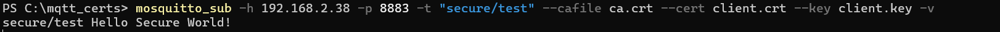
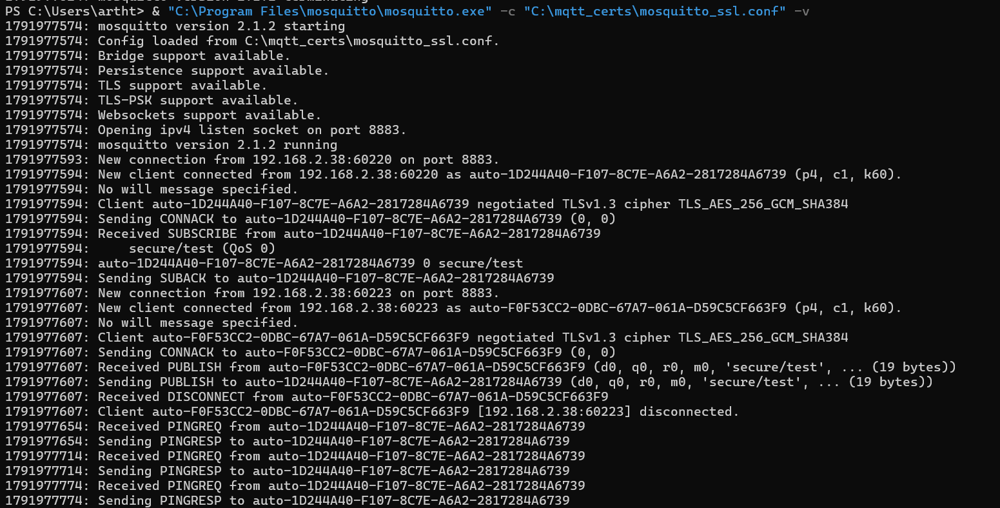
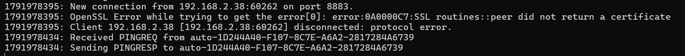
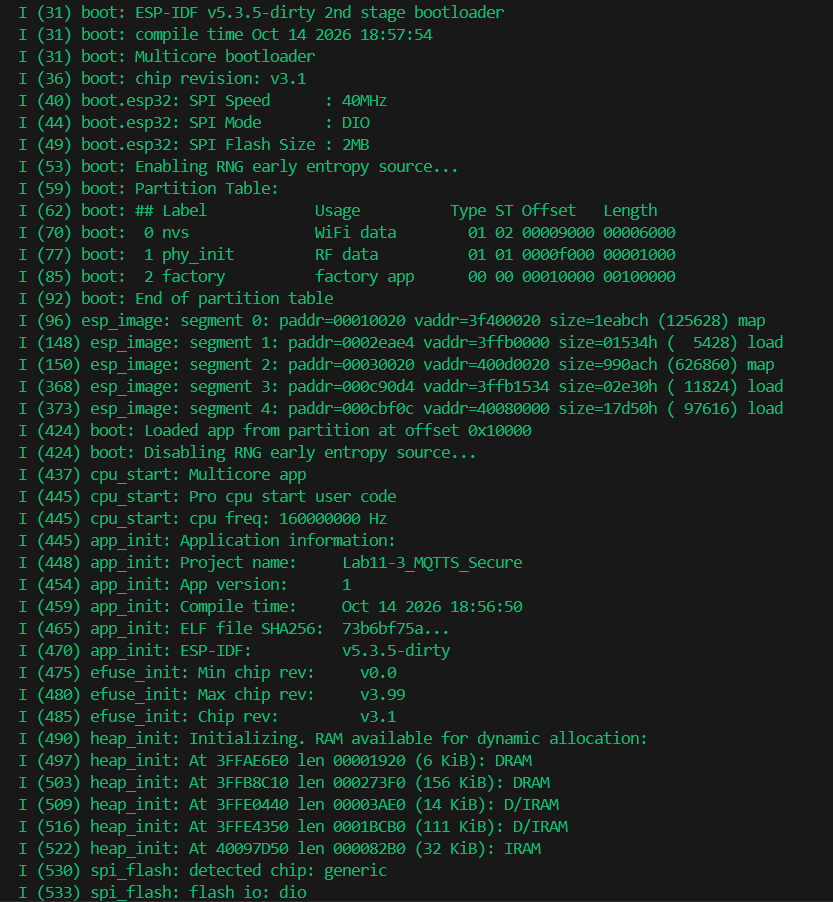
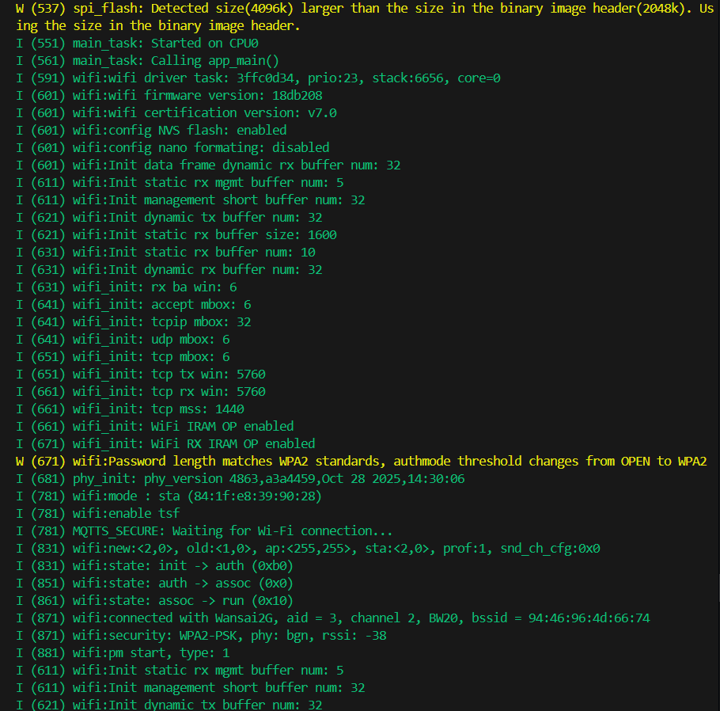
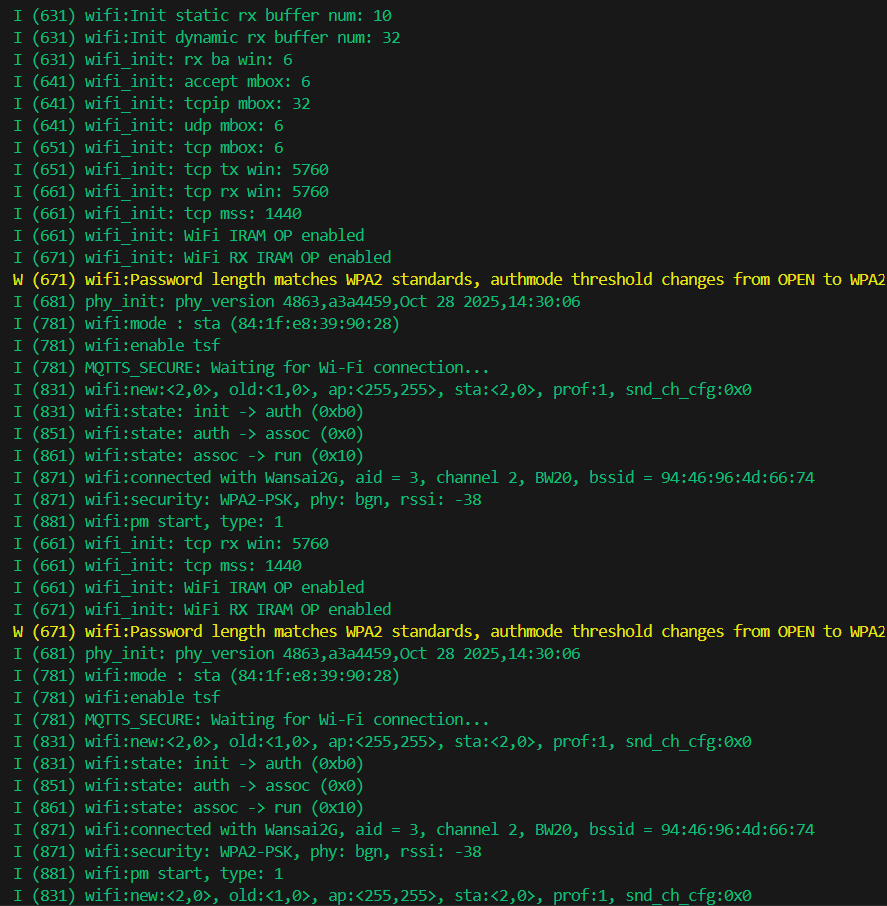
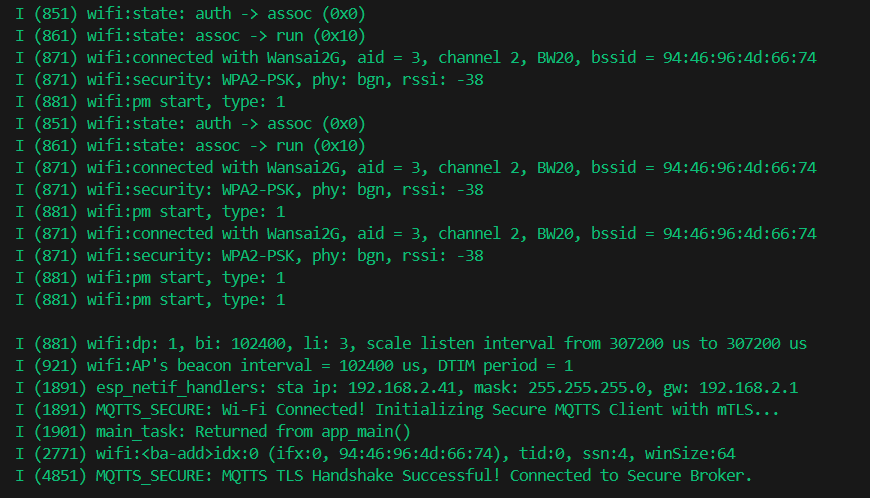
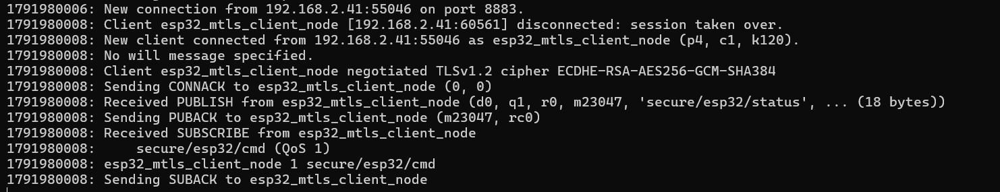

# ใบงานการทดลองที่ 11.3
### การสื่อสาร MQTT ความปลอดภัยสูงด้วย TLS และการยืนยันตัวตนสองทาง (mTLS) บน Mosquitto และ ESP-IDF

> [!NOTE] **คำชี้แจง**
> ในใบงานนี้นักศึกษาจะได้เรียนรู้การยกระดับความปลอดภัยของการสื่อสาร IoT สู่ระดับมาตรฐานองค์กร โดยการสร้าง **องค์กรรับรองความถูกต้องส่วนบุคคล (Local Root CA)** ด้วยเครื่องมือ **OpenSSL** จากนั้นสร้างคู่กุญแจและใบรับรองดิจิทัล X.509 ให้กับ Mosquitto Broker และบอร์ด ESP32 เพื่อทำการเชื่อมต่อผ่านโปรโตคอล **MQTTS (พอร์ต 8883)** พร้อมบังคับใช้ระบบ **Mutual Authentication (mTLS)** ซึ่งทั้งสองฝ่ายต้องยืนยันตัวตนซึ่งกันและกันอย่างสมบูรณ์

> **ข้อมูลผู้จัดทำ**
> * **รหัสนักศึกษา:** 67030260
> * **อีเมล:** 67030260@kmitl.ac.th

---

## 1. วัตถุประสงค์การทดลอง
1. สามารถใช้คำสั่ง OpenSSL ในการสร้าง Root CA, Server Certificate, และ Client Certificate ได้
2. สามารถตั้งค่า Mosquitto Broker ให้เปิดพอร์ต 8883 พร้อมบังคับตรวจใบรับรอง Client (`require_certificate true`)
3. สามารถฝังไฟล์ใบรับรองดิจิทัลและกุญแจส่วนตัวลงในเฟิร์มแวร์ ESP-IDF ผ่านคำสั่ง `EMBED_TXTFILES` ของ CMake ได้
4. สามารถกำหนดค่า `esp_mqtt_client_config_t` สำหรับการเชื่อมต่อ MQTTS พร้อมอ้างอิงสัญลักษณ์ตัวแปร Assembler ได้
5. เข้าใจและสามารถวิเคราะห์ขั้นตอน TLS Handshake รวมถึงสาธิตการปฏิเสธการเชื่อมต่อจาก Client ที่ไม่มีใบรับรองถูกต้อง

---

## 2. อุปกรณ์และเครื่องมือที่ใช้
* เครื่องคอมพิวเตอร์ที่ติดตั้ง **OpenSSL** และ **Eclipse Mosquitto**
* บอร์ดไมโครคอนโทรลเลอร์ **ESP32**
* เฟรมเวิร์ก **ESP-IDF v5.x / v6.x** หรือ Docker
* เราเตอร์ Wi-Fi วงแลนเดียวกัน

---

## 3. ขั้นตอนการทดลอง

### กิจกรรมที่ 11-3.1 การสร้างคู่กุญแจและใบรับรองดิจิทัลด้วย OpenSSL

> [!TIP]
> สำหรับนักศึกษาที่ต้องการศึกษาพื้นฐานความปลอดภัยไซเบอร์, ระบบคู่กุญแจ (Key-Pair), X.509 Certificates และรายละเอียดของแต่ละคำสั่ง OpenSSL สามารถศึกษาเพิ่มเติมได้ที่ **[ภาคผนวกที่ 2 พื้นฐานความปลอดภัยไซเบอร์, กลไกคู่กุญแจ และการใช้งาน OpenSSL สำหรับ IoT](10-Appendix-2-OpenSSL-and-Keys-pair.md)**

สร้างโฟลเดอร์สำหรับเก็บใบรับรอง เช่น `C:\mqtt_certs\` (หรือ `~/mqtt_certs/`) แล้วเปิดหน้าต่าง Terminal ในโฟลเดอร์ดังกล่าว

#### 1. สร้างกุญแจส่วนตัวและใบรับรอง Root CA (ผู้รับรอง)
```bash
# 1.1 สร้างกุญแจส่วนตัว 2048-bit RSA ของ CA
openssl genrsa -out ca.key 2048

# 1.2 สร้างคำร้องขอใบรับรอง (CSR) ของ CA
openssl req -out ca.csr -key ca.key -new -subj "/C=TH/ST=Bangkok/O=IoT Security Lab/CN=IoT Root CA"

# 1.3 ลงนามออกใบรับรอง ca.crt แบบ Self-signed มีอายุ 3650 วัน
openssl x509 -req -in ca.csr -out ca.crt -sha256 -days 3650 -signkey ca.key
```

#### 2. สร้างกุญแจส่วนตัวและใบรับรอง Server (สำหรับ Mosquitto Broker)
> [!IMPORTANT]
> ในคำสั่งด้านล่าง ค่า **CN (Common Name)** ของ Server จะต้องระบุเป็น **หมายเลข IP Address ของเครื่องคอมพิวเตอร์ที่รัน Broker** (เช่น `192.168.2.38`) เพื่อป้องกันข้อผิดพลาด Hostname Mismatch ในขั้นตอน TLS Handshake

```bash
# 2.1 สร้างกุญแจส่วนตัวของ Server
openssl genrsa -out server.key 2048

# 2.2 สร้างคำร้องขอใบรับรอง (ระบุ IP เครื่องคอมพิวเตอร์: 192.168.2.38)
openssl req -out server.csr -key server.key -new -subj "/C=TH/ST=Bangkok/O=IoT Broker/CN=192.168.2.38"

# 2.3 ใช้ Root CA ลงนามออกใบรับรอง server.crt
openssl x509 -req -in server.csr -out server.crt -sha256 -CA ca.crt -CAkey ca.key -CAcreateserial -days 3650
```

#### 3. สร้างกุญแจส่วนตัวและใบรับรอง Client (สำหรับ ESP32)
```bash
# 3.1 สร้างกุญแจส่วนตัวของ Client
openssl genrsa -out client.key 2048

# 3.2 สร้างคำร้องขอใบรับรองของ Client
openssl req -out client.csr -key client.key -new -subj "/C=TH/ST=Bangkok/O=IoT Node/CN=esp32-secure-node"

# 3.3 ใช้ Root CA ลงนามออกใบรับรอง client.crt
openssl x509 -req -in client.csr -out client.crt -sha256 -CA ca.crt -CAkey ca.key -CAcreateserial -days 3650
```

---

### กิจกรรมที่ 11-3.2 การตั้งค่า Mosquitto MQTTS Broker (Port 8883)

สร้างไฟล์คอนฟิก `mosquitto_ssl.conf` ในโฟลเดอร์ `C:\mqtt_certs\`:

```text
# กำหนดให้ฟังพอร์ต 8883 สำหรับการเชื่อมต่อเข้ารหัส TLS
listener 8883 0.0.0.0

# ระบุตำแหน่งไฟล์ใบรับรอง (ใช้ Forward Slash / เสมอ)
cafile C:/mqtt_certs/ca.crt
certfile C:/mqtt_certs/server.crt
keyfile C:/mqtt_certs/server.key

# บังคับการตรวจสอบสิทธิ์สองทาง (Mutual Authentication / mTLS)
require_certificate true

# บังคับใช้ TLS เวอร์ชัน 1.2 ขึ้นไป
tls_version tlsv1.2

# บันทึกรายละเอียดการทำงาน
log_type all
```

สั่งรัน Mosquitto ใน **เทอร์มินัลที่ 1**
```powershell
& "C:\Program Files\mosquitto\mosquitto.exe" -c "C:\mqtt_certs\mosquitto_ssl.conf" -v
```

---

### กิจกรรมที่ 11-3.3 การทดสอบความปลอดภัยผ่านเครื่องมือ CLI

#### 1. การทดสอบแบบถูกต้อง (ส่งทั้ง ca.crt, client.crt, client.key)
เปิด **เทอร์มินัลที่ 2** แล้วสั่ง Subscribe
```powershell
mosquitto_sub -h 192.168.2.38 -p 8883 -t "secure/test" --cafile ca.crt --cert client.crt --key client.key -v
```
เปิด **เทอร์มินัลที่ 3** แล้วสั่ง Publish
```powershell
mosquitto_pub -h 192.168.2.38 -p 8883 -t "secure/test" -m "Hello Secure World!" --cafile ca.crt --cert client.crt --key client.key
```
*สังเกตผล* ในเทอร์มินัลที่ 2 จะได้รับข้อความสำเร็จ และใน Broker Log จะแสดงกระบวนการจับมือ TLS สำเร็จ





#### 2. การทดสอบการปฏิเสธผู้บุกรุก (Unauthorized Client Attack)
ทดลองใช้ `mosquitto_pub` ส่งข้อความ **โดยไม่ส่งใบรับรอง Client** (ส่งเฉพาะ cafile)
```powershell
mosquitto_pub -h 192.168.2.38 -p 8883 -t "secure/test" -m "Hacker message" --cafile ca.crt
```
**ผลลัพธ์ที่คาดหวัง**
* ในเทอร์มินัลจะแจ้งเตือนข้อผิดพลาด: `Error: Connection refused: Not authorised` หรือ `OpenSSL Error: ssl handshake failure`
* ในหน้าต่าง Broker Log จะแจ้ง: `Client disconnected due to TLS error: peer did not return a certificate`
* แสดงว่าระบบปฏิเสธการเชื่อมต่อจากอุปกรณ์แปลกปลอมได้อย่างสมบูรณ์



---

### กิจกรรมที่ 11-3.4 การสร้างโปรเจกต์ ESP-IDF และการฝัง Certificate ผ่าน CMake

#### 1. สร้างโปรเจกต์ใหม่
```powershell
idf.py create-project Lab11-3_MQTTS_Secure
cd Lab11-3_MQTTS_Secure
idf.py set-target esp32c3   # หรือ esp32
```

#### 2. การคัดลอกไฟล์ใบรับรองเข้าสู่โฟลเดอร์ `main/certs/`
สร้างโฟลเดอร์ `main/certs/` แล้วคัดลอกไฟล์ 3 ไฟล์จากโฟลเดอร์ `C:\mqtt_certs\` มาใส่
1. `ca.crt` (ใบรับรอง Root CA)
2. `client.crt` (ใบรับรองของ ESP32)
3. `client.key` (กุญแจส่วนตัวของ ESP32)

#### 3. การแก้ไขไฟล์ `main/CMakeLists.txt`
เปิดไฟล์ `main/CMakeLists.txt` แล้วเพิ่มคำสั่ง `EMBED_TXTFILES`

```cmake
idf_component_register(
    SRCS "main.c"
    INCLUDE_DIRS "."
    EMBED_TXTFILES 
        "certs/ca.crt"
        "certs/client.crt"
        "certs/client.key"
)
```

---

### กิจกรรมที่ 11-3.5 การเขียนโค้ดโปรแกรมหลัก (`main/main.c`)

เปิดไฟล์ `main/main.c` และบันทึกโค้ดต่อไปนี้

```c
#include <stdio.h>
#include <stdint.h>
#include <stddef.h>
#include <string.h>
#include "esp_wifi.h"
#include "esp_system.h"
#include "nvs_flash.h"
#include "esp_event.h"
#include "esp_netif.h"
#include "esp_log.h"
#include "freertos/FreeRTOS.h"
#include "freertos/task.h"
#include "freertos/event_groups.h"
#include "driver/gpio.h"
#include "mqtt_client.h"

#define WIFI_SSID           "Wansai2G"
#define WIFI_PASS           "0819194362"
#define MQTTS_BROKER_URI    "mqtts://192.168.2.38:8883" // พอร์ต 8883

static const char *TAG = "MQTTS_SECURE";
static EventGroupHandle_t s_wifi_event_group;
#define WIFI_CONNECTED_BIT  BIT0

// สัญลักษณ์ Assembler ที่สร้างขึ้นโดยอัตโนมัติจากคำสั่ง EMBED_TXTFILES ใน CMake
extern const uint8_t ca_crt_start[] asm("_binary_ca_crt_start");
extern const uint8_t ca_crt_end[]   asm("_binary_ca_crt_end");

extern const uint8_t client_crt_start[] asm("_binary_client_crt_start");
extern const uint8_t client_crt_end[]   asm("_binary_client_crt_end");

extern const uint8_t client_key_start[] asm("_binary_client_key_start");
extern const uint8_t client_key_end[]   asm("_binary_client_key_end");

/* ========================================================
 * 1. ระบบจัดการ Wi-Fi
 * ======================================================== */
static void wifi_event_handler(void* arg, esp_event_base_t event_base, int32_t event_id, void* event_data)
{
    if (event_base == WIFI_EVENT && event_id == WIFI_EVENT_STA_START) {
        esp_wifi_connect();
    } else if (event_base == WIFI_EVENT && event_id == WIFI_EVENT_STA_DISCONNECTED) {
        esp_wifi_connect();
        xEventGroupClearBits(s_wifi_event_group, WIFI_CONNECTED_BIT);
    } else if (event_base == IP_EVENT && event_id == IP_EVENT_STA_GOT_IP) {
        xEventGroupSetBits(s_wifi_event_group, WIFI_CONNECTED_BIT);
    }
}

static void wifi_init_sta(void)
{
    s_wifi_event_group = xEventGroupCreate();
    ESP_ERROR_CHECK(esp_netif_init());
    ESP_ERROR_CHECK(esp_event_loop_create_default());
    esp_netif_create_default_wifi_sta();

    wifi_init_config_t cfg = WIFI_INIT_CONFIG_DEFAULT();
    ESP_ERROR_CHECK(esp_wifi_init(&cfg));

    ESP_ERROR_CHECK(esp_event_handler_instance_register(WIFI_EVENT, ESP_EVENT_ANY_ID, &wifi_event_handler, NULL, NULL));
    ESP_ERROR_CHECK(esp_event_handler_instance_register(IP_EVENT, IP_EVENT_STA_GOT_IP, &wifi_event_handler, NULL, NULL));

    wifi_config_t wifi_config = {
        .sta = {
            .ssid = WIFI_SSID,
            .password = WIFI_PASS,
        },
    };
    ESP_ERROR_CHECK(esp_wifi_set_mode(WIFI_MODE_STA));
    ESP_ERROR_CHECK(esp_wifi_set_config(WIFI_IF_STA, &wifi_config));
    ESP_ERROR_CHECK(esp_wifi_start());
}

/* ========================================================
 * 2. MQTT Event Handler
 * ======================================================== */
static void mqtt_event_handler(void *handler_args, esp_event_base_t base, int32_t event_id, void *event_data)
{
    esp_mqtt_event_handle_t event = (esp_mqtt_event_handle_t)event_data;
    esp_mqtt_client_handle_t client = event->client;

    switch ((esp_mqtt_event_id_t)event_id) {
    case MQTT_EVENT_CONNECTED:
        ESP_LOGI(TAG, "MQTTS TLS Handshake Successful! Connected to Secure Broker.");
        
        // ส่งข้อความความปลอดภัยสูง
        esp_mqtt_client_publish(client, "secure/esp32/status", "SECURE_ONLINE_MTLS", 0, 1, 0);
        esp_mqtt_client_subscribe(client, "secure/esp32/cmd", 1);
        break;

    case MQTT_EVENT_DATA:
        ESP_LOGI(TAG, "SECURE DATA RECEIVED:");
        ESP_LOGI(TAG, "TOPIC: %.*s", event->topic_len, event->topic);
        ESP_LOGI(TAG, "PAYLOAD: %.*s", event->data_len, event->data);
        break;

    case MQTT_EVENT_ERROR:
        ESP_LOGE(TAG, "MQTTS Error Event occurred");
        if (event->error_handle->error_type == MQTT_ERROR_TYPE_TCP_TRANSPORT) {
            ESP_LOGE(TAG, "TLS / Transport Error Code: 0x%x", event->error_handle->esp_tls_last_esp_err);
        }
        break;

    default:
        break;
    }
}

/* ========================================================
 * 3. ฟังก์ชันหลัก (app_main)
 * ======================================================== */
void app_main(void)
{
    ESP_ERROR_CHECK(nvs_flash_init());

    wifi_init_sta();
    ESP_LOGI(TAG, "Waiting for Wi-Fi connection...");
    xEventGroupWaitBits(s_wifi_event_group, WIFI_CONNECTED_BIT, false, true, portMAX_DELAY);
    ESP_LOGI(TAG, "Wi-Fi Connected! Initializing Secure MQTTS Client with mTLS...");

    // กำหนดค่า MQTTS Client แบบ Mutual TLS
    esp_mqtt_client_config_t mqtt_cfg = {
        .broker = {
            .address = {
                .uri = MQTTS_BROKER_URI,
            },
            .verification = {
                // ติดตั้ง CA Certificate เพื่อตรวจสอบ Broker
                .certificate = (const char *)ca_crt_start,
            },
        },
        .credentials = {
            .client_id = "esp32_mtls_client_node",
            .authentication = {
                // ติดตั้ง Client Certificate และ Private Key เพื่อยืนยันตัวตนกับ Broker
                .certificate = (const char *)client_crt_start,
                .key = (const char *)client_key_start,
            },
        },
    };

    esp_mqtt_client_handle_t client = esp_mqtt_client_init(&mqtt_cfg);
    esp_mqtt_client_register_event(client, ESP_EVENT_ANY_ID, mqtt_event_handler, NULL);
    esp_mqtt_client_start(client);
}
```

---

## 4. การทดสอบและการตรวจสอบผลลัพธ์ (Testing & Verification)

1. แฟลชโปรแกรมลงบนบอร์ด ESP32
   ```powershell
   idf.py -p COM3 flash monitor
   ```
2. สังเกตผลในหน้าต่าง Serial Monitor
   * บอร์ดเชื่อมต่อ Wi-Fi สำเร็จ
   * เริ่มกระบวนการจับมือ TLS `Connecting to 192.168.2.38:8883...`
   * หน้าจอรายงาน `MQTTS TLS Handshake Successful! Connected to Secure Broker.`

   
   
   
   

3. สังเกตหน้าต่าง Broker Log
   * Mosquitto จะพิมพ์ข้อความยืนยัน `Peer certificate verified: /C=TH/ST=Bangkok/O=IoT Node/CN=esp32-secure-node`
   * แสดงว่า Broker ได้ทำการตรวจความถูกต้องของใบรับรองบอร์ด ESP32 ผ่านเรียบร้อยแล้ว



---

## 5. คำถามท้ายการทดลอง (Post-Lab Questions)

### 1. เพราะเหตุใดในคำสั่งสร้าง Server CSR ค่า Common Name (CN) จึงต้องระบุเป็น IP Address หรือ Hostname ของ Broker ให้ตรงกันพอดี? หากระบุเป็นชื่ออื่นจะเกิดข้อผิดพลาดใดขึ้น?
**คำตอบ:**
* **เหตุผลทางเทคนิค:**
  ในมาตรฐานโครงสร้างพื้นฐานกุญแจสาธารณะ (X.509 PKI) และขั้นตอนกระบวนการ **TLS Handshake** นอกจากการตรวจสอบว่าใบรับรองของ Server ได้รับการลงนามรับรอง (Digitally Signed) โดย Root CA ที่เชื่อถือได้หรือไม่แล้ว ไคลเอนต์ (เช่น บอร์ด ESP32 หรือคำสั่ง `mosquitto_sub/pub`) จะมีกลไกสำคัญเรียกว่า **Identity / Hostname Verification** เสมอ 
  
  กลไกนี้จะนำที่อยู่ปลายทางที่ไคลเอนต์ตั้งใจเชื่อมต่อไป (Target IP หรือ Domain Name เช่น `192.168.2.38`) ไปเปรียบเทียบกับฟิลด์ **Common Name (CN)** หรือ **Subject Alternative Name (SAN)** ภายในใบรับรองของเซิร์ฟเวอร์ เพื่อให้มั่นใจได้ว่าเซิร์ฟเวอร์ที่ตนเองกำลังสนทนาด้วยเป็นโฮสต์เป้าหมายตัวจริง ไม่ใช่เซิร์ฟเวอร์แปลกปลอมที่แอบขโมยใบรับรองใบอื่นมาสวมรอย (ป้องกันการโจมตีแบบ **Man-in-the-Middle: MitM Attack**)

* **ข้อผิดพลาดที่จะเกิดขึ้นหากระบุเป็นชื่ออื่น:**
  หากค่า CN/SAN ไม่ตรงกับ IP หรือ Hostname ที่ไคลเอนต์ใช้เชื่อมต่อ:
  1. **บนบอร์ด ESP32 (mbedTLS stack):** ไลบรารี TLS จะหยุดกระบวนการ Handshake ทันที และรายงานโค้ดข้อผิดพลาด `MBEDTLS_ERR_X509_CERT_VERIFY_FAILED` พร้อมแฟล็กสถานะ `MBEDTLS_X509_BADCERT_CN_MISMATCH` (โค้ดฐานสิบหก `0x0020`) ทำให้ฟังก์ชัน `esp_mqtt_client_start()` ไม่สามารถเชื่อมต่อไปยัง Broker ได้
  2. **บนเครื่องมือ CLI (Mosquitto/OpenSSL):** คำสั่งจะตัดการเชื่อมต่อและแจ้งเตือน `OpenSSL Error: certificate verify failed (Hostname mismatch)` หรือ `Error: protocol error` ทันที

---

### 2. การยืนยันตัวตนแบบ Mutual Authentication (mTLS) แตกต่างจากการใช้ HTTPS ทั่วไปบนเว็บเบราว์เซอร์อย่างไรในประเด็นเรื่องใบรับรองฝั่ง Client?
**คำตอบ:**
ความแตกต่างสำคัญระหว่าง **HTTPS ทั่วไป** กับ **mTLS (Mutual TLS)** อยู่ที่ระดับชั้น (Layer) และทิศทางของการตรวจสอบตัวตน (Authentication Direction) ดังตารางเปรียบเทียบต่อไปนี้:

| ประเด็นเปรียบเทียบ | HTTPS ทั่วไป (One-way TLS) | mTLS บน MQTT (Two-way TLS) |
| :--- | :--- | :--- |
| **ทิศทางการยืนยันตัวตน** | ยืนยันตัวตน**ทางเดียว** (Server Authentication เท่านั้น) | ยืนยันตัวตน**สองทาง** (ทั้ง Server และ Client Authentication) |
| **ใบรับรองฝั่ง Client (Client Certificate)** | **ไม่จำเป็นต้องมี** เบราว์เซอร์ไม่มีใบรับรองดิจิทัลส่วนบุคคลในการส่ง | **จำเป็นต้องมี** บอร์ด ESP32 ต้องมี `client.crt` และ `client.key` ที่ลงนามโดย Root CA ประจำระบบ |
| **ระดับชั้นที่ใช้ตรวจสอบ Client** | ตรวจสอบในระดับ **Application Layer** ผ่านการกรอก Username/Password, OTP, API Token, หรือ Session Cookie | ตรวจสอบตั้งแต่ระดับ **Transport / TLS Layer** ในขั้นตอน TLS Handshake ผ่านกลไก Cryptographic Challenge-Response |
| **การรับมืออุปกรณ์แปลกปลอม** | อนุญาตให้ทำ TCP Connection และ TLS Handshake ผ่านเข้ามาก่อน แล้วค่อยเช็กสิทธิ์หน้าเว็บ | ปฏิเสธและตัดการเชื่อมต่อทันทีตั้งแต่ระดับ Network Packet หากไม่มีใบรับรองที่ถูกต้อง |
| **ความเหมาะสมในการใช้งาน** | เหมาะกับ Web Browser ทั่วไปที่เน้นความสะดวกของผู้ใช้งานที่เป็นมนุษย์ | เหมาะอย่างยิ่งกับระบบ IoT เชิงอุตสาหกรรม (M2M: Machine-to-Machine) ที่ต้องการความปลอดภัยขั้นสูงสุดและระบบทำงานอัตโนมัติ |

สรุปคือ ใน HTTPS ทั่วไป เว็บเบราว์เซอร์เชื่อใจเซิร์ฟเวอร์ผ่านใบรับรอง แต่เซิร์ฟเวอร์จะรู้จักไคลเอนต์ผ่าน Username/Password เท่านั้น ส่วน mTLS ฝั่งโฮสต์ Broker จะบีบให้ไคลเอนต์ต้องส่งใบรับรองดิจิทัลมาพิสูจน์ตนเองตั้งแต่ก่อนจะส่งแพ็กเก็ต MQTT ตัวแรก ทำให้มีความปลอดภัยสูงกว่าอย่างชัดเจน

---

### 3. หากมีผู้ไม่หวังดีขโมยไฟล์เฟิร์มแวร์ไบนารี (.bin) ของบอร์ด ESP32 ไปได้ เขาจะสามารถกู้คืนไฟล์ client.key ได้หรือไม่ และในระบบ IoT เชิงพาณิชย์เรามีฮาร์ดแวร์ความปลอดภัยใด (เช่น ESP32 Secure Boot / Flash Encryption / Digital Signature Peripheral) มาช่วยแก้ไขปัญหานี้?
**คำตอบ:**

#### 3.1 การกู้คืนไฟล์ `client.key`:
* **สามารถกู้คืนได้โดยง่ายมาก** หากระบบไม่ได้เปิดฟีเจอร์ความปลอดภัยระดับฮาร์ดแวร์
* **สาเหตุ:** การใช้คำสั่ง `EMBED_TXTFILES` ในระบบคอมไพล์ CMake เป็นเพียงการนำข้อมูลข้อความในไฟล์ `client.key` บรรจุลงไปใน Flash Memory ส่วนข้อมูลคงที่ (`.rodata` หรือ `.text`) แบบตรงไปตรงมาในรูปแบบข้อความ Plaintext ดั้งเดิม (ASCII PEM Format)
* หากผู้โจมตีทำการอ่านหน่วยความจำ Flash ออกมาผ่านคำสั่ง `esptool.py read_flash` หรือได้ไฟล์ `.bin` ไป ผู้โจมตีสามารถใช้คำสั่งย้อนรอย (Reverse Engineering) พื้นฐาน เช่น:
  ```bash
  strings Lab11-3_MQTTS_Secure.bin | grep -A 25 "BEGIN RSA PRIVATE KEY"
  ```
  หรือเปิดดูด้วยโปรแกรม Hex Editor / Ghidra ก็จะสามารถคัดลอกกุญแจส่วนตัว `client.key` ออกมาได้อย่างสมบูรณ์ และนำกุญแจนี้ไปปลอมตัว (Impersonate) เป็นอุปกรณ์ IoT ตัวนั้นเพื่อส่งข้อมูลเท็จหรือควบคุมระบบได้ทันที

#### 3.2 ฮาร์ดแวร์ความปลอดภัยในระบบ IoT เชิงพาณิชย์เพื่อแก้ไขปัญหานี้:
เพื่อป้องกันการรั่วไหลของกุญแจส่วนตัว ในการออกแบบอุปกรณ์ IoT ระดับอุตสาหกรรมจะนิยมใช้กลไกความปลอดภัยระดับฮาร์ดแวร์ดังนี้:

1. **ESP32 Flash Encryption (การเข้ารหัสหน่วยความจำแฟลช):**
   * บอร์ด ESP32 มีโมดูลฮาร์ดแวร์ AES-256 ช่วยเข้ารหัสข้อมูลทั้งหมดใน SPI Flash ภายนอก โดยคีย์ถอดรหัสจะถูกสุ่มสร้างและเบิร์นเก็บไว้ใน **eFuse (ฮาร์ดแวร์วันไทม์โปรแกรม)** ภายในตัวซิลิคอน ซึ่งถูกล็อกไม่ให้อ่านออกมาภายนอกได้
   * ทำให้แม้ผู้โจมตีจะถอดชิป Flash หรือดัมป์ไฟล์ `.bin` ออกไป ข้อมูลที่ได้ทั้งหมดจะเป็นข้อมูลขยะที่ถูกเข้ารหัส (Ciphertext) ไม่สามารถกู้คืนไฟล์ `client.key` หรือโค้ดโปรแกรมได้

2. **ESP32 Secure Boot (การบูตระบบอย่างปลอดภัย):**
   * ทำหน้าที่ตรวจสอบลายเซ็นดิจิทัล (Digital Signature: RSA-3072 / ECDSA) ของ Bootloader และ Application Firmware ทุกครั้งก่อนที่จะเริ่มรันโค้ด
   * ป้องกันไม่ให้ผู้โจมตีแก้ไข ดัดแปลง หรือแฟลชเฟิร์มแวร์แปลกปลอมลงไปบนบอร์ดเพื่อแอบอ่านคีย์ในหน่วยความจำ RAM

3. **Digital Signature Peripheral (DS Peripheral ใน ESP32-S2 / S3 / C3):**
   * เป็นฮาร์ดแวร์เฉพาะทางที่ทำหน้าที่คำนวณการเซ็นชื่อดิจิทัล (Signature Verification) สำหรับกระบวนการ mTLS TLS Handshake โดยตรง
   * โดยกุญแจ `client.key` จะถูกเข้ารหัสและควบคุมผ่านฮาร์ดแวร์ ทำให้**ตัวประมวลผล (CPU) และซอฟต์แวร์ไม่จำเป็นต้องโหลด Private Key ขึ้นมาไว้ในหน่วยความจำ RAM เลย** จึงป้องกันการรั่วไหลของคีย์จากการแฮ็กผ่านซอฟต์แวร์ได้อย่างสมบูรณ์

4. **การใช้ชิปความปลอดภัยภายนอก (Hardware Secure Element):**
   * ในอุปกรณ์เกรดธนาคารหรืออุตสาหกรรมหนัก นิยมต่อชิปประมวลผลความปลอดภัยภายนอก เช่น **Microchip ATECC608A** หรือ **NXP SE050** ผ่านบัส I2C
   * ชิปกลุ่มนี้ทำหน้าที่เสมือนตู้นิรภัยที่สร้างและเก็บ Private Key ไว้ภายในชิปโดยไม่อนุญาตให้อ่านคีย์ออกมาภายนอกได้เลย (Tamper-resistant) และทำหน้าที่คำนวณการยืนยันตัวตนส่งกลับมายัง ESP32 เท่านั้น

