# ใบงานการทดลองที่ 11.4
### การสร้างอุปกรณ์ Smart Light สู่ระบบคลาวด์ด้วย ESP RainMaker SDK, BLE Provisioning และการควบคุมผ่านสมาร์ตโฟน

> [!NOTE] **คำชี้แจง**
> ในใบงานนี้นักศึกษาจะได้สร้างผลิตภัณฑ์ IoT สู่ระบบคลาวด์เชิงพาณิชย์จริงโดยใช้แพลตฟอร์ม **ESP RainMaker** ของ Espressif Systems โดยจะได้เขียนโปรแกรมสร้าง **Node** และ **Device (Smart Light)** พร้อมพารามิเตอร์ **Power** และ **Brightness** จากนั้นทำการเปิดใช้งานระบบ **BLE Wi-Fi Provisioning**, การขอรับใบรับรองผ่านระบบ **Assisted Claiming** สแกนเชื่อมต่อผ่านแอปพลิเคชัน **ESP RainMaker บนสมาร์ตโฟน** และควบคุมอุปกรณ์ข้ามเครือข่ายอินเทอร์เน็ตได้จากทุกที่ทั่วโลก

> **ข้อมูลผู้จัดทำ**
> * **รหัสนักศึกษา:** 67030260
> * **อีเมล:** 67030260@kmitl.ac.th

---

## 1. วัตถุประสงค์การทดลอง
1. เข้าใจโครงสร้างและการทำงานของแพลตฟอร์ม ESP RainMaker บนสถาปัตยกรรม ESP-IDF
2. สามารถสร้าง Node, Device, และ Parameters (Power, Brightness) ผ่าน RainMaker Core API ได้
3. สามารถเขียน Write Callback เพื่อรับคำสั่งจากคลาวด์มาปรับระดับสถานะ GPIO ของ LED และรายงานสถานะกลับ (Report State)
4. สามารถเปิดใช้งานบริการระดับระบบ ได้แก่ บริการซิงก์เวลา SNTP และการตั้งเวลาทำงาน (Schedule Service) ได้
5. สามารถทำกระบวนการ Provisioning และ Assisted Claiming ผ่านแอปพลิเคชันสมาร์ตโฟนด้วยบลูทูธ (BLE) ได้สำเร็จ
6. สามารถทดสอบส่งคำสั่งควบคุมผ่านแอปพลิเคชันมือถือ และเครื่องมือบรรทัดคำสั่ง ESP RainMaker CLI ได้

---

## 2. อุปกรณ์และเครื่องมือที่ใช้
* บอร์ดไมโครคอนโทรลเลอร์ **ESP32-C3** หรือ **ESP32**
* หลอดไฟ LED พร้อมตัวต้านทาน 220Ω ต่อเข้ากับ **GPIO 8** (ESP32-C3) หรือ **GPIO 2** (ESP32)
* สายเชื่อมต่อ USB Data Cable
* เครื่องคอมพิวเตอร์พร้อมระบบพัฒนา **ESP-IDF v5.x / v6.x**
* สมาร์ตโฟน (Android หรือ iOS) ที่ติดตั้งแอปพลิเคชัน **ESP RainMaker** และเปิดบลูทูธ/Wi-Fi ไว้
* เราเตอร์ Wi-Fi (2.4 GHz) ที่เชื่อมต่อออกสู่อินเทอร์เน็ตได้จริง

---

## 3. ขั้นตอนการทดลอง (Deconstructed Activities)

### กิจกรรมที่ 11-4.1 การสร้างโปรเจกต์และติดตั้ง Dependency `esp-rainmaker`

#### 1. สร้างโปรเจกต์ใหม่
```powershell
idf.py create-project Lab11-4_RainMaker_Light
cd Lab11-4_RainMaker_Light
idf.py set-target esp32
```

#### 2. ติดตั้ง ESP RainMaker Component จาก IDF Component Registry
เพิ่มไลบรารีทางการของ Espressif ผ่านคำสั่ง
```powershell
idf.py add-dependency "espressif/esp_rainmaker"
```

ไฟล์ `main/idf_component.yml` จะได้รับการสร้างและอัปเดตโดยอัตโนมัติ
```yaml
dependencies:
  idf:
    version: ">=5.0.0"
  espressif/esp-rainmaker:
    version: "^3.0.0"
```

---

### กิจกรรมที่ 11-4.2 การเขียนโค้ดเฟิร์มแวร์อุปกรณ์ (`main/main.c`)

เปิดไฟล์ `main/main.c` และแทนที่ด้วยโค้ดสมบูรณ์ต่อไปนี้

```c
#include <stdio.h>
#include <string.h>
#include "esp_log.h"
#include "nvs_flash.h"
#include "driver/gpio.h"

// RainMaker Headers
#include "esp_rmaker_core.h"
#include "esp_rmaker_standard_types.h"
#include "esp_rmaker_standard_params.h"
#include "esp_rmaker_standard_devices.h"
#include "esp_rmaker_schedule.h"
#include "app_wifi.h"

#if CONFIG_IDF_TARGET_ESP32C3
#define LED_PIN GPIO_NUM_8
#else
#define LED_PIN GPIO_NUM_2
#endif

static const char *TAG = "RMAKER_LIGHT";
static esp_rmaker_device_t *s_light_device = NULL;

/* ========================================================
 * 1. Write Callback ฟังก์ชันรับคำสั่งควบคุมจากคลาวด์
 * ======================================================== */
static esp_err_t write_cb(const esp_rmaker_device_t *device, const esp_rmaker_param_t *param,
                          const esp_rmaker_param_val_t val, void *priv_data, esp_rmaker_write_ctx_t *ctx)
{
    if (ctx) {
        ESP_LOGI(TAG, "Request received via: %s", esp_rmaker_device_cb_src_to_str(ctx->src));
    }
    const char *device_name = esp_rmaker_device_get_name(device);
    const char *param_name = esp_rmaker_param_get_name(param);

    ESP_LOGI(TAG, "Device: %s | Param: %s", device_name, param_name);

    // ตรวจสอบว่าเป็นคำสั่ง Power (เปิด/ปิด)
    if (strcmp(param_name, ESP_RMAKER_DEF_POWER_NAME) == 0) {
        bool state = val.val.b;
        ESP_LOGI(TAG, "Changing LED state to: %s", state ? "ON" : "OFF");
        gpio_set_level(LED_PIN, state ? 1 : 0);
        
        // รายงานสถานะปัจจุบันกลับสู่คลาวด์ เพื่อให้แอปบนมือถืออัปเดตสถานะทันที
        esp_rmaker_param_update_and_report(param, val);
    }
    // ตรวจสอบว่าเป็นคำสั่ง Brightness (ความสว่าง 0 - 100%)
    else if (strcmp(param_name, ESP_RMAKER_DEF_BRIGHTNESS_NAME) == 0) {
        int brightness = val.val.i;
        ESP_LOGI(TAG, "Changing Brightness to: %d%%", brightness);
        
        // (สามารถนำค่า brightness 0-100 ไปปรับค่า LEDC PWM ในงานจริงได้)
        esp_rmaker_param_update_and_report(param, val);
    }

    return ESP_OK;
}

/* ========================================================
 * 2. ฟังก์ชันหลัก (app_main)
 * ======================================================== */
void app_main(void)
{
    // กำหนดค่า GPIO ควบคุม LED
    gpio_reset_pin(LED_PIN);
    gpio_set_direction(LED_PIN, GPIO_MODE_OUTPUT);
    gpio_set_level(LED_PIN, 0);

    // เริ่มต้นระบบจัดเก็บข้อมูล NVS Flash
    esp_err_t err = nvs_flash_init();
    if (err == ESP_ERR_NVS_NO_FREE_PAGES || err == ESP_ERR_NVS_NEW_VERSION_FOUND) {
        ESP_ERROR_CHECK(nvs_flash_erase());
        err = nvs_flash_init();
    }
    ESP_ERROR_CHECK(err);

    // 1. เริ่มต้นระบบ Wi-Fi Provisioning (ผ่าน BLE)
    app_wifi_init();

    // 2. สร้าง Node ในระบบ ESP RainMaker
    esp_rmaker_config_t rainmaker_cfg = {
        .enable_time_sync = true, // เปิดบริการซิงก์เวลาโลกอัตโนมัติ
    };
    esp_rmaker_node_t *node = esp_rmaker_node_init(&rainmaker_cfg, "Smart Light Node", "Lightbulb");
    if (!node) {
        ESP_LOGE(TAG, "Could not initialise node.");
        return;
    }

    // 3. สร้าง Device ประเภท Lightbulb
    s_light_device = esp_rmaker_lightbulb_device_create("Living Room Light", NULL, false);
    // ผูก Callback สำหรับรับคำสั่ง
    esp_rmaker_device_add_cb(s_light_device, write_cb, NULL);

    // 4. เพิ่ม Parameter Brightness (ความสว่างเริ่มต้น 100%)
    esp_rmaker_param_t *brightness_param = esp_rmaker_brightness_param_create(ESP_RMAKER_DEF_BRIGHTNESS_NAME, 100);
    esp_rmaker_device_add_param(s_light_device, brightness_param);

    // 5. บรรจุ Device เข้าสู่ Node
    esp_rmaker_node_add_device(node, s_light_device);

    // 6. เปิดบริการระดับระบบ (System Services)
    esp_rmaker_timezone_service_enable(); // บริการโซนเวลา
    esp_rmaker_schedule_enable();         // บริการตั้งเวลาอัตโนมัติ

    // 7. เริ่มการทำงานของระบบ RainMaker Core
    esp_rmaker_start();

    // 8. เริ่มต้นระบบค้นหาอุปกรณ์และรับการตั้งค่า Wi-Fi (BLE Provisioning)
    app_wifi_start(POP_TYPE_RANDOM);
}
```

---

### กิจกรรมที่ 11-4.3 การคอมไพล์ แฟลช และสังเกตการสร้าง QR Code

สั่งคอมไพล์และแฟลชโปรแกรม
```powershell
idf.py build
idf.py -p COM3 flash monitor
```

**ผลลัพธ์ใน Serial Monitor**
* บอร์ดจะพิมพ์ **QR Code ในรูปแบบตัวอักษร ASCII** ออกมาทางหน้าจอ พร้อม URL สำหรับเปิดดูรูปภาพ QR Code
* บอร์ดจะเริ่มประกาศสัญญาณบลูทูธ (BLE Advertising) เพื่อรอรับการเชื่อมต่อ

---

### กิจกรรมที่ 11-4.4 การเชื่อมต่อผ่านแอปพลิเคชัน ESP RainMaker บนมือถือ

<p align="center">
  
  &nbsp;&nbsp;&nbsp;&nbsp;
  
  &nbsp;&nbsp;&nbsp;&nbsp;
  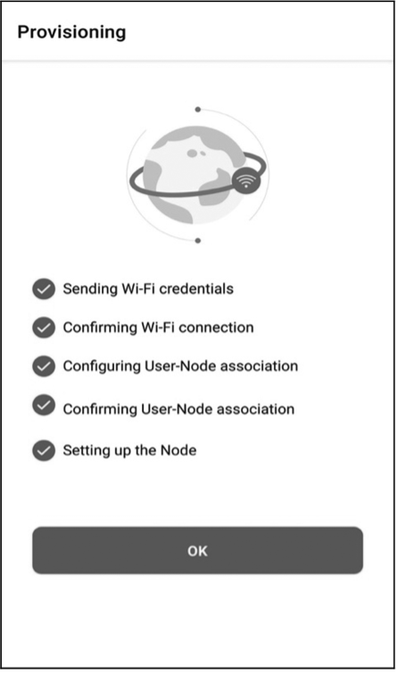
</p>
<p align="center"><b>รูปที่ 11.13</b> ขั้นตอนการเปิดใช้งาน Assisted Claiming และการจับคู่อุปกรณ์บนโทรศัพท์มือถือ</p>

1. **เข้าสู่ระบบ** เปิดแอปพลิเคชัน **ESP RainMaker** บนโทรศัพท์มือถือ เข้าสู่ระบบด้วยบัญชีที่ลงทะเบียนไว้
2. **เพิ่มอุปกรณ์** กดปุ่มเครื่องหมายบวก (`+ Add Device`) บนหน้าจอแอป
3. **สแกน QR Code** นำกล้องสมาร์ตโฟนสแกน QR Code ที่ปรากฏบน Serial Monitor
4. **กระบวนการ Assisted Claiming**
   * หากบอร์ดยังไม่มีใบรับรอง แอปจะขึ้นหน้าต่างยืนยันการขอรับ Certificate ให้กดปุ่มยืนยัน
   * แอปจะดึงใบรับรองจาก RainMaker Cloud แล้วส่งให้ ESP32 ผ่านช่องทาง BLE
5. **กรอกรหัส Wi-Fi** เลือกชื่อ SSID เครือข่าย Wi-Fi 2.4 GHz ในบ้านและกรอกรหัสผ่าน
6. **เสร็จสิ้นการผูกอุปกรณ์** บอร์ดจะเชื่อมต่อ Wi-Fi และผูกตัวเองเข้ากับบัญชีผู้ใช้ แอปจะแสดงการ์ด **"Living Room Light"** ขึ้นมาบนหน้าจอ

---

## 4. การทดสอบและการตรวจสอบผลลัพธ์ (Testing & Verification)

### 1. การควบคุมเปิด-ปิดผ่าน Mobile App
* กดสวิตช์ Power บนหน้าจอแอป สังเกตว่าหลอดไฟ LED บนบอร์ดเปิดและปิดทันทีตามการสั่งการ
* ทดลองเลื่อนแถบสไลเดอร์ Brightness สังเกตข้อความ Log บน Serial Monitor ว่าได้รับค่าความสว่างใหม่กี่เปอร์เซ็นต์

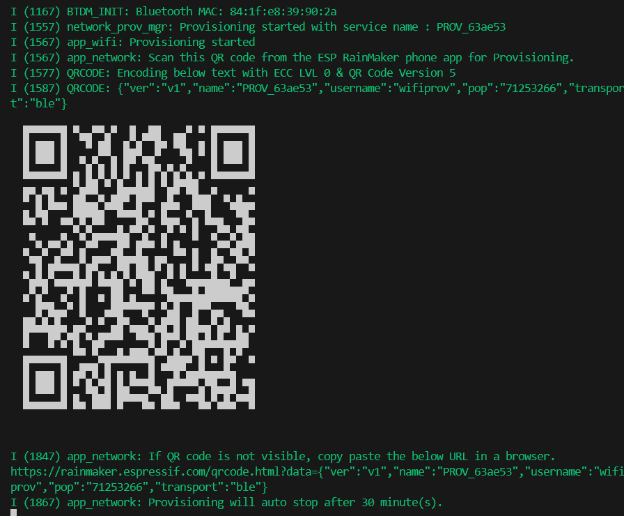
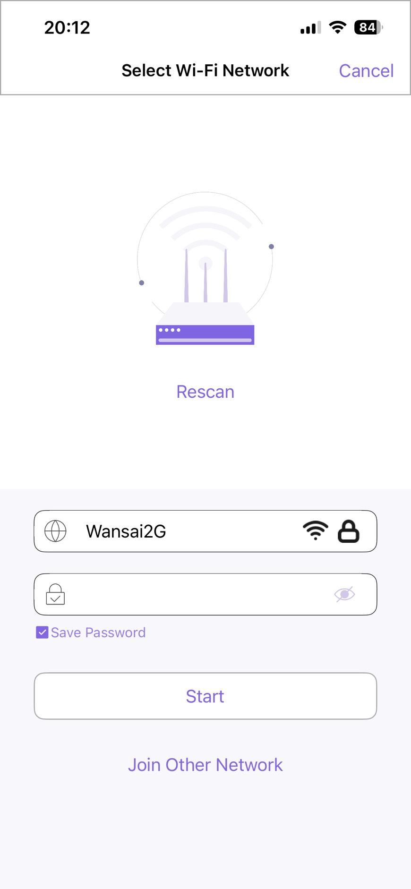
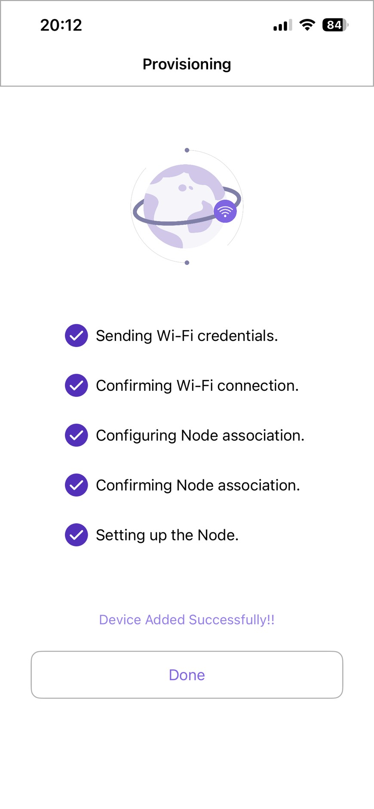
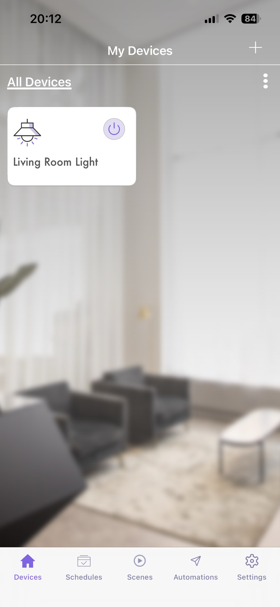
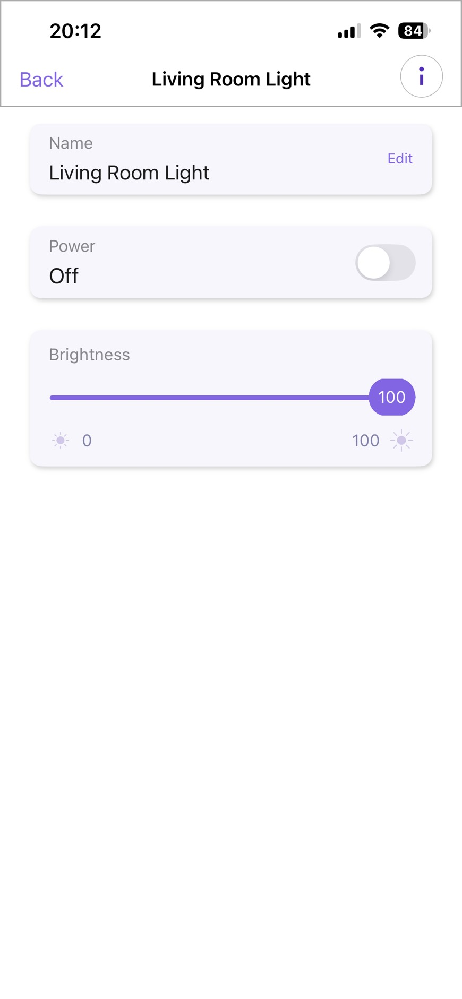
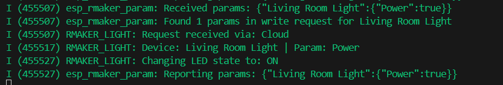
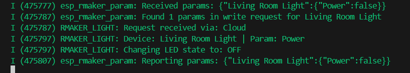
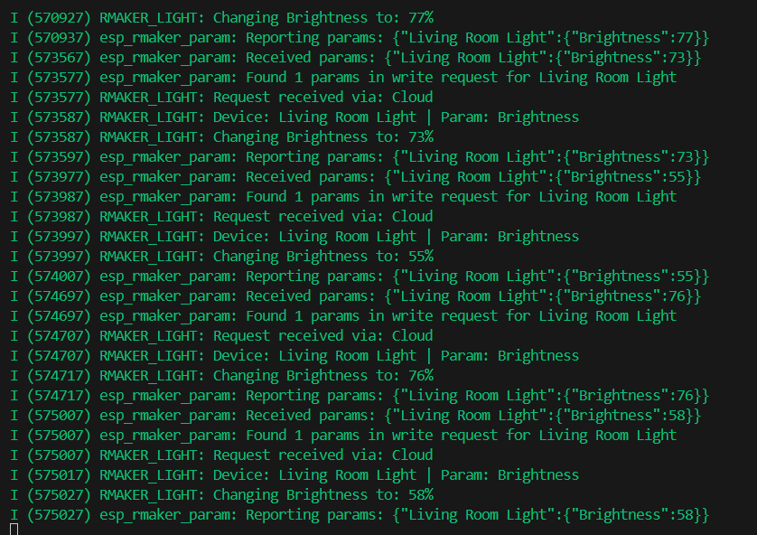


### 2. การควบคุมระยะไกลข้ามอินเทอร์เน็ต (Remote 4G/5G Test)
* **ปิดสัญญาณ Wi-Fi บนสมาร์ตโฟน** แล้วเปิดใช้งานเฉพาะ **สัญญาณอินเทอร์เน็ตมือถือ (4G/5G)**
* กดสั่งเปิด-ปิดหลอดไฟอีกครั้ง สังเกตว่าบอร์ด ESP32 ที่บ้านยังคงตอบสนองต่อคำสั่งได้อย่างรวดเร็ว แสดงถึงพลังของสถาปัตยกรรม Cloud Control

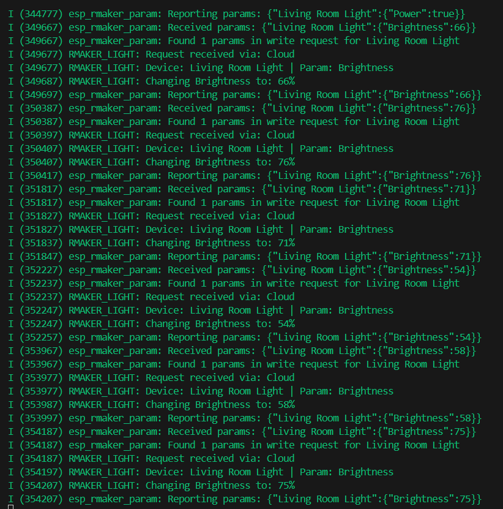
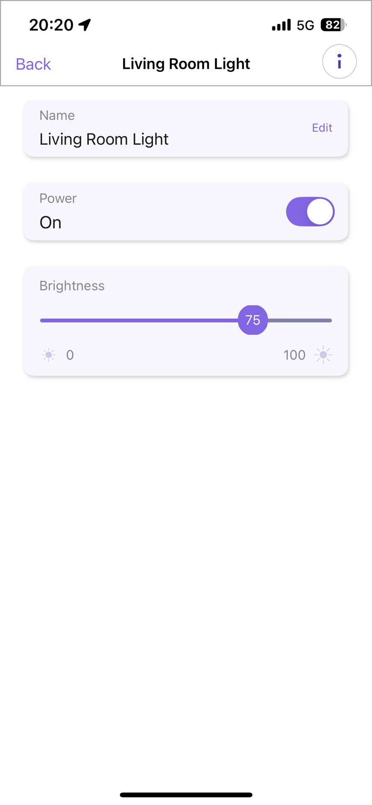


---

### 3. (ทางเลือกขั้นสูง) การทดสอบผ่าน RainMaker CLI บนคอมพิวเตอร์

เปิดเทอร์มินัลใหม่บนคอมพิวเตอร์

```powershell
# ติดตั้งเครื่องมือ CLI
pip install esp-rainmaker-cli

# เข้าสู่ระบบ
rainmaker.py login

# ดึงรายชื่ออุปกรณ์และ Node ID
rainmaker.py getnodes

# สั่งเปิดหลอดไฟผ่าน Command Line
rainmaker.py setparams --nodeid <YOUR_NODE_ID> '{"Living Room Light": {"Power": true}}'

# สั่งปิดหลอดไฟผ่าน Command Line
rainmaker.py setparams --nodeid <YOUR_NODE_ID> '{"Living Room Light": {"Power": false}}'
```

---

## 5. คำถามท้ายการทดลอง (Post-Lab Questions)

### 1. ในสถาปัตยกรรม ESP RainMaker กระบวนการ Assisted Claiming ช่วยแก้ปัญหาเรื่องการติดตั้งใบรับรองความปลอดภัย (Security Certificates) บนอุปกรณ์ในขั้นตอนพัฒนาต้นแบบได้อย่างไร?
**คำตอบ:**
* **ปัญหาดั้งเดิมในการพัฒนาต้นแบบ (Host-driven / Factory Claiming):**
  ในระบบคลาวด์ IoT ระดับสากล (เช่น AWS IoT Core) การเชื่อมต่อจะต้องใช้โปรโตคอล MQTTS (พอร์ต 8883) พร้อมการยืนยันตัวตนแบบ **Mutual TLS (mTLS)** ซึ่งบอร์ดแต่ละตัวจำเป็นต้องมีกุญแจส่วนตัว (Private Key) และใบรับรองประจำอุปกรณ์ (Device Certificate) เฉพาะตัวที่ไม่ซ้ำกัน 
  ในกระบวนการผลิตเชิงพาณิชย์ (Mass Production) จะต้องใช้คอมพิวเตอร์และเครื่องมือ CLI เชื่อมต่อสาย Serial เข้ากับบอร์ดทีละตัวเพื่อลงทะเบียนและเบิร์น Certificate ลงใน Partition `fctry` ล่วงหน้า ซึ่งมีความยุ่งยาก ซับซ้อน และไม่คล่องตัวสำหรับนักพัฒนาที่ซื้อบอร์ดเปล่ามาสร้างระบบต้นแบบ (Prototyping) หรือผู้ใช้ทั่วไปที่ไม่มีความรู้ด้านคำสั่ง Command Line

* **การแก้ปัญหาด้วยกระบวนการ Assisted Claiming:**
  ESP RainMaker ออกแบบกระบวนการ Assisted Claiming ให้สมาร์ตโฟนทำหน้าที่เป็น **"ตัวแทนคนกลาง (Proxy)"** ในการขอรับใบรับรองความปลอดภัยแทนอุปกรณ์ โดยมีขั้นตอนดังนี้:
  1. บอร์ด ESP32 ไม่จำเป็นต้องมีใบรับรองถูกบันทึกมาล่วงหน้า เมื่อเปิดเครื่อง บอร์ดจะสุ่มสร้างคู่กุญแจแบบ **ECDSA (P-256)** ขึ้นมาภายในตัวฮาร์ดแวร์เอง และสร้างคำร้องขอใบรับรอง (CSR: Certificate Signing Request)
  2. ในขั้นตอน Wi-Fi Provisioning บอร์ดจะส่ง CSR นี้ไปยังสมาร์ตโฟนของผู้ใช้ผ่านช่องทาง **Bluetooth Low Energy (BLE)** ที่ปลอดภัย
  3. แอปพลิเคชันบนสมาร์ตโฟน (ซึ่งล็อกอินบัญชี RainMaker ไว้แล้ว) จะนำ CSR ส่งต่อไปยัง **RainMaker Claiming Service** บนคลาวด์ผ่านอินเทอร์เน็ต เพื่อขอรับ Device Certificate และผูก Node ID นั้นเข้ากับบัญชีผู้ใช้
  4. คลาวด์เซ็นรับรองและส่ง Certificate กลับมาที่แอปมือถือ จากนั้นแอปมือถือจะส่ง Certificate กลับมาให้ ESP32 ผ่านบลูทูธ เพื่อบันทึกเก็บไว้ในหน่วยความจำแฟลช (NVS) ถาวร
  
  **ประโยชน์:** ช่วยลดอุปสรรคในการพัฒนาต้นแบบได้อย่างมหาศาล นักพัฒนาเพียงแค่เปิดแอปบนมือถือ สแกน QR Code บอร์ดก็จะได้ใบรับรอง mTLS ที่ถูกต้องตามมาตรฐานความปลอดภัยระดับโลกมาติดตั้งในตัวเองโดยอัตโนมัติ โดยไม่ต้องพิมพ์คำสั่ง CLI หรือเสียบสายแฟลช Certificate ทีละตัว

---

### 2. เพราะเหตุใดฟังก์ชัน write_cb จึงต้องเรียกคำสั่ง esp_rmaker_param_update_and_report() ทุกครั้งที่มีการเปลี่ยนแปลงค่าพารามิเตอร์?
**คำตอบ:**
เหตุผลหลักเกี่ยวข้องกับกลไก **Device State Synchronization** และสถาปัตยกรรม **Digital Twin / Device Shadow** ของระบบคลาวด์ ดังนี้:

1. **การแยกระหว่าง Desired State กับ Reported State:**
   เมื่อผู้ใช้งานกดปุ่มบนแอปพลิเคชันมือถือ คำสั่งที่ส่งลงมาที่บอร์ดผ่านฟังก์ชัน `write_cb` ถือเป็น **"Desired State"** (สถานะที่ผู้ใช้ต้องการให้เป็น เช่น ต้องการให้ไฟเปิด `Power = true`) แต่ในโลกความเป็นจริง ฮาร์ดแวร์อาจทำงานผิดพลาด ไฟดับ หรือขาสัญญาณเสียหายได้

2. **การยืนยันสถานะการทำงานจริง (Reported State):**
   เมื่อโค้ดบนบอร์ดสั่งงานขา GPIO สำเร็จแล้ว (`gpio_set_level(LED_PIN, state ? 1 : 0)`) การเรียกคำสั่ง `esp_rmaker_param_update_and_report(param, val)` จะทำหน้าที่ 2 ประการพร้อมกัน:
   * **อัปเดตสถานะในหน่วยความจำ Local (Local State Update):** บันทึกค่าพารามิเตอร์ใหม่ลงในฐานข้อมูล RainMaker Core บนแรมของบอร์ด
   * **รายงานสถานะจริงกลับสู่คลาวด์ (Publish Reported State):** สั่งแพ็กเกจข้อมูลเป็น MQTT JSON Payload ส่งกลับไปยัง RainMaker Cloud เพื่อยืนยันว่า *"ฮาร์ดแวร์รับคำสั่งและเปลี่ยนสถานะจริงเสร็จสมบูรณ์แล้ว"*

3. **ป้องกันปัญหาความไม่สอดคล้องของหน้าจอแอป (UI State Desynchronization):**
   หากเราไม่เรียกคำสั่งนี้ คลาวด์และแอปบนมือถือจะไม่ได้รับการยืนยันสถานะ ส่งผลให้ปุ่มสวิตช์บนแอปแสดงสถานะค้าง (Pending), ไอคอนเด้งกลับไปที่สถานะเดิม (State Flip-back), หรือแอปมองว่าอุปกรณ์ออฟไลน์ เนื่องจากไม่ได้รับการตอบสนองจากตัวอุปกรณ์จริง

---

### 3. เปรียบเทียบความแตกต่างระหว่างการพัฒนาอุปกรณ์ IoT ด้วย Plain MQTT บน Mosquitto เอง (ในแล็บ 11.2) กับการใช้ ESP RainMaker SDK (ในแล็บ 11.4) ในแง่ของความพยายามในการพัฒนา (Development Effort), ความปลอดภัย (Security), และการขยายระบบ (Scalability)
**คำตอบ:**

| มิติการเปรียบเทียบ | Plain MQTT บน Mosquitto เอง (Lab 11.2) | ESP RainMaker SDK (Lab 11.4) |
| :--- | :--- | :--- |
| **ความพยายามในการพัฒนา (Development Effort)** | **สูงมาก (High Effort):**<br>- ต้องเขียนโค้ดตั้งค่า Wi-Fi และเชื่อมต่อ Broker เองแบบ Hardcoded<br>- ต้องออกแบบ Topic Hierarchy และ Data Schema (JSON) เองทั้งหมด<br>- ต้องพัฒนาแอปพลิเคชันมือถือ, เว็บแดชบอร์ด, และระบบ Backend ขึ้นมาเองทั้งหมดเพื่อควบคุม | **ต่ำมาก (Low Effort / Out-of-the-box):**<br>- มีระบบตั้งค่า Wi-Fi Provisioning ผ่าน Bluetooth (BLE) และ QR Code สำเร็จรูป<br>- มีโครงสร้าง Standard Devices/Params รองรับ ไม่ต้องเขียนโค้ดจัดโครงสร้าง JSON เอง<br>- มีแอปพลิเคชันมาตรฐาน (iOS / Android) ที่สามารถสร้างหน้าจอควบคุม (UI Widget) ตามโค้ด C ได้โดยอัตโนมัติ |
| **ความปลอดภัย (Security)** | **ต่ำมาก (Low Security):**<br>- ในแล็บ 11.2 ส่งข้อมูลผ่านพอร์ต 1883 แบบไม่เข้ารหัส (Cleartext)<br>- เสี่ยงต่อการถูกดักฟัง (Sniffing) และการปลอมแปลงคำสั่ง (Spoofing)<br>- หากต้องการทำ mTLS (แบบแล็บ 11.3) ต้องยุ่งยากกับการจัดการกุญแจและ CA เองทุกอุปกรณ์ | **สูงมากระดับองค์กร (Enterprise Security):**<br>- บังคับเข้ารหัสข้อมูลสองทาง (mTLS พอร์ต 8883) ร่วมกับ AWS IoT Core เป็นค่าเริ่มต้น<br>- กระบวนการ Wi-Fi Provisioning ผ่าน BLE เข้ารหัสด้วยอัลกอริทึม **Security 2 (SRP6a)**<br>- มีระบบ Assisted Claiming บริหารจัดการใบรับรองดิจิทัลแบบแยกรายอุปกรณ์ |
| **การขยายระบบ (Scalability)** | **จำกัด (Limited Scalability):**<br>- Broker Mosquitto ทำงานบนเครื่องคอมพิวเตอร์หรือเซิร์ฟเวอร์เดี่ยว (Single Node)<br>- รองรับการควบคุมเฉพาะภายในวงเครือข่ายแลน (Local LAN)<br>- หากต้องการสั่งงานข้ามอินเทอร์เน็ต ต้องทำ Port Forwarding หรือเช่า VPS ซึ่งบริหารจัดการและขยายโหลดได้ยาก | **ไร้ขีดจำกัด (Infinite Cloud Scalability):**<br>- ทำงานบนสถาปัตยกรรม Serverless ของ AWS Cloud (AWS IoT Core, DynamoDB, Lambda, Cognito)<br>- รองรับการเชื่อมต่ออุปกรณ์และผู้ใช้งานพร้อมกันได้หลายล้านเครื่องจากทุกมุมโลก (Remote 4G/5G Control) ทันทีโดยไม่ต้องตั้งค่าระบบเครือข่าย |

---

### 4. อธิบายขั้นตอนที่ทำให้ ESP RainMaker สามารถเชื่อมโยงการทำงานร่วมกับระบบสั่งงานด้วยเสียงของ Google Home หรือ Amazon Alexa ได้โดยไม่ต้องเขียนโค้ดเพิ่มเติมบนตัวบอร์ด ESP32
**คำตอบ:**
เหตุผลที่บอร์ด ESP32 ไม่จำเป็นต้องเขียนโค้ดจัดการเสียงหรือระบบของ Google/Amazon เลย เกิดจากการออกแบบระบบแบบ **Standardized Data Abstraction** และการเชื่อมต่อในระดับ **Cloud-to-Cloud Integration** ตามขั้นตอนดังนี้:

1. **การใช้นิยามอุปกรณ์มาตรฐาน (Standard Device Abstraction บนบอร์ด):**
   ในโค้ด C ของเรา มีการประกาศอุปกรณ์เป็นประเภทมาตรฐาน เช่น:
   ```c
   s_light_device = esp_rmaker_lightbulb_device_create("Living Room Light", NULL, false);
   ```
   และใช้พารามิเตอร์มาตรฐานคือ `ESP_RMAKER_DEF_POWER_NAME` (Power) และ `ESP_RMAKER_DEF_BRIGHTNESS_NAME` (Brightness) ทำให้เมื่อบอร์ดเชื่อมต่อกับ RainMaker Cloud ข้อมูลคุณสมบัติ (Capabilities / Metadata) ของหลอดไฟนี้จะถูกอัปโหลดขึ้นไปเป็น Data Model บนคลาวด์ทันที

2. **การเชื่อมโยงบัญชีผู้ใช้ (Account Linking ผ่าน OAuth 2.0):**
   ผู้ใช้งานเปิดแอป Google Home หรือ Alexa แล้วเลือกฟังก์ชันเชื่อมต่อบริการ **"ESP RainMaker"** จากนั้นล็อกอินด้วยบัญชี RainMaker เดียวกัน ทำให้คลาวด์ของ Google/Amazon ได้รับสิทธิ์ในการเข้าถึงอุปกรณ์ภายใต้บัญชีนั้น

3. **การแปลงข้อมูลคุณลักษณะโดยอัตโนมัติ (Device Trait Mapping บน Cloud):**
   RainMaker Cloud จะทำหน้าที่เป็นล่ามกลาง ทำการจับคู่ (Mapping) ชนิดอุปกรณ์และพารามิเตอร์ของตนเองให้เข้ากับมาตรฐานของ Smart Home Platform นั้นๆ โดยอัตโนมัติ:
   * `Lightbulb` ใน RainMaker $\rightarrow$ แมปเป็น Smart Home Device Type: `action.devices.types.LIGHT`
   * `Power` parameter $\rightarrow$ แมปเป็น Device Trait: `action.devices.traits.OnOff`
   * `Brightness` parameter $\rightarrow$ แมปเป็น Device Trait: `action.devices.traits.Brightness`

4. **ขั้นตอนการประมวลผลคำสั่งเสียง (Voice Command Execution Flow):**
   * ผู้ใช้พูดคำสั่ง เช่น *"Hey Google, turn on Living Room Light"* หรือสั่งผ่านลำโพงอัจฉริยะ
   * Google Cloud ประมวลผลคำสั่งเสียง (NLP) และยิงคำสั่งผ่าน Webhook ไปยัง **ESP RainMaker Cloud**
   * RainMaker Cloud แปลงคำสั่งนั้นเป็น JSON Message: `{"Living Room Light": {"Power": true}}` แล้วส่งผ่าน MQTT ลงมายังบอร์ด ESP32
   * บอร์ด ESP32 จะรับข้อมูลผ่านฟังก์ชัน `write_cb` ตัวเดิมที่มีอยู่แล้วเหมือนการสั่งงานผ่านแอปมือถือทั่วไป

**สรุป:** ตัวบอร์ด ESP32 มีหน้าที่เพียงแค่รับค่าตัวแปร `Power` และ `Brightness` มาเปลี่ยนขา GPIO เท่านั้น ส่วนขั้นตอนการรับเสียง, การแปลความหมาย (Natural Language Processing), และการจับคู่คำสั่งอัจฉริยะทั้งหมดเกิดขึ้นบนคลาวด์แบบ Cloud-to-Cloud ทำให้ไม่ต้องใช้พลังงานประมวลผลหรือเขียนโค้ดเพิ่มบนตัวบอร์ดแม้แต่บรรทัดเดียว

