# รายงานผลการทดลองที่ 11.1
## การติดตั้ง Mosquitto Broker และการทดสอบโปรโตคอล MQTT ด้วย CLI (Pub/Sub, QoS, Retain, LWT)

---

## 1. บันทึกผลการทดลอง (Experimental Results)

### กิจกรรมที่ 11-1.1: การติดตั้งและเริ่มต้น Mosquitto Broker

#### 1. คำสั่งที่ใช้เริ่มต้น Mosquitto Broker
```powershell
& mosquitto.exe -c "mosquitto.conf" -v
```

```text
1792848634: mosquitto version 2.1.2 starting
1792848634: Config loaded from mosquitto.conf.
1792848634: Bridge support available.
1792848634: Persistence support available.
1792848634: TLS support available.
1792848634: TLS-PSK support available.
1792848634: Websockets support available.
1792848634: Opening ipv4 listen socket on port 1883.
1792848634: mosquitto version 2.1.2 running
```

#### 3. บันทึก Log ขณะหยุดการทำงานของ Broker (เมื่อกด Ctrl+C)
```text
1792848869: mosquitto version 2.1.2 terminating
```

#### 4. ภาพหน้าจอการทำงานของ Mosquitto Broker

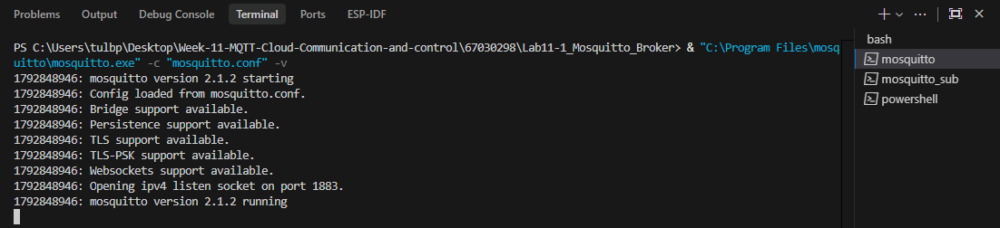

---

### กิจกรรมที่ 11-1.2: การทดสอบ Publish / Subscribe พื้นฐาน และการใช้ Wildcards

#### 1. การ Subscribe หัวข้อเฉพาะเจาะจง (`home/livingroom/light`)
* **คำสั่ง Subscriber (เทอร์มินัล 2):**
  ```powershell
  & mosquitto_sub.exe -h 127.0.0.1 -p 1883 -t "home/livingroom/light" -v
  ```
* **คำสั่ง Publisher (เทอร์มินัล 3):**
  ```powershell
  & mosquitto_pub.exe -h 127.0.0.1 -p 1883 -t "home/livingroom/light" -m "ON"
  ```
* **ผลลัพธ์ที่ได้รับบนหน้าต่าง Subscriber:**

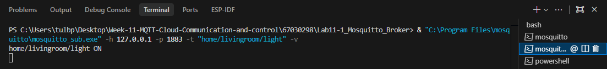

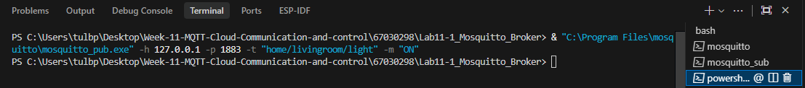

---

#### 2. การทดสอบไวลด์การ์ดระดับเดียว (Single-Level Wildcard: `+`)
* **คำสั่ง Subscriber:** `& mosquitto_sub.exe -h 127.0.0.1 -p 1883 -t "home/+/light" -v`

##### ตารางบันทึกผลการทดสอบ Single-Level Wildcard
| ลำดับ | คำสั่ง Publish Topic & Message | ผลลัพธ์ที่แสดงบน Subscriber (`home/+/light`) | ได้รับ / ไม่ได้รับ |
| :---: | :------------------------------------------------------------- | :------------------------------------------- | :----------------: |
| 1 | `& mosquitto_pub.exe ... -t "home/livingroom/light" -m "ON"` | `home/livingroom/light ON` | [✅] ได้รับ / [ ] ไม่ได้รับ |
| 2 | `& mosquitto_pub.exe ... -t "home/kitchen/light" -m "OFF"` | `home/kitchen/light OFF` | [✅] ได้รับ / [ ] ไม่ได้รับ |
| 3 | `& mosquitto_pub.exe ... -t "home/bedroom/balcony/light" -m "ON"`| *(ไม่แสดงข้อความ)* | [ ] ได้รับ / [✅] ไม่ได้รับ |

* **การวิเคราะห์ผล:** เหตุใดหัวข้อ `home/bedroom/balcony/light` จึงไม่แสดงผลใน Subscriber:
  > **คำตอบ/การวิเคราะห์:** เพราะเครื่องหมาย `+` ใช้แทนชื่อหัวข้อได้เพียงชั้นเดียว แต่หัวข้อนี้มีชั้นย่อยคั่นกลาง 2 ชั้นคือ `bedroom/balcony` จึงไม่ตรงกับเงื่อนไข ทำให้ไม่ได้รับข้อความ

* **ภาพหน้าจอการทดสอบ Single-Level Wildcard:**

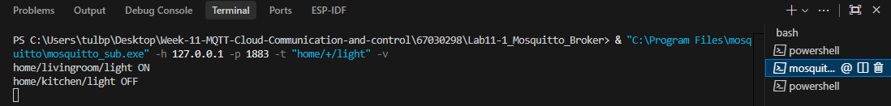

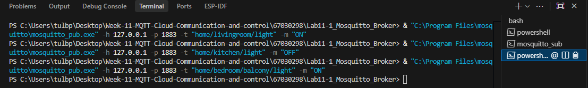

---

#### 3. การทดสอบไวลด์การ์ดหลายระดับ (Multi-Level Wildcard: `#`)
* **คำสั่ง Subscriber:** `& mosquitto_sub.exe -h 127.0.0.1 -p 1883 -t "home/#" -v`

##### ตารางบันทึกผลการทดสอบ Multi-Level Wildcard
| ลำดับ | คำสั่ง Publish Topic & Message | ผลลัพธ์ที่แสดงบน Subscriber (`home/#`) | ได้รับ / ไม่ได้รับ |
| :---: | :------------------------------------------------------------- | :------------------------------------- | :----------------: |
| 1 | `& mosquitto_pub.exe ... -t "home/livingroom/temp" -m "26.4"` | `home/livingroom/temp 26.4` | [✅] ได้รับ / [ ] ไม่ได้รับ |
| 2 | `& mosquitto_pub.exe ... -t "home/bedroom/balcony/light" -m "ON"`| `home/bedroom/balcony/light ON` | [✅] ได้รับ / [ ] ไม่ได้รับ |

* **ผลการสังเกต:**
  > **บันทึกผล:** เครื่องหมาย `#` สามารถดักจับหัวข้อย่อยทั้งหมดที่อยู่ภายใต้ `home/` ได้ทุกระดับชั้น ไม่ว่าจะมีลำดับชั้นเดียวหรือหลายชั้นคั่นกลาง ทำให้ได้รับข้อความทั้งหมด

* **ภาพหน้าจอการทดสอบ Multi-Level Wildcard:**

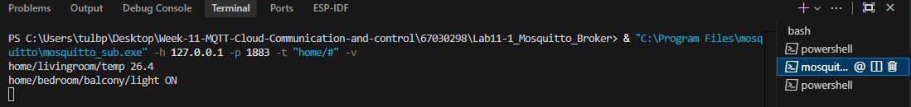

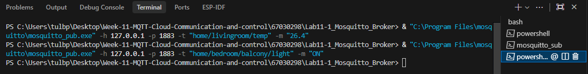

---

### กิจกรรมที่ 11-1.3: การทดสอบระดับคุณภาพการส่งข้อมูล (QoS 0, QoS 1, QoS 2)

#### 1. ตารางเปรียบเทียบลำดับแพ็กเก็ต (Packet Sequence & Handshake) จาก Broker Verbose Log
| ระดับ QoS | คำสั่ง Subscriber & Publisher ที่ใช้ | ลำดับแพ็กเก็ตที่บันทึกได้จาก Broker Log | กลไกการยืนยันข้อมูล (Handshake Mechanism) |
| :---: | :--- | :--- | :--- |
| **QoS 0**<br>(At Most Once) | **Sub:** `mosquitto_sub ... -t "test/qos" -q 0 -v`<br>**Pub:** `mosquitto_pub ... -t "test/qos" -m "QoS 0" -q 0` | 1. `PUBLISH` (จาก Publisher ถึง Broker)<br>2. `PUBLISH` (จาก Broker ถึง Subscriber) | ไม่มีการยืนยันข้อมูล (Fire and Forget) ไม่มีการส่งแพ็กเก็ตตอบรับใดๆ |
| **QoS 1**<br>(At Least Once) | **Sub:** `mosquitto_sub ... -t "test/qos" -q 1 -v`<br>**Pub:** `mosquitto_pub ... -t "test/qos" -m "QoS 1" -q 1` | 1. `PUBLISH` (จาก Publisher ถึง Broker)<br>2. `PUBACK` (จาก Broker กลับไปยัง Publisher)<br>3. `PUBLISH` (จาก Broker ถึง Subscriber)<br>4. `PUBACK` (จาก Subscriber ตอบกลับ Broker) | ยืนยันข้อมูล 2 จังหวะ (Two-way Handshake) ด้วยแพ็กเก็ต `PUBACK` เพื่อรับประกันว่าข้อมูลส่งถึงอย่างน้อย 1 ครั้ง |
| **QoS 2**<br>(Exactly Once) | **Sub:** `mosquitto_sub ... -t "test/qos" -q 2 -v`<br>**Pub:** `mosquitto_pub ... -t "test/qos" -m "QoS 2" -q 2` | 1. `PUBLISH`<br>2. `PUBREC`<br>3. `PUBREL`<br>4. `PUBCOMP` | ยืนยันข้อมูล 4 จังหวะ (Four-way Handshake) เพื่อรับประกันความถูกต้องว่าข้อความส่งถึงปลายทางแน่นอนและเพียงครั้งเดียวเท่านั้น (Exactly Once) |

#### 2. รายละเอียด Broker Log แต่ละระดับ QoS
* **Log การทำงานของ QoS 0:**
  ```text
  1792850901: New connection from 127.0.0.1:54486 on port 1883.
  1792850901: Sending CONNACK to auto-CE1A8F12-A3DB-CB68-09FD-E1B31FA3956E (0, 0)
  1792850901: Received SUBSCRIBE from auto-CE1A8F12-A3DB-CB68-09FD-E1B31FA3956E (test/qos QoS 0)
  1792850901: Sending SUBACK to auto-CE1A8F12-A3DB-CB68-09FD-E1B31FA3956E
  1792850905: Received PUBLISH from auto-92D03C57-7686-1D4C-E153-14121A439858 (d0, q0, r0, m0, 'test/qos', ... (13 bytes))
  1792850905: Sending PUBLISH to auto-CE1A8F12-A3DB-CB68-09FD-E1B31FA3956E (d0, q0, r0, m0, 'test/qos', ... (13 bytes))
  1792850905: Client auto-92D03C57-7686-1D4C-E153-14121A439858 [127.0.0.1:54491] disconnected.
  ```

* **Log การทำงานของ QoS 1 (PUBLISH & PUBACK):**
  ```text
  1792851028: New connection from 127.0.0.1:52117 on port 1883.
  1792851028: Sending CONNACK to auto-15D40994-5D23-9785-EEED-9447A9407E28 (0, 0)
  1792851028: Received SUBSCRIBE from auto-15D40994-5D23-9785-EEED-9447A9407E28 (test/qos QoS 1)
  1792851028: Sending SUBACK to auto-15D40994-5D23-9785-EEED-9447A9407E28
  1792851034: Received PUBLISH from auto-4881C6F0-DBD0-E328-8133-015720CE4D6B (d0, q1, r0, m1, 'test/qos', ... (13 bytes))
  1792851034: Sending PUBLISH to auto-15D40994-5D23-9785-EEED-9447A9407E28 (d0, q1, r0, m1, 'test/qos', ... (13 bytes))
  1792851034: Sending PUBACK to auto-4881C6F0-DBD0-E328-8133-015720CE4D6B (m1, rc0)
  1792851034: Received PUBACK from auto-15D40994-5D23-9785-EEED-9447A9407E28 (Mid: 1, RC:0)
  1792851034: Client auto-4881C6F0-DBD0-E328-8133-015720CE4D6B disconnected.
  ```

* **Log การทำงานของ QoS 2 (4-way Handshake):**
  ```text
  1792851105: Received SUBSCRIBE from auto-250C482B-3133-775C-1295-5E341DFA9B65 (test/qos QoS 2)
  1792851105: Sending SUBACK to auto-250C482B-3133-775C-1295-5E341DFA9B65
  1792851109: Received PUBLISH from auto-2E033EB7-88EF-0582-9BF8-95214441E6E3 (d0, q2, r0, m1, 'test/qos', ... (13 bytes))
  1792851109: Sending PUBREC to auto-2E033EB7-88EF-0582-9BF8-95214441E6E3 (m1, rc0)
  1792851109: Received PUBREL from auto-2E033EB7-88EF-0582-9BF8-95214441E6E3 (Mid: 1)
  1792851109: Sending PUBLISH to auto-250C482B-3133-775C-1295-5E341DFA9B65 (d0, q2, r0, m1, 'test/qos', ... (13 bytes))
  1792851109: Sending PUBCOMP to auto-2E033EB7-88EF-0582-9BF8-95214441E6E3 (m1)
  1792851109: Received PUBREC from auto-250C482B-3133-775C-1295-5E341DFA9B65 (Mid: 1)
  1792851109: Sending PUBREL to auto-250C482B-3133-775C-1295-5E341DFA9B65 (m1)
  1792851109: Received PUBCOMP from auto-250C482B-3133-775C-1295-5E341DFA9B65 (Mid: 1, RC:0)
  ```

#### 3. ภาพหน้าจอ Broker Log เปรียบเทียบ QoS 0, QoS 1, QoS 2
*รูปที่ 1.4: ข้อความแพ็กเก็ตใน Broker Log เปรียบเทียบระดับ QoS 0, 1 และ 2*
- QoS 0

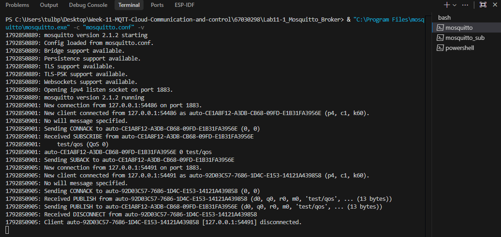

- QoS 1

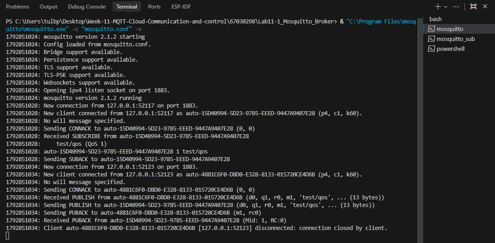

- QoS 2

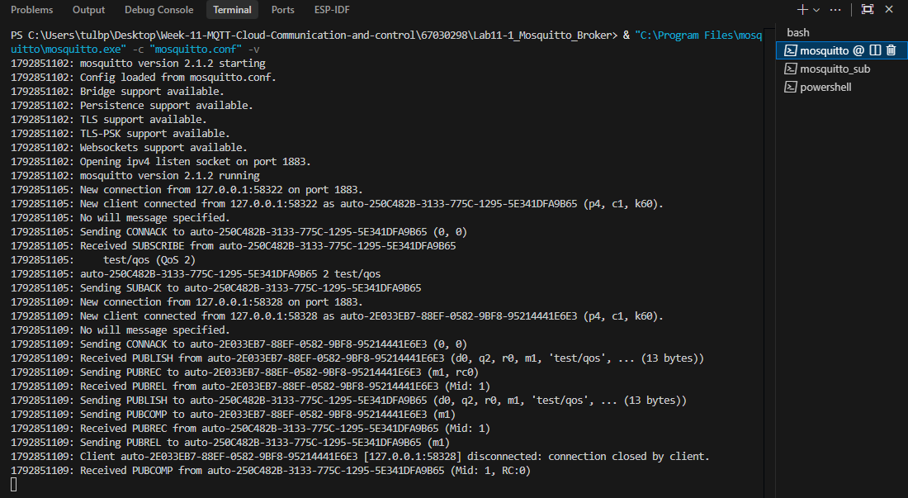

---

### กิจกรรมที่ 11-1.4: การทดสอบข้อความคงค้าง (Retained Messages)

##### ตารางบันทึกผลการทดสอบ Retained Message
| ลำดับขั้นตอน | รายละเอียดการทดสอบและคำสั่งที่ใช้ | ผลลัพธ์บน Subscriber | การวิเคราะห์พฤติกรรมของ Broker |
| :---: | :--- | :--- | :--- |
| 1 | ปิด Subscriber ทั้งหมด แล้ว Publish แบบธรรมดา:<br>`mosquitto_pub ... -t "sensor/state" -m "Normal"`<br>จากนั้นจึงเปิด Subscriber | *(ไม่ได้รับข้อความ)* | ข้อความทั่วไปที่ไม่มีการ Retain จะไม่ถูกจัดเก็บ เมื่อไม่มี Subscriber เชื่อมต่ออยู่ ข้อมูลจะสูญหายทันที |
| 2 | ขณะที่ Subscriber ยังเปิดอยู่ Publish แบบ Retain (`-r`):<br>`mosquitto_pub ... -t "sensor/state" -m "CRITICAL_ALERT" -r` | `sensor/state CRITICAL_ALERT` | Broker ส่งต่อข้อความให้ Subscriber ทันที พร้อมบันทึกข้อความนี้ไว้เป็นสถานะล่าสุดของ Topic (Retain Flag = 1) |
| 3 | ปิด Subscriber (Ctrl+C) แล้วเปิด Subscriber ใหม่อีกครั้ง โดย **ไม่ส่ง** ข้อความใหม่ | `sensor/state CRITICAL_ALERT` | Broker ส่งข้อความล่าสุดที่บันทึกค้างไว้ให้ Subscriber ทันทีที่เชื่อมต่อเข้ามาใหม่ แม้ไม่มีการ Publish เพิ่มเติม |
| 4 | เคลียร์ข้อความ Retained ด้วย Empty Payload (`-n -r`):<br>`mosquitto_pub ... -t "sensor/state" -n -r`<br>แล้วเปิด Subscriber ขึ้นมาใหม่ | *(ไม่ได้รับข้อความ)* | การส่ง Empty Payload พร้อม flag `-r` เป็นการสั่งให้ Broker ลบข้อความที่ค้างอยู่ใน Topic นั้นออกไป |

#### 2. ภาพหน้าจอการทดสอบ Retained Message เมื่อเปิด Subscriber ขึ้นมาใหม่

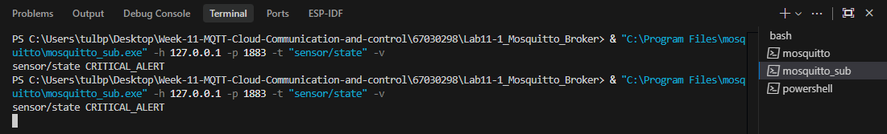

---

### กิจกรรมที่ 11-1.5: การทดสอบพินัยกรรมฉุกเฉิน (Last Will and Testament - LWT)

#### 1. การกำหนดค่า LWT และการทดสอบ
* **คำสั่ง Subscriber เฝ้าดูสถานะ (เทอร์มินัล 2):**
  ```powershell
  & mosquitto_sub.exe -h 127.0.0.1 -p 1883 -t "node/esp32/status" -v
  ```
* **คำสั่งจำลองโหนด ESP32 พร้อมตั้ง LWT (เทอร์มินัล 3):**
  ```powershell
  & mosquitto_sub.exe -h 127.0.0.1 -p 1883 -i "Node_Client_01" -t "dummy/listen" --will-topic "node/esp32/status" --will-payload "LOST_CONNECTION_OFFLINE" --will-qos 1
  ```
* **คำสั่งส่งสถานะเริ่มต้น ONLINE (เทอร์มินัล 4):**
  ```powershell
  & mosquitto_pub.exe -h 127.0.0.1 -p 1883 -t "node/esp32/status" -m "ONLINE"
  ```
* **สถานะเริ่มต้นที่ Subscriber ได้รับ:**
  ```text
  node/esp32/status ONLINE
  ```

#### 2. ผลการจำลองเหตุการณ์ขาดการเชื่อมต่อกะทันหัน (Unclean Disconnection)
* วิธีการตัดการเชื่อมต่อ: บังคับปิดหน้าต่างเทอร์มินัลที่ 3 ทันที (Force Kill Process)
* **ข้อความ LWT ที่ Broker ส่งอัตโนมัติมายังหน้าต่าง Subscriber:**
  ```text
  node/esp32/status LOST_CONNECTION_OFFLINE
  ```

#### 3. ภาพหน้าจอการทำงานของ LWT

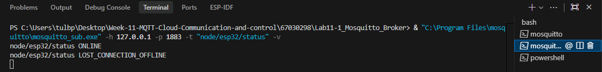

---

## 2. คำถามท้ายการทดลองและการวิเคราะห์ผลเชิงวิศวกรรม (Post-Lab Questions)

### ข้อ 1: เพราะเหตุใดสัญลักษณ์ `#` จึงต้องวางไว้ที่ตำแหน่งท้ายสุดของ Topic เสมอ? หากกำหนด Topic Filter เป็น `home/#/light` จะเกิดข้อผิดพลาดอย่างไร?
> **คำตอบ:** เพราะ `#` ใช้แทนทุกระดับชั้นที่อยู่ถัดไปทั้งหมด หากวางตรงกลางจะผิดกฎมาตรฐาน และ Broker จะปฏิเสธทันที

---

### ข้อ 2: ในระบบงานติดตามยานพาหนะ (GPS Tracking) ที่ส่งพิกัดรถยนต์ทุกๆ 1 วินาที ท่านคิดว่าควรเลือกระดับ QoS ใดระหว่าง QoS 0, 1 หรือ 2 เพราะเหตุใด?
> **คำตอบ:** ควรเลือก **QoS 0** เพราะส่งข้อมูลถี่มากทุกวินาที หากหลุดหายก็มีข้อมูลใหม่มาแทนทันที จึงไม่จำเป็นต้องตอบรับให้เปลืองเน็ตและเสียเวลา

---

### ข้อ 3: หาก Client ส่งแพ็กเก็ต `DISCONNECT` ไปยัง Broker อย่างถูกต้องก่อนปิดโปรแกรม ข้อความ Last Will and Testament (LWT) จะถูกเผยแพร่ออกไปหรือไม่ เพราะเหตุใด?
> **คำตอบ:** ไม่เผยแพร่ เพราะ LWT จะทำงานเฉพาะตอนขาดการเชื่อมต่อกะทันหันเท่านั้น หากสั่งตัดการเชื่อมต่อตามปกติ Broker จะลบพินัยกรรมทิ้งทันที

---

### ข้อ 4: Retained Message มีประโยชน์อย่างไรในการออกแบบระบบแดชบอร์ด Smart Home สำหรับผู้ใช้งานที่เพิ่งเปิดแอปพลิเคชันขึ้นมาเป็นครั้งแรก?
> **คำตอบ:** ช่วยให้แดชบอร์ดแสดงสถานะล่าสุดของอุปกรณ์ได้ทันทีที่เปิดแอป โดยไม่ต้องรอให้อุปกรณ์ส่งข้อมูลรอบใหม่เข้ามา
