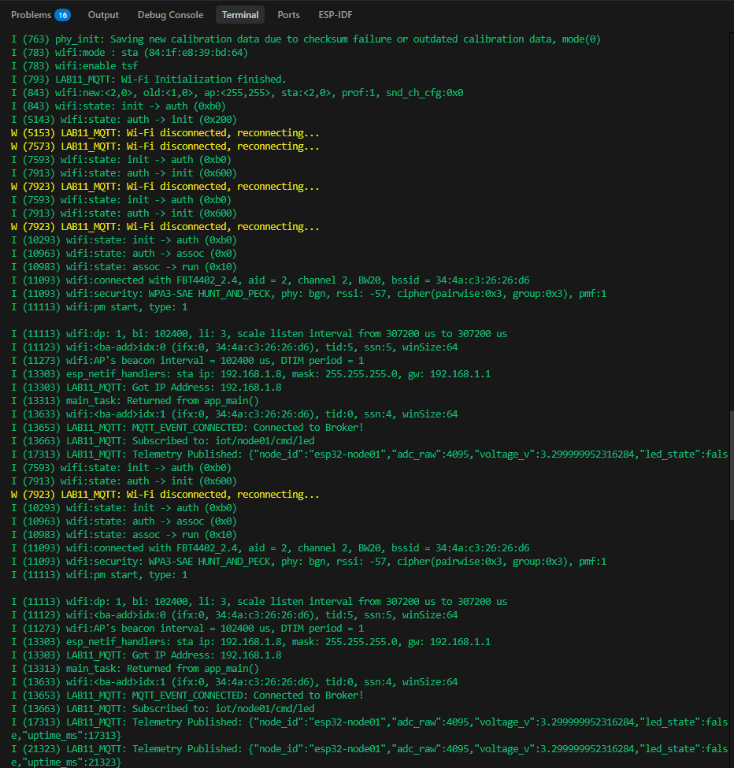
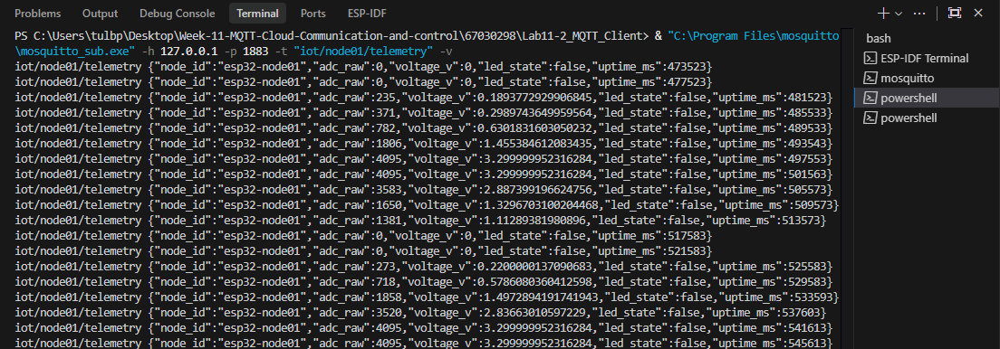
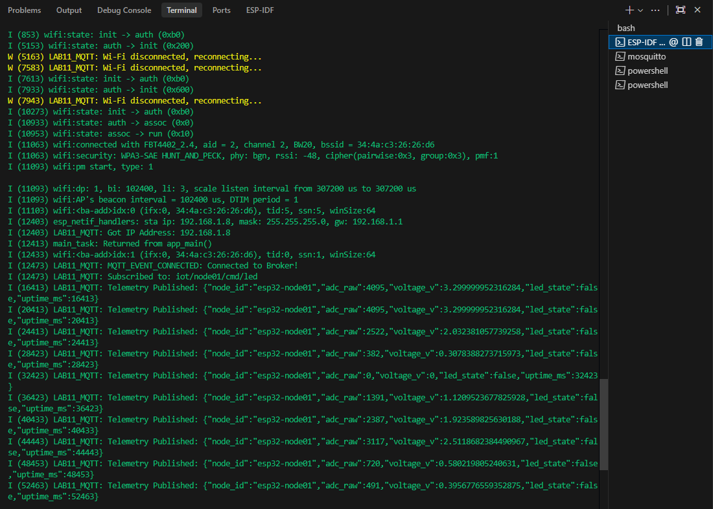
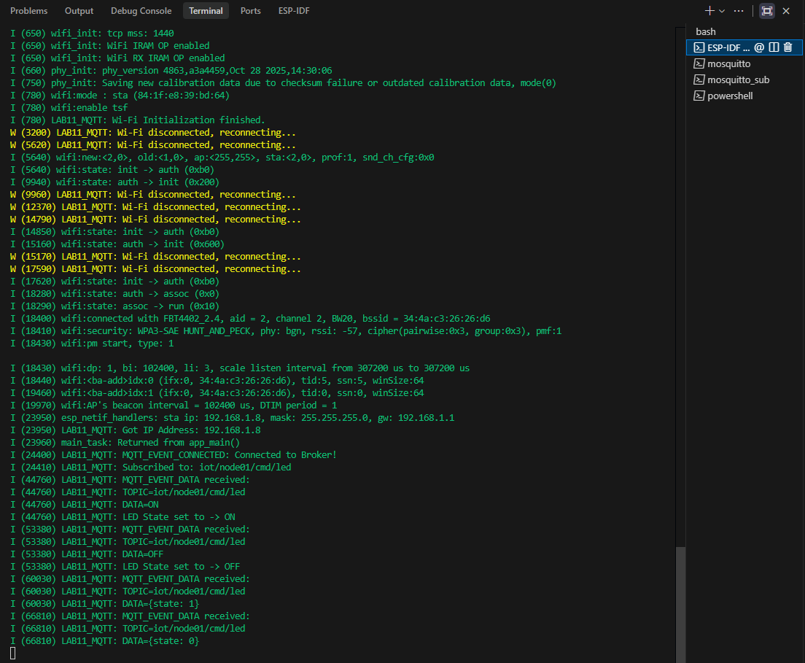
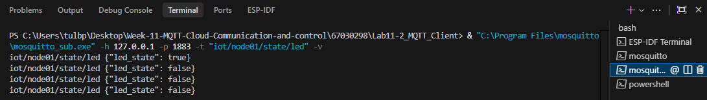
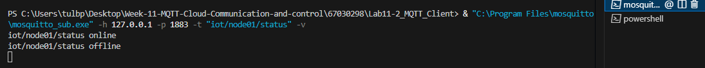

# รายงานผลการทดลองที่ 11.2
## การพัฒนา ESP32 MQTT Client เพื่อรายงานข้อมูลเซนเซอร์ Telemetry และรับคำสั่งควบคุมอุปกรณ์ระยะไกล

---

## 1. บันทึกผลการทดลอง (Experimental Results)

### 1.1 การเชื่อมต่อเครือข่ายและการเริ่มต้นระบบ (System Initialization)

* **ข้อมูลการกำหนดค่าระบบ:**
  * ชิปไมโครคอนโทรลเลอร์ที่ใช้: `ESP32`
  * ขา GPIO ของ LED: `GPIO 2`
  * ขา ADC Channel ของ Potentiometer: `ADC1_CH6` (GPIO `34`)
  * IP Address ของคอมพิวเตอร์ที่รัน Mosquitto Broker: `192.168.1.X`
  * Broker URI ที่ตั้งค่าในโค้ด: `mqtt://192.168.1.X:1883`

* **บันทึก Serial Monitor Log ขณะ ESP32 บูตและเชื่อมต่อ Broker สำเร็จ:**
  ```text
  I (773) wifi:mode : sta (84:1f:e8:39:bd:64)
  I (793) LAB11_MQTT: Wi-Fi Initialization finished.
  I (11093) wifi:connected with YOUR_WIFI_SSID, aid = 2, channel 2, BW20, bssid = 34:4a:c3:26:26:d6
  I (13303) esp_netif_handlers: sta ip: 192.168.1.Y, mask: 255.255.255.0, gw: 192.168.1.1
  I (13303) LAB11_MQTT: Got IP Address: 192.168.1.Y
  I (13653) LAB11_MQTT: MQTT_EVENT_CONNECTED: Connected to Broker!
  I (13663) LAB11_MQTT: Subscribed to: iot/node01/cmd/led
  I (17313) LAB11_MQTT: Telemetry Published: {"node_id":"esp32-node01","adc_raw":4095,"voltage_v":3.299999952316284,"led_state":false,"uptime_ms":17313}
  ```

* **ภาพหน้าจอ Serial Monitor ขณะเริ่มต้นระบบ:**


---

### 1.2 การทดสอบการส่งข้อมูล Telemetry (Sensor Telemetry to Broker)

* **คำสั่ง `mosquitto_sub` ที่ใช้บอกรับข้อมูล Telemetry:**
  ```powershell
  & "C:\Program Files\mosquitto\mosquitto_sub.exe" -h 127.0.0.1 -p 1883 -t "iot/node01/telemetry" -v
  ```

* **ตัวอย่าง JSON Payload ที่ได้รับจาก ESP32:**
  ```json
  {
    "node_id": "esp32-node01",
    "adc_raw": 2387,
    "voltage_v": 1.92,
    "led_state": false,
    "uptime_ms": 337513
  }
  ```

#### ตารางบันทึกผลการทดสอบค่าอนาล็อกจากการหมุน Potentiometer
| ลำดับ | ตำแหน่งการหมุนของ Potentiometer | ค่าดิบ ADC (`adc_raw`) | แรงดันไฟฟ้าคำนวณ (`voltage_v` V) | สถานะ LED (`led_state`) | Uptime (`uptime_ms`) |
| :---: | :------------------------------ | :--------------------: | :-------------------------------: | :---------------------: | :------------------: |
| 1 | หมุนทวนเข็มนาฬิกาสุด (~0%) | `0` | `0.00` | `false` | `517583` |
| 2 | หมุนประมาณ 25% | `718` | `0.58` | `false` | `529583` |
| 3 | หมุนประมาณกึ่งกลาง (~50%) | `1858` | `1.50` | `false` | `533593` |
| 4 | หมุนประมาณ 75% | `3520` | `2.84` | `false` | `537603` |
| 5 | หมุนตามเข็มนาฬิกาสุด (~100%) | `4095` | `3.30` | `false` | `541613` |

* **ภาพหน้าจอ Terminal Subscriber หรือ MQTT Explorer ที่ได้รับ Telemetry JSON:**


* **ภาพหน้าจอ Serial Monitor ขณะกำลังส่ง Telemetry:**


---

### 1.3 การทดสอบการส่งคำสั่งควบคุมเปิด-ปิดหลอดไฟ LED (Remote Control)

#### ตารางบันทึกผลการส่งคำสั่งควบคุม LED และการตอบรับสถานะ (Acknowledge State)
| ลำดับ | รูปแบบคำสั่งควบคุม | คำสั่ง `mosquitto_pub` ที่ใช้ | การตอบสนองของ LED บนบอร์ด | ข้อความตอบกลับที่ `iot/node01/state/led` | ค่า `led_state` ในรอบ Telemetry ถัดไป |
| :---: | :----------------- | :---------------------------- | :-------------------------: | :--------------------------------------- | :-----------------------------------: |
| 1 | สั่งเปิดไฟด้วยข้อความ ("ON") | `mosquitto_pub ... -t "iot/node01/cmd/led" -m "ON" -q 1` | [✅] สว่าง<br>[ ] ดับ | `{"led_state": true}` | `true` |
| 2 | สั่งปิดไฟด้วยข้อความ ("OFF") | `mosquitto_pub ... -t "iot/node01/cmd/led" -m "OFF" -q 1` | [ ] สว่าง<br>[✅] ดับ | `{"led_state": false}` | `false` |
| 3 | สั่งเปิดไฟด้วย JSON (`{"state": 1}`) | `mosquitto_pub ... -t "iot/node01/cmd/led" -m "{\"state\": 1}" -q 1` | [✅] สว่าง<br>[ ] ดับ | `{"led_state": true}` | `true` |
| 4 | สั่งปิดไฟด้วย JSON (`{"state": 0}`) | `mosquitto_pub ... -t "iot/node01/cmd/led" -m "{\"state\": 0}" -q 1` | [ ] สว่าง<br>[✅] ดับ | `{"led_state": false}` | `false` |

* **บันทึก Serial Monitor Log เมื่อได้รับคำสั่งควบคุม LED:**


* **ภาพหน้าจอการทดสอบส่งคำสั่งผ่าน Terminal และผลตอบรับ Acknowledge State:**


---

### 1.4 การทดสอบสถานะการเชื่อมต่อ และ Last Will and Testament (LWT)

* **ข้อความสถานะเมื่อ ESP32 เชื่อมต่อสำเร็จ (`iot/node01/status`):**
  ```text
  iot/node01/status online
  ```

* **ผลเมื่อจำลองการดึงสาย USB หรือตัดกระแสไฟของบอร์ด ESP32 ทันที:**
  * อาการที่เกิดขึ้นกับ Broker: เมื่อขาดการตอบสนองจาก ESP32 เกินระยะเวลา Keep-alive ตัว Broker จะขึ้นแจ้งเตือน `Client ESP32_39BD64 disconnected: exceeded timeout.`
  * ข้อความ LWT ที่ Broker ส่งออกมายังหัวข้อ `iot/node01/status`:
    ```text
    iot/node01/status offline
    ```

* **ภาพหน้าจอผลการทดสอบ LWT ของโหนด ESP32:**


---

## 2. คำถามท้ายการทดลองและการวิเคราะห์ผลเชิงวิศวกรรม (Post-Lab Questions)

### ข้อ 1: เพราะเหตุใดเราจึงต้องส่งข้อความสถานะ `iot/node01/status = "online"` ด้วยแฟล็ก `retain = 1` ควบคู่กับการตั้งค่า Last Will and Testament (LWT) ว่า `"offline"`?
> **คำตอบ:**
> 

---

### ข้อ 2: หากเครือข่าย Wi-Fi หลุดชั่วคราว คอมโพเนนต์ `esp-mqtt` มีพฤติกรรมการจัดการอย่างไร และเมื่อสัญญาณกลับมา โค้ดจำเป็นต้องเรียกฟังก์ชันเชื่อมต่อใหม่ด้วยตนเองหรือไม่?
> **คำตอบ:**
> 

---

### ข้อ 3: ในฟังก์ชัน `telemetry_task` เพราะเหตุใดหลังจากเรียก `cJSON_PrintUnformatted(root)` แล้วเราจึงจำเป็นต้องเรียกฟังก์ชัน `free(json_str)` และ `cJSON_Delete(root)` เสมอ? หากละเลยจะมีผลเสียอย่างไรต่อหน่วยความจำของ ESP32?
> **คำตอบ:**
> 
