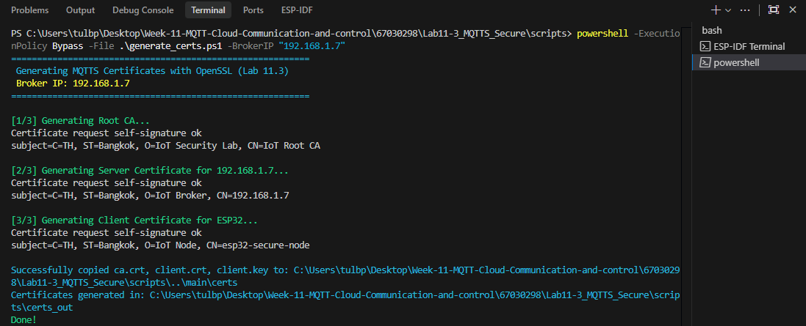
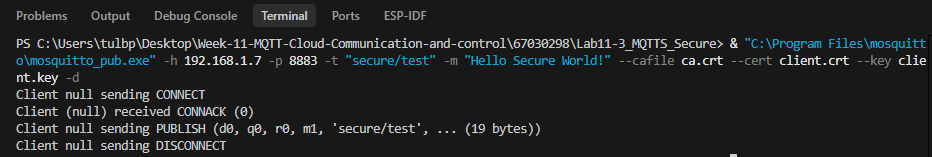
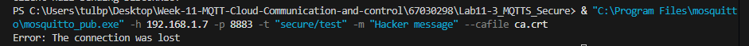
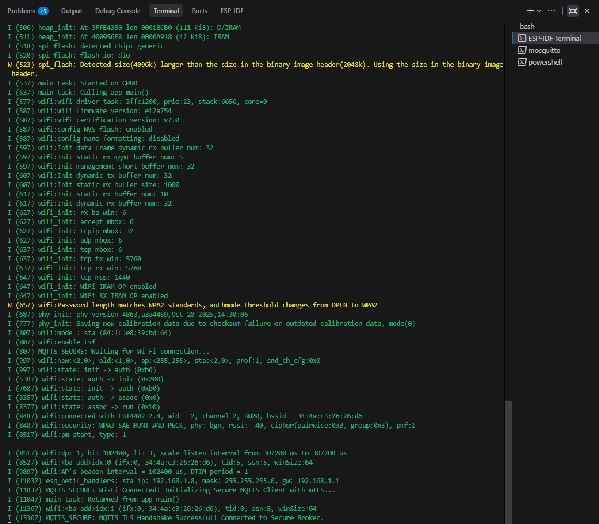
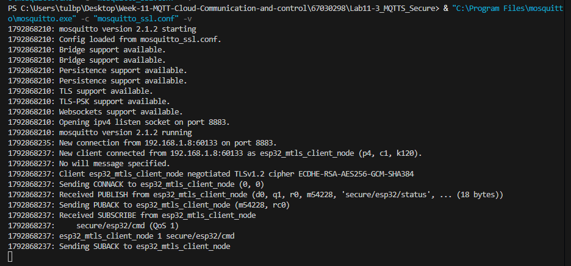

# รายงานผลการทดลองที่ 11.3
## การสื่อสาร MQTT ความปลอดภัยสูงด้วย TLS และการยืนยันตัวตนสองทาง (mTLS) บน Mosquitto และ ESP-IDF

---

## 1. บันทึกผลการทดลอง (Experimental Results)

### 1.1 การสร้างคู่กุญแจและใบรับรองดิจิทัล (OpenSSL PKI Infrastructure Setup)

* **หมายเลข IP Address ของเครื่องคอมพิวเตอร์ที่ใช้เป็น Broker:** `192.168.1.X`

#### ตารางสรุปคู่กุญแจและใบรับรองดิจิทัล X.509 ที่สร้างขึ้น
| ลำดับ | ชื่อไฟล์ | บทบาทหน้าที่ในระบบความปลอดภัย | Common Name (CN) ที่กำหนด | ประเภทและขนาดกุญแจ | ผู้มีอำนาจลงนาม (Issuer) |
| :---: | :--- | :--- | :--- | :---: | :--- |
| 1 | `ca.key` | กุญแจส่วนตัวของ Root CA | - | 2048-bit RSA | - |
| 2 | `ca.crt` | ใบรับรองของ Root CA | `IoT Root CA` | 2048-bit RSA | Self-signed (รับรองตนเอง) |
| 3 | `server.key` | กุญแจส่วนตัวของ Mosquitto Broker | - | 2048-bit RSA | - |
| 4 | `server.crt` | ใบรับรองของ Mosquitto Broker | `192.168.1.X` | 2048-bit RSA | ลงนามโดย Root CA |
| 5 | `client.key` | กุญแจส่วนตัวของบอร์ด ESP32 | - | 2048-bit RSA | - |
| 6 | `client.crt` | ใบรับรองของบอร์ด ESP32 | `esp32-secure-node` | 2048-bit RSA | ลงนามโดย Root CA |

* **บันทึกคำสั่ง OpenSSL หรือผลลัพธ์ของสคริปต์สร้างใบรับรอง:**
  ```powershell
  PS C:\...\Lab11-3_MQTTS_Secure\scripts> powershell -ExecutionPolicy Bypass -File .\generate_certs.ps1 -BrokerIP "192.168.1.X"
  ==========================================================
   Generating MQTTS Certificates with OpenSSL (Lab 11.3)
   Broker IP: 192.168.1.X
  ==========================================================

  [1/3] Generating Root CA...
  Certificate request self-signature ok
  subject=C=TH, ST=Bangkok, O=IoT Security Lab, CN=IoT Root CA

  [2/3] Generating Server Certificate for 192.168.1.X...
  Certificate request self-signature ok
  subject=C=TH, ST=Bangkok, O=IoT Broker, CN=192.168.1.X

  [3/3] Generating Client Certificate for ESP32...
  Certificate request self-signature ok
  subject=C=TH, ST=Bangkok, O=IoT Node, CN=esp32-secure-node

  Successfully copied ca.crt, client.crt, client.key to: ...\Lab11-3_MQTTS_Secure\main\certs
  Certificates generated in: ...\Lab11-3_MQTTS_Secure\scripts\certs_out
  Done!
  ```

* **ภาพหน้าจอโฟลเดอร์หรือ Terminal แสดงการสร้างไฟล์ Certificates สำเร็จ:**


---

### 1.2 การตั้งค่าและการทดสอบ Mosquitto MQTTS Broker (Port 8883) ด้วย CLI

#### 1. การกำหนดค่า `mosquitto_ssl.conf`
```text
listener 8883 0.0.0.0
cafile C:/mqtt_certs/ca.crt
certfile C:/mqtt_certs/server.crt
keyfile C:/mqtt_certs/server.key
require_certificate true
tls_version tlsv1.2
log_type all
```

* **บันทึก Log การเริ่มต้น MQTTS Broker บนพอร์ต 8883:**
  ```text
  1792866879: mosquitto version 2.1.2 starting
  1792866879: Config loaded from mosquitto_ssl.conf.
  1792866879: Bridge support available.
  1792866879: Persistence support available.
  1792866879: TLS support available.
  1792866879: TLS-PSK support available.
  1792866879: Websockets support available.
  1792866879: Opening ipv4 listen socket on port 8883.
  1792866879: mosquitto version 2.1.2 running
  ```

---

#### 2. การทดสอบที่ 1: การเชื่อมต่อแบบถูกต้อง (Authorized Client with Full mTLS Certs)
* **คำสั่ง Subscriber (ส่งครบทั้ง cafile, cert, key):**
  ```powershell
  mosquitto_sub -h 192.168.1.X -p 8883 -t "secure/test" --cafile ca.crt --cert client.crt --key client.key -v
  ```
* **คำสั่ง Publisher:**
  ```powershell
  mosquitto_pub -h 192.168.1.X -p 8883 -t "secure/test" -m "Hello Secure World!" --cafile ca.crt --cert client.crt --key client.key -d
  ```
* **ผลลัพธ์บนหน้าต่าง Subscriber:**
  ```text
  secure/test Hello Secure World!
  ```
* **Log บนฝั่ง Broker แสดงกระบวนการ TLS Handshake สำเร็จ:**
  ```text
  1792866884: New connection from 192.168.1.X:51455 on port 8883.
  1792866884: New client connected from 192.168.1.X:51455 as auto-3F1C5AA7-C6A1-E9E2-A7FA-D6B52BE164EA (p4, c1, k60).
  1792866884: No will message specified.
  1792866884: Client auto-3F1C5AA7-C6A1-E9E2-A7FA-D6B52BE164EA negotiated TLSv1.3 cipher TLS_AES_256_GCM_SHA384
  1792866884: Sending CONNACK to auto-3F1C5AA7-C6A1-E9E2-A7FA-D6B52BE164EA (0, 0)
  1792866884: Received PUBLISH from auto-3F1C5AA7-C6A1-E9E2-A7FA-D6B52BE164EA (d0, q0, r0, m0, 'secure/test', ... (19 bytes))
  1792866884: Received DISCONNECT from auto-3F1C5AA7-C6A1-E9E2-A7FA-D6B52BE164EA
  1792866884: Client auto-3F1C5AA7-C6A1-E9E2-A7FA-D6B52BE164EA [192.168.1.X:51455] disconnected.
  ```
* **ภาพหน้าจอการทดสอบ mTLS ถูกต้องผ่าน CLI:**


---

#### 3. การทดสอบที่ 2: การจำลองการโจมตีจากไคลเอนต์ที่ไม่ได้รับอนุญาต (Unauthorized Client Attack)
* **คำสั่ง Publisher ที่ไม่แนบใบรับรอง Client (ส่งเฉพาะ `--cafile`):**
  ```powershell
  mosquitto_pub -h 192.168.1.X -p 8883 -t "secure/test" -m "Hacker message" --cafile ca.crt
  ```
* **ข้อความ Error บนหน้าต่าง Publisher Terminal:**
  ```text
  Error: The connection was lost
  ```
* **ข้อความ Error Log บนฝั่ง Mosquitto Broker:**
  ```text
  1792866980: New connection from 192.168.1.X:57203 on port 8883.
  1792866980: OpenSSL Error while trying to get the error[0]: error:0A0000C7:SSL routines::peer did not return a certificate
  1792866980: Client 192.168.1.X [192.168.1.X:57203] disconnected: protocol error.
  ```
* **การวิเคราะห์ผล:** เหตุใด Broker จึงปฏิเสธการเชื่อมต่อนี้ทันที:
  > **คำตอบ/การวิเคราะห์:** โบรกเกอร์เปิดใช้งานการยืนยันตัวตนแบบสองทาง เมื่อไคลเอนต์เชื่อมต่อโดยไม่แนบใบรับรองมาด้วย การจับมือเข้ารหัสจึงล้มเหลว โบรกเกอร์จึงตัดการเชื่อมต่อทันทีก่อนเข้าสู่โพรโทคอล ทำให้ส่งข้อมูลไม่ได้

* **ภาพหน้าจอการปฏิเสธ Unauthorized Client:**


---

### 1.3 การทดสอบการเชื่อมต่อ mTLS บน ESP32 เฟิร์มแวร์

* **การตั้งค่าไฟล์ `main/CMakeLists.txt` สำหรับฝังใบรับรอง:**
  ```cmake
  idf_component_register(
      SRCS "main.c"
      INCLUDE_DIRS "."
      EMBED_TXTFILES 
          "certs/ca.crt"
          "certs/client.crt"
          "certs/client.key"
  )
  ```

* **บันทึก Serial Monitor Log ขณะเริ่มเชื่อมต่อจนสำเร็จ:**
  ```text
  I (11037) esp_netif_handlers: sta ip: 192.168.1.Y, mask: 255.255.255.0, gw: 192.168.1.1
  I (11037) MQTTS_SECURE: Wi-Fi Connected! Initializing Secure MQTTS Client with mTLS...
  I (11047) main_task: Returned from app_main()
  I (11367) wifi:<ba-add>idx:1 (ifx:0, 34:4a:c3:26:26:d6), tid:0, ssn:5, winSize:64
  I (13367) MQTTS_SECURE: MQTTS TLS Handshake Successful! Connected to Secure Broker.
  ```

* **บันทึก Mosquitto Broker Log ขณะตรวจสอบใบรับรองของ ESP32:**
  ```text
  1792868235: New connection from 192.168.1.Y:60133 on port 8883.
  1792868237: New client connected from 192.168.1.Y:60133 as esp32_mtls_client_node (p4, c1, k120).
  1792868237: No will message specified.
  1792868237: Client esp32_mtls_client_node negotiated TLSv1.2 cipher ECDHE-RSA-AES256-GCM-SHA384
  1792868237: Sending CONNACK to esp32_mtls_client_node (0, 0)
  1792868237: Received PUBLISH from esp32_mtls_client_node (d0, q1, r0, m54228, 'secure/esp32/status', ... (18 bytes))
  1792868237: Sending PUBACK to esp32_mtls_client_node (m54228, rc0)
  1792868237: Received SUBSCRIBE from esp32_mtls_client_node
  1792868237:     secure/esp32/cmd (QoS 1)
  1792868237: esp32_mtls_client_node 1 secure/esp32/cmd
  1792868237: Sending SUBACK to esp32_mtls_client_node
  ```

* **ผลการรับส่งข้อความผ่านหัวข้อความปลอดภัย:**
  * หัวข้อ: `secure/esp32/status`
  * ข้อมูลที่ได้รับ: `SECURE_ONLINE_MTLS`

* **ภาพหน้าจอ Serial Monitor และ Mosquitto Broker Log ทำงานร่วมกัน:**



---

## 2. คำถามท้ายการทดลองและการวิเคราะห์ผลเชิงวิศวกรรม (Post-Lab Questions)

### ข้อ 1: เพราะเหตุใดในคำสั่งสร้าง Server CSR ค่า Common Name (CN) จึงต้องระบุเป็น IP Address หรือ Hostname ของ Broker ให้ตรงกันพอดี? หากระบุเป็นชื่ออื่นจะเกิดข้อผิดพลาดใดขึ้น?
> **คำตอบ:**
> 

---

### ข้อ 2: การยืนยันตัวตนแบบ Mutual Authentication (mTLS) แตกต่างจากการใช้ HTTPS ทั่วไปบนเว็บเบราว์เซอร์อย่างไรในประเด็นเรื่องใบรับรองฝั่ง Client?
> **คำตอบ:**
> 

---

### ข้อ 3: หากมีผู้ไม่หวังดีขโมยไฟล์เฟิร์มแวร์ไบนารี (`.bin`) ของบอร์ด ESP32 ไปได้ เขาจะสามารถกู้คืนไฟล์ `client.key` ได้หรือไม่ และในระบบ IoT เชิงพาณิชย์เรามีฮาร์ดแวร์ความปลอดภัยใด (เช่น ESP32 Secure Boot / Flash Encryption / Digital Signature Peripheral) มาช่วยแก้ไขปัญหานี้?
> **คำตอบ:**
> 
