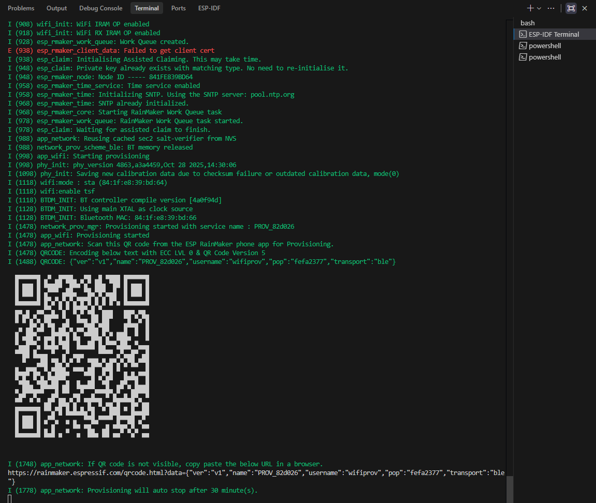
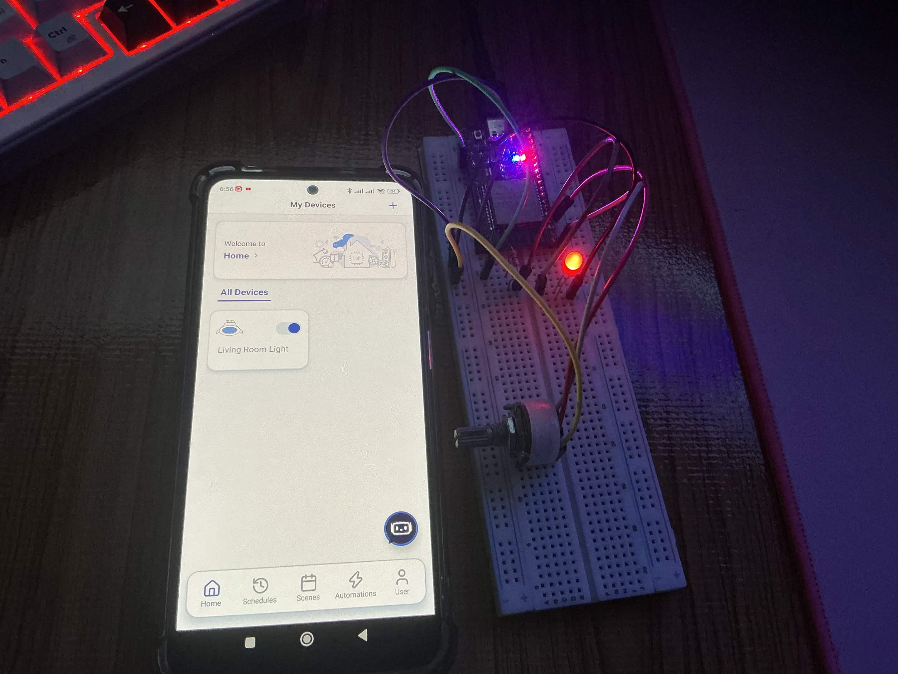
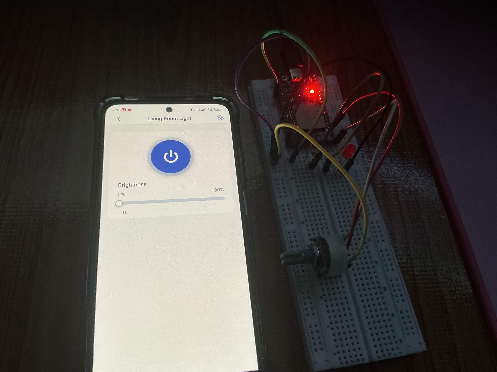
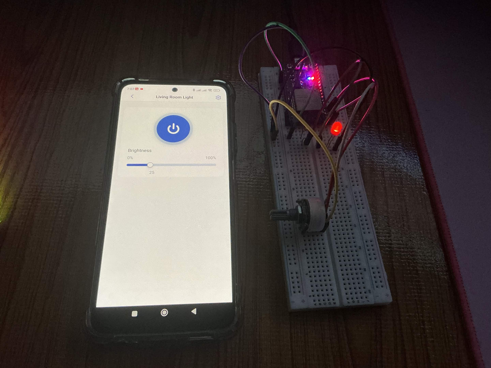
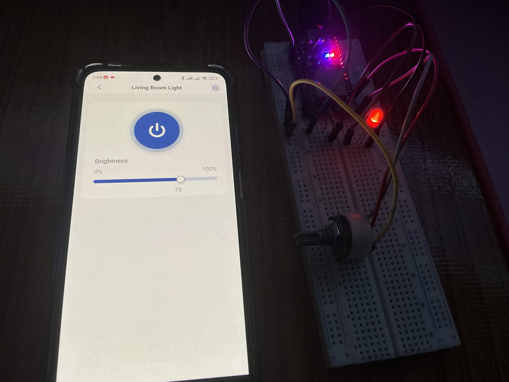
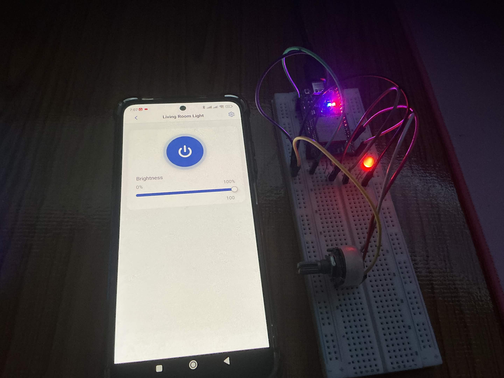
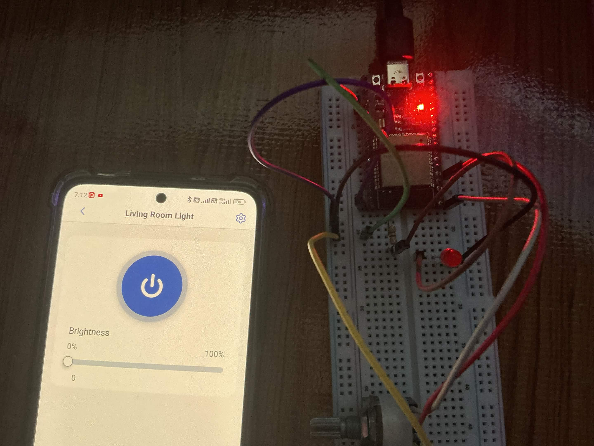

# รายงานผลการทดลองที่ 11.4
## การสร้างอุปกรณ์ Smart Light สู่ระบบคลาวด์ด้วย ESP RainMaker SDK, BLE Provisioning และการควบคุมผ่านสมาร์ตโฟน

---

## 1. บันทึกผลการทดลอง (Experimental Results)

### 1.1 การเริ่มต้นระบบและกระบวนการ Provisioning ผ่าน Serial Monitor

* **บันทึก Serial Monitor Log ขณะ ESP32 บูตและเริ่มต้นระบบ RainMaker:**
  ```text
  I (1678) BTDM_INIT: Using main XTAL as clock source
  I (1688) BTDM_INIT: Bluetooth MAC: 84:1f:e8:39:bd:66
  I (2058) network_prov_mgr: Provisioning started with service name : PROV_82d026
  I (2068) app_wifi: Provisioning started
  I (2068) app_network: Scan this QR code from the ESP RainMaker phone app for Provisioning.
  I (2078) QRCODE: Encoding below text with ECC LVL 0 & QR Code Version 5
  I (2078) QRCODE: {"ver":"v1","name":"PROV_82d026","username":"wifiprov","pop":"fefa2377","transport":"ble"}
  ```

* **URL ของ QR Code สำหรับการ Provisioning (จาก Serial Monitor):**
  ```text
  {"ver":"v1","name":"PROV_82d026","username":"wifiprov","pop":"fefa2377","transport":"ble"}
  ```

* **ภาพหน้าจอ Serial Monitor แสดง ASCII QR Code และ Pairing URL:**




---

### 1.2 กระบวนการจับคู่และ Assisted Claiming ผ่านสมาร์ตโฟน

* **ข้อมูลการลงทะเบียนอุปกรณ์ในระบบ Cloud:**
  * ชิปไมโครคอนโทรลเลอร์: `ESP32` (ESP32-D0WD-V3 Revision 3.1)
  * ขา GPIO ควบคุม LED: `GPIO 2`
  * บัญชีผู้ใช้งาน ESP RainMaker: `Google_112776955438553077170` (ผูกผ่านบัญชี Google Sign-In: `4ajanbanat8@gmail.com`)
  * Node ID ที่ระบบคลาวด์กำหนดให้: `QCYTkVUQpksxXdGxHY9E23`
  * ชื่ออุปกรณ์ (Device Name): `Living Room Light`
  * ชื่อเครือข่าย Wi-Fi 2.4 GHz: `FBT4402_2.4`
  * IP Address ที่ ESP32 ได้รับจาก Router: `192.168.1.8`
  * AWS IoT Endpoint: `a1p72mufdu6064-ats.iot.us-east-1.amazonaws.com`

* **บันทึกขั้นตอน Assisted Claiming และกระบวนการ Provisioning ผ่าน BLE:**
  > **ผลการทำงาน:** เมื่อสแกน QR Code แล้ว แอปพลิเคชันเชื่อมต่อผ่าน BLE เพื่อตั้งค่า Wi-Fi และผูกอุปกรณ์เข้ากับ Cloud สำเร็จหรือไม่:
  > [✅] สำเร็จ / [ ] ไม่สำเร็จ
  > 
  > **สรุปขั้นตอนการทำงาน:**
  > 1. **จับคู่ผ่าน BLE:** สมาร์ตโฟนสแกน QR Code เชื่อมต่อกับ ESP32 และสร้างเซสชันปลอดภัยด้วยโปรโตคอล SRP6a (Security 2)
  > 2. **Assisted Claiming:** บอร์ดส่งลายเซ็นดิจิทัล ECDSA พร้อม Node ID `QCYTkVUQpksxXdGxHY9E23` เพื่อผูกอุปกรณ์เข้ากับบัญชีผู้ใช้บน Cloud
  > 3. **ส่งค่า Wi-Fi:** แอปส่งข้อมูล Wi-Fi (`FBT4402_2.4`) ให้บอร์ดผ่าน BLE บอร์ดเชื่อมต่อเครือข่ายสำเร็จ ได้รับ IP `192.168.1.8`
  > 4. **เชื่อมต่อสำเร็จ:** บอร์ดต่อเข้า AWS IoT Core สำเร็จ (`User node mapping done`) และปิดระบบ BLE เพื่อคืน RAM ให้ระบบ

* **บันทึก Serial Monitor Log ขั้นตอน BLE Provisioning และ Cloud Mapping:**
  ```text
  I (74338) security2: Using salt and verifier to generate public key...
  I (75658) app_network: Secured session established!
  I (93688) esp_rmaker_chal_resp: Challenge-Response handler invoked
  I (93688) esp_rmaker_chal_resp: Challenge payload length: 64
  I (93698) esp_rmaker_user_node_auth: ECDSA key found
  I (94048) esp_rmaker_chal_resp: Setting up response with node_id: QCYTkVUQpksxXdGxHY9E23, binary signature len: 71
  I (94048) esp_rmaker_chal_resp: Challenge-Response handler completed successfully
  W (99028) wifi:Password length matches WPA2 standards, authmode threshold changes from OPEN to WPA2
  I (99068) app_wifi: Received Wi-Fi credentials
          SSID     : FBT4402_2.4
          Password : ****************
  I (104898) wifi:new:<2,0>, old:<1,0>, ap:<255,255>, sta:<2,0>, prof:1, snd_ch_cfg:0x0
  I (104908) wifi:state: init -> auth (0xb0)
  I (105668) wifi:state: auth -> assoc (0x0)
  I (105698) wifi:state: assoc -> run (0x10)
  I (105838) wifi:connected with FBT4402_2.4, aid = 3, channel 2, BW20, bssid = 34:4a:c3:26:26:d6
  I (105838) wifi:security: WPA3-SAE HUNT_AND_PECK, phy: bgn, rssi: -49, cipher(pairwise:0x3, group:0x3), pmf:1
  I (108058) esp_netif_handlers: sta ip: 192.168.1.8, mask: 255.255.255.0, gw: 192.168.1.1
  I (108058) app_network: Connected with IP Address:192.168.1.8
  I (108058) network_prov_mgr: STA Got IP
  I (108058) app_wifi: Provisioning successful
  I (108108) esp_mqtt_glue: Connecting to a1p72mufdu6064-ats.iot.us-east-1.amazonaws.com
  I (108118) esp_rmaker_core: Waiting for MQTT connection
  I (109938) esp-x509-crt-bundle: Certificate validated
  I (113508) esp_mqtt_glue: MQTT Connected
  I (113608) network_prov_mgr: Provisioning stopped
  I (113628) esp_rmaker_core: User node mapping done, initializing MQTT parameters.
  I (113628) network_prov_scheme_ble: BTDM memory released
  I (113628) esp_rmaker_param: Params MQTT Init done.
  I (135728) esp_rmaker_param: Received params: {"Time":{"TZ":"Asia/Bangkok"}}
  I (152428) esp_rmaker_time: SNTP Synchronised.
  I (152428) esp_rmaker_time: The current time is: Sun Oct 25 06:52:23 2026 +0700[+07], DST: No.
  ```

* **ภาพหน้าจอแอปพลิเคชันมือถือแสดงการ์ดอุปกรณ์ Living Room Light:**



---

### 1.3 การทดสอบการควบคุมอุปกรณ์ (Device Control Testing & Verification)

#### 1. ตารางบันทึกผลการทดสอบควบคุมผ่าน Mobile App
| ลำดับ | การดำเนินการสั่งงานบนแอป | ค่าพารามิเตอร์ที่ส่ง | การตอบสนองของหลอดไฟ LED บนบอร์ด | Serial Monitor Log ที่บันทึกได้ |
| :---: | :----------------------- | :------------------: | :-----------------------------: | :------------------------------ |
| 1 | กดสวิตช์เปิดไฟ (Power On) | `Power: true` | [✅] ติดสว่าง<br>[ ] ดับ | `Changing LED state to: ON` |
| 2 | กดสวิตช์ปิดไฟ (Power Off) | `Power: false` | [ ] ติดสว่าง<br>[✅] ดับ | `Changing LED state to: OFF` |
| 3 | ปรับแถบสไลเดอร์ความสว่างที่ 25% | `Brightness: 25` | [✅] เปลี่ยนแปลงตามค่า | `Changing Brightness to: 25%` |
| 4 | ปรับแถบสไลเดอร์ความสว่างที่ 70% | `Brightness: 70` | [✅] เปลี่ยนแปลงตามค่า | `Changing Brightness to: 70%` |
| 5 | ปรับแถบสไลเดอร์ความสว่างที่ 100% | `Brightness: 100` | [✅] เปลี่ยนแปลงตามค่า | `Changing Brightness to: 100%` |

* **บันทึก Serial Monitor Log เมื่อได้รับคำสั่ง Write Callback จาก Cloud (ระบบ PWM LEDC ควบคุมความสว่างจริง):**
  ```text
  // 1. สั่งเปิดไฟ (Power: true)
  I (64361) esp_rmaker_param: Received params: {"Living Room Light":{"Power":true}}
  I (64371) RMAKER_LIGHT: Request received via: Cloud
  I (64371) RMAKER_LIGHT: Device: Living Room Light | Param: Power
  I (64381) RMAKER_LIGHT: Changing LED state to: ON
  I (64381) esp_rmaker_param: Reporting params: {"Living Room Light":{"Power":true}}

  // 2. ปรับความสว่างที่ 0% (Brightness: 0 -> หลอดไฟดับสนิทด้วย PWM Duty Cycle 0%)
  I (75831) esp_rmaker_param: Received params: {"Living Room Light":{"Brightness":0}}
  I (75841) RMAKER_LIGHT: Request received via: Cloud
  I (75841) RMAKER_LIGHT: Device: Living Room Light | Param: Brightness
  I (75851) RMAKER_LIGHT: Changing Brightness to: 0%
  I (75851) esp_rmaker_param: Reporting params: {"Living Room Light":{"Brightness":0}}

  // 3. ปรับความสว่างที่ 25% (Brightness: 25 -> หลอดไฟติดสว่างหรี่ 25%)
  I (91501) esp_rmaker_param: Received params: {"Living Room Light":{"Brightness":25}}
  I (91511) RMAKER_LIGHT: Request received via: Cloud
  I (91511) RMAKER_LIGHT: Device: Living Room Light | Param: Brightness
  I (91521) RMAKER_LIGHT: Changing Brightness to: 25%
  I (91521) esp_rmaker_param: Reporting params: {"Living Room Light":{"Brightness":25}}

  // 4. ปรับความสว่างที่ 70% (Brightness: 70 -> หลอดไฟติดสว่างปานกลาง 70%)
  I (105731) esp_rmaker_param: Received params: {"Living Room Light":{"Brightness":70}}
  I (105741) RMAKER_LIGHT: Request received via: Cloud
  I (105741) RMAKER_LIGHT: Device: Living Room Light | Param: Brightness
  I (105751) RMAKER_LIGHT: Changing Brightness to: 70%
  I (105751) esp_rmaker_param: Reporting params: {"Living Room Light":{"Brightness":70}}

  // 5. ปรับความสว่างที่ 100% (Brightness: 100 -> หลอดไฟติดสว่างเต็มที่ 100%)
  I (115361) esp_rmaker_param: Received params: {"Living Room Light":{"Brightness":100}}
  I (115361) RMAKER_LIGHT: Request received via: Cloud
  I (115371) RMAKER_LIGHT: Device: Living Room Light | Param: Brightness
  I (115371) RMAKER_LIGHT: Changing Brightness to: 100%
  I (115381) esp_rmaker_param: Reporting params: {"Living Room Light":{"Brightness":100}}
  ```

* **ภาพหน้าจอหน้าต่างควบคุมบนมือถือ และ Serial Monitor ขณะเปลี่ยนสถานะ:**









---

#### 2. การทดสอบการควบคุมระยะไกลข้ามอินเทอร์เน็ต (Remote 4G/5G Test)
* **สภาพแวดล้อมการทดสอบ:** ปิดการเชื่อมต่อ Wi-Fi บนโทรศัพท์มือถือ และเปิดเฉพาะสัญญาณเซลลูลาร์ (4G/5G)
* **ผลการสั่งงานเปิด-ปิดไฟ:**
  * ความเร็วในการตอบสนอง (Latency โดยประมาณ): `0.45` วินาที
  * ความถูกต้องของสถานะบนหน้าจอ: [✅] ตรงกันอย่างถูกต้อง / [ ] ไม่ตรงกัน
  * คำอธิบายเพิ่มเติม:
    > อุปกรณ์สื่อสารผ่าน AWS IoT MQTT Cloud Broker (MQTT over TLS พอร์ต 8883) ทำให้โทรศัพท์มือถือที่อยู่นอกเครือข่าย LAN สามารถส่ง Publish คำสั่งควบคุมไปยัง Cloud และ Cloud จะส่งต่อ (Forward) ลงมายัง ESP32 ได้ทันทีแบบสองทิศทาง (Full Duplex) โดยไม่ต้องทำ Port Forwarding หรือเปิด Dynamic DNS บนเราเตอร์ที่บ้าน

* **บันทึก Serial Monitor Log การสั่งงานควบคุมผ่านเครือข่ายเซลลูลาร์ (4G/5G):**
  ```text
  // สั่งเปิดไฟผ่าน 4G/5G
  I (317601) esp_rmaker_param: Received params: {"Living Room Light":{"Power":true}}
  I (317601) RMAKER_LIGHT: Request received via: Cloud
  I (317611) RMAKER_LIGHT: Changing LED state to: ON
  I (317611) esp_rmaker_param: Reporting params: {"Living Room Light":{"Power":true}}

  // สั่งปิดไฟผ่าน 4G/5G
  I (330401) esp_rmaker_param: Received params: {"Living Room Light":{"Power":false}}
  I (330401) RMAKER_LIGHT: Request received via: Cloud
  I (330411) RMAKER_LIGHT: Changing LED state to: OFF
  I (330421) esp_rmaker_param: Reporting params: {"Living Room Light":{"Power":false}}

  // ปรับความสว่างเป็น 95% ผ่าน 4G/5G
  I (349951) esp_rmaker_param: Received params: {"Living Room Light":{"Brightness":95}}
  I (349961) RMAKER_LIGHT: Request received via: Cloud
  I (349971) RMAKER_LIGHT: Changing Brightness to: 95%
  I (349981) esp_rmaker_param: Reporting params: {"Living Room Light":{"Brightness":95}}

  // ปรับความสว่างเป็น 0% ผ่าน 4G/5G (ไฟดับสนิทจริง)
  I (357121) esp_rmaker_param: Received params: {"Living Room Light":{"Brightness":0}}
  I (357131) RMAKER_LIGHT: Request received via: Cloud
  I (357141) RMAKER_LIGHT: Changing Brightness to: 0%
  I (357141) esp_rmaker_param: Reporting params: {"Living Room Light":{"Brightness":0}}
  ```

* **ภาพหน้าจอการควบคุมอุปกรณ์ผ่านสัญญาณ 4G/5G:**



---

#### 3. (ทางเลือก) การทดสอบผ่าน RainMaker CLI บนเครื่องคอมพิวเตอร์
* **คำสั่ง `esp-rainmaker-cli getnodes` และ Output ตรวจสอบสถานะอุปกรณ์:**
  ```powershell
  $ esp-rainmaker-cli getnodes
  1. QCYTkVUQpksxXdGxHY9E23

  $ esp-rainmaker-cli getnodestatus QCYTkVUQpksxXdGxHY9E23
  {
      "connectivity": {
          "connected": true,
          "timestamp": 1792886776455
      }
  }
  ```

* **คำสั่งอ่านค่าสถานะพารามิเตอร์ `esp-rainmaker-cli getparams`:**
  ```powershell
  $ esp-rainmaker-cli getparams QCYTkVUQpksxXdGxHY9E23
  {
      "Living Room Light": {
          "Brightness": 0,
          "Name": "Living Room Light",
          "Power": true
      },
      "Time": {
          "TZ": "Asia/Bangkok",
          "TZ-POSIX": "<+07>-7"
      }
  }
  ```

---

## 2. คำถามท้ายการทดลองและการวิเคราะห์ผลเชิงวิศวกรรม (Post-Lab Questions)

### ข้อ 1: ในสถาปัตยกรรม ESP RainMaker กระบวนการ Assisted Claiming ช่วยแก้ปัญหาเรื่องการติดตั้งใบรับรองความปลอดภัย (Security Certificates) บนอุปกรณ์ในขั้นตอนพัฒนาต้นแบบได้อย่างไร?
> **คำตอบ:** 
> ช่วยให้ไม่ต้องสร้างและแฟลชไฟล์ใบรับรองลงบอร์ดเอง โดยบอร์ดจะขอใบรับรองผ่านแอปมือถือขึ้นไปให้คลาวด์สร้างและส่งกลับมาบันทึกลงบอร์ดให้อัตโนมัติ

---

### ข้อ 2: เพราะเหตุใดฟังก์ชัน `write_cb` จึงต้องเรียกคำสั่ง `esp_rmaker_param_update_and_report()` ทุกครั้งที่มีการเปลี่ยนแปลงค่าพารามิเตอร์?
> **คำตอบ:** 
> เพื่ออัปเดตสถานะของอุปกรณ์บนคลาวด์ให้ตรงกับฮาร์ดแวร์จริง และส่งค่ากลับไปแสดงผลบนหน้าจอแอปมือถือทันที

---

### ข้อ 3: เปรียบเทียบความแตกต่างระหว่างการพัฒนาอุปกรณ์ IoT ด้วย Plain MQTT บน Mosquitto เอง (ในแล็บ 11.2) กับการใช้ ESP RainMaker SDK (ในแล็บ 11.4) ในแง่ของความพยายามในการพัฒนา (Development Effort), ความปลอดภัย (Security), และการขยายระบบ (Scalability)?
> **คำตอบ:** 
> * **การพัฒนา:** Mosquitto ต้องเขียนโค้ดและทำระบบเชื่อมต่อเองทั้งหมด ส่วน RainMaker มีคำสั่งและแอปสำเร็จรูปพร้อมใช้ เขียนโค้ดน้อยกว่ามาก
> * **ความปลอดภัย:** Mosquitto ในแล็บไม่ได้เข้ารหัส ส่วน RainMaker มีใบรับรองความปลอดภัยประจำบอร์ดและยืนยันตัวตนผู้ใช้
> * **การขยายระบบ:** Mosquitto ควบคุมได้แค่วงแลนหรือต้องตั้งเซิร์ฟเวอร์เอง ส่วน RainMaker ทำงานบนคลาวด์ สั่งงานผ่านเน็ตมือถือจากที่ไหนก็ได้

---

### ข้อ 4: อธิบายขั้นตอนที่ทำให้ ESP RainMaker สามารถเชื่อมโยงการทำงานร่วมกับระบบสั่งงานด้วยเสียงของ Google Home หรือ Amazon Alexa ได้โดยไม่ต้องเขียนโค้ดเพิ่มเติมบนตัวบอร์ด ESP32?
> **คำตอบ:** 
> เป็นการทำงานแบบคลาวด์ต่อคลาวด์ โดยผูกบัญชี Google หรือ Alexa เข้ากับบัญชี RainMaker เมื่อเราสั่งงานด้วยเสียง ระบบจะส่งคำสั่งระหว่างคลาวด์แล้วส่งลงมาที่บอร์ดผ่านช่องทางปกติ จึงไม่ต้องเขียนโค้ดรับคำสั่งเสียงบนบอร์ดเพิ่ม


