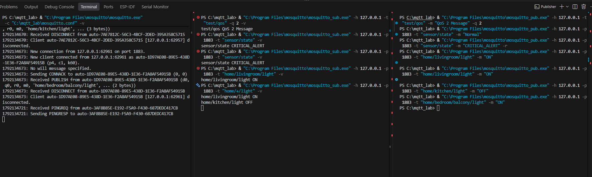
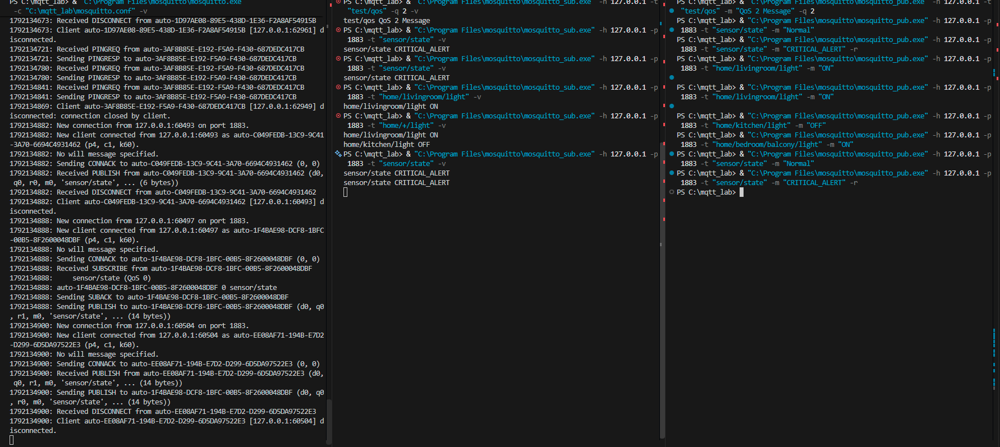

# ใบงานการทดลองที่ 11.1
### การติดตั้ง Mosquitto Broker และการทดสอบโปรโตคอล MQTT ด้วย CLI (Pub/Sub, QoS, Retain, LWT)

### กิจกรรมที่ 11-1.2  การทดสอบ Publish / Subscribe พื้นฐาน และการใช้ Wildcards

#### 1. การ Subscribe หัวข้อเฉพาะเจาะจง
ใน **เทอร์มินัลที่ 2 (Subscriber)**  สั่งรันคำสั่งต่อไปนี้
```powershell
& mosquitto_sub.exe -h 127.0.0.1 -p 1883 -t "home/livingroom/light" -v
```

เปิด **เทอร์มินัลที่ 3 (Publisher)**  ส่งข้อความสั่งงานดังนี้
```powershell
& mosquitto_pub.exe -h 127.0.0.1 -p 1883 -t "home/livingroom/light" -m "ON"
```

*สังเกตผล*  ในเทอร์มินัลที่ 2  (Subscriber) จะได้รับข้อความ `home/livingroom/light ON`
ถ้าไม่ได้ ให้ตรวจสอบว่าทั้งสอง terminal   รันอยู่ที่  IP Address  และ  Port  เดียวกันหรือไม่
เพราะนี่คือจุดเริ่มต้นของการทำงานพื้นฐานที่ต้องรันได้อย่างถูกต้อง

#### 2. การทดสอบไวลด์การ์ดระดับเดียว (Single-Level Wildcard: `+`)
ใน **เทอร์มินัลที่ 2 (Subscriber)**  กด `Ctrl + C` เพื่อออกจากโปรแกรม subscriber แล้วเปลี่ยนคำสั่ง Subscribe เป็น
```powershell
& mosquitto_sub.exe -h 127.0.0.1 -p 1883 -t "home/+/light" -v
```

ใน **เทอร์มินัลที่ 3 (Publisher)**  ทดลอง Publish ข้อความ 3 ครั้ง
```powershell
& mosquitto_pub.exe -h 127.0.0.1 -p 1883 -t "home/livingroom/light" -m "ON"
& mosquitto_pub.exe -h 127.0.0.1 -p 1883 -t "home/kitchen/light" -m "OFF"
& mosquitto_pub.exe -h 127.0.0.1 -p 1883 -t "home/bedroom/balcony/light" -m "ON"
```

> [!NOTE]
> บันทึกผลการทดลอง สังเกตว่าข้อความใดบ้างที่ปรากฏในเทอร์มินัลที่ 2 และข้อความใดที่ไม่ปรากฏ พร้อมอธิบายเหตุผลว่าทำไม `home/bedroom/balcony/light` จึงไม่แสดงผล
```
home/livingroom/light ON
home/kitchen/light OFF
```
```
เหตุผลว่าทำไม `home/bedroom/balcony/light` จึงไม่แสดงผล
เครื่องหมาย + (Single-Level Wildcard) สามารถใช้แทน Topic ได้เพียง 1 ระดับ (1 Level) ในตำแหน่งนั้นเท่านั้น
- home/livingroom/light → มี 1 ระดับคั่นกลาง (livingroom) จึงตรงตามเงื่อนไข (Match)
- home/kitchen/light → มี 1 ระดับคั่นกลาง (kitchen) จึงตรงตามเงื่อนไข (Match)
- home/bedroom/balcony/light → มีถึง 2 ระดับคั่นกลาง (bedroom/balcony) เกินกว่าที่ + ตัวเดียวจะครอบคลุมได้ จึงไม่ตรงตามเงื่อนไข (Not Match) ข้อความจึงไม่แสดงผล
```

#### 3. การทดสอบไวลด์การ์ดหลายระดับ (Multi-Level Wildcard: `#`)
ใน **เทอร์มินัลที่ 2 (Subscriber)** กด `Ctrl + C` เพื่อออกจากโปรแกรม subscriber แล้วเปลี่ยนคำสั่ง Subscribe เป็น
```powershell
& mosquitto_sub.exe -h 127.0.0.1 -p 1883 -t "home/#" -v
```

ใน **เทอร์มินัลที่ 3 (Publisher)** ทดลอง Publish ข้อความไปยังหัวข้อต่างๆ
```powershell
& mosquitto_pub.exe -h 127.0.0.1 -p 1883 -t "home/livingroom/temp" -m "26.4"
& mosquitto_pub.exe -h 127.0.0.1 -p 1883 -t "home/bedroom/balcony/light" -m "ON"
```

*สังเกตผล* ทุกข้อความที่ขึ้นต้นด้วย `home/` จะถูกส่งมาแสดงผลทั้งหมด
```
home/livingroom/temp 26.4
home/bedroom/balcony/light ON
```

### กิจกรรมที่ 11-1.3 การทดสอบระดับคุณภาพการส่งข้อมูล (QoS 0, QoS 1, QoS 2)

ในกิจกรรมนี้ ให้สังเกตข้อความ Log ใน **เทอร์มินัลที่ 1 (Mosquitto Broker)** ควบคู่กับคำสั่งในเทอร์มินัลที่ 2 และ 3

#### 1. ทดสอบ QoS 0 (At Most Once)
* ในเทอร์มินัลที่ 2 (Subscriber)  `& "C:\Program Files\mosquitto\mosquitto_sub.exe" -h 127.0.0.1 -t "test/qos" -q 0 -v`
* ในเทอร์มินัลที่ 3 (Publisher)  `& "C:\Program Files\mosquitto\mosquitto_pub.exe" -h 127.0.0.1 -t "test/qos" -m "QoS 0 Message" -q 0`
* *หมายเหตุ* การรันโปรแกรมทั้ง subscriber และ publisher จะทำให้หน้าต่างค้างและรอแสดงข้อความที่ publisher ส่งมาให้ ดังนั้นการเปลี่ยนคำสั่ง ต้องกด  `Ctrl+C`  ทุกครั้งเพื่อออกจาก  โปรแกรม subscriber ก่อนเสมอ แล้วเปลี่ยนคำสั่ง subscriber ใหม่ จากนั้นจึงรันคำสั่ง publisher ใหม่
* *สังเกต Log ฝั่ง Broker*  มีเพียงแพ็กเก็ต `PUBLISH` ส่งผ่านไปโดยไม่มีแพ็กเก็ตตอบรับใดๆ
```
PS C:\mqtt_lab> & "C:\Program Files\mosquitto\mosquitto_sub.exe" -h 127.0.0.1 -t "test/qos" -q 0 -v
test/qos QoS 0 Message
```


#### 2. ทดสอบ QoS 1 (At Least Once)
* ในเทอร์มินัลที่ 2 (Subscriber)  `& "C:\Program Files\mosquitto\mosquitto_sub.exe" -h 127.0.0.1 -t "test/qos" -q 1 -v`
* ในเทอร์มินัลที่ 3 (Publisher)  `& "C:\Program Files\mosquitto\mosquitto_pub.exe" -h 127.0.0.1 -t "test/qos" -m "QoS 1 Message" -q 1`
* *สังเกต Log ฝั่ง Broker*  จะปรากฏแพ็กเก็ต `PUBLISH (d0, q1, m1, ...)` ตามด้วยแพ็กเก็ต `PUBACK (Mid: 1)` เพื่อยืนยันการรับส่งข้อมูล
```
PS C:\mqtt_lab> & "C:\Program Files\mosquitto\mosquitto_sub.exe" -h 127.0.0.1 -t "test/qos" -q 1 -v
test/qos QoS 1 Message

1792133765: Sending PUBACK to auto-089C4EA4-8A24-9B9C-4D17-4380D1739CE2 (m1, rc0)
1792133765: Received PUBACK from auto-0C940CD1-4231-064A-1A58-069E4B795DE8 (Mid: 1, RC:0)
```
#### 3. ทดสอบ QoS 2 (Exactly Once)
* ในเทอร์มินัลที่ 2 (Subscriber)  `& mosquitto_sub.exe -h 127.0.0.1 -t "test/qos" -q 2 -v`
* ในเทอร์มินัลที่ 3 (Publisher)  `& mosquitto_pub.exe -h 127.0.0.1 -p 1883 -t "test/qos" -m "QoS 2 Message" -q 2`
* *สังเกต Log ฝั่ง Broker*  จะปรากฏกระบวนการ 4-way Handshake อย่างชัดเจน
  1. `Received PUBLISH ... q2`
  2. `Sending PUBREC`
  3. `Received PUBREL`
  4. `Sending PUBCOMP`
```
1792133940: New connection from 127.0.0.1:50724 on port 1883.
1792133940: New client connected from 127.0.0.1:50724 as auto-94DD3B24-83B9-D158-0946-2C343A1BC329 (p4, c1, k60).
1792133940: No will message specified.
1792133940: Sending CONNACK to auto-94DD3B24-83B9-D158-0946-2C343A1BC329 (0, 0)
1792133940: Received PUBLISH from auto-94DD3B24-83B9-D158-0946-2C343A1BC329 (d0, q2, r0, m1, 'test/qos', ... (13 bytes))
1792133940: Sending PUBREC to auto-94DD3B24-83B9-D158-0946-2C343A1BC329 (m1, rc0)
1792133940: Received PUBREL from auto-94DD3B24-83B9-D158-0946-2C343A1BC329 (Mid: 1)
1792133940: Sending PUBLISH to auto-BCEF9F09-8CEE-6ECB-75EB-81B1CBDAA297 (d0, q2, r0, m1, 'test/qos', ... (13 bytes))
1792133940: Sending PUBCOMP to auto-94DD3B24-83B9-D158-0946-2C343A1BC329 (m1)
1792133940: Received PUBREC from auto-BCEF9F09-8CEE-6ECB-75EB-81B1CBDAA297 (Mid: 1)
1792133940: Sending PUBREL to auto-BCEF9F09-8CEE-6ECB-75EB-81B1CBDAA297 (m1)
1792133940: Client auto-94DD3B24-83B9-D158-0946-2C343A1BC329 [127.0.0.1:50724] disconnected: connection closed by client.
1792133940: Received PUBCOMP from auto-BCEF9F09-8CEE-6ECB-75EB-81B1CBDAA297 (Mid: 1, RC:0)


```
---

### กิจกรรมที่ 11-1.4 การทดสอบข้อความคงค้าง (Retained Messages)

#### 1. ทดสอบข้อความคงค้าง (Retained Messages)
1. ปิด Subscriber ใน **เทอร์มินัลที่ 2 (Subscriber)** ทั้งหมด (ไม่มีใคร Subscribe อยู่)
2. ใน **เทอร์มินัลที่ 3 (Publisher)** ส่งข้อความธรรมดา (ไม่ใส่พารามิเตอร์ `-r`)
   ```powershell
   & mosquitto_pub.exe -h 127.0.0.1 -p 1883 -t "sensor/state" -m "Normal"
   ```
3. เปิด Subscriber ใน **เทอร์มินัลที่ 2 (Subscriber)**
   ```powershell
   & mosquitto_sub.exe -h 127.0.0.1 -p 1883 -t "sensor/state" -v
   ```
   *ผลที่ได้*  หน้าจอว่างเปล่า ไม่ได้รับข้อความใดๆ เพราะข้อความถูกส่งผ่านไปแล้วก่อนหน้านี้

4. ใน **เทอร์มินัลที่ 3 (Publisher)** สั่ง Publish โดยเพิ่มพารามิเตอร์ **`-r` (Retain)**
   ```powershell
   & mosquitto_pub.exe -h 127.0.0.1 -p 1883 -t "sensor/state" -m "CRITICAL_ALERT" -r
   ```
   *ผลที่ได้* ในเทอร์มินัลที่ 2 (Subscriber)ได้รับข้อความ `sensor/state CRITICAL_ALERT` ทันที

5. ปิดเทอร์มินัลที่ 2 (Subscriber) (`Ctrl + C`) แล้วรัน subscriber ใหม่อีกครั้ง
   ```powershell
   & mosquitto_sub.exe -h 127.0.0.1 -p 1883 -t "sensor/state" -v
   ```
   *ผลที่ได้* ทันทีที่เชื่อมต่อสำเร็จ เทอร์มินัลที่ 2 (Subscriber) จะได้รับข้อความ `CRITICAL_ALERT` ในทันที แม้ Publisher จะไม่ได้ส่งข้อความใหม่เลยก็ตาม

> [!TIP]
> **วิธีลบ Retained Message ออกจาก Broker**  ส่งข้อความที่มีเนื้อหาว่างเปล่า (Empty Payload) พร้อมเปิดแฟล็ก `-r`
> ```powershell
> & mosquitto_pub.exe -h 127.0.0.1 -p 1883 -t "sensor/state" -n -r
> ```
```
PS C:\mqtt_lab> & "C:\Program Files\mosquitto\mosquitto_sub.exe" -h 127.0.0.1 -p 1883 -t "sensor/state" -v
sensor/state CRITICAL_ALERT
PS C:\mqtt_lab> & "C:\Program Files\mosquitto\mosquitto_sub.exe" -h 127.0.0.1 -p 1883 -t "sensor/state" -v
sensor/state CRITICAL_ALERT


PS C:\mqtt_lab> & "C:\Program Files\mosquitto\mosquitto_pub.exe" -h 127.0.0.1 -p 1883 -t "sensor/state" -m "Normal"
PS C:\mqtt_lab> & "C:\Program Files\mosquitto\mosquitto_pub.exe" -h 127.0.0.1 -p 1883 -t "sensor/state" -m "CRITICAL_ALERT" -r
```
---

### กิจกรรมที่ 11-1.5 การทดสอบพินัยกรรมฉุกเฉิน (Last Will and Testament - LWT)

1. ใน **เทอร์มินัลที่ 2 (Subscriber)** เปิด Subscribe เพื่อรอเฝ้าดูสถานะของโหนด
   ```powershell
   & mosquitto_sub.exe -h 127.0.0.1 -p 1883 -t "node/esp32/status" -v
   ```
2. ใน **เทอร์มินัลที่ 3 (Publisher)** เปิด Client ที่จำลองเป็น ESP32 โดยกำหนดค่า **LWT** ไว้ล่วงหน้า
   ```powershell
   & mosquitto_sub.exe -h 127.0.0.1 -p 1883 -i "Node_Client_01" -t "dummy/listen" --will-topic "node/esp32/status" --will-payload "LOST_CONNECTION_OFFLINE" --will-qos 1
   ```
3. ส่งสถานะเริ่มต้นว่า "ONLINE" จากอุปกรณ์
   (เปิดเทอร์มินัลที่ 4 (Publisher 2) แล้วพิมพ์ `& mosquitto_pub.exe -h 127.0.0.1 -p 1883 -t "node/esp32/status" -m "ONLINE"`)
   *สังเกตผล* เทอร์มินัลที่ 2 แสดงสถานะ `ONLINE`

4. **จำลองเหตุการณ์ไฟดับหรือเครือข่ายหลุดกะทันหัน**  
   ในเทอร์มินัลที่ 3 ให้ทำการ **บังคับปิดหน้าต่างเทอร์มินัลทันที** หรือกดปิดโปรเซส เพื่อไม่ให้ Client ส่งแพ็กเก็ต `DISCONNECT`
5. *สังเกตผลในเทอร์มินัลที่ 2*  
   เมื่อ Broker ตรวจพบว่า TCP Connection ขาดหาย Broker จะเป็นผู้ส่งข้อความ
   ```text
   node/esp32/status LOST_CONNECTION_OFFLINE
   ```
   มายังเทอร์มินัลที่ 2 โดยอัตโนมัติ

---

## 4. การบันทึกและวิเคราะห์ผลการทดลอง

ให้นักศึกษาบันทึกภาพหน้าจอ (Screenshots) และตอบคำถามต่อไปนี้ลงในรายงาน
1. ภาพหน้าจอการทำงานของ Mosquitto Broker Verbose Log ขณะที่มีการเชื่อมต่อและ Subscribe ข้อความ

2. ตารางเปรียบเทียบลำดับแพ็กเก็ตที่เกิดขึ้นระหว่าง QoS 0, QoS 1 และ QoS 2 ที่สังเกตได้จาก Broker Log
| ระดับ QoS | ระดับการรับประกัน (Delivery Guarantee) | ลำดับแพ็กเก็ตที่ปรากฏใน Broker Log | ทิศทางการรับส่งแพ็กเก็ต (Flow) | การยืนยันผล (Handshake) | เหมาะสำหรับงาน (Use Cases) |
| :---: | :--- | :--- | :--- | :---: | :--- |
| **QoS 0** | **At most once**<br>(ส่งอย่างมากที่สุด 1 ครั้ง อาจสูญหายได้) | 1. `Received PUBLISH ... (q0)`<br>2. `Sending PUBLISH ... (q0)` | Publisher → Broker → Subscriber | **ไม่มี**<br>(ไม่มีการตอบกลับใดๆ) | ข้อมูลเซนเซอร์ที่ส่งถี่ๆ เช่น อุณหภูมิ, ความชื้น |
| **QoS 1** | **At least once**<br>(ส่งอย่างน้อย 1 ครั้ง ไม่สูญหาย แต่อาจซ้ำได้) | 1. `Received PUBLISH ... (q1, m1)`<br>2. `Sending PUBACK ... (Mid: 1)`<br>3. `Sending PUBLISH ... (q1, m1)`<br>4. `Received PUBACK ... (Mid: 1)` | 1. Pub ส่ง `PUBLISH`<br>2. Broker ตอบรับ `PUBACK` | **ยืนยัน 1 ครั้ง**<br>(ใช้ Message ID ยืนยัน) | ข้อมูลสถานะประตู/หน้าต่าง, Alarm แจ้งเตือน |
| **QoS 2** | **Exactly once**<br>(ส่งถึงปลายทางแน่นอน ครั้งเดียวพอดี ไม่ซ้ำ) | 1. `Received PUBLISH ... (q2, m1)`<br>2. `Sending PUBREC ... (Mid: 1)`<br>3. `Received PUBREL ... (Mid: 1)`<br>4. `Sending PUBCOMP ... (Mid: 1)` | **4-Way Handshake**<br>1. Pub → `PUBLISH`<br>2. Broker → `PUBREC`<br>3. Pub → `PUBREL`<br>4. Broker → `PUBCOMP` | **ยืนยัน 2 รอบ (4 ขั้นตอน)**<br>รับประกันไม่สูญหายและไม่เกิดข้อความซ้ำ | คำสั่งควบคุมที่มีความเสี่ยงสูง เช่น เปิด-ปิดวาล์ว, ระบบตัดเงิน |

#### ข้อมูล Log เปรียบเทียบของแต่ละระดับ QoS:

* **Log ของ QoS 0 (At Most Once):**
```text
1792135304: New connection from 127.0.0.1:55202 on port 1883.
1792135304: New client connected from 127.0.0.1:55202 as auto-44F08EA1-2B0C-800C-C2A7-F1CBDB5CEC1C (p4, c1, k60).
1792135304: No will message specified.
1792135304: Sending CONNACK to auto-44F08EA1-2B0C-800C-C2A7-F1CBDB5CEC1C (0, 0)
1792135304: Received PUBLISH from auto-44F08EA1-2B0C-800C-C2A7-F1CBDB5CEC1C (d0, q0, r0, m0, 'test/qos', ... (13 bytes))
1792135304: Sending PUBLISH to auto-B169DE4F-B878-1034-FF3B-71A9774A7C53 (d0, q0, r0, m0, 'test/qos', ... (13 bytes))
1792135304: Received DISCONNECT from auto-44F08EA1-2B0C-800C-C2A7-F1CBDB5CEC1C
1792135304: Client auto-44F08EA1-2B0C-800C-C2A7-F1CBDB5CEC1C [127.0.0.1:55202] disconnected.
```

* **Log ของ QoS 1 (At Least Once):**
```text
1792135374: Sending CONNACK to auto-8B6F5345-4659-AAC5-2C87-5B333DAD6C46 (0, 0)
1792135374: Received PUBLISH from auto-8B6F5345-4659-AAC5-2C87-5B333DAD6C46 (d0, q1, r0, m1, 'test/qos', ... (13 bytes))
1792135374: Sending PUBLISH to auto-2F6BEAF8-E2BE-2453-B823-4A6107748CF0 (d0, q1, r0, m1, 'test/qos', ... (13 bytes))
1792135374: Sending PUBACK to auto-8B6F5345-4659-AAC5-2C87-5B333DAD6C46 (m1, rc0)
1792135374: Received PUBACK from auto-2F6BEAF8-E2BE-2453-B823-4A6107748CF0 (Mid: 1, RC:0)
1792135374: Client auto-8B6F5345-4659-AAC5-2C87-5B333DAD6C46 [127.0.0.1:55229] disconnected: connection closed by client.


```

* **Log ของ QoS 2 (Exactly Once):**
```text
1792135417: Sending CONNACK to auto-DE59DBF7-5F2D-CB98-F94E-77D0948E224A (0, 0)
1792135417: Received PUBLISH from auto-DE59DBF7-5F2D-CB98-F94E-77D0948E224A (d0, q2, r0, m1, 'test/qos', ... (13 bytes))
1792135417: Sending PUBREC to auto-DE59DBF7-5F2D-CB98-F94E-77D0948E224A (m1, rc0)
1792135417: Received PUBREL from auto-DE59DBF7-5F2D-CB98-F94E-77D0948E224A (Mid: 1)
1792135417: Sending PUBLISH to auto-C194FDF1-5E1C-140A-F802-1666AFB84EC4 (d0, q2, r0, m1, 'test/qos', ... (13 bytes))
1792135417: Sending PUBCOMP to auto-DE59DBF7-5F2D-CB98-F94E-77D0948E224A (m1)
1792135417: Received PUBREC from auto-C194FDF1-5E1C-140A-F802-1666AFB84EC4 (Mid: 1)
1792135417: Sending PUBREL to auto-C194FDF1-5E1C-140A-F802-1666AFB84EC4 (m1)
1792135417: Client auto-DE59DBF7-5F2D-CB98-F94E-77D0948E224A [127.0.0.1:54095] disconnected: connection closed by client.
1792135417: Received PUBCOMP from auto-C194FDF1-5E1C-140A-F802-1666AFB84EC4 (Mid: 1, RC:0)


```

3. ภาพการทดสอบ Retained Message เมื่อเปิด Subscriber ขึ้นมาใหม่

---

## 5. คำถามท้ายการทดลอง (Post-Lab Questions)

### ข้อ 1: เพราะเหตุใดสัญลักษณ์ `#` จึงต้องวางไว้ที่ตำแหน่งท้ายสุดของ Topic เสมอ? หากกำหนด Topic Filter เป็น `home/#/light` จะเกิดข้อผิดพลาดอย่างไร?
* **คำตอบ:**
  * **เหตุผล:** ตามข้อกำหนดมาตรฐานของโพรโทคอล MQTT (MQTT Specification) สัญลักษณ์ `#` คือ **Multi-Level Wildcard** ซึ่งถูกออกแบบมาให้ทำหน้าที่จับคู่ (Match) กับระดับชั้นย่อยทุกระดับที่อยู่ถัดไปจนถึงจุดสิ้นสุดของ Topic Tree โครงสร้างอัลกอริทึมการกรองจึงต้องให้ `#` ครอบคลุมไปจนสุดสาย
  * **ข้อผิดพลาดหากใช้ `home/#/light`:** 
    * เป็นการละเมิดไวยากรณ์ของโพรโทคอล MQTT (Protocol Violation) เนื่องจากไม่อนุญาตให้มีระดับอื่นใดตามหลังเครื่องหมาย `#`
    * เมื่อ Client ส่งคำขอ Subscribe หัวข้อนี้ไปยัง Broker ทาง Broker จะถือว่าเป็น **Invalid Topic Filter** และจะส่ง `SUBACK` พร้อมรหัสข้อผิดพลาด (Failure Code `0x80`) เพื่อปฏิเสธการ Subscribe หรือ Client CLI จะแจ้งเตือนข้อผิดพลาดทันที

---

### ข้อ 2: ในระบบงานติดตามยานพาหนะ (GPS Tracking) ที่ส่งพิกัดรถยนต์ทุกๆ 1 วินาที ท่านคิดว่าควรเลือกระดับ QoS ใดระหว่าง QoS 0, 1 หรือ 2 เพราะเหตุใด?
* **คำตอบ:** ควรเลือก **QoS 0 (At Most Once)**
* **เหตุผล:**
  1. **ความถี่ในการส่งข้อมูลสูง (High Frequency):** พิกัดถูกส่งมาทุกๆ 1 วินาทีอย่างต่อเนื่อง หากมีพิกัดบางวินาทีตกหล่นไปเนื่องจากสัญญาณสะดุด ก็จะมีพิกัดใหม่ในวินาทีถัดไปส่งเข้ามาทดแทนทันที จึงไม่จำเป็นต้องใช้กลไกการส่งซ้ำ
  2. **ป้องกันปัญหาข้อมูลสะสมและส่งย้อนหลัง (Out-of-Order / Queue Delay):** หากใช้ QoS 1 หรือ QoS 2 ในช่วงที่รถขับเข้าจุดอับสัญญาณ (เช่น อุโมงค์) แพ็กเก็ตเก่าที่ส่งไม่สำเร็จจะค้างอยู่ในคิวและพยายามส่งซ้ำ (Retry) ทำให้เกิดความล่าช้า (Latency) และพิกัดเก่าอาจวิ่งไปแซงหรือรบกวนการแสดงผลพิกัดปัจจุบัน
  3. **ประหยัดแบนด์วิดท์และพลังงาน:** QoS 0 เป็นแบบ *Fire and Forget* ไม่มีการส่งแพ็กเก็ตตอบรับยืนยัน (Handshake) ทำให้ลดปริมาณการใช้ Data บนซิมเครือข่าย Cellular (IoT SIM) และประหยัดพลังงานของอุปกรณ์ติดตาม

---

### ข้อ 3: หาก Client ส่งแพ็กเก็ต `DISCONNECT` ไปยัง Broker อย่างถูกต้องก่อนปิดโปรแกรม ข้อความ Last Will and Testament (LWT) จะถูกเผยแพร่ออกไปหรือไม่ เพราะเหตุใด?
* **คำตอบ:** **ไม่ถูกเผยแพร่ออกไป**
* **เหตุผล:**
  * วัตถุประสงค์ของกลไก LWT (Last Will and Testament) มีไว้เพื่อแจ้งเตือนสถานะเมื่อเกิด **การตัดการเชื่อมต่อแบบผิดปกติหรือไม่คาดคิด (Ungraceful / Abnormal Disconnection)** เช่น ไฟดับ, บอร์ดค้าง (Crash), หรือสัญญาณเครือข่ายหลุดกะทันหัน ซึ่ง Broker จะตรวจพบการขาดหายไปของ TCP Connection หรือหมดเวลา Keep-Alive โดยไม่ได้รับแพ็กเก็ต DISCONNECT
  * แต่หาก Client มีการส่งแพ็กเก็ต `DISCONNECT` เข้ามาอย่างถูกต้อง จะถือว่าเป็นการปิดการเชื่อมต่อตามปกติ (Graceful Shutdown) Broker จะทำการยกเลิกและล้างข้อความ LWT นั้นทิ้งทันที จึงไม่มีการเผยแพร่พินัยกรรมออกไป

---

### ข้อ 4: Retained Message มีประโยชน์อย่างไรในการออกแบบระบบแดชบอร์ด Smart Home สำหรับผู้ใช้งานที่เพิ่งเปิดแอปพลิเคชันขึ้นมาเป็นครั้งแรก?
* **คำตอบ:**
  1. **แสดงสถานะปัจจุบันได้ในทันที (Instant State Synchronization):** เมื่อผู้ใช้เปิดแอปขึ้นมา แอปจะเริ่ม Subscribe หัวข้อต่างๆ (เช่น `home/livingroom/light`, `sensor/temp`, `door/lock`) และจะได้รับค่าสถานะล่าสุด (**Last Known Good State**) ที่ Broker บันทึกค้างไว้ส่งกลับมาให้ทันที ทำให้แดชบอร์ดแสดงผลสถานะจริงได้ทันทีโดยไม่ต้องแสดงจอว่างเปล่า (Blank) หรือสถานะ Unknown
  2. **ไม่ต้องรอรอบเวลาส่งของอุปกรณ์ IoT:** อุปกรณ์ตรวจวัดบางตัวส่งค่าห่างกัน (เช่น วัดอุณหภูมิทุก 15 นาที หรือเซนเซอร์ประตูที่จะส่งเฉพาะตอนเปิด/ปิด) หากไม่มี Retained Message ผู้ใช้จะต้องรอจนกว่าเซนเซอร์จะส่งค่ารอบใหม่ หรือกรณีประตูอาจไม่รู้สถานะเลยจนกว่าจะมีคนเปิดประตู
  3. **ประหยัดพลังงานของอุปกรณ์ Edge Device:** เซนเซอร์ไม่จำเป็นต้องส่งข้อมูลสถานะเดิมซ้ำๆ ถี่เกินจำเป็นเพื่อคอยบอกผู้ใช้ที่เพิ่งเปิดแอป ทำให้อุปกรณ์ที่ใช้พลังงานแบตเตอรี่ประหยัดพลังงานได้สูงสุด
