# Answer Lab 11.1 – Mosquitto Broker และ MQTT Fundamentals

- ชื่อ-สกุล: ธีรณัฏฐ์ ภูติวณิชย์
- รหัสนักศึกษา: 67030098
- วันที่ทำการทดลอง: 13/10/2026
- โค้ด: [Code/Lab11-1](../../Code/Lab11-1-Mosquitto-Broker-and-MQTT-Fundamentals)
- รูปภาพ: [Answer/Image/Lab11-1](../Image/Lab11-1)

---

## 1. ผลการทดลอง

### 11-1.1 Broker Verbose Log
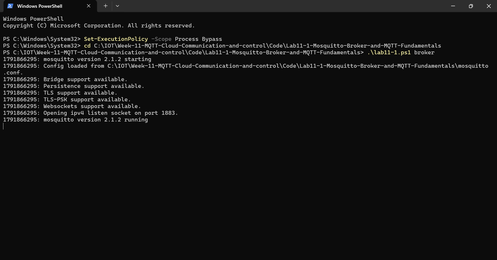

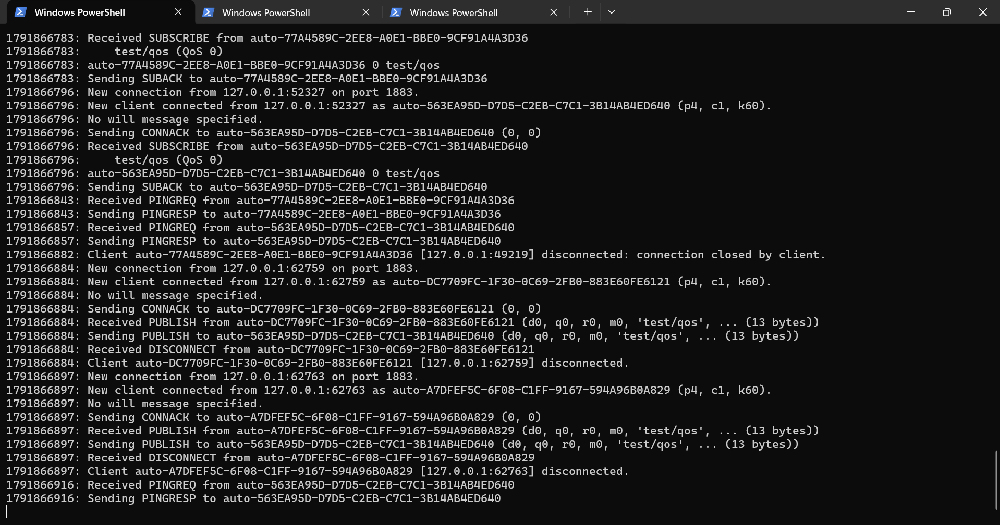

*รูปที่ Broker verbose log ขณะเชื่อมต่อและ Subscribe*: Broker (mosquitto 2.1.2) เปิดพอร์ต 1883 และแสดง log ทุกเหตุการณ์ ได้แก่ `New client connected`, `Received SUBSCRIBE`, `Sending SUBACK`, `Received PUBLISH`, `Sending PUBLISH` และ `Received DISCONNECT`

### 11-1.2 Pub/Sub และ Wildcards
| Topic ที่ Publish | Filter `home/+/light` | Filter `home/#` |
|---|---|---|
| home/livingroom/light | รับ | รับ |
| home/kitchen/light | รับ | รับ |
| home/bedroom/balcony/light | ไม่รับ | รับ |

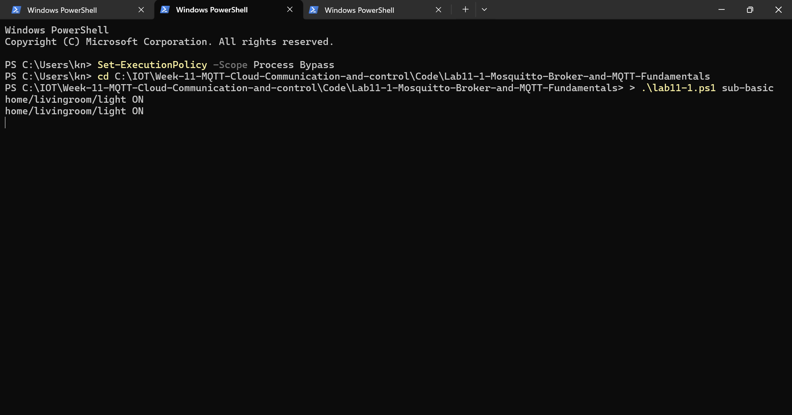

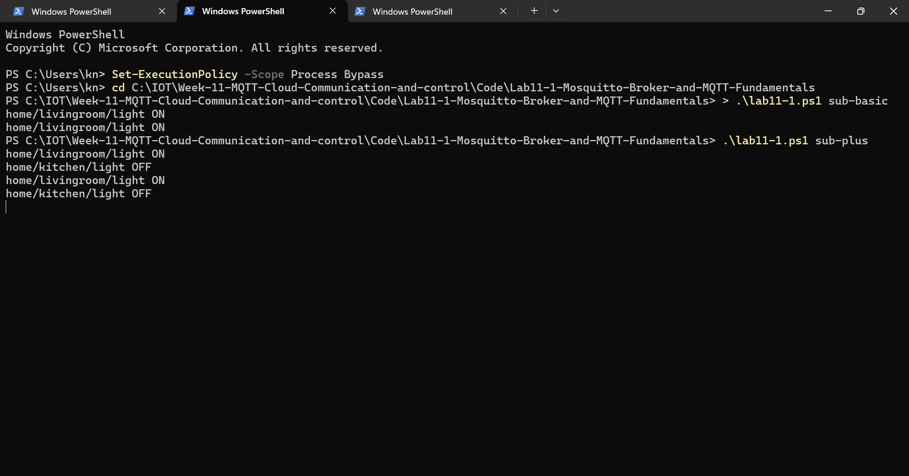

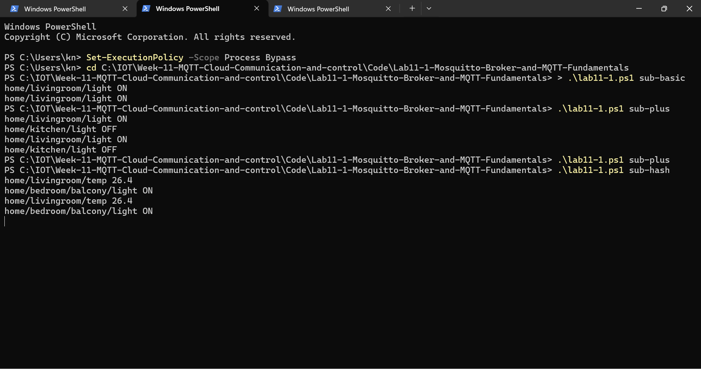

*รูปที่ ผลการทดสอบ Wildcard*: filter `home/+/light` แสดงเฉพาะ `home/livingroom/light` และ `home/kitchen/light` ส่วน `home/bedroom/balcony/light` ไม่แสดง เพราะ `+` ตรงกับ topic ได้เพียง 1 ระดับ (ระหว่าง `home` กับ `light` ของ topic นี้มี 2 ระดับคือ `bedroom/balcony`) ขณะที่ filter `home/#` รับได้ทุกข้อความที่ขึ้นต้นด้วย `home/`

### 11-1.3 เปรียบเทียบ QoS
| QoS | ลำดับแพ็กเก็ตที่เห็นใน Broker Log | จำนวนแพ็กเก็ต | หมายเหตุ |
|---|---|---|---|
| 0 | PUBLISH (รับจาก Publisher) → PUBLISH (ส่งให้ Subscriber) | 2 | At most once, `m0` ไม่มี Message ID, ไม่มี ACK, ข้อความอาจสูญหายได้ |
| 1 | PUBLISH → PUBLISH → PUBACK (ถึง Publisher) → PUBACK (จาก Subscriber) | 4 | At least once, `m1` มี Message ID, อาจได้ข้อความซ้ำ |
| 2 | PUBLISH → PUBREC → PUBREL → PUBLISH → PUBCOMP → PUBREC → PUBREL → PUBCOMP | 8 | Exactly once, 4-way handshake ทั้งฝั่ง Publisher และ Subscriber, ช้าและใช้ bandwidth มากที่สุด |

**QoS 0**

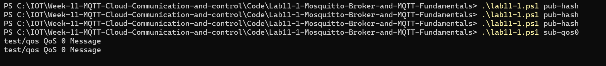

**QoS 1**

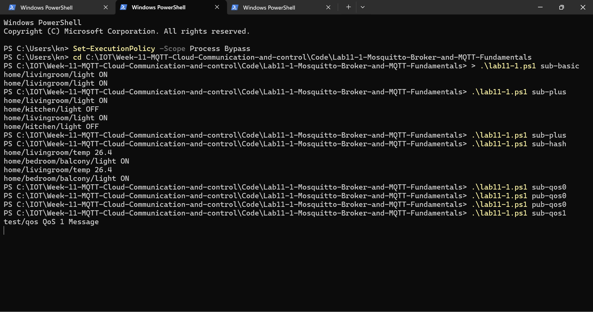

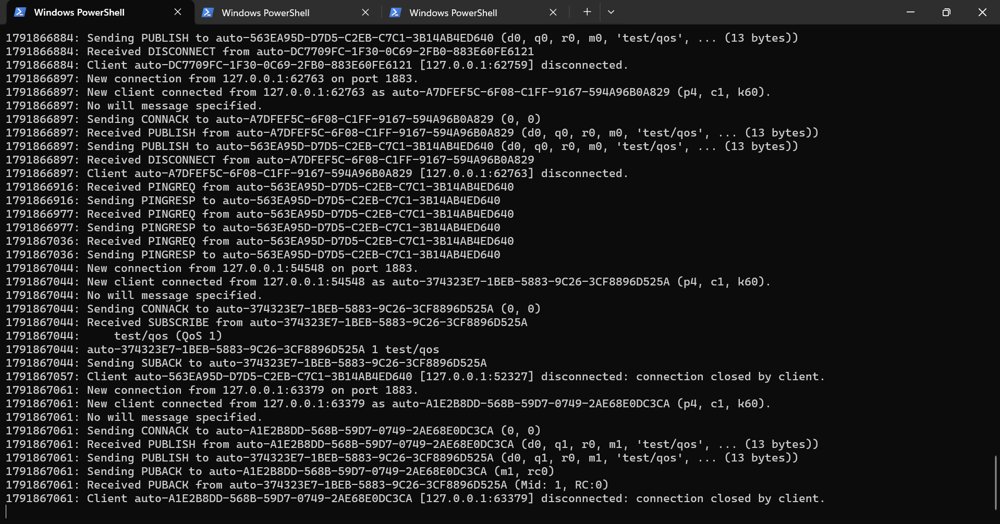

**QoS 2**

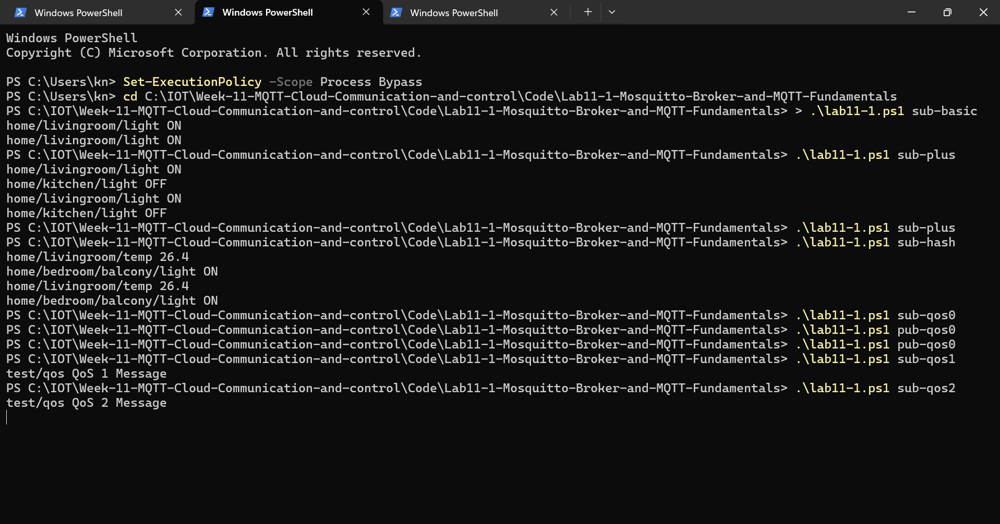

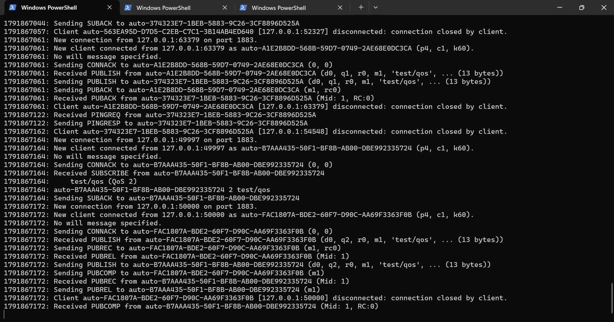

*รูปที่ Broker log QoS 0/1/2*: QoS 0 มีเพียง `PUBLISH` (`q0, m0`) QoS 1 มี `PUBLISH` ตามด้วย `PUBACK` (`q1, m1`, `Mid: 1`) และ QoS 2 มี `PUBREC`, `PUBREL`, `PUBCOMP` ครบ (`q2, m1`)

### 11-1.4 Retained Message
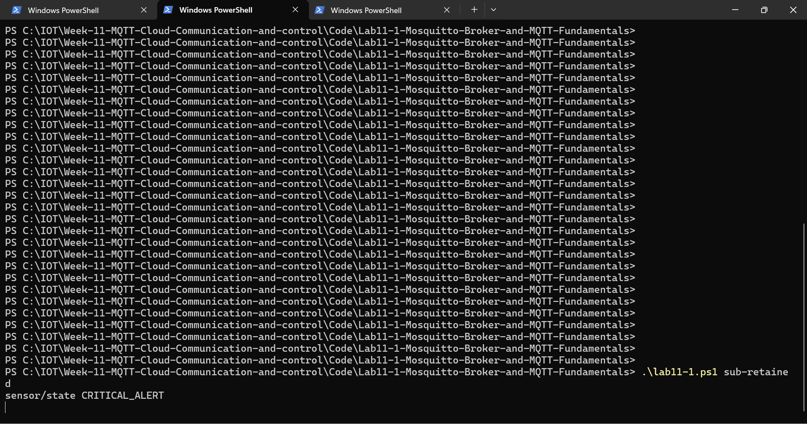

*รูปที่ Subscriber เปิดใหม่ได้รับ retained message*: เมื่อ Publish ด้วย `-r` แล้วเปิด Subscriber ใหม่ จะได้ `sensor/state CRITICAL_ALERT` ทันทีโดยไม่มีการ Publish ซ้ำ เพราะ Broker เก็บข้อความล่าสุดของ topic ไว้ (ข้อความธรรมดาที่ส่งก่อนหน้าโดยไม่ใส่ `-r` จะไม่ถูกเก็บ)

### 11-1.5 LWT
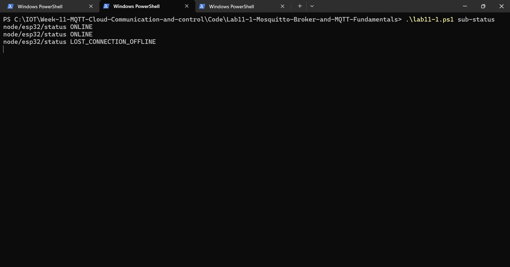

*รูปที่ ข้อความ LWT หลัง client หลุด*: หลังปิดหน้าต่าง client `Node_Client_01` ทันที (ไม่ส่ง `DISCONNECT`) Broker ตรวจพบว่าการเชื่อมต่อขาด และเผยแพร่ `node/esp32/status LOST_CONNECTION_OFFLINE` แทนอุปกรณ์โดยอัตโนมัติ

## 2. คำถามท้ายการทดลอง

**1. เหตุใด `#` ต้องอยู่ท้ายสุด และ `home/#/light` ผิดอย่างไร?**

> คำตอบ: `#` คือ Multi-level wildcard ที่แทนทุกระดับที่เหลือ (ตั้งแต่ศูนย์ระดับขึ้นไป) ต่อจากตำแหน่งของมัน จึงต้องเป็นตัวสุดท้ายของ Topic Filter และต้องอยู่ต่อจาก `/` หรืออยู่เดี่ยวๆ ถ้าวางไว้กลางทาง Broker จะไม่รู้ว่าระดับที่ตามหลังมันต้องจับคู่กับส่วนใดของ topic ทำให้กำกวม ดังนั้น `home/#/light` เป็น Topic Filter ที่ไม่ถูกต้องตามมาตรฐาน MQTT Broker จะปฏิเสธการ SUBSCRIBE (ตอบ SUBACK ด้วย failure code) และ client จะไม่ได้รับข้อความ

**2. ระบบ GPS Tracking ส่งทุก 1 วินาที ควรใช้ QoS ใด เพราะเหตุใด?**

> คำตอบ: ควรใช้ **QoS 0** เพราะพิกัดถูกส่งซ้ำทุก 1 วินาที ค่าใหม่จะมาทดแทนค่าเก่าเสมอ ถ้าแพ็กเก็ตหายไป 1 ครั้งก็ไม่กระทบมาก QoS 0 มี overhead ต่ำที่สุด (ไม่มี ACK ไม่ต้องเก็บ state) ประหยัด bandwidth และพลังงานของอุปกรณ์ ส่วน QoS 1/2 จะเพิ่มภาระและความหน่วงโดยไม่จำเป็น ทั้งยังอาจทำให้พิกัดเก่าที่ส่งซ้ำมาถึงช้ากว่าพิกัดใหม่

**3. หาก Client ส่ง `DISCONNECT` ถูกต้อง LWT จะถูกเผยแพร่หรือไม่ เพราะเหตุใด?**

> คำตอบ: **ไม่เผยแพร่** เพราะ LWT ออกแบบไว้สำหรับกรณีที่การเชื่อมต่อขาดแบบไม่ปกติ (ไม่ได้ตั้งใจ เช่น ไฟดับ เครือข่ายหลุด หรือ keepalive timeout) เมื่อ client ส่งแพ็กเก็ต `DISCONNECT` อย่างถูกต้อง Broker ถือว่าเป็นการตัดการเชื่อมต่อโดยตั้งใจ จึงลบ will message ทิ้งโดยไม่ส่งให้ใคร

**4. Retained Message มีประโยชน์อย่างไรกับแดชบอร์ด Smart Home?**

> คำตอบ: เมื่อผู้ใช้เปิดแอปครั้งแรก (หรือเปิดใหม่) แอปเพิ่ง subscribe จึงไม่รู้สถานะปัจจุบันของอุปกรณ์ เพราะข้อความเก่าถูกส่งไปแล้ว หากอุปกรณ์ Publish สถานะ (เช่น ไฟเปิด/ปิด, อุณหภูมิล่าสุด) พร้อม retain flag Broker จะเก็บค่าล่าสุดไว้และส่งให้ทันทีที่แอป subscribe ทำให้แดชบอร์ดแสดงสถานะที่ถูกต้องได้ในทันที โดยไม่ต้องรอให้อุปกรณ์ส่งข้อมูลรอบถัดไป

## 3. สรุปผลการทดลอง

ติดตั้งและรัน Mosquitto Broker ตามไฟล์คอนฟิกที่กำหนด แล้วทดสอบด้วย `mosquitto_sub` และ `mosquitto_pub` พบว่า Topic แบบ `+` ตรงได้ 1 ระดับ ขณะที่ `#` ตรงได้ทุกระดับ ระดับ QoS ที่สูงขึ้นให้ความน่าเชื่อถือมากขึ้นแต่ใช้แพ็กเก็ตมากขึ้น (QoS 0: 2, QoS 1: 4, QoS 2: 8 แพ็กเก็ต) Retained Message ทำให้ Subscriber ที่เข้ามาทีหลังได้รับค่าล่าสุดทันที และ LWT ทำให้ Broker แจ้งสถานะ offline แทนอุปกรณ์ที่หลุดการเชื่อมต่อโดยไม่ส่ง `DISCONNECT`
