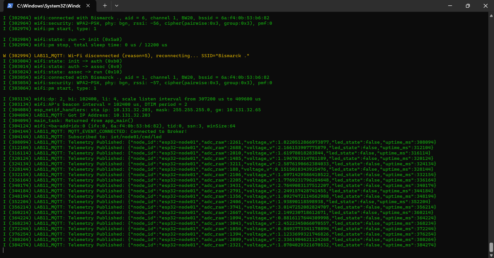
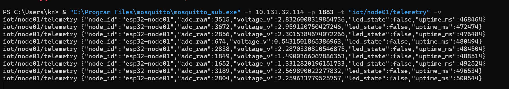
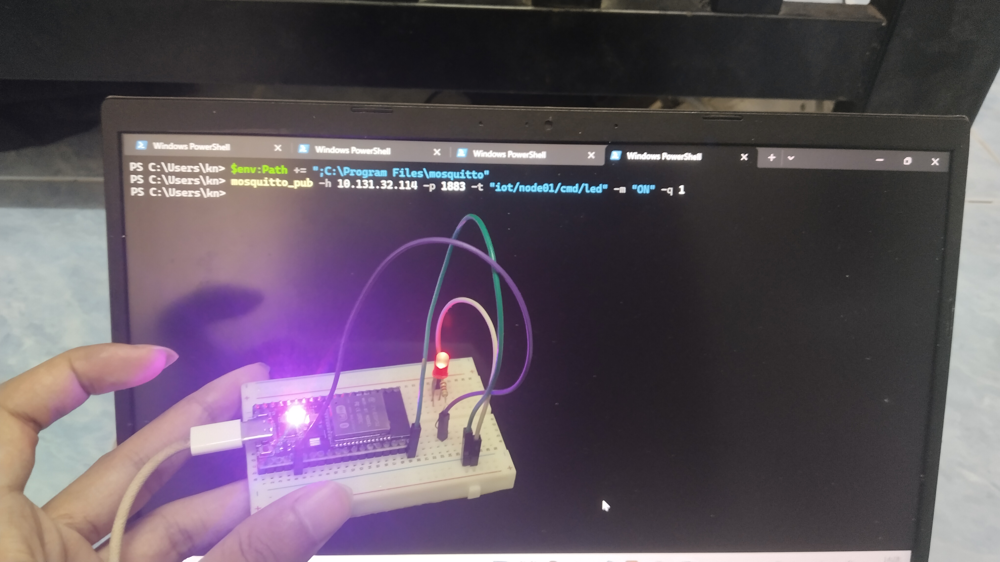
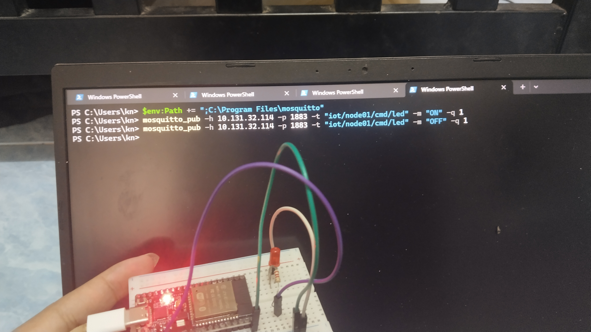
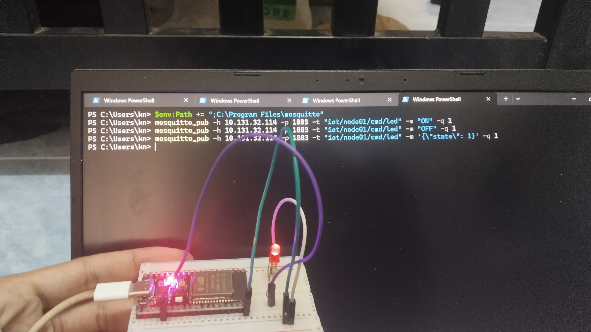

# Answer Lab 11.2 – ESP32 MQTT Client: Telemetry และควบคุม LED

- ชื่อ-สกุล: ธีรณัฏฐ์ ภูติวณิชย์
- รหัสนักศึกษา: 67030098
- วันที่ทำการทดลอง: 13/10/2026
- โค้ด: [Code/Lab11-2](../../Code/Lab11-2-ESP32-MQTT-Client-Telemetry-and-Control)
- รูปภาพ: [Answer/Image/Lab11-2](../Image/Lab11-2)

---

## 1. ผลการทดลอง

### 11-2.1 Build / Flash
Build และ flash โปรเจกต์สำเร็จ โดยกำหนดโฟลเดอร์ build สั้นๆ ด้วย `idf.py -B C:\b\l112 build` เพื่อเลี่ยงปัญหา path ยาวเกิน 260 ตัวอักษรบน Windows จากนั้นสั่ง `idf.py -B C:\b\l112 -p COM3 flash monitor` (ค่า Wi-Fi และ Broker อ่านจากไฟล์ `.env`)

### 11-2.2 Serial Monitor (เชื่อม Wi-Fi และ MQTT)

*รูปที่ Serial monitor*: บอร์ดเชื่อมต่อ Wi-Fi SSID `Bismarck .` สำเร็จ ได้ IP `10.131.32.203` จากนั้นขึ้น `MQTT_EVENT_CONNECTED: Connected to Broker!` และ `Subscribed to: iot/node01/cmd/led` แล้วเริ่มส่ง `Telemetry Published` ทุก 4 วินาที (มี `Wi-Fi disconnected (reason=5)` ช่วงแรก 1 ครั้ง ซึ่งโค้ดเชื่อมต่อใหม่เองสำเร็จ)

### 11-2.3 Telemetry (mosquitto_sub)

*รูปที่ JSON telemetry*: `mosquitto_sub` subscribe topic `iot/node01/telemetry` ได้รับ JSON ทุก 4 วินาที (ค่า `uptime_ms` เพิ่มขึ้นทีละประมาณ 4,010 ms) ประกอบด้วย `node_id`, `adc_raw`, `voltage_v`, `led_state` และ `uptime_ms`

> หมายเหตุ: ไม่มี Potentiometer จึงจำลองค่า ADC ด้วยเลขสุ่ม 0–4095 (`esp_random()`)

| รอบที่ส่ง | ค่า ADC / JSON ที่ได้ |
|---|---|
| 1 | `{"node_id":"esp32-node01","adc_raw":3515,"voltage_v":2.83,"led_state":false,"uptime_ms":468464}` |
| 2 | `{"node_id":"esp32-node01","adc_raw":3672,"voltage_v":2.96,"led_state":false,"uptime_ms":472474}` |
| 3 | `{"node_id":"esp32-node01","adc_raw":2856,"voltage_v":2.30,"led_state":false,"uptime_ms":476484}` |

### 11-2.4 ควบคุม LED
| คำสั่ง Publish | สถานะ LED | หมายเหตุ |
|---|---|---|
| `ON` | ติด | LED สีแดงบน breadboard สว่างทันทีหลังส่งคำสั่ง (QoS 1) |
| `OFF` | ดับ | LED สีแดงดับ เหลือเพียงไฟ power ของบอร์ด |
| `{"state": 1}` | ติด | รองรับ JSON payload; LED กลับมาสว่าง |

**ส่งคำสั่ง `ON`**

**ส่งคำสั่ง `OFF`**

**ส่งคำสั่ง `{"state": 1}`**

*รูปที่ ผลการสั่ง LED*: ESP32 Subscribe topic `iot/node01/cmd/led` และถอดรหัสคำสั่ง `ON`/`OFF` รวมถึง JSON `{"state": 1}` แล้วสั่ง GPIO 2 ให้ LED ติด/ดับตามคำสั่ง จากภาพถ่ายบอร์ดจริง

## 2. คำถามท้ายการทดลอง

**1. เหตุใดต้องส่ง `status = "online"` แบบ retain ควบคู่กับ LWT `"offline"`?**

> คำตอบ: ข้อความ `online` แบบ retain ทำให้ Subscriber ที่เข้ามาทีหลัง (เช่น แดชบอร์ดที่เพิ่งเปิด) ได้รับสถานะล่าสุดของอุปกรณ์ทันทีโดยไม่ต้องรอ ส่วน LWT `offline` (retain, QoS 1) เป็นข้อความที่ Broker เผยแพร่แทนอุปกรณ์เมื่อการเชื่อมต่อขาดแบบไม่ปกติ (ไฟดับ, Wi-Fi หลุด, keepalive หมด) ทั้งสองทำงานคู่กันบน topic เดียวกัน: เชื่อมต่อแล้ว → `online` ถูก retain ไว้, หลุดโดยไม่ส่ง `DISCONNECT` → Broker เปลี่ยนค่า retained เป็น `offline` ดังนั้นค่า retained ล่าสุดของ `iot/node01/status` จึงสะท้อนสถานะจริงของอุปกรณ์เสมอ ถ้าไม่ retain `online` ผู้ที่ subscribe ทีหลังจะไม่รู้สถานะ และถ้าไม่มี LWT จะค้างที่ `online` ทั้งที่อุปกรณ์ตายไปแล้ว

**2. เมื่อ Wi-Fi หลุดชั่วคราว `esp-mqtt` ทำงานอย่างไร ต้องเรียกเชื่อมต่อใหม่เองหรือไม่?**

> คำตอบ: คอมโพเนนต์ `esp-mqtt` มี **auto-reconnect** ในตัว เมื่อ TCP/Wi-Fi หลุดจะเกิด `MQTT_EVENT_DISCONNECTED` แล้ว client จะพยายามเชื่อมต่อ Broker ใหม่เองตามค่า `reconnect_timeout_ms` (ค่าเริ่มต้น 10 วินาที) ตราบที่ยังไม่เรียก `esp_mqtt_client_stop()` หรือปิด `disable_auto_reconnect` โค้ดจึง **ไม่จำเป็นต้องเรียกเชื่อมต่อใหม่ด้วยตนเอง** ส่วน Wi-Fi ถูกกู้คืนโดย `wifi_event_handler` ที่เรียก `esp_wifi_connect()` ใน `WIFI_EVENT_STA_DISCONNECTED` เมื่อเชื่อมต่อได้อีกครั้งจะเกิด `MQTT_EVENT_CONNECTED` ซึ่งโค้ดจะ publish `online` และ subscribe `iot/node01/cmd/led` ใหม่ให้เองใน event handler (เพราะเป็น clean session จึงต้อง subscribe ใหม่ทุกครั้ง)

**3. เหตุใดต้องเรียก `free(json_str)` และ `cJSON_Delete(root)` และผลเสียหากละเลย?**

> คำตอบ: `cJSON_CreateObject()` และ `cJSON_AddXxxToObject()` จัดสรรหน่วยความจำบน heap สำหรับโครงสร้าง object จึงต้องคืนด้วย `cJSON_Delete(root)` ส่วน `cJSON_PrintUnformatted()` สร้างสตริง JSON ใหม่บน heap อีกก้อนหนึ่ง ซึ่งไม่ได้เป็นของ `root` ต้องคืนด้วย `free(json_str)` แยกต่างหาก หากละเลย หน่วยความจำจะรั่ว (memory leak) ทุกรอบการส่ง (ทุก 4 วินาที) heap ว่างของ ESP32 ซึ่งมีเพียงประมาณ 200–300 KB จะค่อยๆ ลดลงจนหมด ส่งผลให้ `malloc` ล้มเหลว, `cJSON_PrintUnformatted` คืน `NULL`, MQTT/Wi-Fi ทำงานผิดพลาด และท้ายที่สุดบอร์ดอาจค้างหรือรีเซ็ตเอง

## 3. สรุปผลการทดลอง

พัฒนาโปรแกรม ESP-IDF ให้ ESP32 เป็น MQTT Client สองทาง: เชื่อมต่อ Wi-Fi และ Mosquitto Broker ได้สำเร็จ (ได้ IP 10.131.32.203) ส่ง Telemetry เป็น JSON ด้วย `cJSON` ทุก 4 วินาทีที่ topic `iot/node01/telemetry` (ใช้เลขสุ่มจำลองค่า ADC เนื่องจากไม่มี Potentiometer) และ Subscribe `iot/node01/cmd/led` เพื่อรับคำสั่ง `ON`, `OFF` และ JSON `{"state": 1}` สั่งเปิด-ปิด LED ที่ GPIO 2 ได้ถูกต้อง นอกจากนี้ใช้ `online` แบบ retain ร่วมกับ LWT `offline` เพื่อรายงานสถานะอุปกรณ์ และ `esp-mqtt` เชื่อมต่อใหม่เองเมื่อการเชื่อมต่อหลุด

