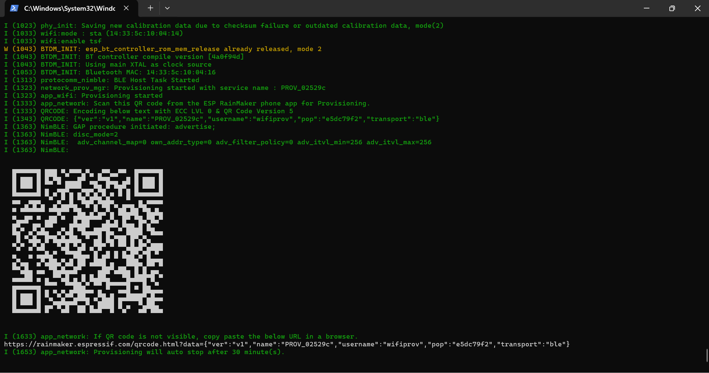
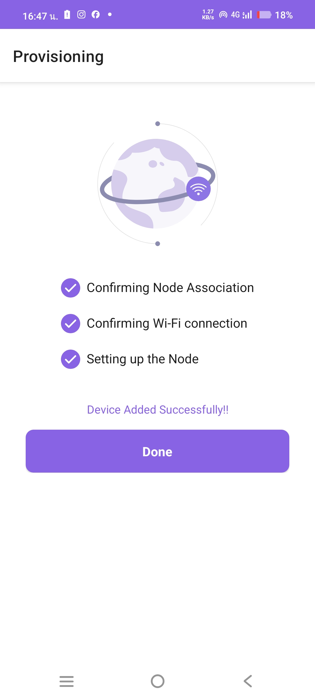
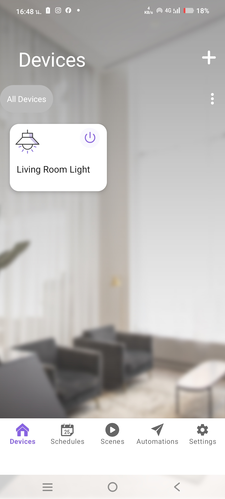
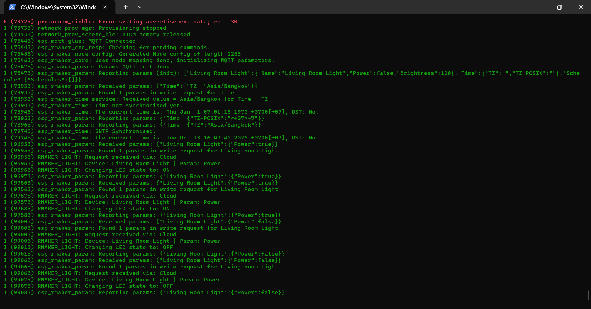
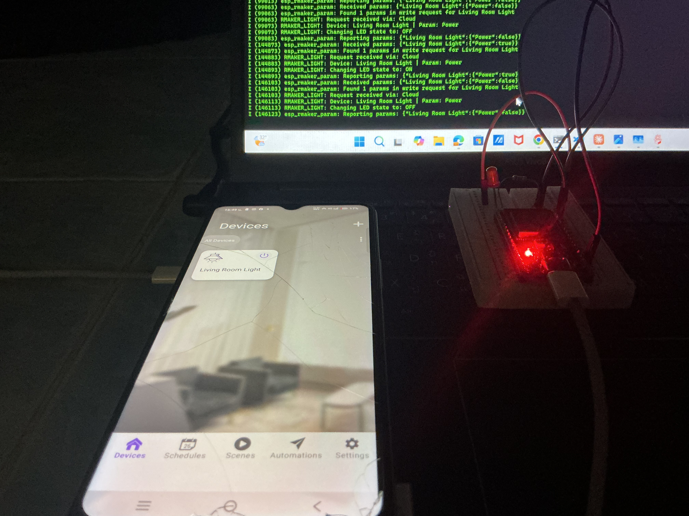
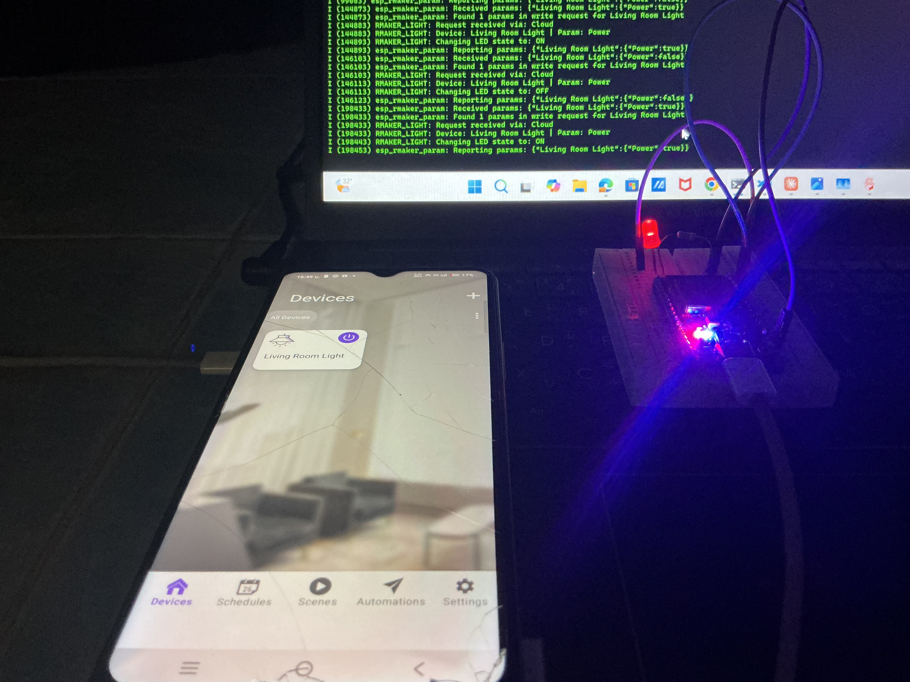

# Answer Lab 11.4 – ESP RainMaker Smart Light

- ชื่อ-สกุล: ธีรณัฏฐ์ ภูติวณิชย์
- รหัสนักศึกษา: 67030098
- วันที่ทำการทดลอง: 13/10/2026
- โค้ด: [Code/Lab11-4](../../Code/Lab11-4-ESP-RainMaker-Cloud-IoT-and-Smart-Device)
- รูปภาพ: [Answer/Image/Lab11-4](../Image/Lab11-4)

---

## 1. ผลการทดลอง

### 11-4.1–2 โปรเจกต์และโค้ด
โปรเจกต์ใช้ dependency `espressif/esp_rainmaker` และ `espressif/rmaker_app_network` ในไฟล์ `main/idf_component.yml` (ชื่อใน Component Registry ใช้ขีดล่าง ต่างจากใบงานที่เขียน `esp-rainmaker`) และใช้ `app_network.h` แทน `app_wifi.h` เพราะ `app_wifi` เป็นโค้ดตัวอย่างที่ไม่อยู่ใน registry จากนั้น `idf.py build` สำเร็จด้วย ESP-IDF v6.1 (ขนาดเฟิร์มแวร์ `0x162810` byte)

> หมายเหตุ: ต้องใช้ตารางพาร์ติชันที่มี `fctry` (`partitions.csv`) มิฉะนั้นจะเกิด `esp_rmaker_fctry: NVS Flash init failed`

### 11-4.3 Build / Flash และ QR Code

*รูปที่ QR Code ใน serial log*: หลัง flash บอร์ดเริ่ม BLE provisioning ด้วย service name `PROV_02529c` พิมพ์ QR Code แบบ ASCII พร้อม URL สำหรับเปิดรูป QR (`transport":"ble"`) และแจ้งว่า provisioning จะหยุดอัตโนมัติหลัง 30 นาที

### 11-4.4 Provisioning และ Claiming

*รูปที่ ขั้นตอน provisioning ในแอป*: สแกน QR ในแอป ESP RainMaker แล้วแอปทำ `Confirming Node Association`, `Confirming Wi-Fi connection` และ `Setting up the Node` ผ่านครบ ขึ้น `Device Added Successfully!!` จากนั้นหน้า Devices แสดงการ์ด **Living Room Light**

### 4.1 ควบคุมผ่าน Mobile App
| การกระทำในแอป | สถานะ LED | หมายเหตุ |
|---|---|---|
| Power ON | ติด | Serial: `Request received via: Cloud`, `Changing LED state to: ON` และรายงาน `{"Power":true}` กลับคลาวด์ |
| Power OFF | ดับ | Serial: `Changing LED state to: OFF` และรายงาน `{"Power":false}` |
| Brightness | ไม่ได้ทดสอบ | ในแอปที่ใช้ไม่มีสไลเดอร์ Brightness บนการ์ด (โค้ดรองรับ และจะแสดงเฉพาะ log `Changing Brightness to: NN%`) |

**Serial Monitor: MQTT เชื่อมต่อและรับคำสั่งจากคลาวด์**

*รูปที่ ควบคุมผ่านแอป*: บอร์ดแสดง `MQTT Connected`, รายงานค่าเริ่มต้น `{"Power":false,"Brightness":100}`, ซิงก์เวลา SNTP และตั้ง timezone `Asia/Bangkok` เมื่อกดสวิตช์ในแอปจะได้ `Received params: {"Living Room Light":{"Power":true}}` ผ่าน `write_cb` แล้ว LED เปลี่ยนสถานะและรายงานค่ากลับขึ้นคลาวด์

### 4.2 Remote Test ผ่านเครือข่ายมือถือ
**LED ดับ (Power OFF)**

**LED ติด (Power ON)**

*รูปที่ ทดสอบผ่านเครือข่ายมือถือ*: ภาพถ่ายแสดงมือถือ (แถบสถานะเป็น 4G) กดสวิตช์ในแอป แล้วหลอด LED บนบอร์ดติด/ดับตาม และ Serial ขึ้น `Request received via: Cloud` แสดงว่าคำสั่งส่งผ่าน RainMaker Cloud ไม่ได้ส่งตรงเข้าบอร์ดผ่าน LAN/BLE

### 4.3 RainMaker CLI (ทางเลือก)
ไม่ได้ทดสอบในการทดลองนี้ (เป็นกิจกรรมทางเลือก)

## 2. คำถามท้ายการทดลอง

**1. Assisted Claiming ช่วยแก้ปัญหาการติดตั้งใบรับรองบนอุปกรณ์อย่างไร?**

> คำตอบ: ปกติอุปกรณ์ที่เชื่อมต่อ MQTT/TLS กับคลาวด์ต้องมี Private Key และ Certificate เฉพาะตัวฝังอยู่บนอุปกรณ์ ซึ่งต้องออกใบรับรองและ provision ให้ทีละเครื่องตั้งแต่การผลิต (ยุ่งยากมากช่วงทำต้นแบบ) **Assisted Claiming** แก้ปัญหานี้โดยให้บอร์ดสร้าง Private Key ในตัวเองแล้วส่ง CSR ผ่านโทรศัพท์ (ผ่าน BLE) ไปให้ RainMaker Cloud ลงนามออกใบรับรองให้ แล้วโทรศัพท์ส่งใบรับรองกลับมาติดตั้งบนบอร์ดระหว่างทำ Provisioning นักศึกษาจึงไม่ต้องสร้าง CA/ใบรับรองเอง ไม่ต้องมี MAC address ที่ลงทะเบียนไว้ล่วงหน้า และ Private Key ไม่เคยออกจากอุปกรณ์ จึงใช้งานคลาวด์จริงด้วย TLS ที่ปลอดภัยได้ทันที

**2. เหตุใด `write_cb` ต้องเรียก `esp_rmaker_param_update_and_report()` ทุกครั้ง?**

> คำตอบ: การ return `ESP_OK` จาก `write_cb` เพียงบอกว่าคำสั่งถูกรับแล้ว แต่ **ไม่ได้อัปเดตค่าของพารามิเตอร์ใน Node และไม่ได้แจ้งคลาวด์** ฟังก์ชัน `esp_rmaker_param_update_and_report()` ทำสองอย่าง คือ (1) อัปเดตค่าในหน่วยความจำของ RainMaker agent ให้ตรงกับสถานะจริงของ LED และ (2) publish ค่าใหม่ขึ้นคลาวด์ (MQTT) เพื่อให้แอปมือถือ, อุปกรณ์/แอปอื่นที่ผูกบัญชีเดียวกัน, Schedule และ Voice Assistant เห็นสถานะที่ถูกต้องตรงกัน หากไม่เรียก สถานะบนแอปจะค้างเป็นค่าเก่า (สวิตช์กลับหรือไม่ตรงกับ LED จริง) และเมื่อแอปอ่านสถานะซ้ำก็จะได้ค่าที่ไม่ถูกต้อง

**3. เปรียบเทียบ Plain MQTT (Lab 11.2) กับ ESP RainMaker (Lab 11.4) ด้าน Development Effort, Security, Scalability**

| ด้าน | Plain MQTT + Mosquitto | ESP RainMaker |
|---|---|---|
| Development Effort | ต้องทำเองทั้งหมด: ติดตั้ง/ดูแล Broker, กำหนด topic และรูปแบบ JSON, เขียนโค้ด Wi-Fi + MQTT + reconnect, และสร้างแอป/แดชบอร์ดสำหรับผู้ใช้เอง (Lab 11.2 ต้องใช้ `mosquitto_pub` สั่งงาน) | ใช้ SDK สำเร็จรูป: ประกาศ Node/Device/Param แล้วเขียนเพียง write callback; มี BLE Provisioning, แอปมือถือ, Schedule, OTA และ Voice integration ให้พร้อมใช้ |
| Security | ต้องตั้งค่า TLS/mTLS, ออกและจัดการใบรับรองเอง (Lab 11.3) ถ้าไม่ทำจะเป็น plaintext และ `allow_anonymous` เสี่ยงโดนสวมรอย | TLS เข้ารหัสตลอดทาง, ใบรับรองรายอุปกรณ์ออกโดยคลาวด์ (Claiming), มีระบบบัญชีผู้ใช้และสิทธิ์ต่ออุปกรณ์, รองรับ Secure Boot/Flash Encryption |
| Scalability | ขยายเองได้ แต่ต้องดูแลโครงสร้างพื้นฐาน (Broker หลายตัว, load balancing, ฐานข้อมูล, ระบบผู้ใช้) เมื่อจำนวนอุปกรณ์เพิ่ม | คลาวด์ของ Espressif (AWS) รองรับอุปกรณ์จำนวนมากโดยผู้พัฒนาไม่ต้องดูแลเซิร์ฟเวอร์ แต่ผูกกับแพลตฟอร์ม/ข้อจำกัดโควตาของบริการ |

**4. ขั้นตอนเชื่อม RainMaker กับ Google Home / Alexa โดยไม่ต้องแก้โค้ดบนบอร์ด**

> คำตอบ: ESP RainMaker มี Skill/Action สำเร็จรูปสำหรับ Alexa และ Google Home ที่เชื่อมกับ RainMaker Cloud (ไม่ใช่เชื่อมกับบอร์ดโดยตรง) ขั้นตอนคือ (1) ทำ Provisioning/Claiming ให้อุปกรณ์ผูกกับบัญชี RainMaker แล้ว (2) ใช้ **ประเภทอุปกรณ์/พารามิเตอร์มาตรฐาน** เช่น `Lightbulb` กับ `Power` และ `Brightness` เพื่อให้ผู้ช่วยเสียงเข้าใจชนิดอุปกรณ์ (3) ในแอป Alexa เปิดและเปิดใช้ Skill **ESP RainMaker** แล้ว Link บัญชีด้วย login เดียวกัน (หรือในแอป Google Home เพิ่ม Action "ESP RainMaker" ด้วยบัญชีเดียวกัน) (4) สั่ง discover อุปกรณ์ ผู้ช่วยเสียงจะดึงรายการ Node/Device จากคลาวด์มาเอง เมื่อสั่งด้วยเสียง คำสั่งจะผ่านคลาวด์ของ RainMaker มายัง `write_cb` ที่มีอยู่เดิม จึงไม่ต้องเขียนโค้ดเพิ่มบน ESP32

## 3. สรุปผลการทดลอง

สร้างอุปกรณ์ Smart Light บน ESP RainMaker: Node "Smart Light Node" และ Device "Living Room Light" ที่มีพารามิเตอร์ Power และ Brightness ทำ BLE Wi-Fi Provisioning และ Assisted Claiming ผ่านแอปมือถือสำเร็จ (`Device Added Successfully!!`) บอร์ดเชื่อมต่อ RainMaker Cloud ด้วย MQTT, ซิงก์เวลา SNTP และ timezone `Asia/Bangkok` และรับคำสั่ง Power จากแอปผ่านคลาวด์ใน `write_cb` เพื่อเปิด-ปิด LED พร้อมรายงานสถานะกลับด้วย `esp_rmaker_param_update_and_report()` ทำให้สถานะในแอปตรงกับ LED จริง เมื่อเทียบกับ Plain MQTT (Lab 11.2) การใช้ RainMaker ลดงานด้าน Broker, ใบรับรอง, Provisioning และแอปผู้ใช้ แลกกับการพึ่งพาแพลตฟอร์มของ Espressif ข้อสังเกตระหว่างทำคือใบงานอ้างชื่อ dependency และไฟล์ `app_wifi.h` ที่ไม่มีใน registry และต้องมีพาร์ติชัน `fctry` เพิ่มเติมจึงจะ initialise Node ได้

