# ใบงานการทดลองที่ 11.1
### การติดตั้ง Mosquitto Broker และการทดสอบโปรโตคอล MQTT ด้วย CLI (Pub/Sub, QoS, Retain, LWT)

> [!NOTE] **คำชี้แจง**
> ในใบงานนี้นักศึกษาจะได้เรียนรู้การติดตั้งและตั้งค่า **Eclipse Mosquitto MQTT Broker** บนเครื่องคอมพิวเตอร์เพื่อทำหน้าที่เป็นตัวกลางรับส่งข้อมูลของระบบ IoT จากนั้นใช้เครื่องมือบรรทัดคำสั่ง **`mosquitto_sub`** และ **`mosquitto_pub`** ในการทดลองคุณสมบัติสำคัญของโปรโตคอล MQTT ได้แก่ ระบบหัวข้อ (Topics & Wildcards), ระดับคุณภาพการให้บริการ (QoS 0, 1, 2), ข้อความคงค้าง (Retained Messages) และพินัยกรรมฉุกเฉิน (Last Will and Testament - LWT)

---

## 1. วัตถุประสงค์การทดลอง
1. สามารถติดตั้งและกำหนดค่าไฟล์คอนฟิกูเรชันของ Eclipse Mosquitto MQTT Broker ได้อย่างถูกต้อง
2. สามารถใช้คำสั่ง `mosquitto_sub` และ `mosquitto_pub` ในการบอกรับและเผยแพร่ข้อความผ่านเครือข่ายได้
3. เข้าใจความแตกต่างและสามารถใช้งานตัวกรองไวลด์การ์ดระดับเดียว (`+`) และหลายระดับ (`#`) ได้
4. สามารถเปรียบเทียบพฤติกรรมการรับส่งข้อมูลที่ระดับ QoS 0, QoS 1 และ QoS 2 พร้อมเข้าใจกลไก Packet Identifier และ ACKs
5. สามารถอธิบายและสาธิตการทำงานของ Retained Message และ Last Will and Testament (LWT) ได้

> [!NOTE] **สภาพแวดล้อมที่ใช้ทำการทดลองจริง (รหัสนักศึกษา 67030011)**
> * macOS + **Eclipse Mosquitto 2.0.22** (ติดตั้งด้วย `brew install mosquitto`) จึงเรียก `mosquitto`, `mosquitto_sub`, `mosquitto_pub` โดยไม่ต้องมี `.exe` / `&`
> * ไฟล์คอนฟิก: [Lab11-1_Mosquitto_CLI/mosquitto.conf](Lab11-1_Mosquitto_CLI/mosquitto.conf) — ตามใบงาน และเพิ่ม `log_timestamp_format %H:%M:%S` ให้ Log อ่านเวลาง่าย
> * ทุกกิจกรรมรันตามลำดับในใบงานด้วยสคริปต์ [Lab11-1_Mosquitto_CLI/lab11_1_cli_tests.sh](Lab11-1_Mosquitto_CLI/lab11_1_cli_tests.sh) ผลของแต่ละเทอร์มินัลเก็บไว้ใน [Lab11-1_Mosquitto_CLI/logs/](Lab11-1_Mosquitto_CLI/logs/)
> * เพิ่ม `-W <วินาที>` ให้ Subscriber ปิดตัวเองอัตโนมัติ, ใช้ `-i` ตั้งชื่อ Client และ `-d` (debug) ในกิจกรรม QoS เพื่อให้เห็นแพ็กเก็ตฝั่ง Client ชัดเจน


---

## 2. อุปกรณ์และเครื่องมือที่ใช้
* เครื่องคอมพิวเตอร์ระบบปฏิบัติการ Windows หรือ Linux/macOS
* ซอฟต์แวร์ **Eclipse Mosquitto** (พร้อมเครื่องมือ Client CLI) หรือ Docker Engine โดยโปรแกรมที่จะเรียกใช้ในใบงานนี้คือ 
  - mosquitto.exe   ทำหน้าที่เป็น broker
  - mosquitto_sub.exe   ทำหน้าที่เป็น subscriber
  - mosquitto_pub.exe   ทำหน้าที่เป็น publisher
* ซอฟต์แวร์ MQTTExplorer หรือ Thinksboard หรือ any other MQTT client เพื่อใช้ในการตรวจสอบการทำงานของ MQTT Broker โดยจะใช้ client ใด client หนึ่งก็ได้ 
  - ศึกษาวิธีการใช้โปรแกรม MQTTExplorer ได้จาก  [ภาคผนวก 1 MQTTExplorer_user_guide](10-Appendix-1-MQTTExplorer_user_guide.md)
  - เว็บ Thingsboard สามารถเข้าถึงได้ที่ [thingsboard web client](https://test.thingsboard.io/login)
* หน้าต่างเทอร์มินัล (PowerShell หรือ Bash Terminal) อย่างน้อย 3 หน้าต่าง


<p align="center">

</p>

<p align="center">
<b>รูปที่ L11.01_01</b> แผนภาพการทำงานของ MQTT Broker
</p>

---

## 3. ขั้นตอนการทดลอง

### กิจกรรมที่ 11-1.1: การติดตั้งและเริ่มต้น Mosquitto Broker

#### 1. การติดตั้งโปรแกรม
* **สำหรับ Windows** ให้ดาวน์โหลดตัวติดตั้ง `mosquitto-2.x.x-install-windows-x64.exe` จาก [mosquitto.org](https://mosquitto.org/download/) และติดตั้งลงในเครื่อง

ให้จดบันทึกไว้ด้วยว่า installer ติดตั้งไว้ที่ folder ใด 
เนื่องจากใน Lab จะมีการเรียกใช้โปรแกรมผ่าน `&` ซึ่งเป็น **Call Operator** ใน PowerShell ดังนั้นหากติดตั้งที่อื่น หรือใช้ชื่ออื่น ต้องแก้ไขคำสั่งในใบงานให้ถูกต้อง
> ในใบงานนี้ ใช้ค่า default คือ `"C:\Program Files\mosquitto\mosquitto.exe"` หรือเรียกโดยไม่ต้องใส่ path เป็น `mosquitto.exe` ก็ได้


* **สำหรับ Linux (Ubuntu/Debian)**
  ```bash
  sudo apt update && sudo apt install -y mosquitto mosquitto-clients
  ```
* **หรือรันผ่าน Docker**
  ```bash
  docker run -d --name mosquitto-test -p 1883:1883 eclipse-mosquitto:2
  ```

การเรียกคำสั่ง ให้เรียกตามวิธีการที่เหมาะสมของ Linux  หรือ Mac 

**Linux/Mac**
```bash
mosquitto_sub -h [IP_ADDRESS] -t "home/livingroom/light" -v
```

#### 2. การสร้างไฟล์คอนฟิกูเรชันเฉพาะ (`mosquitto.conf`)
สร้างโฟลเดอร์สำหรับแล็บ เช่น `C:\mqtt_lab\` (หรือ `~/mqtt_lab/`) แล้วสร้างไฟล์ชื่อ `mosquitto.conf`:

```text
# กำหนดพอร์ตและอนุญาตให้ทุกอินเทอร์เฟซเชื่อมต่อได้
listener 1883 0.0.0.0

# อนุญาตการเชื่อมต่อแบบ Anonymous (สำหรับการทดลองในห้องปฏิบัติการ)
allow_anonymous true

# แสดงบันทึกข้อความอย่างละเอียด
log_type all
```


#### 3. เปิด Terminal (Powershell) จำนวน 4 หน้าต่าง

#### 3.1 กรณีใช้ powershell windows

- หน้าต่างที่ 1  สำหรับรัน Mosquitto Broker  ตั้งชื่อหน้าต่างว่า "Mosquitto Broker"
- หน้าต่างที่ 2  สำหรับรัน mosquitto_sub  ตั้งชื่อหน้าต่างว่า "Subscriber"
- หน้าต่างที่ 3  สำหรับรัน mosquitto_pub  ตั้งชื่อหน้าต่างว่า "Publisher"
- หน้าต่างที่ 4  สำหรับรัน mosquitto_pub  ตั้งชื่อหน้าต่างว่า "Publisher 2"

วิธีการตั้งชื่อหน้าต่าง ให้คลิกขวาที่ไอคอนที่แถบหัวข้อ > คลิก "Properties" > คลิก "Options" > ที่ช่อง "Window Title" พิมพ์ชื่อหน้าต่างที่ต้องการ

#### 3.2 กรณีใช้ vsc terminal

เปิด Terminal (Powershell) ใน VSCode  จำนวน 4 หน้าต่าง
เปลี่ยนชื่อโดยการคลิกขวาที่ชื่อ terminal แล้วเลือก `Rename...`

- หน้าต่างที่ 1  สำหรับรัน Mosquitto Broker  ตั้งชื่อหน้าต่างว่า "Mosquitto Broker"
- หน้าต่างที่ 2  สำหรับรัน mosquitto_sub  ตั้งชื่อหน้าต่างว่า "Subscriber"
- หน้าต่างที่ 3  สำหรับรัน mosquitto_pub  ตั้งชื่อหน้าต่างว่า "Publisher"
- หน้าต่างที่ 4  สำหรับรัน mosquitto_pub  ตั้งชื่อหน้าต่างว่า "Publisher 2"


#### 4. เริ่มต้นการทำงานของ Mosquitto Broker
ใน **เทอร์มินัลที่ 1 (Mosquitto Broker)**  สั่งรัน Broker ในโหมดแสดงผลละเอียด (Verbose)

```powershell
# บน Windows (ระบุ Path ไฟล์คอนฟิกที่สร้างไว้)
& mosquitto.exe -c "C:\mqtt_lab\mosquitto.conf" -v

# บน Linux
mosquitto -c ~/mqtt_lab/mosquitto.conf -v
```

**หมายเหตุ** 
1. ถ้ารัน mosquitto.exe บนวินโดวส์ไม่ได้ ให้ตรวจสอบ path ในตัวแปรระบบ โดยเพิ่มเส้นทางการค้นหา "c:\Program Files\Mosquitto\" เข้าไป แล้วเรียก Powershell ใหม่อีกครั้ง 
2. `C:\mqtt_lab\mosquitto.conf` คือไฟล์ที่เก็บ configuration ของ mqtt broker ให้ใส่เส้นทางที่อยู่ของไฟล์จริง ๆ 

> [!WARNING] **ข้อควรระวังสำคัญมากสำหรับ Windows (ปัญหา Mosquitto Service ซ้ำซ้อน / Split-Brain Broker)**
> ตัวติดตั้ง Mosquitto บน Windows จะทำการติดตั้งและเปิดใช้งาน **Windows Service** ชื่อ `mosquitto` ให้รันอยู่เบื้องหลังอัตโนมัติตลอดเวลา ซึ่ง Service ตัวนี้จะผูกกับ `127.0.0.1:1883` 
> หากเปิด Terminal มารัน `mosquitto.exe -c mosquitto.conf -v` อีกตัว จะทำให้เกิด **Broker ทำงานซ้อนกัน 2 ตัวในเครื่องเดียว**:
> * `127.0.0.1` จะวิ่งไปหา Windows Service
> * `0.0.0.0` (IP ของบอร์ด ESP32 วงแลน เช่น `192.168.1.xxx`) จะวิ่งไปหา Terminal Mosquitto
> ส่งผลให้อุปกรณ์ ESP32 และคำสั่ง CLI คุยกันคนละตัวและไม่ส่งข้อมูลถึงกัน!
> 
> **แนวทางปฏิบัติที่ถูกต้อง:** ให้เปิด PowerShell (Run as Administrator) แล้วปิด Service นี้ก่อนเสมอ:
> ```powershell
> Stop-Service mosquitto
> Set-Service mosquitto -StartupType Manual
> ```

ผลลัพธ์ที่ควรเห็นใน **เทอร์มินัล Mosquitto Broker**:
```text
mosquitto version 2.0.18 starting
Config loaded from C:\mqtt_lab\mosquitto.conf.
Opening ipv4 listen socket on port 1883.
mosquitto version 2.0.18 running
```

**ผลการทดลอง:** Broker เปิดพอร์ต 1883 สำเร็จ และเมื่อมี Client เข้ามาจะเห็น Log `New connection`, `CONNACK`, `SUBSCRIBE`, `SUBACK` ครบ (log_type all)

<p align="center">
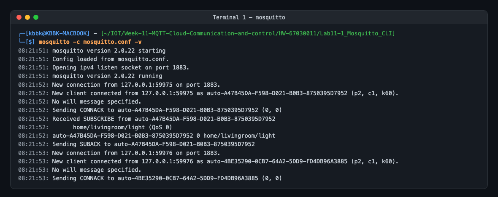
</p>
<p align="center"><b>ผลการทดลอง: Mosquitto Broker (verbose) ขณะมี Client เชื่อมต่อและ Subscribe</b></p>


#### 5. หยุดการทำงานของ Mosquitto Broker
ใน **เทอร์มินัลที่ 1 (Mosquitto Broker)**  ให้กด Ctrl+C เพื่อหยุดการทำงานของ Mosquitto Broker
ในหน้าต่างแสดงผลของ Mosquitto Broker จะปรากฏ Log แสดงการปิดการเชื่อมต่อและหยุดการทำงานของ Broker
```text

...

mosquitto version 2.1.2 terminating
```

**ผลการทดลอง:** กด Ctrl+C แล้ว Broker แสดง `mosquitto version 2.0.22 terminating`

<p align="center">
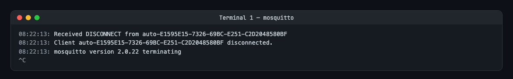
</p>


---

### กิจกรรมที่ 11-1.2  การทดสอบ Publish / Subscribe พื้นฐาน และการใช้ Wildcards

#### 1. การ Subscribe หัวข้อเฉพาะเจาะจง
ใน **เทอร์มินัลที่ 2 (Subscriber)**  สั่งรันคำสั่งต่อไปนี้
```powershell
& mosquitto_sub.exe -h 127.0.0.1 -p 1883 -t "home/livingroom/light" -v
```

เปิด **เทอร์มินัลที่ 3 (Publisher)**  ส่งข้อความสั่งงานดังนี้
```powershell
& mosquitto_pub.exe -h 127.0.0.1 -p 1883 -t "home/livingroom/light" -m "ON"
```

*สังเกตผล*  ในเทอร์มินัลที่ 2  (Subscriber) จะได้รับข้อความ `home/livingroom/light ON`
ถ้าไม่ได้ ให้ตรวจสอบว่าทั้งสอง terminal   รันอยู่ที่  IP Address  และ  Port  เดียวกันหรือไม่
เพราะนี่คือจุดเริ่มต้นของการทำงานพื้นฐานที่ต้องรันได้อย่างถูกต้อง

**ผลการทดลอง:** Subscriber ได้รับ `home/livingroom/light ON` ทันที

<p align="center">
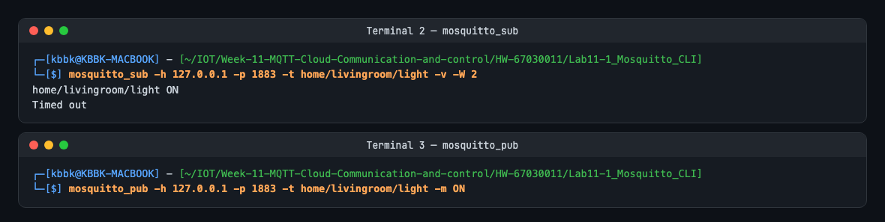
</p>


#### 2. การทดสอบไวลด์การ์ดระดับเดียว (Single-Level Wildcard: `+`)
ใน **เทอร์มินัลที่ 2 (Subscriber)**  กด `Ctrl + C` เพื่อออกจากโปรแกรม subscriber แล้วเปลี่ยนคำสั่ง Subscribe เป็น
```powershell
& mosquitto_sub.exe -h 127.0.0.1 -p 1883 -t "home/+/light" -v
```

ใน **เทอร์มินัลที่ 3 (Publisher)**  ทดลอง Publish ข้อความ 3 ครั้ง
```powershell
& mosquitto_pub.exe -h 127.0.0.1 -p 1883 -t "home/livingroom/light" -m "ON"
& mosquitto_pub.exe -h 127.0.0.1 -p 1883 -t "home/kitchen/light" -m "OFF"
& mosquitto_pub.exe -h 127.0.0.1 -p 1883 -t "home/bedroom/balcony/light" -m "ON"
```

> [!NOTE]
> บันทึกผลการทดลอง สังเกตว่าข้อความใดบ้างที่ปรากฏในเทอร์มินัลที่ 2 และข้อความใดที่ไม่ปรากฏ พร้อมอธิบายเหตุผลว่าทำไม `home/bedroom/balcony/light` จึงไม่แสดงผล

**ผลการทดลอง:**

| Topic ที่ Publish | จำนวนระดับ | ตรงกับ `home/+/light` | ปรากฏในเทอร์มินัลที่ 2 |
| :--- | :---: | :---: | :---: |
| `home/livingroom/light` | 3 | ✔ (`+` = `livingroom`) | ✔ `home/livingroom/light ON` |
| `home/kitchen/light` | 3 | ✔ (`+` = `kitchen`) | ✔ `home/kitchen/light OFF` |
| `home/bedroom/balcony/light` | 4 | ✘ | ✘ ไม่ปรากฏ |

**เหตุผล:** `+` แทนได้ **หนึ่งระดับพอดี** (ข้อความระหว่าง `/` สองตัว) Filter `home/+/light` จึงตรงกับ Topic ที่มี 3 ระดับเท่านั้น แต่ `home/bedroom/balcony/light` มี 4 ระดับ ส่วนที่ต้องให้ `+` แทนคือ `bedroom/balcony` (2 ระดับ) จึงไม่ตรง — ใน Broker Log จะเห็น `Received PUBLISH ... 'home/bedroom/balcony/light'` แต่ **ไม่มีบรรทัด `Sending PUBLISH`** ไปหา Subscriber เลย ถ้าต้องการรับด้วยต้องใช้ `home/+/+/light` หรือ `home/#`

<p align="center">
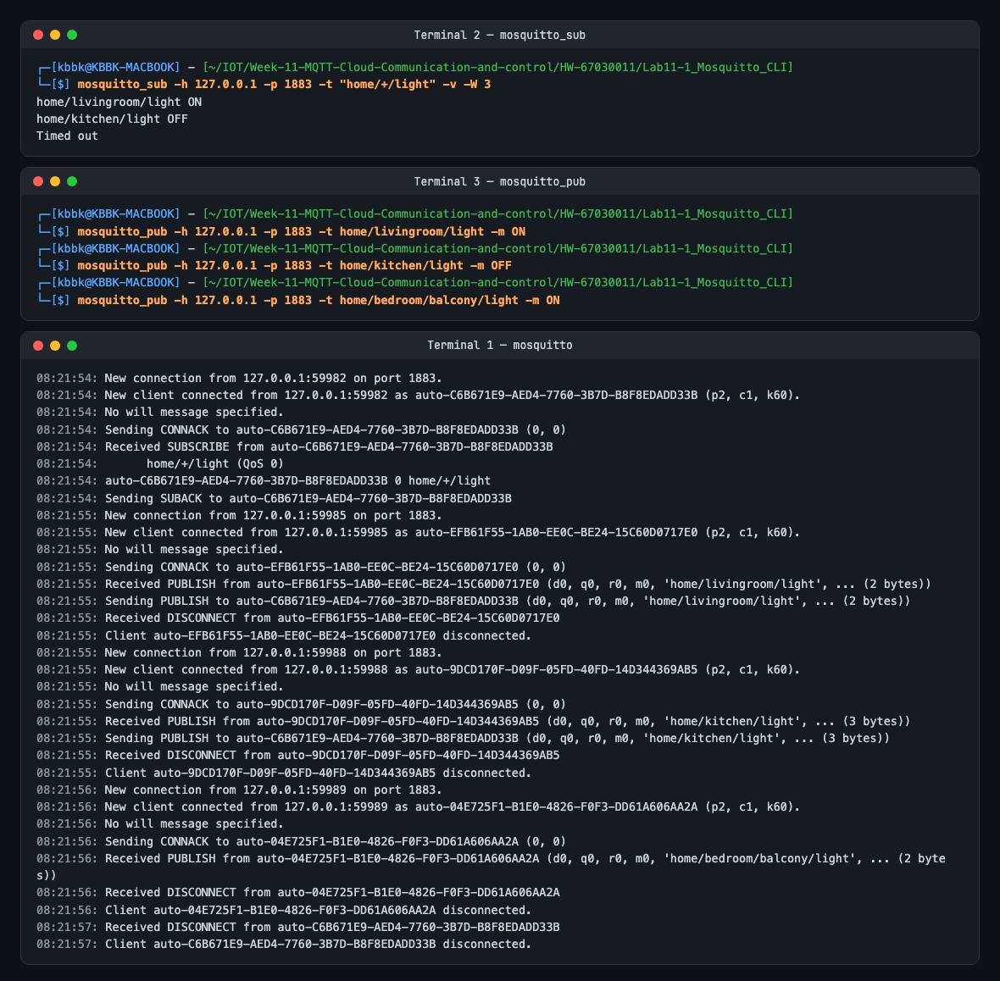
</p>


#### 3. การทดสอบไวลด์การ์ดหลายระดับ (Multi-Level Wildcard: `#`)
ใน **เทอร์มินัลที่ 2 (Subscriber)** กด `Ctrl + C` เพื่อออกจากโปรแกรม subscriber แล้วเปลี่ยนคำสั่ง Subscribe เป็น
```powershell
& mosquitto_sub.exe -h 127.0.0.1 -p 1883 -t "home/#" -v
```

ใน **เทอร์มินัลที่ 3 (Publisher)** ทดลอง Publish ข้อความไปยังหัวข้อต่างๆ
```powershell
& mosquitto_pub.exe -h 127.0.0.1 -p 1883 -t "home/livingroom/temp" -m "26.4"
& mosquitto_pub.exe -h 127.0.0.1 -p 1883 -t "home/bedroom/balcony/light" -m "ON"
```

*สังเกตผล* ทุกข้อความที่ขึ้นต้นด้วย `home/` จะถูกส่งมาแสดงผลทั้งหมด

**ผลการทดลอง:** ได้รับทั้ง `home/livingroom/temp 26.4` และ `home/bedroom/balcony/light ON` เพราะ `#` แทน "ศูนย์ระดับขึ้นไป" ต่อจาก `home/`

<p align="center">
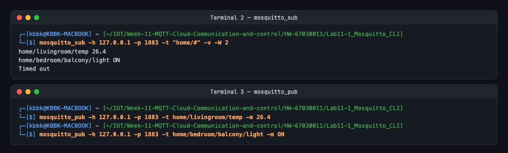
</p>


---

### กิจกรรมที่ 11-1.3 การทดสอบระดับคุณภาพการส่งข้อมูล (QoS 0, QoS 1, QoS 2)

ในกิจกรรมนี้ ให้สังเกตข้อความ Log ใน **เทอร์มินัลที่ 1 (Mosquitto Broker)** ควบคู่กับคำสั่งในเทอร์มินัลที่ 2 และ 3

#### 1. ทดสอบ QoS 0 (At Most Once)
* ในเทอร์มินัลที่ 2 (Subscriber)  `& "C:\Program Files\mosquitto\mosquitto_sub.exe" -h 127.0.0.1 -t "test/qos" -q 0 -v`
* ในเทอร์มินัลที่ 3 (Publisher)  `& "C:\Program Files\mosquitto\mosquitto_pub.exe" -h 127.0.0.1 -t "test/qos" -m "QoS 0 Message" -q 0`
* *หมายเหตุ* การรันโปรแกรมทั้ง subscriber และ publisher จะทำให้หน้าต่างค้างและรอแสดงข้อความที่ publisher ส่งมาให้ ดังนั้นการเปลี่ยนคำสั่ง ต้องกด  `Ctrl+C`  ทุกครั้งเพื่อออกจาก  โปรแกรม subscriber ก่อนเสมอ แล้วเปลี่ยนคำสั่ง subscriber ใหม่ จากนั้นจึงรันคำสั่ง publisher ใหม่
* *สังเกต Log ฝั่ง Broker*  มีเพียงแพ็กเก็ต `PUBLISH` ส่งผ่านไปโดยไม่มีแพ็กเก็ตตอบรับใดๆ

**ผลการทดลอง:** Broker มีแค่ `Received PUBLISH (d0, q0, r0, m0 ...)` แล้ว `Sending PUBLISH` ต่อทันที ไม่มี ACK ใด ๆ — สังเกตว่าฝั่ง Client แสดง `m1` แต่ Broker เห็น `m0` เพราะ QoS 0 **ไม่มี Packet Identifier** อยู่ในแพ็กเก็ตจริง (ค่า m1 เป็นเพียงตัวนับภายในไลบรารี)

<p align="center">
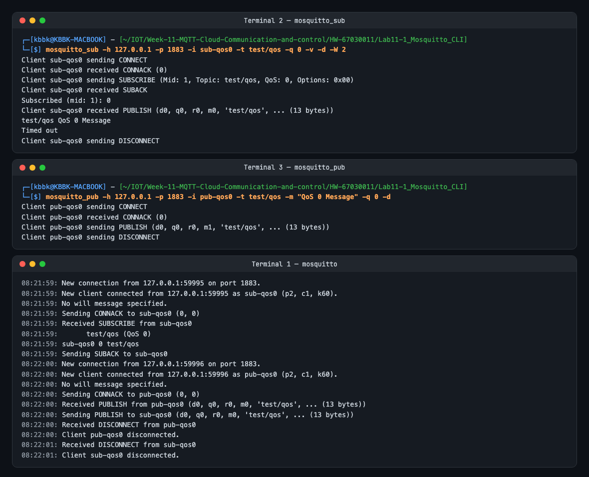
</p>


#### 2. ทดสอบ QoS 1 (At Least Once)
* ในเทอร์มินัลที่ 2 (Subscriber)  `& "C:\Program Files\mosquitto\mosquitto_sub.exe" -h 127.0.0.1 -t "test/qos" -q 1 -v`
* ในเทอร์มินัลที่ 3 (Publisher)  `& "C:\Program Files\mosquitto\mosquitto_pub.exe" -h 127.0.0.1 -t "test/qos" -m "QoS 1 Message" -q 1`
* *สังเกต Log ฝั่ง Broker*  จะปรากฏแพ็กเก็ต `PUBLISH (d0, q1, m1, ...)` ตามด้วยแพ็กเก็ต `PUBACK (Mid: 1)` เพื่อยืนยันการรับส่งข้อมูล

**ผลการทดลอง:** `Received PUBLISH (q1, m1)` → `Sending PUBLISH to sub-qos1 (q1, m1)` → `Sending PUBACK to pub-qos1 (m1, rc0)` → `Received PUBACK from sub-qos1 (Mid: 1)` คือ ACK แยกกันสองช่วง (Publisher↔Broker และ Broker↔Subscriber)

<p align="center">
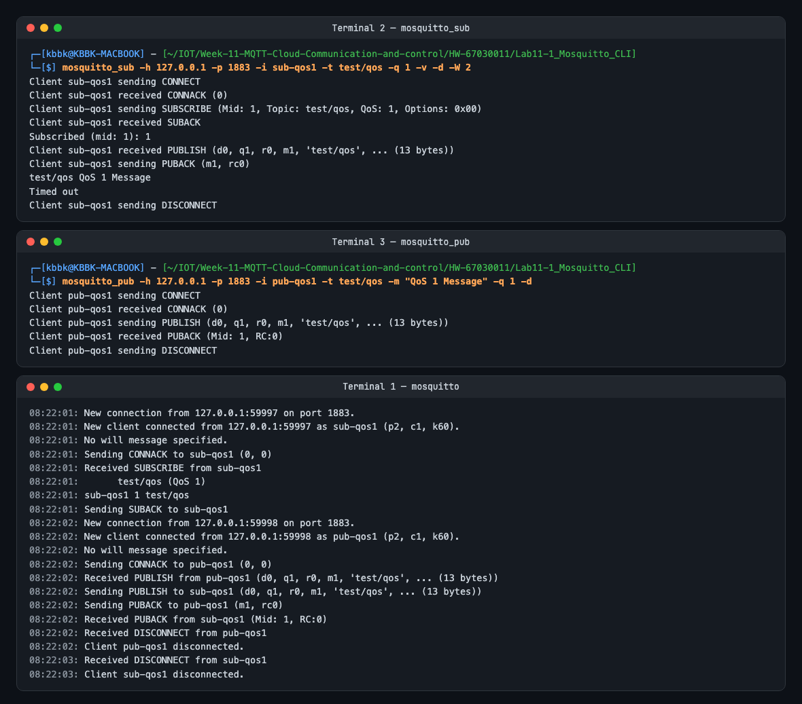
</p>


#### 3. ทดสอบ QoS 2 (Exactly Once)
* ในเทอร์มินัลที่ 2 (Subscriber)  `& mosquitto_sub.exe -h 127.0.0.1 -t "test/qos" -q 2 -v`
* ในเทอร์มินัลที่ 3 (Publisher)  `& mosquitto_pub.exe -h 127.0.0.1 -p 1883 -t "test/qos" -m "QoS 2 Message" -q 2`
* *สังเกต Log ฝั่ง Broker*  จะปรากฏกระบวนการ 4-way Handshake อย่างชัดเจน
  1. `Received PUBLISH ... q2`
  2. `Sending PUBREC`
  3. `Received PUBREL`
  4. `Sending PUBCOMP`

**ผลการทดลอง:** เห็น 4-way handshake ครบทั้งสองช่วง และ Mosquitto จะส่งต่อให้ Subscriber **หลังได้รับ PUBREL** จาก Publisher แล้วเท่านั้น

<p align="center">
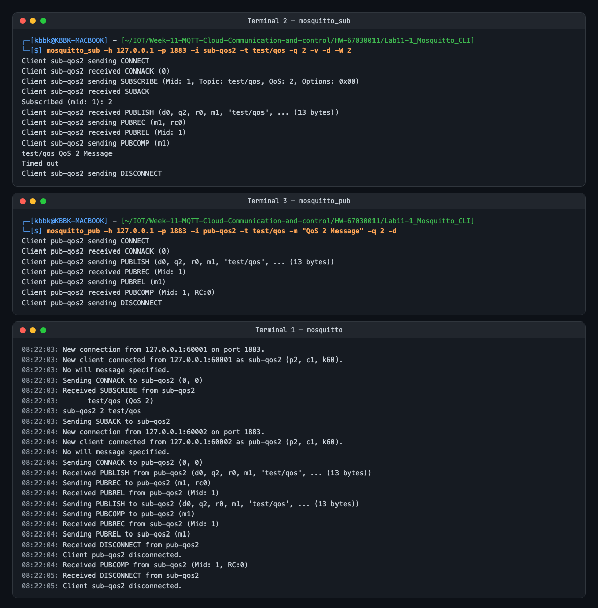
</p>


---

### กิจกรรมที่ 11-1.4 การทดสอบข้อความคงค้าง (Retained Messages)

#### 1. ทดสอบข้อความคงค้าง (Retained Messages)
1. ปิด Subscriber ใน **เทอร์มินัลที่ 2 (Subscriber)** ทั้งหมด (ไม่มีใคร Subscribe อยู่)
2. ใน **เทอร์มินัลที่ 3 (Publisher)** ส่งข้อความธรรมดา (ไม่ใส่พารามิเตอร์ `-r`)
   ```powershell
   & mosquitto_pub.exe -h 127.0.0.1 -p 1883 -t "sensor/state" -m "Normal"
   ```
3. เปิด Subscriber ใน **เทอร์มินัลที่ 2 (Subscriber)**
   ```powershell
   & mosquitto_sub.exe -h 127.0.0.1 -p 1883 -t "sensor/state" -v
   ```
   *ผลที่ได้*  หน้าจอว่างเปล่า ไม่ได้รับข้อความใดๆ เพราะข้อความถูกส่งผ่านไปแล้วก่อนหน้านี้

4. ใน **เทอร์มินัลที่ 3 (Publisher)** สั่ง Publish โดยเพิ่มพารามิเตอร์ **`-r` (Retain)**
   ```powershell
   & mosquitto_pub.exe -h 127.0.0.1 -p 1883 -t "sensor/state" -m "CRITICAL_ALERT" -r
   ```
   *ผลที่ได้* ในเทอร์มินัลที่ 2 (Subscriber)ได้รับข้อความ `sensor/state CRITICAL_ALERT` ทันที

5. ปิดเทอร์มินัลที่ 2 (Subscriber) (`Ctrl + C`) แล้วรัน subscriber ใหม่อีกครั้ง
   ```powershell
   & mosquitto_sub.exe -h 127.0.0.1 -p 1883 -t "sensor/state" -v
   ```
   *ผลที่ได้* ทันทีที่เชื่อมต่อสำเร็จ เทอร์มินัลที่ 2 (Subscriber) จะได้รับข้อความ `CRITICAL_ALERT` ในทันที แม้ Publisher จะไม่ได้ส่งข้อความใหม่เลยก็ตาม

> [!TIP]
> **วิธีลบ Retained Message ออกจาก Broker**  ส่งข้อความที่มีเนื้อหาว่างเปล่า (Empty Payload) พร้อมเปิดแฟล็ก `-r`
> ```powershell
> & mosquitto_pub.exe -h 127.0.0.1 -p 1883 -t "sensor/state" -n -r
> ```

**ผลการทดลอง:**
1. Publish `Normal` (ไม่มี `-r`) ตอนไม่มีใคร Subscribe → เปิด Subscriber ภายหลัง **ไม่ได้รับอะไร**
2. Publish `CRITICAL_ALERT -r` ขณะ Subscriber เปิดอยู่ → ได้รับทันที
3. ปิดแล้วเปิด Subscriber ใหม่ → ได้รับ `CRITICAL_ALERT` ทันทีโดยไม่มีการ Publish ใหม่ และ `-F "%r"` แสดง `retain flag=1`
4. ส่ง Empty Payload `-n -r` → Broker ลบ Retained Message (Log แสดง `(0 bytes)`) เปิด Subscriber อีกครั้งจึงไม่ได้อะไร

<p align="center">
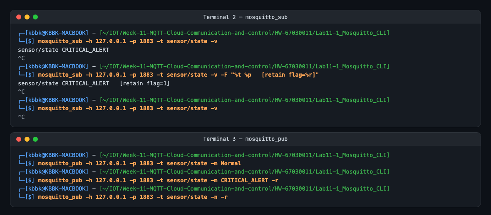
</p>

จาก Broker Log: ข้อความที่ส่งให้ Subscriber ที่ **เปิดอยู่แล้ว** มี `r0` แต่ข้อความที่ส่งให้ Subscriber ที่ **เพิ่ง Subscribe** มี `r1` — Broker ตั้ง Retain Flag เฉพาะข้อความที่ดึงจากที่เก็บ Retained เพื่อบอกว่าเป็น "ค่าล่าสุดที่เก็บไว้" ไม่ใช่ข้อความสด

<p align="center">
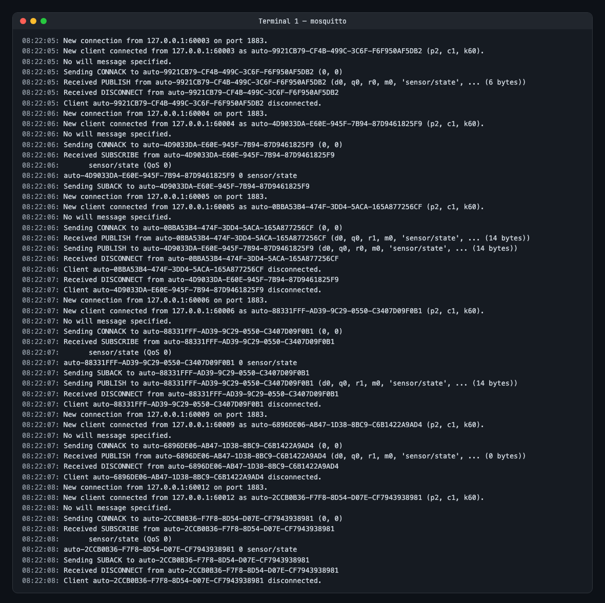
</p>


---

### กิจกรรมที่ 11-1.5 การทดสอบพินัยกรรมฉุกเฉิน (Last Will and Testament - LWT)

1. ใน **เทอร์มินัลที่ 2 (Subscriber)** เปิด Subscribe เพื่อรอเฝ้าดูสถานะของโหนด
   ```powershell
   & mosquitto_sub.exe -h 127.0.0.1 -p 1883 -t "node/esp32/status" -v
   ```
2. ใน **เทอร์มินัลที่ 3 (Publisher)** เปิด Client ที่จำลองเป็น ESP32 โดยกำหนดค่า **LWT** ไว้ล่วงหน้า
   ```powershell
   & mosquitto_sub.exe -h 127.0.0.1 -p 1883 -i "Node_Client_01" -t "dummy/listen" --will-topic "node/esp32/status" --will-payload "LOST_CONNECTION_OFFLINE" --will-qos 1
   ```
3. ส่งสถานะเริ่มต้นว่า "ONLINE" จากอุปกรณ์
   (เปิดเทอร์มินัลที่ 4 (Publisher 2) แล้วพิมพ์ `& mosquitto_pub.exe -h 127.0.0.1 -p 1883 -t "node/esp32/status" -m "ONLINE"`)
   *สังเกตผล* เทอร์มินัลที่ 2 แสดงสถานะ `ONLINE`

4. **จำลองเหตุการณ์ไฟดับหรือเครือข่ายหลุดกะทันหัน**  
   ในเทอร์มินัลที่ 3 ให้ทำการ **บังคับปิดหน้าต่างเทอร์มินัลทันที** หรือกดปิดโปรเซส เพื่อไม่ให้ Client ส่งแพ็กเก็ต `DISCONNECT`
5. *สังเกตผลในเทอร์มินัลที่ 2*  
   เมื่อ Broker ตรวจพบว่า TCP Connection ขาดหาย Broker จะเป็นผู้ส่งข้อความ
   ```text
   node/esp32/status LOST_CONNECTION_OFFLINE
   ```
   มายังเทอร์มินัลที่ 2 โดยอัตโนมัติ

**ผลการทดลอง:** จำลองไฟดับด้วยการ `kill -9` (SIGKILL) โปรเซสของ `Node_Client_01` ซึ่งปิด Socket ทันทีโดยไม่ได้ส่ง `DISCONNECT` → Broker บันทึก `Client Node_Client_01 closed its connection.` แล้ว `Sending PUBLISH ... 'node/esp32/status' (23 bytes)` ทันที เทอร์มินัลที่ 2 ได้รับ `node/esp32/status LOST_CONNECTION_OFFLINE` (Will Message ส่งด้วย QoS 0 เพราะ min(will-qos 1, QoS ของ Subscriber 0))

<p align="center">
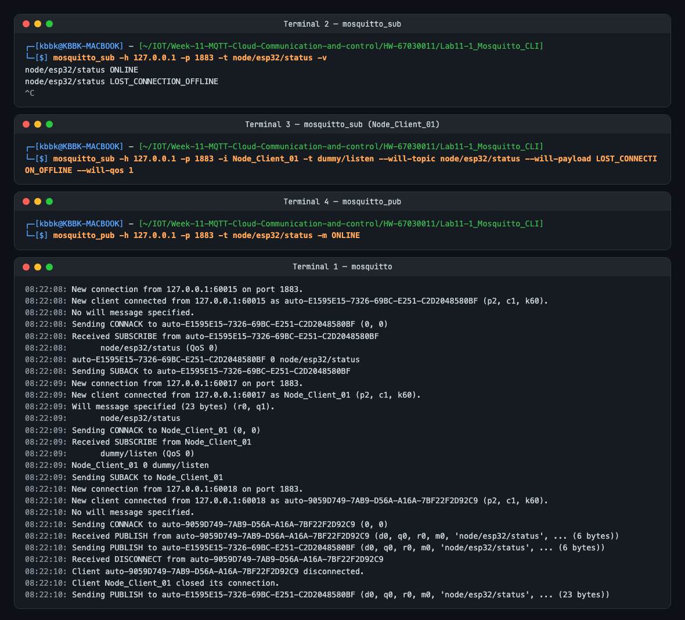
</p>


---

## 4. การบันทึกและวิเคราะห์ผลการทดลอง

ให้นักศึกษาบันทึกภาพหน้าจอ (Screenshots) และตอบคำถามต่อไปนี้ลงในรายงาน
1. ภาพหน้าจอการทำงานของ Mosquitto Broker Verbose Log ขณะที่มีการเชื่อมต่อและ Subscribe ข้อความ
2. ตารางเปรียบเทียบลำดับแพ็กเก็ตที่เกิดขึ้นระหว่าง QoS 0, QoS 1 และ QoS 2 ที่สังเกตได้จาก Broker Log
3. ภาพการทดสอบ Retained Message เมื่อเปิด Subscriber ขึ้นมาใหม่

### ผลการบันทึก (67030011)

**1. Mosquitto Broker Verbose Log ขณะเชื่อมต่อและ Subscribe** — ดูภาพในกิจกรรม 11-1.1 ([lab11-1-1-broker-verbose.png](Images/lab11-1-1-broker-verbose.png)) และ Log ฉบับเต็ม [logs/broker.log](Lab11-1_Mosquitto_CLI/logs/broker.log)

**2. ตารางเปรียบเทียบลำดับแพ็กเก็ตจาก Broker Log (ข้อความ 13 ไบต์ `QoS n Message`, Topic `test/qos`)**

| ลำดับ | QoS 0 (At most once) | QoS 1 (At least once) | QoS 2 (Exactly once) |
| :---: | :--- | :--- | :--- |
| 1 | `Received PUBLISH from pub-qos0 (d0, q0, r0, m0)` | `Received PUBLISH from pub-qos1 (d0, q1, r0, m1)` | `Received PUBLISH from pub-qos2 (d0, q2, r0, m1)` |
| 2 | `Sending PUBLISH to sub-qos0 (d0, q0, r0, m0)` | `Sending PUBLISH to sub-qos1 (d0, q1, r0, m1)` | `Sending PUBREC to pub-qos2 (m1, rc0)` |
| 3 | — | `Sending PUBACK to pub-qos1 (m1, rc0)` | `Received PUBREL from pub-qos2 (Mid: 1)` |
| 4 | — | `Received PUBACK from sub-qos1 (Mid: 1, RC:0)` | `Sending PUBLISH to sub-qos2 (d0, q2, r0, m1)` |
| 5 | — | — | `Sending PUBCOMP to pub-qos2 (m1)` |
| 6 | — | — | `Received PUBREC from sub-qos2 (Mid: 1)` |
| 7 | — | — | `Sending PUBREL to sub-qos2 (m1)` |
| 8 | — | — | `Received PUBCOMP from sub-qos2 (Mid: 1, RC:0)` |
| **รวมแพ็กเก็ตต่อ 1 ข้อความ** | **2** | **4** | **8** |
| Packet Identifier | ไม่มี (m0) | มี (m1) | มี (m1) |

ข้อสังเกต: จำนวนแพ็กเก็ตเพิ่มเป็น 2 เท่าทุกครั้งที่เพิ่ม QoS และใน QoS 2 Broker เก็บสถานะข้อความไว้จนได้ PUBREL ก่อนส่งต่อ จึงรับประกันว่าไม่มีข้อความซ้ำ

**3. Retained Message เมื่อเปิด Subscriber ใหม่** — ดูภาพในกิจกรรม 11-1.4 ([lab11-1-4-retained.png](Images/lab11-1-4-retained.png))


---

## 5. คำถามท้ายการทดลอง (Post-Lab Questions)

1. **เพราะเหตุใดสัญลักษณ์ `#` จึงต้องวางไว้ที่ตำแหน่งท้ายสุดของ Topic เสมอ? หากกำหนด Topic Filter เป็น `home/#/light` จะเกิดข้อผิดพลาดอย่างไร?**
   * **คำตอบ:** `#` หมายถึง "ระดับปัจจุบันและทุกระดับที่อยู่ลึกลงไป" มันจึงกินทุกอย่างที่เหลือของ Topic ไปแล้ว การมีระดับอื่นตามหลัง `#` จึงไม่มีความหมาย และทำให้การจับคู่กำกวม (`#` ต้องกินกี่ระดับก่อนจะถึง `light`) มาตรฐาน MQTT 3.1.1 ข้อ 4.7.1.2 จึงบังคับว่า `#` ต้องเป็น **อักขระสุดท้าย** ของ Topic Filter และต้องอยู่เดี่ยว ๆ หรือตามหลัง `/` เท่านั้น ผลที่ได้จากการทดลองจริงมี 2 ชั้น:
     * **ฝั่ง Client:** `mosquitto_sub -t "home/#/light"` ตรวจเองและปฏิเสธทันที `Error: Invalid subscription topic 'home/#/light', are all '+' and '#' wildcards correct?` (exit code 1) ไม่มีการส่งอะไรออกไป
     * **ฝั่ง Broker:** เมื่อส่งแพ็กเก็ต SUBSCRIBE ดิบด้วย [raw_invalid_subscribe.py](Lab11-1_Mosquitto_CLI/raw_invalid_subscribe.py) Broker บันทึก `Invalid subscription string from 127.0.0.1, disconnecting.` และ `Client raw-wildcard-test disconnected due to malformed packet.` **ไม่มี SUBACK** และตัดการเชื่อมต่อทันที (ถือเป็น Protocol Violation) ขณะที่ `home/+/light` ได้ SUBACK `90 03 00 01 00` ตามปกติ
     * ถ้าต้องการ "light ที่อยู่ใต้ home กี่ระดับก็ได้" ต้องใช้ `home/#` แล้วกรองในแอป หรือระบุจำนวนระดับด้วย `+` เช่น `home/+/light`, `home/+/+/light`

<p align="center">
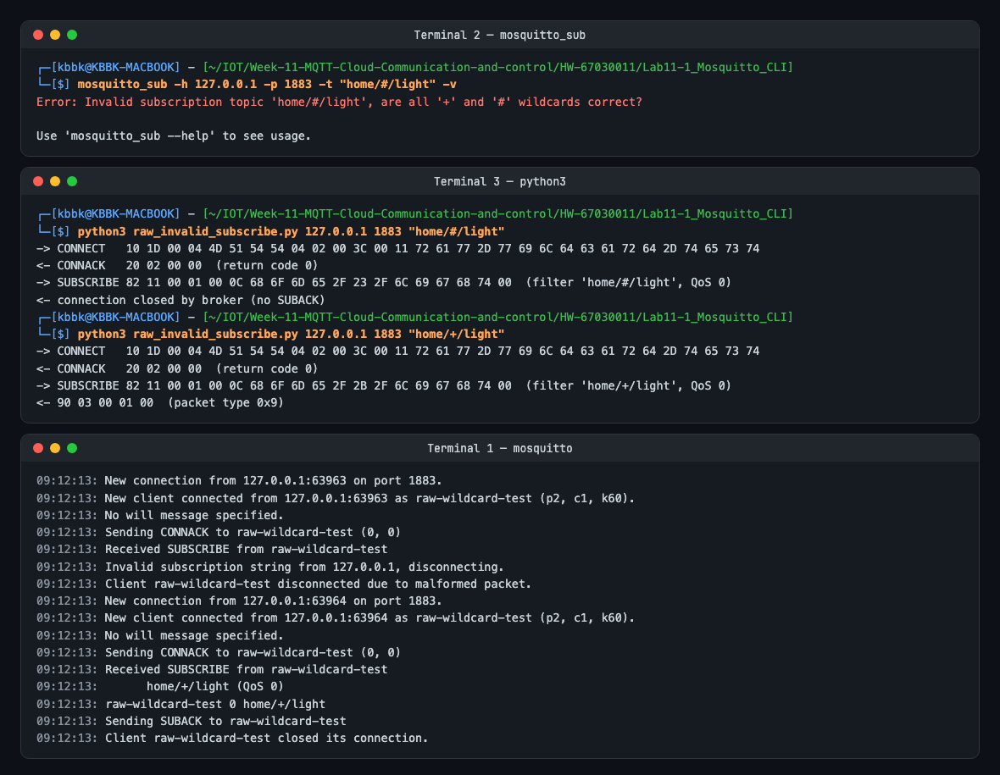
</p>

2. **ในระบบงานติดตามยานพาหนะ (GPS Tracking) ที่ส่งพิกัดรถยนต์ทุกๆ 1 วินาที ท่านคิดว่าควรเลือกระดับ QoS ใดระหว่าง QoS 0, 1 หรือ 2 เพราะเหตุใด?**
   * **คำตอบ:** เลือก **QoS 0** สำหรับพิกัดที่ส่งทุก 1 วินาที เพราะ
     * ข้อมูลมีอายุสั้นมาก พิกัดใหม่มาแทนภายใน 1 วินาที ถ้าหายไป 1 จุดระบบยังประมาณเส้นทางจากจุดก่อน/หลังได้ การส่งซ้ำพิกัดเก่าหลังจากหลุดเครือข่ายกลับทำให้ข้อมูลล้าสมัยและสลับลำดับ
     * จากตารางในหัวข้อที่ 4 (ผลการบันทึก) QoS 1 ใช้ 4 แพ็กเก็ต และ QoS 2 ใช้ 8 แพ็กเก็ตต่อ 1 ข้อความ เทียบกับ QoS 0 ที่ใช้ 2 แพ็กเก็ต สำหรับ 86,400 ข้อความ/วันต่อคัน บนเครือข่ายมือถือ ค่า Data, แบตเตอรี่ และ RAM ที่ต้องเก็บข้อความ In-flight จะเพิ่มขึ้นตามโดยไม่คุ้ม
     * ขณะเชื่อมต่ออยู่ TCP รับประกันการส่งให้แล้ว ข้อมูลจะหายจริงเฉพาะช่วงที่การเชื่อมต่อขาด ซึ่ง QoS ที่สูงขึ้นจะเอาพิกัดเก่าที่ไม่มีใครต้องการแล้วมาส่งซ้ำ
     * **ข้อยกเว้น:** เหตุการณ์สำคัญที่ห้ามหาย เช่น ปุ่ม SOS, ออกนอก Geofence, เริ่ม/จบเที่ยว ควรแยก Topic และใช้ **QoS 1** ส่วน QoS 2 ไม่จำเป็นเพราะฝั่ง Server กันข้อมูลซ้ำได้ด้วย Timestamp/Sequence

3. **หาก Client ส่งแพ็กเก็ต `DISCONNECT` ไปยัง Broker อย่างถูกต้องก่อนปิดโปรแกรม ข้อความ Last Will and Testament (LWT) จะถูกเผยแพร่ออกไปหรือไม่ เพราะเหตุใด?**
   * **คำตอบ:** **ไม่ถูกเผยแพร่** มาตรฐาน MQTT 3.1.1 ข้อ 3.14.4 กำหนดว่าเมื่อ Server ได้รับ DISCONNECT ต้อง **ทิ้ง Will Message โดยไม่ Publish** เพราะ DISCONNECT คือการบอกว่า "ตั้งใจออกเอง" ส่วน LWT มีไว้แจ้งการหายไปแบบผิดปกติเท่านั้น (Socket ขาด, Keep Alive หมดเวลา, Protocol Error, ถูก Client ID เดียวกันแย่งการเชื่อมต่อ)
     * **ผลทดลองยืนยัน:** `Node_Client_02` ตั้ง Will เป็น `WILL_FROM_NODE_02` แล้วปิดด้วย Ctrl+C (mosquitto_sub ส่ง DISCONNECT) Broker บันทึก `Received DISCONNECT from Node_Client_02` → `Client Node_Client_02 disconnected.` และ **ไม่มี** `Sending PUBLISH` ของ Will เลย เทอร์มินัลที่ 2 จึงไม่ได้รับอะไร ต่างจาก `Node_Client_01` ที่ถูก SIGKILL ซึ่ง Broker เห็นแค่ `closed its connection` และส่ง LWT ออกไป
     * ดังนั้นอุปกรณ์ที่ปิดตัวเองอย่างตั้งใจ (เช่น ก่อน Deep Sleep หรือ OTA Reboot) ต้อง Publish สถานะ `offline` (retain) เองก่อนส่ง DISCONNECT

<p align="center">
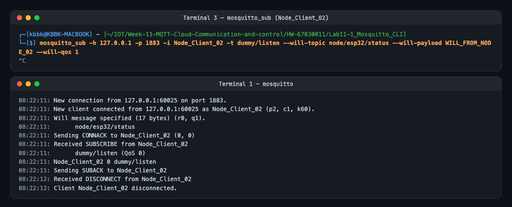
</p>

4. **Retained Message มีประโยชน์อย่างไรในการออกแบบระบบแดชบอร์ด Smart Home สำหรับผู้ใช้งานที่เพิ่งเปิดแอปพลิเคชันขึ้นมาเป็นครั้งแรก?**
   * **คำตอบ:** แอปที่เพิ่งเปิดจะ Subscribe แล้ว **ได้ค่าล่าสุดของทุก Topic ทันที** โดยไม่ต้องรอให้อุปกรณ์ Publish รอบถัดไป ซึ่งสำหรับอุปกรณ์แบบ Event-driven (สวิตช์ไฟ, ประตู, สถานะ online/offline) อาจนานเป็นชั่วโมง ในการทดลองข้อ 11-1.4 Subscriber ที่เปิดใหม่ได้ `CRITICAL_ALERT` พร้อม `retain flag=1` ทันทีทั้งที่ไม่มีการ Publish ใหม่
     * แดชบอร์ดแสดงสถานะจริงตั้งแต่วินาทีแรก (ไฟห้องนั่งเล่นเปิดอยู่, อุณหภูมิล่าสุด, อุปกรณ์ online/offline) ไม่ต้องทำ API "ขอสถานะ" หรือ Polling แยก และอุปกรณ์ไม่ต้องรู้ว่ามีแอปใหม่เข้ามา (Decoupling ของ Pub/Sub ยังคงอยู่)
     * ใช้คู่กับ LWT แบบ retain ทำให้แอปรู้ทันทีว่าอุปกรณ์ไหนออฟไลน์
     * **ข้อควรระวัง:** Broker เก็บได้ Topic ละ 1 ข้อความล่าสุด จึงควรใส่ Timestamp ใน Payload เพื่อให้รู้ว่าค่าเก่าแค่ไหน **ห้ามตั้ง retain กับ Topic คำสั่ง** (`.../cmd/...`) ไม่เช่นนั้นอุปกรณ์จะทำคำสั่งเก่าซ้ำทุกครั้งที่ Reconnect และลบค่าที่ไม่ใช้แล้วด้วย Empty Payload + `-r`
