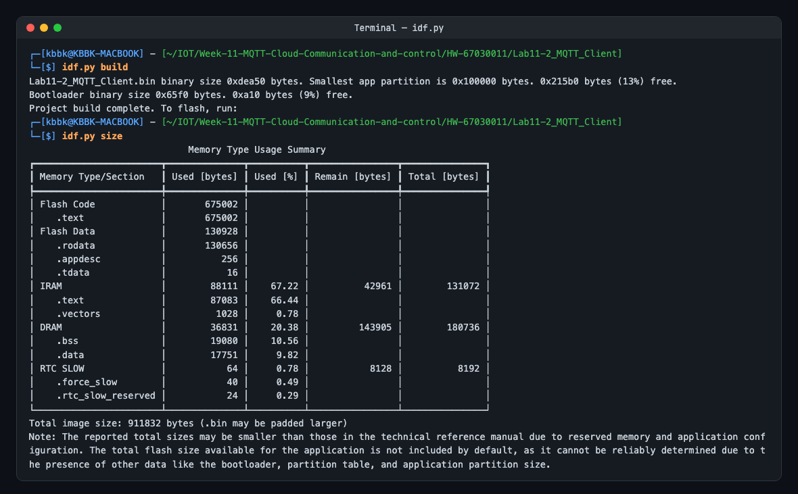
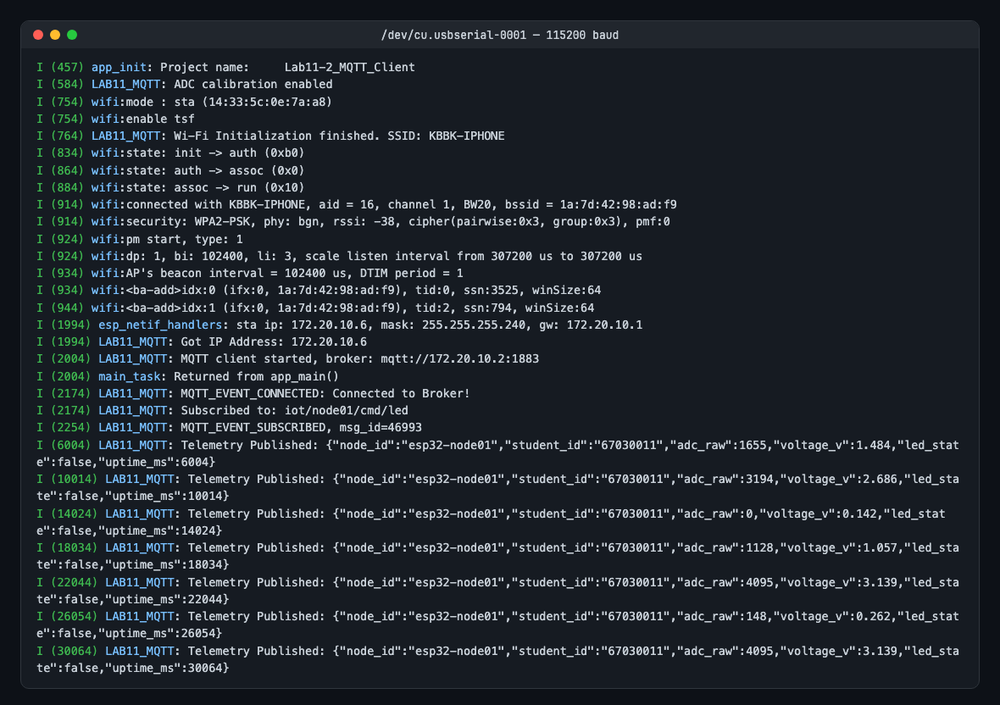
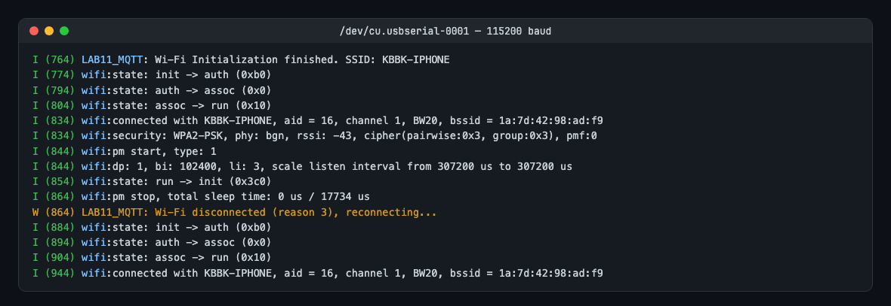
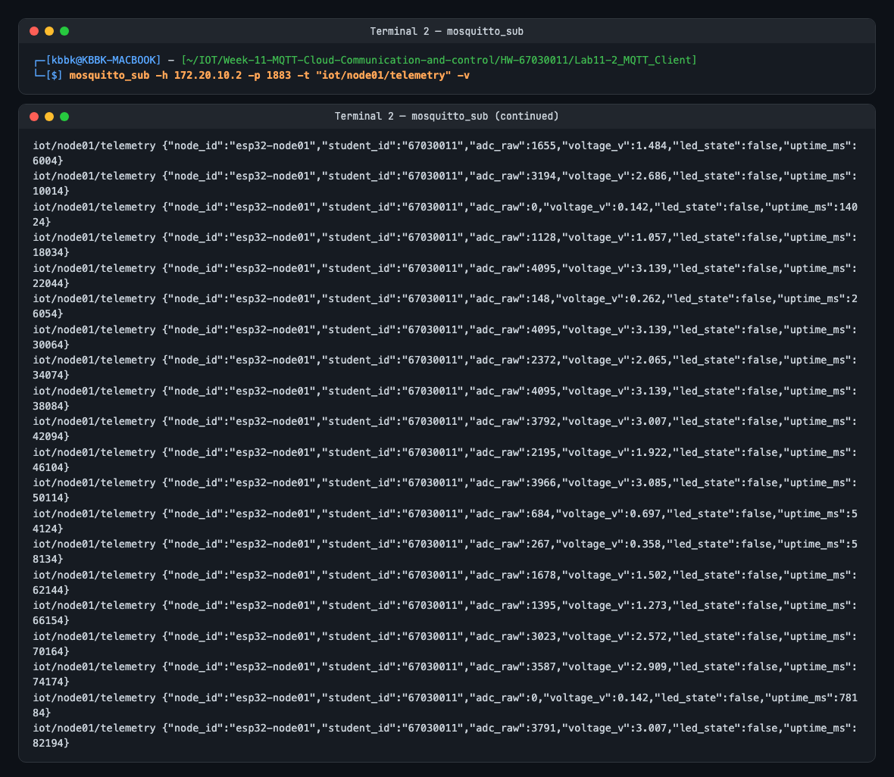
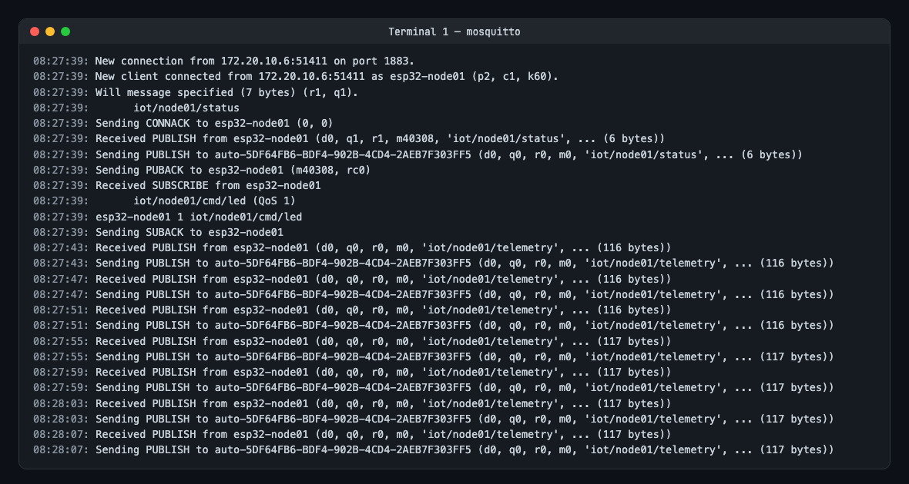
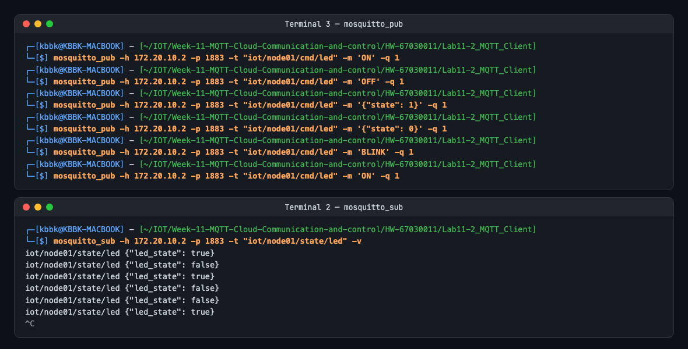
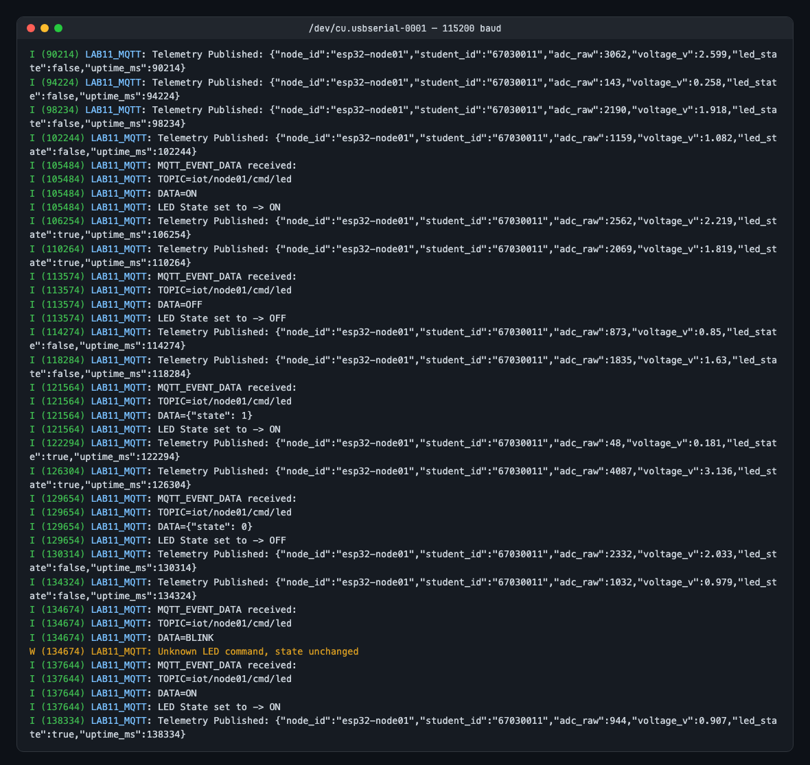
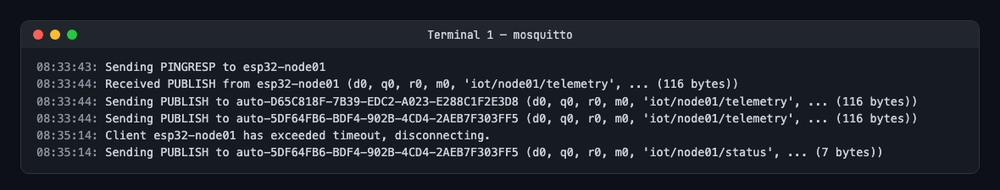
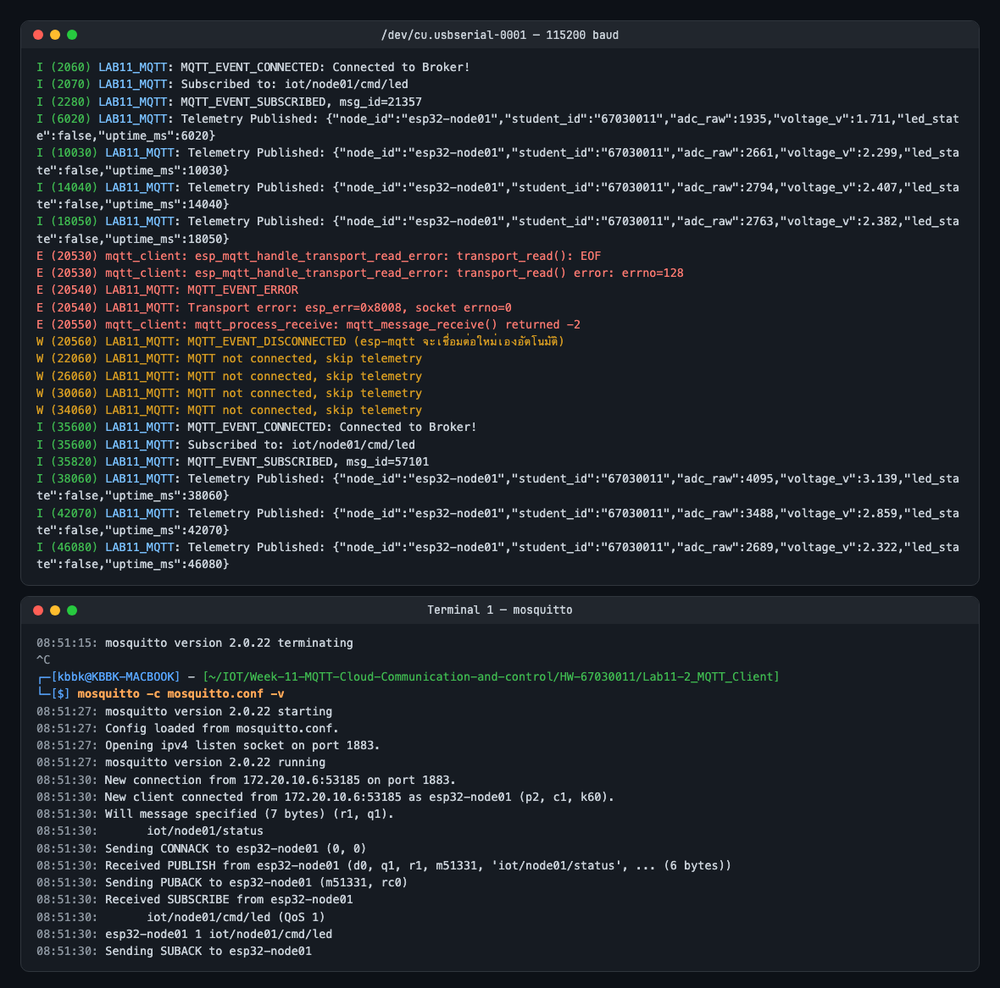

# ใบงานการทดลองที่ 11.2
### การพัฒนา ESP32 MQTT Client เพื่อรายงานข้อมูลเซนเซอร์ Telemetry และรับคำสั่งควบคุมอุปกรณ์ระยะไกล

> [!NOTE] **คำชี้แจง**
> ในใบงานนี้นักศึกษาจะได้เขียนโปรแกรมภาษา C บนเฟรมเวิร์ก **ESP-IDF** เพื่อเปลี่ยนบอร์ดไมโครคอนโทรลเลอร์ ESP32 / ESP32-C3 ให้ทำงานเป็น **MQTT Client สองทาง (Bi-directional MQTT Client)** โดยทำหน้าที่ทั้ง Publish ข้อมูลการอ่านค่าแรงดันแอนะล็อกของตัวต้านทานปรับค่าได้ (Potentiometer) ในรูปของ JSON Payload ขึ้นสู่ Broker และ Subscribe รอรับคำสั่งควบคุมเปิด-ปิดหลอดไฟ LED จากระยะไกล

---

## 1. วัตถุประสงค์การทดลอง
1. สามารถกำหนดค่าและใช้งานคอมโพเนนต์ `esp-mqtt` ในการสร้างการเชื่อมต่อกับ MQTT Broker ได้
2. สามารถเขียน Event Handler เพื่อจัดการเหตุการณ์เครือข่าย `MQTT_EVENT_CONNECTED`, `MQTT_EVENT_DATA` และ `MQTT_EVENT_DISCONNECTED` ได้
3. สามารถพัฒนา FreeRTOS Task เพื่ออ่านค่าแอนะล็อก (ADC) และสร้างแพ็กเก็ตข้อมูล JSON ด้วยไลบรารี `cJSON` ส่งขึ้นหัวข้อ Telemetry อย่างต่อเนื่อง
4. สามารถถอดรหัสข้อความคำสั่งควบคุมที่ได้รับจาก Broker แล้วนำไปควบคุมสถานะ GPIO ของหลอดไฟ LED ได้
5. สามารถทดสอบและติดตามการทำงานผ่านเครื่องมือ CLI (`mosquitto_sub` และ `mosquitto_pub`)

> [!NOTE] **สภาพแวดล้อมที่ใช้ทำการทดลองจริง (รหัสนักศึกษา 67030011)**
> * บอร์ด **ESP32-D0WD-V3 (rev v3.1)** ที่ `/dev/cu.usbserial-0001`, ESP-IDF **v6.0.2**, Broker = Mosquitto 2.0.22 บน Mac
> * เครือข่าย: iPhone Personal Hotspot `KBBK-IPHONE` (เปิด Maximize Compatibility ให้เป็น 2.4 GHz) — Mac ได้ IP `172.20.10.2`, ESP32 ได้ `172.20.10.6`
> * โปรเจกต์: [Lab11-2_MQTT_Client/](Lab11-2_MQTT_Client/) รหัส Wi-Fi แยกไว้ใน `main/wifi_credentials.h` (อยู่ใน `.gitignore`) — ดูตัวอย่างที่ [wifi_credentials.h.example](Lab11-2_MQTT_Client/main/wifi_credentials.h.example)
> * Log ทั้งหมดอยู่ใน [Lab11-2_MQTT_Client/logs/](Lab11-2_MQTT_Client/logs/)


---

## 2. วงจรและการต่อสายฮาร์ดแวร์ (Schematic & Wiring)

<p align="center">

</p>

<p align="center">
<b>รูปที่ L11-02-1</b> การเชื่อมต่อวงจรสำหรับการทดลอง 11-2
</p>

| อุปกรณ์                    | ขาอุปกรณ์                              | ขาต่อ ESP32            | หน้าที่การทำงาน               |
| :------------------------- | :------------------------------------- | :--------------------- | :---------------------------- |
| **LED**                    | Anode (+)                              | **GPIO 2**             | หลอดไฟแสดงสถานะ (Actuator)    |
| **Resistor 330 หรือ 470Ω** | สลับขาได้ เนื่องจากตัวต้านทานไม่มีขั้ว | อนุกรมกับ LED          | ตัวต้านทานจำกัดกระแส          |
| **Potentiometer 10k**      | Wiper (ขากลาง)                         | **GPIO 34** (ADC1_CH6) | เซนเซอร์ตรวจวัดแรงดันแอนะล็อก |
| **Potentiometer 10k**      | ขาริมซ้าย / ขวา                        | **3.3V / GND**         | แรงดันอ้างอิงและกราวด์        |

**การต่อวงจรจริง:** ใช้ **LED บนบอร์ด (GPIO 2)** เป็น Actuator และต่อ Potentiometer 10k ขากลางเข้า **GPIO 34**, ขาริมเข้า 3V3 / GND

> [!WARNING] ตอนแรก LED ภายนอกถูกต่อที่ **GPIO 35** ซึ่งใช้ไม่ได้ เพราะ GPIO 34–39 ของ ESP32 เป็นขา **Input-only** (ไม่มีวงจรขับเอาต์พุต) จึงย้ายไปใช้ GPIO 2 ตามใบงาน


---

## 3. ขั้นตอนการทดลอง

### กิจกรรมที่ 11-2.1 การสร้างโปรเจกต์และเพิ่มไลบรารี cJSON

#### 1. สร้างโปรเจกต์ใหม่ผ่าน ESP-IDF
```powershell
idf.py create-project Lab11-2_MQTT_Client
cd Lab11-2_MQTT_Client
```

*หรือใช้ Docker*
```powershell
docker run --rm --mount "type=bind,source=$((Get-Location).Path),target=/workspace" -w /workspace espressif/idf:release-v6.1 idf.py create-project Lab11-2_MQTT_Client
cd Lab11-2_MQTT_Client
```

#### 2. กำหนด Target ชิป
```powershell
# สำหรับ ESP32-C3
idf.py set-target esp32c3

# หรือสำหรับ ESP32 ปกติ
idf.py set-target esp32
```

*หรือใช้ Docker*
```
    เปลี่ยนท้ายคำสั่ง docker จาก `idf.py create-project Lab11-2_MQTT_Client` เป็น  `idf.py set-target esp32`
```

#### 3. ติดตั้ง Dependency `cJSON` และ mqtt
เพิ่มคอมโพเนนต์ cJSON สำหรับจัดการ JSON Payload และ mqtt
```powershell
idf.py add-dependency "espressif/cjson"
idf.py add-dependency "espressif/mqtt"
```

**ผลการทดลอง:** ใน ESP-IDF v6 คอมโพเนนต์ `mqtt` ถูกแยกออกจาก IDF ไปอยู่ใน Component Registry แล้ว จึงต้อง `add-dependency "espressif/mqtt"` ด้วย ไฟล์ [main/idf_component.yml](Lab11-2_MQTT_Client/main/idf_component.yml) ได้ `espressif/cjson: '*'` และ `espressif/mqtt: '*'`


*หรือใช้ Docker* 
```
    เปลี่ยนท้ายคำสั่ง docker เป็น  `idf.py add-dependency "espressif/cjson"` และ `idf.py add-dependency "espressif/mqtt"`
```


#### 4. แก้ไข main/CMakeLists.txt 
เพิ่ม  REQUIRES  ลงใน `main/CMakeLists.txt` 

```
idf_component_register(SRCS "Lab11-2_MQTT_Client.c"
                    INCLUDE_DIRS "."
                    REQUIRES mqtt cjson esp_wifi esp_event nvs_flash cjson esp_adc driver esp_driver_gpio)
```

**ที่ใช้จริง** ([main/CMakeLists.txt](Lab11-2_MQTT_Client/main/CMakeLists.txt)): ตัด `cjson` ที่ซ้ำ และตัด `driver` (ใน IDF v6 ใช้ `esp_driver_gpio` แทนแล้ว)
```cmake
idf_component_register(SRCS "Lab11-2_MQTT_Client.c"
                    INCLUDE_DIRS "."
                    REQUIRES mqtt cjson esp_wifi esp_event nvs_flash esp_adc esp_driver_gpio)
```


---
### กิจกรรมที่ 11-2.2 การเขียนโค้ดโปรแกรมหลัก (`main/Lab11-2_MQTT_Client.c`)

เปิดไฟล์ `main/Lab11-2_MQTT_Client.c` และแทนที่ด้วยโค้ดสมบูรณ์ต่อไปนี้

```c
#include <stdio.h>
#include <stdint.h>
#include <stddef.h>
#include <string.h>
#include "esp_wifi.h"
#include "esp_system.h"
#include "nvs_flash.h"
#include "esp_event.h"
#include "esp_netif.h"
#include "esp_log.h"
#include "freertos/FreeRTOS.h"
#include "freertos/task.h"
#include "freertos/event_groups.h"
#include "driver/gpio.h"
#include "esp_adc/adc_oneshot.h"
#include "mqtt_client.h"
#include "cJSON.h"

#define WIFI_SSID           "YOUR_WIFI_SSID"
#define WIFI_PASS           "YOUR_WIFI_PASSWORD"
#define MQTT_BROKER_URI     "mqtt://192.168.1.100:1883" // เปลี่ยนเป็น IP คอมพิวเตอร์ของท่าน

#if CONFIG_IDF_TARGET_ESP32C3
#define LED_PIN             GPIO_NUM_8
#define ADC_CHANNEL         ADC_CHANNEL_0   // GPIO 0
#else
#define LED_PIN             GPIO_NUM_2
#define ADC_CHANNEL         ADC_CHANNEL_6   // GPIO 34
#endif

static const char *TAG = "LAB11_MQTT";
static EventGroupHandle_t s_wifi_event_group;
#define WIFI_CONNECTED_BIT  BIT0

static esp_mqtt_client_handle_t s_mqtt_client = NULL;
static adc_oneshot_unit_handle_t s_adc_handle = NULL;
static bool s_led_state = false;

/* ========================================================
 * 1. ระบบเชื่อมต่อ Wi-Fi Station
 * ======================================================== */
static void wifi_event_handler(void* arg, esp_event_base_t event_base, int32_t event_id, void* event_data)
{
    if (event_base == WIFI_EVENT && event_id == WIFI_EVENT_STA_START) {
        esp_wifi_connect();
    } else if (event_base == WIFI_EVENT && event_id == WIFI_EVENT_STA_DISCONNECTED) {
        ESP_LOGW(TAG, "Wi-Fi disconnected, reconnecting...");
        esp_wifi_connect();
        xEventGroupClearBits(s_wifi_event_group, WIFI_CONNECTED_BIT);
    } else if (event_base == IP_EVENT && event_id == IP_EVENT_STA_GOT_IP) {
        ip_event_got_ip_t* event = (ip_event_got_ip_t*) event_data;
        ESP_LOGI(TAG, "Got IP Address: " IPSTR, IP2STR(&event->ip_info.ip));
        xEventGroupSetBits(s_wifi_event_group, WIFI_CONNECTED_BIT);
    }
}

static void wifi_init_sta(void)
{
    s_wifi_event_group = xEventGroupCreate();
    ESP_ERROR_CHECK(esp_netif_init());
    ESP_ERROR_CHECK(esp_event_loop_create_default());
    esp_netif_create_default_wifi_sta();

    wifi_init_config_t cfg = WIFI_INIT_CONFIG_DEFAULT();
    ESP_ERROR_CHECK(esp_wifi_init(&cfg));

    esp_event_handler_instance_t instance_any_id;
    esp_event_handler_instance_t instance_got_ip;
    ESP_ERROR_CHECK(esp_event_handler_instance_register(WIFI_EVENT, ESP_EVENT_ANY_ID, &wifi_event_handler, NULL, &instance_any_id));
    ESP_ERROR_CHECK(esp_event_handler_instance_register(IP_EVENT, IP_EVENT_STA_GOT_IP, &wifi_event_handler, NULL, &instance_got_ip));

    wifi_config_t wifi_config = {
        .sta = {
            .threshold.authmode = WIFI_AUTH_WPA2_PSK,
        },
    };
    size_t ssid_len = strlen(WIFI_SSID);
    if (ssid_len > sizeof(wifi_config.sta.ssid)) ssid_len = sizeof(wifi_config.sta.ssid);
    memcpy(wifi_config.sta.ssid, WIFI_SSID, ssid_len);

    size_t pass_len = strlen(WIFI_PASS);
    if (pass_len > sizeof(wifi_config.sta.password)) pass_len = sizeof(wifi_config.sta.password);
    memcpy(wifi_config.sta.password, WIFI_PASS, pass_len);

    ESP_ERROR_CHECK(esp_wifi_set_mode(WIFI_MODE_STA));
    ESP_ERROR_CHECK(esp_wifi_set_config(WIFI_IF_STA, &wifi_config));
    ESP_ERROR_CHECK(esp_wifi_start());
    ESP_LOGI(TAG, "Wi-Fi Initialization finished.");
}

/* ========================================================
 * 2. การจัดการ MQTT Event Handler
 * ======================================================== */
static void mqtt_event_handler(void *handler_args, esp_event_base_t base, int32_t event_id, void *event_data)
{
    esp_mqtt_event_handle_t event = (esp_mqtt_event_handle_t)event_data;
    esp_mqtt_client_handle_t client = event->client;

    switch ((esp_mqtt_event_id_t)event_id) {
    case MQTT_EVENT_CONNECTED:
        ESP_LOGI(TAG, "MQTT_EVENT_CONNECTED: Connected to Broker!");
        
        // ส่งข้อความสถานะ Online ทันทีที่เชื่อมต่อ (Retain = 1, QoS = 1)
        esp_mqtt_client_publish(client, "iot/node01/status", "online", 0, 1, 1);

        // บอกรับหัวข้อคำสั่งควบคุม LED
        esp_mqtt_client_subscribe(client, "iot/node01/cmd/led", 1);
        ESP_LOGI(TAG, "Subscribed to: iot/node01/cmd/led");
        break;

    case MQTT_EVENT_DISCONNECTED:
        ESP_LOGW(TAG, "MQTT_EVENT_DISCONNECTED");
        break;

    case MQTT_EVENT_DATA:
        ESP_LOGI(TAG, "MQTT_EVENT_DATA received:");
        ESP_LOGI(TAG, "TOPIC=%.*s", event->topic_len, event->topic);
        ESP_LOGI(TAG, "DATA=%.*s", event->data_len, event->data);

        // ตรวจสอบหัวข้อควบคุม
        if (strncmp(event->topic, "iot/node01/cmd/led", event->topic_len) == 0) {
            char buf[64] = {0};
            int len = event->data_len < sizeof(buf) - 1 ? event->data_len : sizeof(buf) - 1;
            memcpy(buf, event->data, len);

            // ถอดรหัสคำสั่ง (รองรับทั้ง "ON", "OFF" และ JSON {"state": 1})
            if (strcasecmp(buf, "ON") == 0 || strstr(buf, "\"state\":1") || strstr(buf, "\"state\": 1")) {
                s_led_state = true;
                gpio_set_level(LED_PIN, 1);
                ESP_LOGI(TAG, "LED State set to -> ON");
            } else if (strcasecmp(buf, "OFF") == 0 || strstr(buf, "\"state\":0") || strstr(buf, "\"state\": 0")) {
                s_led_state = false;
                gpio_set_level(LED_PIN, 0);
                ESP_LOGI(TAG, "LED State set to -> OFF");
            }

            // ตอบกลับสถานะปัจจุบัน (Acknowledge State)
            char ack_msg[64];
            snprintf(ack_msg, sizeof(ack_msg), "{\"led_state\": %s}", s_led_state ? "true" : "false");
            esp_mqtt_client_publish(client, "iot/node01/state/led", ack_msg, 0, 1, 0);
        }
        break;

    default:
        break;
    }
}

/* ========================================================
 * 3. FreeRTOS Task: ส่ง Telemetry เป็นระยะ
 * ======================================================== */
static void telemetry_task(void *pvParameters)
{
    while (1) {
        vTaskDelay(pdMS_TO_TICKS(4000)); // ส่งข้อมูลทุก 4 วินาที

        if (s_mqtt_client != NULL) {
            int adc_raw = 0;
            if (s_adc_handle != NULL) {
                adc_oneshot_read(s_adc_handle, ADC_CHANNEL, &adc_raw);
            }
            // แปลงค่า ADC เป็นแรงดันไฟฟ้าโดยประมาณ (0 - 3300 mV)
            float voltage = ((float)adc_raw / 4095.0f) * 3.3f;

            // สร้าง JSON Payload
            cJSON *root = cJSON_CreateObject();
            cJSON_AddStringToObject(root, "node_id", "esp32-node01");
            cJSON_AddNumberToObject(root, "adc_raw", adc_raw);
            cJSON_AddNumberToObject(root, "voltage_v", voltage);
            cJSON_AddBoolToObject(root, "led_state", s_led_state);
            cJSON_AddNumberToObject(root, "uptime_ms", esp_log_timestamp());

            char *json_str = cJSON_PrintUnformatted(root);
            if (json_str != NULL) {
                esp_mqtt_client_publish(s_mqtt_client, "iot/node01/telemetry", json_str, 0, 0, 0);
                ESP_LOGI(TAG, "Telemetry Published: %s", json_str);
                free(json_str);
            }
            cJSON_Delete(root);
        }
    }
}

/* ========================================================
 * 4. ฟังก์ชันหลัก (app_main)
 * ======================================================== */
void app_main(void)
{
    // กำหนดค่า NVS Flash
    esp_err_t ret = nvs_flash_init();
    if (ret == ESP_ERR_NVS_NO_FREE_PAGES || ret == ESP_ERR_NVS_NEW_VERSION_FOUND) {
        ESP_ERROR_CHECK(nvs_flash_erase());
        ret = nvs_flash_init();
    }
    ESP_ERROR_CHECK(ret);

    // กำหนดค่า GPIO สำหรับ LED
    gpio_reset_pin(LED_PIN);
    gpio_set_direction(LED_PIN, GPIO_MODE_OUTPUT);
    gpio_set_level(LED_PIN, 0);

    // กำหนดค่า ADC สำหรับอ่าน Potentiometer
    adc_oneshot_unit_init_cfg_t init_config = {
        .unit_id = ADC_UNIT_1,
    };
    adc_oneshot_new_unit(&init_config, &s_adc_handle);

    adc_oneshot_chan_cfg_t chan_config = {
        .bitwidth = ADC_BITWIDTH_DEFAULT,
        .atten = ADC_ATTEN_DB_12,
    };
    adc_oneshot_config_channel(s_adc_handle, ADC_CHANNEL, &chan_config);

    // เริ่มการเชื่อมต่อ Wi-Fi และรอจนกว่าจะได้ IP
    wifi_init_sta();
    xEventGroupWaitBits(s_wifi_event_group, WIFI_CONNECTED_BIT, false, true, portMAX_DELAY);

    // ตั้งค่า MQTT Client
    esp_mqtt_client_config_t mqtt_cfg = {
        .broker = {
            .address = {
                .uri = MQTT_BROKER_URI,
            },
        },
        .session = {
            .keepalive = 60,
            .last_will = {
                .topic = "iot/node01/status",
                .msg = "offline",
                .msg_len = 7,
                .qos = 1,
                .retain = 1,
            },
        },
    };

    s_mqtt_client = esp_mqtt_client_init(&mqtt_cfg);
    esp_mqtt_client_register_event(s_mqtt_client, ESP_EVENT_ANY_ID, mqtt_event_handler, NULL);
    esp_mqtt_client_start(s_mqtt_client);

    // สร้าง Telemetry Task
    xTaskCreate(telemetry_task, "telemetry_task", 4096, NULL, 5, NULL);
}
```

**โค้ดที่ใช้จริง:** [main/Lab11-2_MQTT_Client.c](Lab11-2_MQTT_Client/main/Lab11-2_MQTT_Client.c) — โครงสร้างตามใบงาน และปรับปรุงดังนี้
* อ่าน SSID/Password จาก `wifi_credentials.h` และตั้ง `sae_pwe_h2e` ให้ต่อ Hotspot แบบ WPA2/WPA3 ได้
* เทียบ Topic ด้วย **ความยาว + strncmp** — โค้ดเดิม `strncmp(event->topic, "iot/node01/cmd/led", event->topic_len)` จะยอมรับ Topic ที่สั้นกว่าเช่น `iot/node01/cmd` เพราะเทียบแค่ `topic_len` ตัวแรก
* ถอดรหัส JSON ด้วย `cJSON_ParseWithLength` (รองรับ `{"state": 1}`, `{"state":0}`, `{"state": true}`) แทน `strstr` และคำสั่งที่ไม่รู้จักจะไม่เปลี่ยนสถานะ LED
* แปลง ADC เป็นแรงดันด้วย **ADC Calibration (eFuse Vref)** และเฉลี่ย 8 ครั้ง แทน `raw/4095*3.3` ซึ่งไม่ตรงกับย่าน 12 dB จริงของ ESP32 (ค่าที่ raw = 0 จริงคือ ≈ 0.14 V และ raw = 4095 คือ ≈ 3.14 V)
* เพิ่ม `student_id` ใน JSON, ตั้ง `client_id = "esp32-node01"` ให้อ่าน Broker Log ง่าย และไม่ Publish Telemetry ขณะ MQTT ยังไม่เชื่อมต่อ


---

### กิจกรรมที่ 11-2.3 การคอมไพล์และแฟลชโปรแกรมลงบอร์ด

1. แก้ไขชื่อ `WIFI_SSID`, `WIFI_PASS` และ IP Address ของ Broker ในตัวแปร `MQTT_BROKER_URI` ให้ตรงกับสภาพแวดล้อมเครือข่ายของท่าน
2. สั่งคอมไพล์และแฟลช
```powershell
idf.py build
idf.py -p COMx flash monitor
```
*(เปลี่ยน `COMx` เป็นพอร์ตของบอร์ด ESP32 เช่น `COM3`)*

**ผลการทดลอง:** Build ผ่านโดยไม่มี Warning (`idf.py build` แล้ว `idf.py -p /dev/cu.usbserial-0001 flash`) ไฟล์ .bin ขนาด 0xdea50 (911,952 ไบต์) ใช้ Partition 1 MB ไป 87%

<p align="center">

</p>

Serial Monitor หลังบูต: ต่อ Wi-Fi ได้ IP `172.20.10.6` → `MQTT_EVENT_CONNECTED` → Subscribe `iot/node01/cmd/led` → ส่ง Telemetry ทุก 4 วินาที

<p align="center">

</p>


*หรือใช้ Docker*
```powershell
python -m esptool -p <COMxx> --chip esp32 -b 460800 --before default_reset --after hard_reset write_flash --flash_mode dio --flash_size 2MB --flash_freq 40m 0x1000  build/bootloader/bootloader.bin 0x8000  build/partition_table/partition-table.bin 0x10000 build/Lab11-2_MQTT_Client.bin && idf monitor -p <COMxx>
```


---

## 4. การทดสอบและการตรวจสอบผลลัพธ์ (Testing & Verification)

> [!IMPORTANT] **ข้อสังเกตและแนวทางแก้ปัญหาสำคัญ (Troubleshooting Guide)**
> 1. **ปัญหา Broker ทำงานซ้ำซ้อน (Split-Brain Broker บน Windows)**:
>    * หากเครื่องคอมพิวเตอร์มีการติดตั้ง Mosquitto เป็น Windows Service ตัว Service ดังกล่าวจะแอบรันอยู่เบื้องหลังและผูกกับ IP `127.0.0.1` ตลอดเวลา
>    * เมื่อท่านเปิดรัน `mosquitto.exe -c mosquitto.conf -v` ใน Terminal อีกตัว บอร์ด ESP32 จะเชื่อมต่อเข้ากับ Terminal (ผ่าน IP วงแลน `192.168.1.xxx`) ในขณะที่คำสั่ง `mosquitto_pub` ที่ส่งไปยัง `127.0.0.1` จะวิ่งไปหา Windows Service แทน ทำให้ส่งคำสั่งไม่ถึงตัวบอร์ด!
>    * **วิธีแก้:** ให้ปิด Windows Service ก่อนเสมอด้วยคำสั่งใน PowerShell (Admin):  
>      `Stop-Service mosquitto; Set-Service mosquitto -StartupType Manual`
> 2. **ทำไมใน MQTT Explorer จึงแสดงเป็น QoS 0 ทั้งที่ส่งด้วย `-q 1`?**:
>    * ตามมาตรฐาน MQTT ระดับ QoS ที่ผู้รับจะได้รับจริงถูกคำนวณจาก **`min(QoS_publish, QoS_subscribe)`**
>    * โปรแกรม MQTT Explorer ทำการ Subscribe ทุกหัวข้อ (`#`) ด้วย **QoS 0** เป็นค่าเริ่มต้น เมื่อ Broker ได้รับข้อความระดับ QoS 1 จึงทำการลดระดับ (Downgrade) เป็น QoS 0 ส่งให้ MQTT Explorer แสดงผล
>    * หากต้องการให้ข้อความปรากฏค้างอยู่ใน MQTT Explorer เสมอแม้ส่งเสร็จไปแล้ว ให้เพิ่มแฟล็ก **`-r` (Retain)** ในคำสั่ง Publish
> 3. **การเปิดพอร์ต Firewall**: ตรวจสอบว่า Windows Defender Firewall อนุญาตให้พอร์ต TCP 1883 รับการเชื่อมต่อจาก Inbound LAN

> [!NOTE] **ปัญหาที่พบจริงระหว่างการทดลอง (macOS + iPhone Hotspot)**
> 1. **iPhone Hotspot ส่ง Deauth (reason 3) ทันทีหลัง Associate** — iOS รับอุปกรณ์ใหม่เฉพาะตอนเปิดหน้า *Settings › Personal Hotspot* ค้างไว้ (และเปิด *Allow Others to Join*) หลังเปิดหน้านั้นบอร์ดต่อได้ และครั้งต่อ ๆ ไปต่อได้ทันที
> 2. **Brownout Reset** ขณะเสียบสาย LED ใหม่ระหว่างบอร์ดทำงาน (`E BOD: Brownout detector was triggered`) — เกิดช่วง Wi-Fi เริ่มส่งสัญญาณซึ่งกินกระแสสูงสุด ควรถอด USB ก่อนแก้วงจร
>
> <p align="center">
> 
> </p>


---

### 1. การตรวจสอบ Telemetry Data
เปิดเทอร์มินัลบนเครื่องคอมพิวเตอร์ แล้วรันคำสั่งบอกรับข้อมูล (เปลี่ยน `192.168.1.xxx` เป็น IP ของคอมพิวเตอร์ที่รัน Broker):
```powershell
# สามารถใช้ IP ของเครื่อง หรือ 127.0.0.1 (หากปิด Windows Service แล้ว)
mosquitto_sub -h 192.168.1.111 -p 1883 -t "iot/node01/telemetry" -v
```
**ผลลัพธ์ที่คาดหวัง**: จะได้รับ JSON ข้อมูลเซนเซอร์ทุกๆ 4 วินาที
```text
iot/node01/telemetry {"node_id":"esp32-node01","adc_raw":1786,"voltage_v":1.439,"led_state":false,"uptime_ms":1910367}
```
*ทดลองหมุนก้านของ Potentiometer*: สังเกตว่าค่า `adc_raw` และ `voltage_v` เปลี่ยนแปลงตามการหมุนอย่างถูกต้อง

**ผลการทดลอง:** ได้รับ JSON ทุก ~4 วินาที (`uptime_ms` ห่างกัน 4,010 ms) ขณะหมุน Potentiometer ค่าเปลี่ยนครบช่วง `adc_raw` 0 – 4095 และ `voltage_v` 0.142 – 3.139 V

<p align="center">

</p>

Broker Log ตอนบอร์ดเชื่อมต่อ: CONNECT พร้อม **Will (r1, q1) ที่ Topic `iot/node01/status`**, Publish `online` แบบ `q1, r1` แล้ว Subscribe `iot/node01/cmd/led` ด้วย QoS 1

<p align="center">

</p>


---

### 2. การส่งคำสั่งเปิด-ปิดหลอดไฟ LED
เปิดเทอร์มินัลอีกหน้าต่างหนึ่ง แล้วทดลองส่งคำสั่งสั่งงาน:

* **คำสั่งเปิดไฟ**
```powershell
mosquitto_pub -h 192.168.1.111 -p 1883 -t "iot/node01/cmd/led" -m "ON" -q 1
```
*สังเกตผล*: หลอดไฟ LED บนบอร์ดจะติดสว่างทันที และในรอบ Telemetry ถัดไป ค่า `"led_state"` จะเปลี่ยนเป็น `true`

* **คำสั่งปิดไฟ**
```powershell
mosquitto_pub -h 192.168.1.111 -p 1883 -t "iot/node01/cmd/led" -m "OFF" -q 1
```
*สังเกตผล*: หลอดไฟ LED จะดับลงทันที และค่า `"led_state"` ใน Telemetry จะเปลี่ยนกลับเป็น `false`

* **คำสั่งแบบ JSON Payload**
```powershell
mosquitto_pub -h 192.168.1.111 -p 1883 -t "iot/node01/cmd/led" -m "{\"state\": 1}" -q 1
```

**ผลการทดลอง:** ส่งคำสั่ง 6 ครั้ง `ON`, `OFF`, `{"state": 1}`, `{"state": 0}`, `BLINK` (คำสั่งผิด), `ON` บอร์ดเปลี่ยนสถานะ LED ถูกต้องทุกครั้ง ตอบกลับที่ `iot/node01/state/led` และคำสั่ง `BLINK` ไม่เปลี่ยนสถานะ (ตอบ `{"led_state": false}` เหมือนเดิม) LED บนบอร์ดติด/ดับตามคำสั่ง และค่า `led_state` ใน Telemetry รอบถัดไปเปลี่ยนตาม

<p align="center">

</p>

<p align="center">

</p>


---

## 5. คำถามท้ายการทดลอง (Post-Lab Questions)

1. **เพราะเหตุใดเราจึงต้องส่งข้อความสถานะ `iot/node01/status = "online"` ด้วยแฟล็ก `retain = 1` ควบคู่กับการตั้งค่า Last Will and Testament (LWT) ว่า `"offline"`**
   * **คำตอบ:** สองส่วนนี้ทำงานคู่กันเป็นรูปแบบ **Presence Detection** ที่ทำให้ Topic สถานะมี "ค่าล่าสุดที่ถูกต้องเสมอ" อยู่ที่ Broker
     * `online` + retain: Client ที่ Subscribe ทีหลัง (แดชบอร์ด, แอปที่เพิ่งเปิด) ได้สถานะทันทีจาก Retained Message ไม่ต้องรอ และค่านี้ **ทับ `offline` ที่ค้างจาก LWT ครั้งก่อน** ทุกครั้งที่บอร์ดเชื่อมต่อใหม่ (โค้ดจึง Publish ใน `MQTT_EVENT_CONNECTED`)
     * LWT `offline` + retain: ถ้าบอร์ดหายไปแบบไม่ได้ตั้งใจ (ไฟดับ, Wi-Fi หลุด, ค้าง) บอร์ดไม่มีโอกาสบอกใคร **Broker จึงเป็นผู้ Publish แทน** และเพราะเป็น retain จึงแทนที่ `online` ที่ค้างอยู่ ถ้าไม่มีข้อนี้แดชบอร์ดจะเห็น `online` ค้างตลอดไป (Ghost Online) ถ้า `online` ไม่ retain แดชบอร์ดที่เปิดทีหลังจะเห็นแค่ `offline` เก่าหรือไม่เห็นอะไรเลย
     * ทั้งคู่ใช้ QoS 1 เพื่อให้ Broker ยืนยันการรับ (เห็น `PUBACK` ใน Log)
     * **ผลทดลองจริง** (จาก [sub_all_timestamped.txt](Lab11-2_MQTT_Client/logs/sub_all_timestamped.txt)): ถอดสาย USB บอร์ด (ข้อมูลสุดท้าย 08:33:44) → 08:35:14 Broker บันทึก `Client esp32-node01 has exceeded timeout, disconnecting.` แล้วส่ง `iot/node01/status offline` ซึ่งช้ากว่าแพ็กเก็ตสุดท้าย **90 วินาที = 1.5 × Keep Alive 60 s** ตามมาตรฐาน MQTT เสียบกลับเข้าไป 08:47:24 ได้ `online` กลับมา ถ้าต้องการรู้เร็วกว่านี้ให้ลด `keepalive` (แลกกับ PINGREQ ที่ถี่ขึ้น)

<p align="center">

</p>

2. **หากเครือข่าย Wi-Fi หลุดชั่วคราว คอมโพเนนต์ `esp-mqtt` มีพฤติกรรมการจัดการอย่างไร และเมื่อสัญญาณกลับมา โค้ดจำเป็นต้องเรียกฟังก์ชันเชื่อมต่อใหม่ด้วยตนเองหรือไม่**
   * **คำตอบ:** เมื่อ TCP ขาด (read error/EOF หรือไม่ได้ PINGRESP ภายใน Keep Alive) `esp-mqtt` จะส่ง `MQTT_EVENT_ERROR` ตามด้วย `MQTT_EVENT_DISCONNECTED` ปิด Socket แล้วเข้าสถานะรอและ **พยายามเชื่อมต่อใหม่เองทุก `network.reconnect_timeout_ms` (ค่าเริ่มต้น 10 วินาที)** ตราบใดที่ `network.disable_auto_reconnect = false` (ค่าเริ่มต้น) **จึงไม่ต้องเรียก `esp_mqtt_client_start()` หรือ `esp_mqtt_client_reconnect()` เอง** แต่มีสิ่งที่โค้ดต้องรับผิดชอบ:
     * **การต่อ Wi-Fi ใหม่ไม่ใช่หน้าที่ของ esp-mqtt** — Driver Wi-Fi ไม่ Reconnect ให้อัตโนมัติ โค้ดจึงเรียก `esp_wifi_connect()` ใน `WIFI_EVENT_STA_DISCONNECTED` เมื่อได้ IP คืน การลองครั้งถัดไปของ esp-mqtt ก็จะสำเร็จ
     * **Subscribe ใหม่ใน `MQTT_EVENT_CONNECTED`** เพราะค่าเริ่มต้นเป็น Clean Session (`c1` ใน Broker Log) Broker ลบ Subscription เดิมทิ้งตอนหลุด และ Publish `online` ใหม่ให้ทับ `offline` จาก LWT
     * ข้อความ **QoS 0** ที่ส่งระหว่างหลุดจะหาย (`esp_mqtt_client_publish` คืน -1) โค้ดนี้จึงข้ามการส่ง Telemetry ขณะ `s_mqtt_connected == false` ส่วน QoS 1/2 จะถูกเก็บใน Outbox แล้วส่งซ้ำหลังเชื่อมต่อได้
     * **ผลทดลองจริง:** หยุด Broker 12 วินาที (ผลต่อ esp-mqtt เหมือน Wi-Fi หลุด คือ TCP ขาด) บอร์ดขึ้น `transport_read(): EOF` → `MQTT_EVENT_DISCONNECTED` ที่ 20.56 s → `MQTT not connected, skip telemetry` → `MQTT_EVENT_CONNECTED` เองที่ 35.60 s **โดยไม่ Reboot และไม่มีโค้ดสั่ง Reconnect** Broker เห็น `esp32-node01` กลับมา Publish `online` และ Subscribe ใหม่ ส่วนกรณี Wi-Fi หลุดจริง เห็นได้จากช่วงบูตที่ Hotspot ส่ง Deauth ซ้ำ (reason 3 / 204) และ `wifi_event_handler` เรียก `esp_wifi_connect()` วนจนได้ IP

<p align="center">

</p>

3. **ในฟังก์ชัน `telemetry_task` เพราะเหตุใดหลังจากเรียก `cJSON_PrintUnformatted(root)` แล้วเราจึงจำเป็นต้องเรียกฟังก์ชัน `free(json_str)` และ `cJSON_Delete(root)` เสมอ? หากละเลยจะมีผลเสียอย่างไรต่อหน่วยความจำของ ESP32**
   * **คำตอบ:** cJSON จองหน่วยความจำจาก Heap ด้วย `malloc` ทั้งหมดและภาษา C ไม่มี Garbage Collector
     * `cJSON_CreateObject()` และ `cJSON_Add...ToObject()` สร้าง Node `cJSON` ทีละตัว (บน ESP32 แต่ละ Node 40 ไบต์ บวกสำเนาของชื่อ Key และ String Value) Tree ในโค้ดนี้มี 7 Node (root + 6 field) → **`cJSON_Delete(root)`** ไล่คืนหน่วยความจำของทุก Node และทุกสตริงในต้นไม้แบบ Recursive
     * `cJSON_PrintUnformatted()` จอง **บัฟเฟอร์สตริงใหม่อีกก้อน** (≈ 117–119 ไบต์ตาม Payload จริงใน Broker Log) แยกจาก Tree → ต้อง **`free(json_str)`** เอง
   * **ถ้าละเลย:** เกิด Memory Leak ทุกรอบ ประมาณ 7×40 + ~80 (สตริง) + ~120 (บัฟเฟอร์) ≈ **0.5 KB ต่อรอบ** (ยังไม่รวม Header ของ Heap Allocator) ส่งทุก 4 วินาที = 900 รอบ/ชั่วโมง ≈ **430 KB/ชั่วโมง** ขณะที่ ESP32 มี DRAM รวม 180 KB (`idf.py size` แสดงว่าตัวแปร Static ใช้ไป 36,831 ไบต์ และ Wi-Fi/LwIP/MQTT จะจองเพิ่มตอนทำงาน) Heap จึงหมดในเวลาไม่ถึงชั่วโมง ผลคือ `malloc` คืน NULL → `cJSON_PrintUnformatted` ล้มเหลว, Wi-Fi/LwIP/esp-mqtt จองบัฟเฟอร์ไม่ได้จนหลุดการเชื่อมต่อ และสุดท้ายเกิด `abort()` / Reboot วนซ้ำ ระหว่างนั้น Heap ยังแตกเป็นชิ้น (Fragmentation) ทำให้จองก้อนใหญ่ไม่ได้แม้ผลรวมยังเหลือ ตรวจได้ด้วย `esp_get_free_heap_size()` / `heap_caps_get_minimum_free_size()` ที่จะลดลงเรื่อย ๆ
