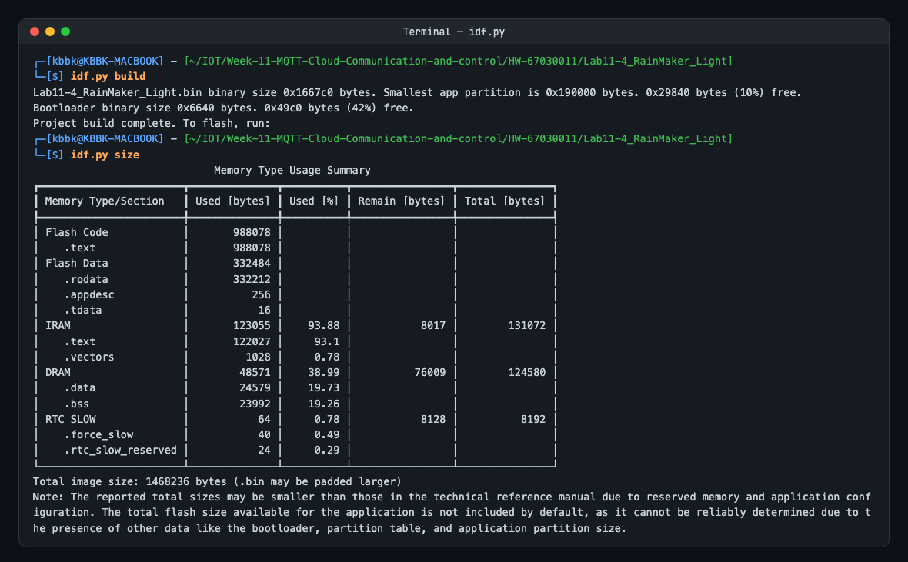
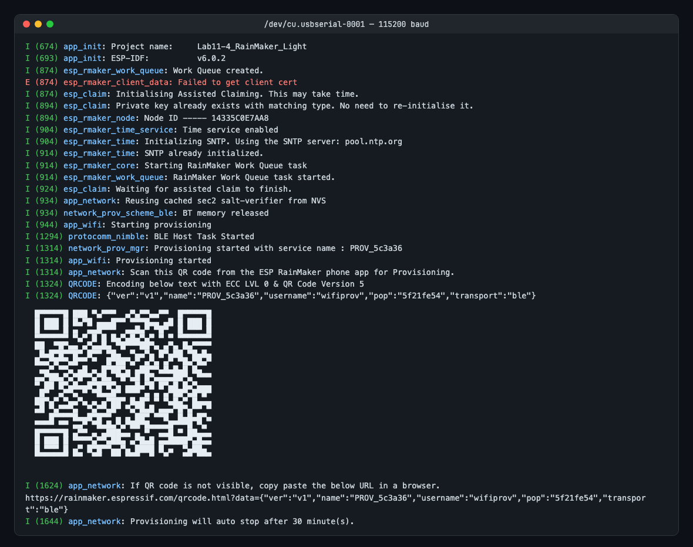
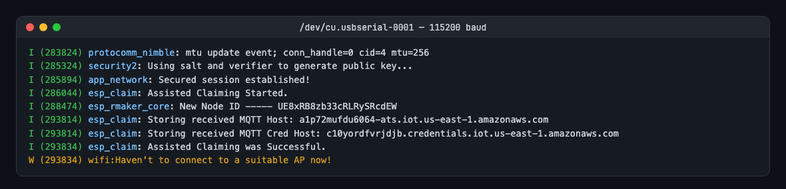
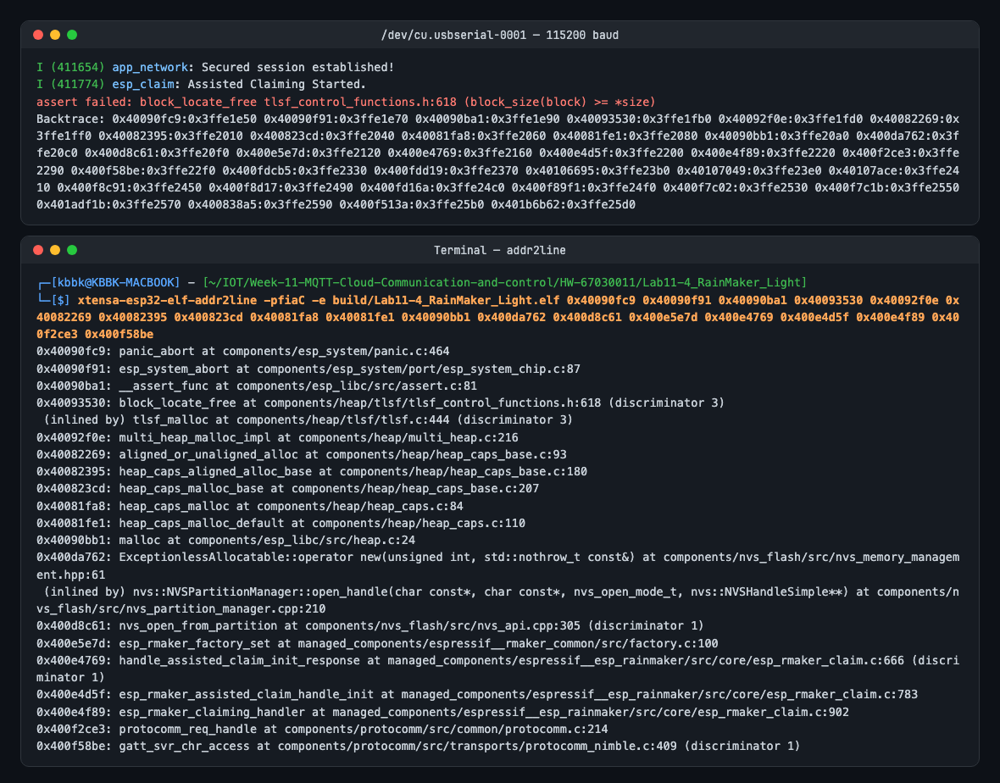
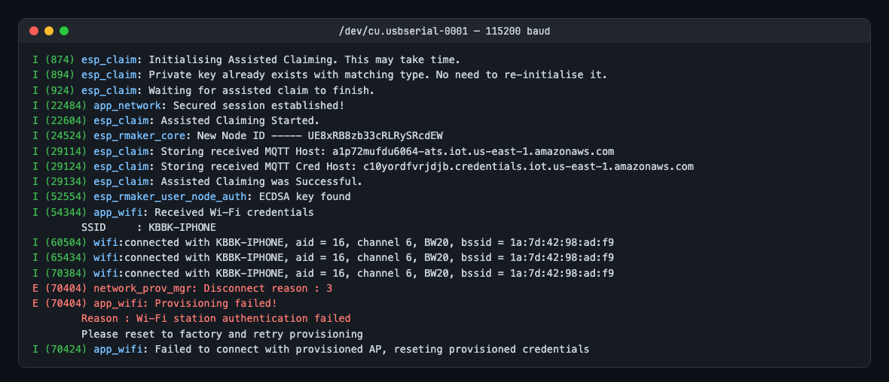
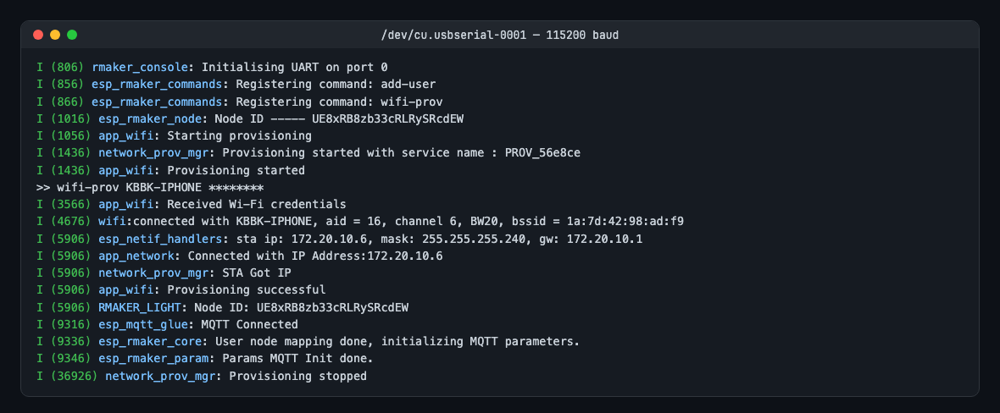
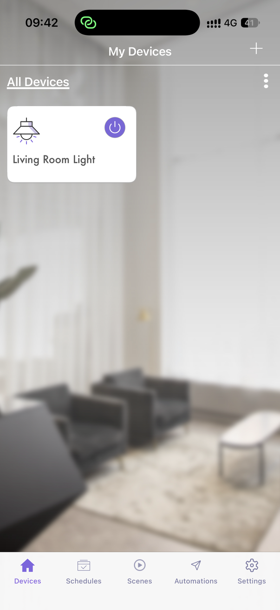
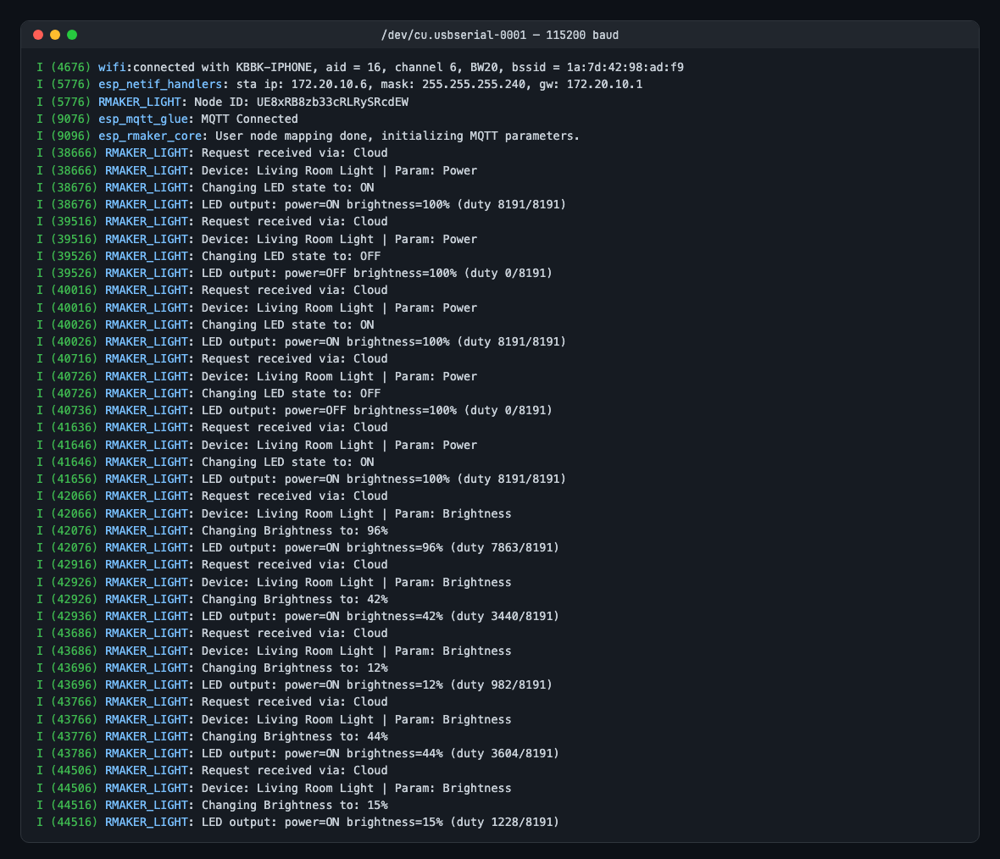
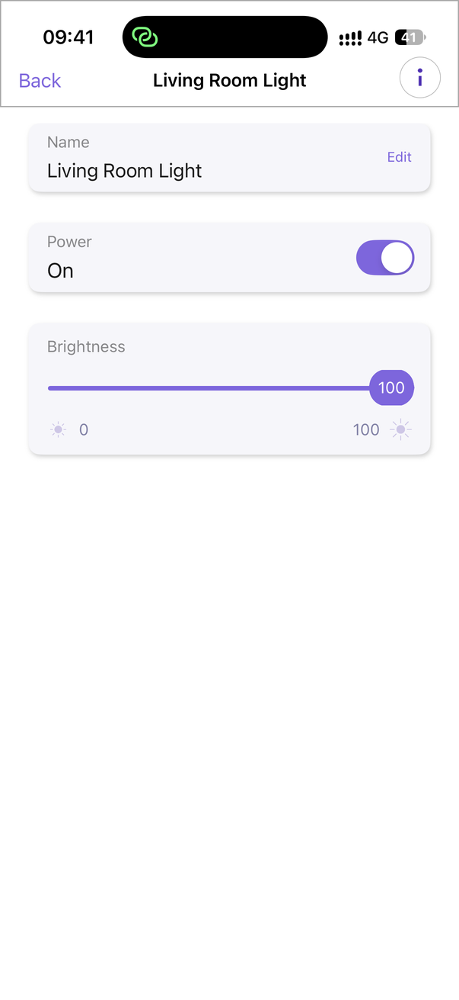

# ใบงานการทดลองที่ 11.4
### การสร้างอุปกรณ์ Smart Light สู่ระบบคลาวด์ด้วย ESP RainMaker SDK, BLE Provisioning และการควบคุมผ่านสมาร์ตโฟน

> [!NOTE] **คำชี้แจง**
> ในใบงานนี้นักศึกษาจะได้สร้างผลิตภัณฑ์ IoT สู่ระบบคลาวด์เชิงพาณิชย์จริงโดยใช้แพลตฟอร์ม **ESP RainMaker** ของ Espressif Systems โดยจะได้เขียนโปรแกรมสร้าง **Node** และ **Device (Smart Light)** พร้อมพารามิเตอร์ **Power** และ **Brightness** จากนั้นทำการเปิดใช้งานระบบ **BLE Wi-Fi Provisioning**, การขอรับใบรับรองผ่านระบบ **Assisted Claiming** สแกนเชื่อมต่อผ่านแอปพลิเคชัน **ESP RainMaker บนสมาร์ตโฟน** และควบคุมอุปกรณ์ข้ามเครือข่ายอินเทอร์เน็ตได้จากทุกที่ทั่วโลก

---

## 1. วัตถุประสงค์การทดลอง
1. เข้าใจโครงสร้างและการทำงานของแพลตฟอร์ม ESP RainMaker บนสถาปัตยกรรม ESP-IDF
2. สามารถสร้าง Node, Device, และ Parameters (Power, Brightness) ผ่าน RainMaker Core API ได้
3. สามารถเขียน Write Callback เพื่อรับคำสั่งจากคลาวด์มาปรับระดับสถานะ GPIO ของ LED และรายงานสถานะกลับ (Report State)
4. สามารถเปิดใช้งานบริการระดับระบบ ได้แก่ บริการซิงก์เวลา SNTP และการตั้งเวลาทำงาน (Schedule Service) ได้
5. สามารถทำกระบวนการ Provisioning และ Assisted Claiming ผ่านแอปพลิเคชันสมาร์ตโฟนด้วยบลูทูธ (BLE) ได้สำเร็จ
6. สามารถทดสอบส่งคำสั่งควบคุมผ่านแอปพลิเคชันมือถือ และเครื่องมือบรรทัดคำสั่ง ESP RainMaker CLI ได้

> [!NOTE] **สภาพแวดล้อมที่ใช้ทำการทดลองจริง (รหัสนักศึกษา 67030011)**
> * บอร์ด ESP32-D0WD-V3 (Flash 4 MB), ESP-IDF v6.0.2, `espressif/esp_rainmaker` **1.17.0**, `espressif/rmaker_app_network` **1.4.5**
> * LED บนบอร์ด GPIO 2, แอป ESP RainMaker บน iPhone ซึ่งเป็นตัวปล่อย Hotspot `KBBK-IPHONE` ด้วย
> * โปรเจกต์: [Lab11-4_RainMaker_Light/](Lab11-4_RainMaker_Light/) — Log ใน [logs/](Lab11-4_RainMaker_Light/logs/)


---

## 2. อุปกรณ์และเครื่องมือที่ใช้
* บอร์ดไมโครคอนโทรลเลอร์ **ESP32-C3** หรือ **ESP32**
* หลอดไฟ LED พร้อมตัวต้านทาน 220Ω ต่อเข้ากับ **GPIO 8** (ESP32-C3) หรือ **GPIO 2** (ESP32)
* สายเชื่อมต่อ USB Data Cable
* เครื่องคอมพิวเตอร์พร้อมระบบพัฒนา **ESP-IDF v5.x / v6.x**
* สมาร์ตโฟน (Android หรือ iOS) ที่ติดตั้งแอปพลิเคชัน **ESP RainMaker** และเปิดบลูทูธ/Wi-Fi ไว้
* เราเตอร์ Wi-Fi (2.4 GHz) ที่เชื่อมต่อออกสู่อินเทอร์เน็ตได้จริง

---

## 3. ขั้นตอนการทดลอง (Deconstructed Activities)

### กิจกรรมที่ 11-4.1 การสร้างโปรเจกต์และติดตั้ง Dependency `esp-rainmaker`

#### 1. สร้างโปรเจกต์ใหม่
```powershell
idf.py create-project Lab11-4_RainMaker_Light
cd Lab11-4_RainMaker_Light
idf.py set-target esp32c3   # หรือ esp32
```

#### 2. ติดตั้ง ESP RainMaker Component จาก IDF Component Registry
เพิ่มไลบรารีทางการของ Espressif ผ่านคำสั่ง
```powershell
idf.py add-dependency "espressif/esp-rainmaker"
```

**ผลการทดลอง — ชื่อคอมโพเนนต์ในใบงานไม่มีอยู่ใน Registry:**
```text
$ idf.py add-dependency "espressif/esp-rainmaker"
ERROR: Component "espressif/esp-rainmaker" not found
```
ชื่อที่ถูกต้องใช้ขีดล่าง และ `app_wifi.h` ไม่ได้อยู่ใน esp_rainmaker แต่อยู่ในคอมโพเนนต์ `rmaker_app_network` (มี `app_wifi.h` เป็นชั้น Compatibility ที่ map `app_wifi_init()` / `app_wifi_start()` ไปยัง `app_network_*`)
```powershell
idf.py add-dependency "espressif/esp_rainmaker"
idf.py add-dependency "espressif/rmaker_app_network"
```


ไฟล์ `main/idf_component.yml` จะได้รับการสร้างและอัปเดตโดยอัตโนมัติ
```yaml
dependencies:
  idf:
    version: ">=5.0.0"
  espressif/esp-rainmaker:
    version: "^3.0.0"
```

**ที่ได้จริง** ([main/idf_component.yml](Lab11-4_RainMaker_Light/main/idf_component.yml)) — เวอร์ชันล่าสุดของ esp_rainmaker คือ **1.17.0** (ไม่มีเวอร์ชัน `^3.0.0` ตามใบงาน) และ Component Manager ดึง Dependency มาเพิ่มรวม 22 ตัว (network_provisioning, esp_schedule, rmaker_common, mqtt, qrcode, ...)
```yaml
dependencies:
  idf:
    version: '>=4.1.0'
  espressif/rmaker_app_network: '*'
  espressif/esp_rainmaker: '*'
```


---

### กิจกรรมที่ 11-4.2 การเขียนโค้ดเฟิร์มแวร์อุปกรณ์ (`main/main.c`)

เปิดไฟล์ `main/main.c` และแทนที่ด้วยโค้ดสมบูรณ์ต่อไปนี้

```c
#include <stdio.h>
#include <string.h>
#include "esp_log.h"
#include "nvs_flash.h"
#include "driver/gpio.h"

// RainMaker Headers
#include "esp_rmaker_core.h"
#include "esp_rmaker_standard_types.h"
#include "esp_rmaker_standard_params.h"
#include "esp_rmaker_standard_devices.h"
#include "esp_rmaker_schedule.h"
#include "app_wifi.h"

#if CONFIG_IDF_TARGET_ESP32C3
#define LED_PIN GPIO_NUM_8
#else
#define LED_PIN GPIO_NUM_2
#endif

static const char *TAG = "RMAKER_LIGHT";
static esp_rmaker_device_t *s_light_device = NULL;

/* ========================================================
 * 1. Write Callback ฟังก์ชันรับคำสั่งควบคุมจากคลาวด์
 * ======================================================== */
static esp_err_t write_cb(const esp_rmaker_device_t *device, const esp_rmaker_param_t *param,
                          const esp_rmaker_param_val_t val, void *priv_data, esp_rmaker_write_ctx_t *ctx)
{
    if (ctx) {
        ESP_LOGI(TAG, "Request received via: %s", esp_rmaker_device_cb_src_to_str(ctx->src));
    }
    const char *device_name = esp_rmaker_device_get_name(device);
    const char *param_name = esp_rmaker_param_get_name(param);

    ESP_LOGI(TAG, "Device: %s | Param: %s", device_name, param_name);

    // ตรวจสอบว่าเป็นคำสั่ง Power (เปิด/ปิด)
    if (strcmp(param_name, ESP_RMAKER_DEF_POWER_NAME) == 0) {
        bool state = val.val.b;
        ESP_LOGI(TAG, "Changing LED state to: %s", state ? "ON" : "OFF");
        gpio_set_level(LED_PIN, state ? 1 : 0);
        
        // รายงานสถานะปัจจุบันกลับสู่คลาวด์ เพื่อให้แอปบนมือถืออัปเดตสถานะทันที
        esp_rmaker_param_update_and_report(param, val);
    }
    // ตรวจสอบว่าเป็นคำสั่ง Brightness (ความสว่าง 0 - 100%)
    else if (strcmp(param_name, ESP_RMAKER_DEF_BRIGHTNESS_NAME) == 0) {
        int brightness = val.val.i;
        ESP_LOGI(TAG, "Changing Brightness to: %d%%", brightness);
        
        // (สามารถนำค่า brightness 0-100 ไปปรับค่า LEDC PWM ในงานจริงได้)
        esp_rmaker_param_update_and_report(param, val);
    }

    return ESP_OK;
}

/* ========================================================
 * 2. ฟังก์ชันหลัก (app_main)
 * ======================================================== */
void app_main(void)
{
    // กำหนดค่า GPIO ควบคุม LED
    gpio_reset_pin(LED_PIN);
    gpio_set_direction(LED_PIN, GPIO_MODE_OUTPUT);
    gpio_set_level(LED_PIN, 0);

    // เริ่มต้นระบบจัดเก็บข้อมูล NVS Flash
    esp_err_t err = nvs_flash_init();
    if (err == ESP_ERR_NVS_NO_FREE_PAGES || err == ESP_ERR_NVS_NEW_VERSION_FOUND) {
        ESP_ERROR_CHECK(nvs_flash_erase());
        err = nvs_flash_init();
    }
    ESP_ERROR_CHECK(err);

    // 1. เริ่มต้นระบบ Wi-Fi Provisioning (ผ่าน BLE)
    app_wifi_init();

    // 2. สร้าง Node ในระบบ ESP RainMaker
    esp_rmaker_config_t rainmaker_cfg = {
        .enable_time_sync = true, // เปิดบริการซิงก์เวลาโลกอัตโนมัติ
    };
    esp_rmaker_node_t *node = esp_rmaker_node_init(&rainmaker_cfg, "Smart Light Node", "Lightbulb");
    if (!node) {
        ESP_LOGE(TAG, "Could not initialise node.");
        return;
    }

    // 3. สร้าง Device ประเภท Lightbulb
    s_light_device = esp_rmaker_lightbulb_device_create("Living Room Light", NULL, false);
    // ผูก Callback สำหรับรับคำสั่ง
    esp_rmaker_device_add_cb(s_light_device, write_cb, NULL);

    // 4. เพิ่ม Parameter Brightness (ความสว่างเริ่มต้น 100%)
    esp_rmaker_param_t *brightness_param = esp_rmaker_brightness_param_create(ESP_RMAKER_DEF_BRIGHTNESS_NAME, 100);
    esp_rmaker_device_add_param(s_light_device, brightness_param);

    // 5. บรรจุ Device เข้าสู่ Node
    esp_rmaker_node_add_device(node, s_light_device);

    // 6. เปิดบริการระดับระบบ (System Services)
    esp_rmaker_timezone_service_enable(); // บริการโซนเวลา
    esp_rmaker_schedule_enable();         // บริการตั้งเวลาอัตโนมัติ

    // 7. เริ่มการทำงานของระบบ RainMaker Core
    esp_rmaker_start();

    // 8. เริ่มต้นระบบค้นหาอุปกรณ์และรับการตั้งค่า Wi-Fi (BLE Provisioning)
    app_wifi_start(POP_TYPE_RANDOM);
}
```

**โค้ดที่ใช้จริง:** [main/main.c](Lab11-4_RainMaker_Light/main/main.c) — โครงสร้างตามใบงาน (Node "Smart Light Node", Device "Living Room Light", Param Power + Brightness, Time Sync, Timezone, Schedule) และปรับดังนี้
* **Brightness ใช้งานได้จริง**: ขับ LED ผ่าน **LEDC PWM 5 kHz, 13 บิต** แทน `gpio_set_level` — duty = Brightness% × 8191 เมื่อ Power เปิด และ 0 เมื่อปิด
* `write_cb` ปรับ Hardware ก่อนแล้วจึง `esp_rmaker_param_update_and_report()` และตรวจค่าที่คืนจาก `app_wifi_start()`
* เรียก `esp_rmaker_console_init()` เปิด Console ทาง UART (คำสั่ง `wifi-prov`, `get-node-id`, `reboot`, `reset-to-factory` ฯลฯ) — ใช้ตั้งค่า Wi-Fi ทางสาย USB ได้เมื่อมือถือที่ใช้แอปเป็นตัวปล่อย Hotspot เอง (ดูกิจกรรม 11-4.4)
* ต้องเพิ่มไฟล์ที่ใบงานไม่ได้ระบุเพื่อให้ RainMaker ทำงานบน ESP32 ได้:
  * [partitions.csv](Lab11-4_RainMaker_Light/partitions.csv) — พาร์ทิชัน `fctry` (เก็บ Node ID/ใบรับรองจากการ Claim), `ota_0`/`ota_1` ละ 1.6 MB (เฟิร์มแวร์มีขนาด 1.47 MB ใส่ใน Factory 1 MB เดิมไม่ได้)
  * [sdkconfig.defaults](Lab11-4_RainMaker_Light/sdkconfig.defaults) — Flash 4 MB, Custom Partition Table, **BT + NimBLE** (สำหรับ BLE Provisioning / Assisted Claiming), mbedTLS Dynamic Buffer

<p align="center">

</p>


---

### กิจกรรมที่ 11-4.3 การคอมไพล์ แฟลช และสังเกตการสร้าง QR Code

สั่งคอมไพล์และแฟลชโปรแกรม
```powershell
idf.py build
idf.py -p COMx flash monitor
```

**ผลลัพธ์ใน Serial Monitor**
* บอร์ดจะพิมพ์ **QR Code ในรูปแบบตัวอักษร ASCII** ออกมาทางหน้าจอ พร้อม URL สำหรับเปิดดูรูปภาพ QR Code
* บอร์ดจะเริ่มประกาศสัญญาณบลูทูธ (BLE Advertising) เพื่อรอรับการเชื่อมต่อ

**ผลการทดลอง:** หลัง `idf.py erase-flash` + `flash` บอร์ดพิมพ์ QR Code (Version 5) พร้อม URL และเริ่ม BLE Advertising ชื่อ `PROV_5c3a36` (PoP แบบสุ่ม) บรรทัด `E ... Failed to get client cert` เป็นเรื่องปกติของบอร์ดที่ยังไม่เคย Claim — มันจึงเข้าสู่โหมด `Initialising Assisted Claiming`

<p align="center">

</p>

QR เดียวกันที่แปลงจาก Serial Log เป็นรูปเพื่อสแกนด้วยมือถือ:

<p align="center">

</p>


---

### กิจกรรมที่ 11-4.4 การเชื่อมต่อผ่านแอปพลิเคชัน ESP RainMaker บนมือถือ

<p align="center">
  
  &nbsp;&nbsp;&nbsp;&nbsp;
  
  &nbsp;&nbsp;&nbsp;&nbsp;
  
</p>
<p align="center"><b>รูปที่ 11.13</b> ขั้นตอนการเปิดใช้งาน Assisted Claiming และการจับคู่อุปกรณ์บนโทรศัพท์มือถือ</p>

1. **เข้าสู่ระบบ** เปิดแอปพลิเคชัน **ESP RainMaker** บนโทรศัพท์มือถือ เข้าสู่ระบบด้วยบัญชีที่ลงทะเบียนไว้
2. **เพิ่มอุปกรณ์** กดปุ่มเครื่องหมายบวก (`+ Add Device`) บนหน้าจอแอป
3. **สแกน QR Code** นำกล้องสมาร์ตโฟนสแกน QR Code ที่ปรากฏบน Serial Monitor
4. **กระบวนการ Assisted Claiming**
   * หากบอร์ดยังไม่มีใบรับรอง แอปจะขึ้นหน้าต่างยืนยันการขอรับ Certificate ให้กดปุ่มยืนยัน
   * แอปจะดึงใบรับรองจาก RainMaker Cloud แล้วส่งให้ ESP32 ผ่านช่องทาง BLE
5. **กรอกรหัส Wi-Fi** เลือกชื่อ SSID เครือข่าย Wi-Fi 2.4 GHz ในบ้านและกรอกรหัสผ่าน
6. **เสร็จสิ้นการผูกอุปกรณ์** บอร์ดจะเชื่อมต่อ Wi-Fi และผูกตัวเองเข้ากับบัญชีผู้ใช้ แอปจะแสดงการ์ด **"Living Room Light"** ขึ้นมาบนหน้าจอ

**ผลการทดลอง — Assisted Claiming สำเร็จ:** หลังสแกน QR แอปเปิด Session แบบ Security 2 (SRP6a + PoP) แล้วทำ Claim ผ่าน BLE บอร์ดได้ **Node ID ใหม่ `UE8xRB8zb33cRLRySRcdEW`** และ MQTT Host ของ AWS IoT (`a1p72mufdu6064-ats.iot.us-east-1.amazonaws.com`) เก็บไว้ในพาร์ทิชัน `fctry`

<p align="center">

</p>


**ผลการทดลอง — ขั้นตอนตั้งค่า Wi-Fi และผูกอุปกรณ์**

> [!WARNING] **ปัญหาที่พบระหว่าง Provisioning และวิธีแก้**
> 1. **Claim ซ้ำในการบูตเดียวกันทำให้บอร์ด Crash:** รอบแรกแอปตัดการเชื่อมต่อหลัง Claim เมื่อสแกนใหม่แอปสั่ง Claim อีกครั้ง บอร์ดเกิด `assert failed: block_locate_free tlsf_control_functions.h:618` (Heap เสียหาย) แล้ว Reboot — ถอด Backtrace ด้วย `addr2line` ได้ `handle_assisted_claim_init_response()` (esp_rmaker_claim.c:666) → `esp_rmaker_factory_set()` → `nvs_open_from_partition()` → `malloc` เป็นบั๊กในเส้นทาง Claim ซ้ำของไลบรารี ไม่ใช่โค้ดแล็บ
> 2. **iOS Cache ตาราง GATT:** หลังบอร์ดถูก Claim แล้ว Endpoint `rmaker_claim` หายไป ทำให้ Handle ของ Characteristic เลื่อน แต่ iPhone ใช้ Handle เดิมที่ Cache ไว้ บอร์ดจึงขึ้น `ATT write: invalid handle` และแอปแจ้ง `ESPProvision.ESPSessionError error 0` แก้โดย `idf.py erase-flash` ให้บอร์ดกลับเป็นสถานะยังไม่ Claim (ตาราง GATT ตรงกับที่ iPhone จำไว้) แล้ว Claim ใหม่ได้สำเร็จในครั้งเดียว
> 3. **iPhone ที่ใช้แอปเป็นตัวปล่อย Hotspot เอง:** รายการ Wi-Fi ที่บอร์ดสแกนไม่มี `KBBK-IPHONE` จึงพิมพ์เองผ่าน "Join Other Network" บอร์ดได้รหัสและ Associate ได้ แต่ iOS ส่ง Deauth (reason 3) เพราะรับอุปกรณ์ใหม่เฉพาะตอนเปิดหน้า *Settings › Personal Hotspot* ซึ่งเปิดพร้อมกับแอป RainMaker ไม่ได้ แอปจึงขึ้น *Wi-Fi authentication error*

<p align="center">

</p>

<p align="center">

</p>

**วิธีที่ใช้จนสำเร็จ:** การผูกอุปกรณ์กับบัญชีผู้ใช้ทำเสร็จก่อนขั้นตอน Wi-Fi แล้ว (แอปใช้ Challenge-Response กับกุญแจ ECDSA ของบอร์ด — Log `esp_rmaker_user_node_auth: ECDSA key found`) จึงเหลือแค่ส่งรหัส Wi-Fi ระหว่างที่หน้า Personal Hotspot เปิดอยู่ ใช้คำสั่ง Console `wifi-prov` ผ่านสาย USB (ซึ่ง `wifi-prov` เรียก `network_prov_mgr_configure_wifi_sta()` ของ Provisioning Manager ตัวเดียวกับแอป) ผลคือ `Provisioning successful` → `MQTT Connected` (AWS IoT) → **`User node mapping done`** และการ์ด **"Living Room Light"** ขึ้นในแอปของผู้ใช้ (รหัสผ่านใน Log ถูกปิดเป็น `********`)

<p align="center">

</p>

หน้าจอแอป ESP RainMaker บน iPhone หลังผูกอุปกรณ์สำเร็จ: การ์ด **Living Room Light** ขึ้นในหน้า *My Devices*

<p align="center">

</p>
<p align="center"><b>ผลการทดลอง: การ์ด Living Room Light ในแอป ESP RainMaker (09:42)</b></p>


---

## 4. การทดสอบและการตรวจสอบผลลัพธ์ (Testing & Verification)

### 1. การควบคุมเปิด-ปิดผ่าน Mobile App
* กดสวิตช์ Power บนหน้าจอแอป สังเกตว่าหลอดไฟ LED บนบอร์ดเปิดและปิดทันทีตามการสั่งการ
* ทดลองเลื่อนแถบสไลเดอร์ Brightness สังเกตข้อความ Log บน Serial Monitor ว่าได้รับค่าความสว่างใหม่กี่เปอร์เซ็นต์

### 2. การควบคุมระยะไกลข้ามอินเทอร์เน็ต (Remote 4G/5G Test)
* **ปิดสัญญาณ Wi-Fi บนสมาร์ตโฟน** แล้วเปิดใช้งานเฉพาะ **สัญญาณอินเทอร์เน็ตมือถือ (4G/5G)**
* กดสั่งเปิด-ปิดหลอดไฟอีกครั้ง สังเกตว่าบอร์ด ESP32 ที่บ้านยังคงตอบสนองต่อคำสั่งได้อย่างรวดเร็ว แสดงถึงพลังของสถาปัตยกรรม Cloud Control

**ผลการทดลอง — ควบคุมผ่านแอปมือถือ:** การ์ด Living Room Light ขึ้นในแอป กด Power เปิด/ปิด 5 ครั้งและเลื่อน Brightness หลายระดับ LED บนบอร์ดตอบสนองทันทีทุกครั้ง Serial Log แสดง `Request received via: Cloud` ทุกคำสั่ง และ Duty ของ PWM เปลี่ยนตามความสว่างจริง (เช่น 12 % → 982/8191, 42 % → 3440/8191, 100 % → 8191/8191; Power OFF → 0/8191)

**การควบคุมผ่าน 4G/5G:** iPhone ที่ใช้สั่งงานคือตัวปล่อย Hotspot เอง ตัวมันจึงออกอินเทอร์เน็ตผ่านเครือข่ายมือถือ (4G/5G) ตลอดการทดลอง คำสั่งทุกครั้งเดินทาง **แอป → อินเทอร์เน็ตมือถือ → RainMaker Cloud (AWS IoT us-east-1) → MQTT → บอร์ด** ไม่ได้ผ่านวงแลน (ยืนยันจาก `Request received via: Cloud` ซึ่งแยกจาก `Local`) ส่วน RainMaker CLI (ทางเลือกขั้นสูง) ไม่ได้ทดลองเพราะต้องล็อกอินบัญชีบนคอมพิวเตอร์

<p align="center">

</p>

หน้าควบคุมในแอป: Power = On, Brightness = 100 — แถบสถานะของ iPhone แสดง **4G** และไอคอน Personal Hotspot (สีเขียว) แปลว่ามือถือออกอินเทอร์เน็ตผ่านเครือข่ายมือถือขณะสั่งงาน

<p align="center">

</p>
<p align="center"><b>ผลการทดลอง: ควบคุม Power / Brightness ผ่านแอป (09:41, เครือข่าย 4G)</b></p>


---

### 3. (ทางเลือกขั้นสูง) การทดสอบผ่าน RainMaker CLI บนคอมพิวเตอร์

เปิดเทอร์มินัลใหม่บนคอมพิวเตอร์

```powershell
# ติดตั้งเครื่องมือ CLI
pip install esp-rainmaker-cli

# เข้าสู่ระบบ
rainmaker.py login

# ดึงรายชื่ออุปกรณ์และ Node ID
rainmaker.py getnodes

# สั่งเปิดหลอดไฟผ่าน Command Line
rainmaker.py setparams --nodeid <YOUR_NODE_ID> '{"Living Room Light": {"Power": true}}'

# สั่งปิดหลอดไฟผ่าน Command Line
rainmaker.py setparams --nodeid <YOUR_NODE_ID> '{"Living Room Light": {"Power": false}}'
```

---

## 5. คำถามท้ายการทดลอง (Post-Lab Questions)

1. **ในสถาปัตยกรรม ESP RainMaker กระบวนการ Assisted Claiming ช่วยแก้ปัญหาเรื่องการติดตั้งใบรับรองความปลอดภัย (Security Certificates) บนอุปกรณ์ในขั้นตอนพัฒนาต้นแบบได้อย่างไร?**
   * **คำตอบ:** อุปกรณ์ต้องมี **X.509 Certificate เฉพาะตัวที่ RainMaker/AWS IoT รับรอง** จึงจะเชื่อมต่อ MQTT แบบ mTLS กับคลาวด์ได้ ในการผลิตจริงใบรับรองถูกฝังจากโรงงาน (พาร์ทิชัน `esp_secure_cert`) ซึ่งนักพัฒนาต้นแบบทำเองไม่ได้ และถ้าทำแบบใบงาน 11.3 (สร้าง CA/กุญแจด้วย OpenSSL แล้วฝังใน Firmware) ก็ต้องดูแล PKI เองและเสี่ยงกุญแจหลุด Assisted Claiming แก้ปัญหานี้โดย
     * บอร์ด **สร้างคู่กุญแจและ CSR เองบนชิป** (Log: `Private key already exists with matching type` คือกุญแจที่บอร์ดสร้างไว้ตั้งแต่บูตแรก) Private Key ไม่เคยออกจากบอร์ดและไม่ต้องอยู่ใน Source Code/Git
     * ส่ง CSR ผ่าน **BLE ที่เข้ารหัสด้วย Security 2 + PoP** ไปที่แอปบนมือถือ ซึ่งล็อกอินบัญชีผู้ใช้อยู่แล้ว แอปส่งต่อให้ Claiming Service บนคลาวด์ (มือถือ "ช่วย" เพราะบอร์ดยังไม่มีอินเทอร์เน็ต)
     * คลาวด์เซ็นใบรับรอง ผูกกับบัญชีผู้ Claim แล้วส่งกลับพร้อม Node ID และ MQTT Host บอร์ดเก็บลงพาร์ทิชัน `fctry` — ผลจริง: `New Node ID ----- UE8xRB8zb33cRLRySRcdEW` → `Storing received MQTT Host: a1p72mufdu6064-ats.iot.us-east-1.amazonaws.com` → `Assisted Claiming was Successful.`
     * ได้ใบรับรองไม่ซ้ำกันทุกบอร์ดโดยอัตโนมัติในขั้นตอนเดียวกับการตั้งค่า Wi-Fi ไม่ต้องใช้ OpenSSL หรือเครื่องมือโรงงาน (Assisted Claiming เหมาะกับงานพัฒนา/ต้นแบบ และมีโควตาจำนวนบอร์ดต่อบัญชี การผลิตจำนวนมากยังควรใช้ใบรับรองจากโรงงาน)

2. **เพราะเหตุใดฟังก์ชัน `write_cb` จึงต้องเรียกคำสั่ง `esp_rmaker_param_update_and_report()` ทุกครั้งที่มีการเปลี่ยนแปลงค่าพารามิเตอร์?**
   * **คำตอบ:** `write_cb` เป็นเพียง **"คำขอ" (desired)** ที่มาจากแอป/คลาวด์/Schedule/Local Control ส่วน RainMaker เก็บ **"สถานะที่รายงาน" (reported)** ของแต่ละ Param แยกไว้ คล้าย Device Shadow ของ AWS IoT การเรียก `esp_rmaker_param_update_and_report()` ทำ 2 อย่าง
     * **update:** อัปเดตค่าใน Data Model บนบอร์ด เพื่อให้ `get-param`, Local Control, Schedule และการรายงานครั้งถัดไปใช้ค่าปัจจุบัน
     * **report:** Publish ค่าใหม่ขึ้นคลาวด์ (Topic `node/<node_id>/params/local`) เพื่อให้แอปทุกเครื่องที่แชร์อุปกรณ์, Alexa/Google Home และหน้าจอ Schedule เห็นสถานะเดียวกัน
     * ถ้าไม่เรียก ไฟจริงเปลี่ยนแต่คลาวด์ยังเก็บค่าเก่า แอปจะเด้งกลับไปแสดงค่าเดิมหรือค้างที่สถานะผิด และผู้ใช้คนอื่นเห็นข้อมูลไม่ตรงกัน
     * ควรรายงาน **ค่าที่ Hardware ทำได้จริง** หลังสั่งงานสำเร็จ (โค้ดนี้จึงเรียก `led_apply()` ก่อน report) และถ้าค่าเปลี่ยนจากฝั่งบอร์ดเอง (เช่น กดปุ่ม) ก็ต้องเรียก `esp_rmaker_param_update_and_report()` เช่นกัน

3. **เปรียบเทียบความแตกต่างระหว่างการพัฒนาอุปกรณ์ IoT ด้วย Plain MQTT บน Mosquitto เอง (ในแล็บ 11.2) กับการใช้ ESP RainMaker SDK (ในแล็บ 11.4) ในแง่ของความพยายามในการพัฒนา (Development Effort), ความปลอดภัย (Security), และการขยายระบบ (Scalability)**
   * **คำตอบ:**

     | ประเด็น | Plain MQTT + Mosquitto (11.2) | ESP RainMaker (11.4) |
     | :--- | :--- | :--- |
     | **Development Effort** | เขียนเองทั้งหมด: ต่อ Wi-Fi แบบฝัง SSID/Password, ออกแบบ Topic, ถอดรหัส JSON, LWT/Status, ตั้ง Broker และต้องทำแอป/แดชบอร์ดแยก ข้อดีคือยืดหยุ่นและเบา (.bin 0.91 MB, IRAM 67 %, DRAM static 36.8 KB) | ประกาศ Node/Device/Param ราว 100 บรรทัด ได้ BLE Provisioning + QR, แอปมือถือที่สร้าง UI จาก Param อัตโนมัติ, Schedule, Time Sync, OTA, Voice Assistant มาให้ แลกกับเฟิร์มแวร์ใหญ่ (.bin 1.47 MB, IRAM 93.9 %, DRAM static 48.6 KB), ต้องใช้ Flash 4 MB + ตาราง Partition เฉพาะ และผูกกับ Data Model/คลาวด์ของ Espressif |
     | **Security** | พอร์ต 1883 ไม่เข้ารหัส, `allow_anonymous true`, ใครอยู่ในวงแลนก็ดักฟังหรือส่งคำสั่ง `iot/node01/cmd/led` ได้ และรหัส Wi-Fi อยู่ในเฟิร์มแวร์ (แล็บ 11.3 แก้ด้วย mTLS แต่ต้องดูแล PKI เองและกุญแจอยู่ใน Flash แบบไม่เข้ารหัส) | mTLS กับ AWS IoT ด้วยใบรับรองรายเครื่องที่ได้จาก Claiming, Provisioning ผ่าน BLE แบบ Security 2 (SRP6a + AES-GCM + PoP), ผูกอุปกรณ์กับบัญชีผู้ใช้, สิทธิ์ (Policy) แยกต่อ Node, บอร์ดไม่เปิดพอร์ตรับการเชื่อมต่อจากภายนอก |
     | **Scalability** | Broker ตัวเดียวบนโน้ตบุ๊ก ใช้ได้แค่ในวงแลน ไม่มี High Availability, ไม่มีระบบผู้ใช้/สิทธิ์/ทะเบียนอุปกรณ์ ต้องทำ ACL, Cluster, OTA และ Multi-user เอง | ใช้โครงสร้าง AWS IoT Core ที่รองรับอุปกรณ์จำนวนมาก, ควบคุมผ่านอินเทอร์เน็ตได้ทุกที่, แชร์อุปกรณ์ให้ผู้ใช้หลายคน, จัดกลุ่ม และ OTA ทั้ง Fleet ได้ แต่ขยายได้ภายในกรอบ Data Model ของ RainMaker และใช้งานเชิงพาณิชย์ต้องใช้ Private Deployment (มีค่าใช้จ่าย) |

     สรุป: Plain MQTT เหมาะกับการเรียนรู้โปรโตคอล งาน Local/Edge หรือระบบที่ต้องคุมทุกอย่างเอง ส่วน RainMaker เหมาะกับการทำผลิตภัณฑ์ Smart Home ให้ออกสู่ผู้ใช้ได้เร็วและปลอดภัยตั้งแต่ต้น

4. **อธิบายขั้นตอนที่ทำให้ ESP RainMaker สามารถเชื่อมโยงการทำงานร่วมกับระบบสั่งงานด้วยเสียงของ Google Home หรือ Amazon Alexa ได้โดยไม่ต้องเขียนโค้ดเพิ่มเติมบนตัวบอร์ด ESP32**
   * **คำตอบ:** เพราะเฟิร์มแวร์ประกาศอุปกรณ์ด้วย **Standard Types** อยู่แล้ว (`esp_rmaker_lightbulb_device_create()` → type `esp.device.lightbulb`, Param `esp.param.power` และ `esp.param.brightness`) คลาวด์ RainMaker จึงแปลงเป็น Capability มาตรฐานของผู้ช่วยเสียงได้เอง บอร์ดคุยกับ RainMaker Cloud ผ่าน MQTT เหมือนเดิม และไม่รู้ด้วยซ้ำว่าคำสั่งมาจากเสียง ขั้นตอนคือ
     1. บอร์ดรายงาน **Node Config** (รายการ Device/Param/Type) ขึ้นคลาวด์ตอนเชื่อมต่อ
     2. ผู้ใช้เปิดใช้ Skill **"ESP RainMaker"** ในแอป Alexa หรือ Link บริการ **"ESP RainMaker"** ในแอป Google Home แล้วล็อกอินบัญชี RainMaker (**Account Linking ด้วย OAuth 2.0**)
     3. Alexa/Google ทำ **Discovery** เรียก API ของ RainMaker แล้วได้รายชื่ออุปกรณ์ของบัญชี พร้อม map `esp.device.lightbulb` → Light, `power` → *PowerController* / *OnOff*, `brightness` → *BrightnessController* / *Brightness*
     4. ผู้ใช้พูด "Alexa, turn on Living Room Light" → Alexa Cloud ส่ง Directive ไป RainMaker Cloud → แปลงเป็นการ Set Param `{"Living Room Light": {"Power": true}}` ส่งลง MQTT ไปที่บอร์ด
     5. บอร์ดรับใน `write_cb` เหมือนคำสั่งจากแอปทุกประการ (`Request received via: Cloud`) ปรับ LED แล้ว `esp_rmaker_param_update_and_report()` → คลาวด์อัปเดตสถานะกลับไปให้ Alexa/Google แสดงผลและตอบคำถามเช่น "ไฟเปิดอยู่ไหม"
     * เงื่อนไขคือต้องใช้ Device/Param Type มาตรฐาน ถ้าใช้ Type ที่กำหนดเอง ผู้ช่วยเสียงจะไม่รู้จัก
