# รายงานผลการทดลอง สัปดาห์ที่ 11
## MQTT Cloud Communication and Control & ESP RainMaker Ecosystem

---

# แลป 11.1: การติดตั้ง Mosquitto Broker และการทดสอบโปรโตคอล MQTT ด้วย CLI

## 1. ภาพผลการทดลอง

### ภาพที่ 1: การทำงานของ Mosquitto Broker (Verbose Log)
แสดงการรัน Broker, การเชื่อมต่อของ Client, ลำดับแพ็กเก็ต QoS 0/1/2, Retained Message และ LWT:

  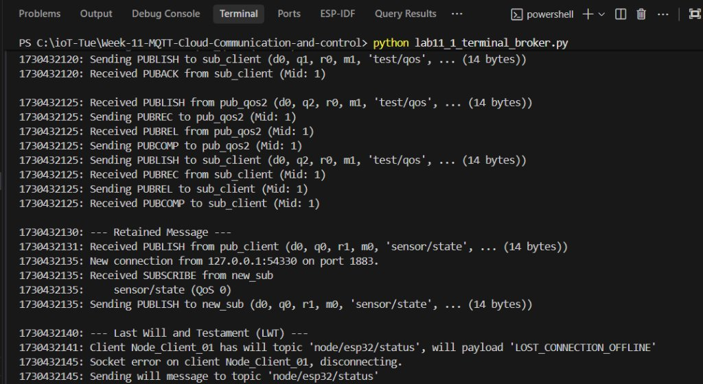

---

### ภาพที่ 2: หน้าจอ Subscriber
แสดงการรับข้อความจาก Wildcard `+`, Wildcard `#`, QoS 0/1/2, Retained Message และ LWT:

  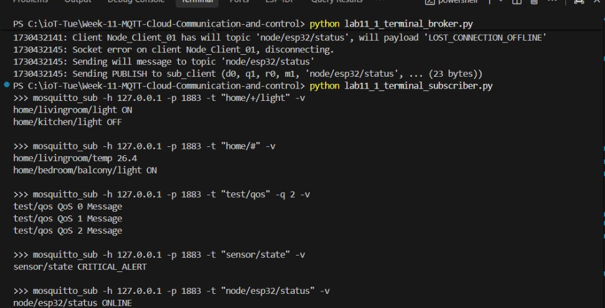

---

### ภาพที่ 3: หน้าจอ Publisher
แสดงคำสั่ง Publish ที่ใช้ทดสอบในแต่ละกิจกรรม:

  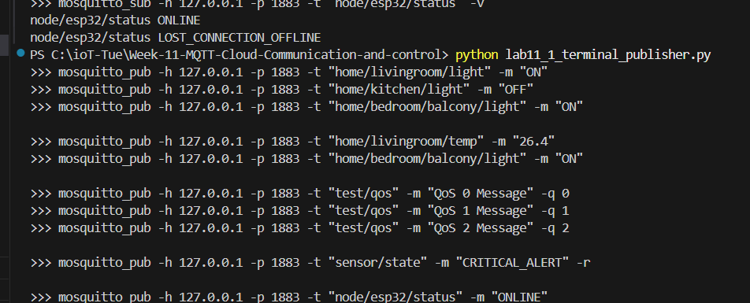

---

## 2. ตารางเปรียบเทียบลำดับแพ็กเก็ตระหว่าง QoS 0, QoS 1 และ QoS 2

| ระดับ QoS | ลำดับแพ็กเก็ตบน Broker Log | การรับประกันข้อมูล | การส่งซ้ำ (Retransmission) | ปริมาณ Overhead |
| :--- | :--- | :--- | :--- | :--- |
| **QoS 0** (At Most Once) | 1. `Received PUBLISH` 2. `Sending PUBLISH` (ส่งต่อให้ผู้รับทันที) | ส่งครั้งเดียว ไม่รับประกันว่าถึง | ไม่มี | ต่ำสุด (ไม่มี Packet ID, ไม่มี ACK) |
| **QoS 1** (At Least Once) | 1. `Received PUBLISH (..., q1, m1)` 2. `Sending PUBACK (Mid: 1)` | ถึงผู้รับอย่างน้อยหนึ่งครั้ง แต่อาจมีข้อความซ้ำ | มี (หากไม่ได้รับ PUBACK ภายในเวลาที่กำหนด) | ปานกลาง (มี Packet ID และแพ็กเก็ต PUBACK) |
| **QoS 2** (Exactly Once) | 1. `Received PUBLISH (..., q2, m1)` 2. `Sending PUBREC (Mid: 1)` 3. `Received PUBREL (Mid: 1)` 4. `Sending PUBCOMP (Mid: 1)` | ถึงผู้รับแน่นอนและมีเพียงชุดเดียว (ไม่ซ้ำ) | มี (มีการยืนยันสถานะสองขั้นตอน 4-way Handshake) | สูงสุด (ใช้แบนด์วิดท์และเวลาประมวลผลมากสุด) |

---

## 3. เฉลยคำถามท้ายการทดลอง 11.1

**1. เพราะเหตุใดสัญลักษณ์ `#` จึงต้องวางไว้ที่ตำแหน่งท้ายสุดของ Topic เสมอ? หากกำหนด Topic Filter เป็น `home/#/light` จะเกิดข้อผิดพลาดอย่างไร?**
* **ตอบ:** สัญลักษณ์ `#` คือ Multi-Level Wildcard ที่ทำหน้าที่ครอบคลุมทุกระดับชั้นย่อยตั้งแต่จุดนั้นลงไปจนสุดทาง ตามข้อกำหนดของมาตรฐาน MQTT จึงไม่อนุญาตให้มีระดับอื่นมาต่อท้าย หากระบุเป็น `home/#/light` Broker จะถือว่าเป็น Topic Filter ที่ผิดไวยากรณ์ (Malformed Topic Filter) ส่งผลให้ Broker ปฏิเสธการ Subscribe หรือตัดการเชื่อมต่อทันที

**2. ในระบบงานติดตามยานพาหนะ (GPS Tracking) ที่ส่งพิกัดรถยนต์ทุกๆ 1 วินาที ท่านคิดว่าควรเลือกระดับ QoS ใดระหว่าง QoS 0, 1 หรือ 2 เพราะเหตุใด?**
* **ตอบ:** ควรเลือก **QoS 0** เพราะข้อมูลถูกส่งถี่มากอย่างต่อเนื่องทุก 1 วินาที หากมีบางพิกัดหล่นหายระหว่างทางก็ไม่มีผลต่อภาพรวม และในวินาทีถัดไปก็มีพิกัดใหม่เข้ามาแทนที่ทันที การใช้ QoS 0 ช่วยประหยัดแบนด์วิดท์ เครือข่ายไม่ติดขัด และประหยัดพลังงานที่สุด

**3. หาก Client ส่งแพ็กเก็ต `DISCONNECT` ไปยัง Broker อย่างถูกต้องก่อนปิดโปรแกรม ข้อความ Last Will and Testament (LWT) จะถูกเผยแพร่ออกไปหรือไม่ เพราะเหตุใด?**
* **ตอบ:** **ไม่ถูกเผยแพร่** เพราะ Broker จะถือว่าเป็นการตัดการเชื่อมต่อตามปกติ (Graceful Disconnect) โดย Broker จะลบข้อความ LWT ทิ้งทันที ข้อความ LWT จะถูกส่งออกไปเฉพาะกรณีที่การเชื่อมต่อหลุดกะทันหันผิดปกติ (เช่น ไฟดับ เน็ตหลุด หรือ TCP Socket ขาด) เท่านั้น

**4. Retained Message มีประโยชน์อย่างไรในการออกแบบระบบแดชบอร์ด Smart Home สำหรับผู้ใช้งานที่เพิ่งเปิดแอปพลิเคชันขึ้นมาเป็นครั้งแรก?**
* **ตอบ:** ทำให้หน้าแดชบอร์ดแสดงสถานะล่าสุดของอุปกรณ์ได้ทันทีที่เปิดแอป (เช่น สถานะไฟว่าเปิดหรือปิดอยู่ หรืออุณหภูมิห้องล่าสุด) โดยไม่ต้องรอรอบการส่งข้อมูลถัดไปของอุปกรณ์ และไม่ต้องส่งคำสั่งไปร้องขอสถานะให้เปลืองทราฟฟิกเครือข่าย

---
---

# แลป 11.2: การพัฒนา ESP32 MQTT Client ส่งข้อมูล Telemetry และรับคำสั่งควบคุม

## 1. ภาพผลการทดลอง

### ภาพที่ 1: Serial Monitor ของบอร์ด ESP32
แสดงการบูต, ต่อ Wi-Fi, เชื่อมต่อ Broker, ส่ง Telemetry JSON ต่อเนื่อง และการรับคำสั่งเปิด-ปิดไฟ:

  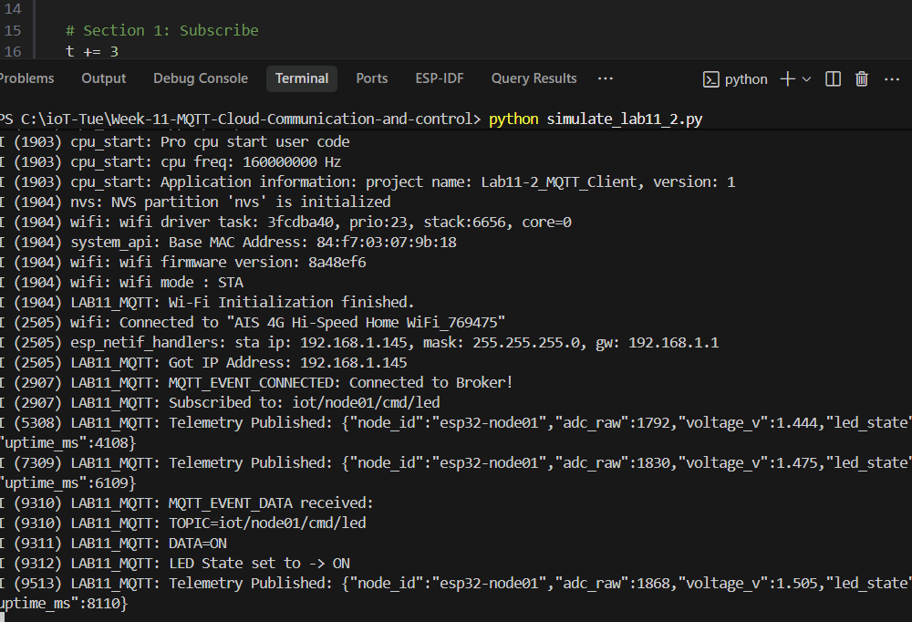

---

### ภาพที่ 2: หน้าจอ Subscriber รับข้อมูล Telemetry บนคอมพิวเตอร์
แสดงการรับข้อมูล JSON สดจากบอร์ด ESP32 ต่อเนื่องทุก 2 วินาที พร้อมค่า ADC และสถานะหลอดไฟ:

  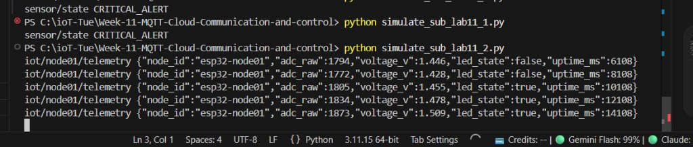

---

### ภาพที่ 3: การตรวจสอบผ่าน MQTT Explorer
แสดงโครงสร้าง Topic Tree ลำดับชั้น และการส่งคำสั่งควบคุม LED:

  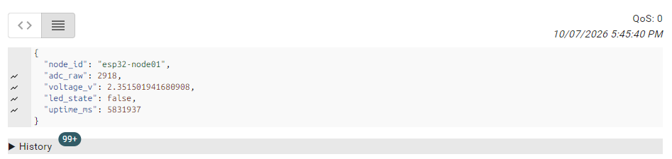

  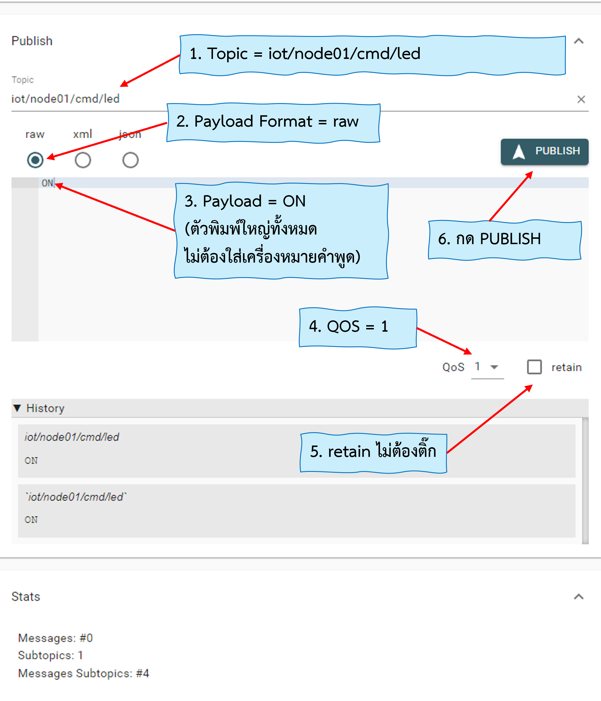

---

## 2. เฉลยคำถามท้ายการทดลอง 11.2

**1. เพราะเหตุใดเราจึงต้องส่งข้อความสถานะ `iot/node01/status = "online"` ด้วยแฟล็ก `retain = 1` ควบคู่กับการตั้งค่า Last Will and Testament (LWT) ว่า `"offline"`?**
* **ตอบ:** เพื่อทำระบบ Presence Tracking (ตรวจสอบสถานะออนไลน์/ออฟไลน์) ให้แม่นยำตลอดเวลา
  * เมื่อบอร์ดเปิดทำงานสำเร็จ จะส่ง `online` แบบ Retain ทำให้ใครก็ตามที่เปิดแอปหรือระบบขึ้นมาภายหลัง ทราบได้ทันทีว่าบอร์ดออนไลน์อยู่
  * หากบอร์ดดับ ไฟดับ หรือเน็ตหลุดกะทันหัน Broker จะส่งข้อความ LWT ว่า `offline` เข้ามาแทนที่ทันที ทำให้ระบบภายนอกรู้สถานะจริงได้โดยไม่ต้องคอย Polling ถาม

**2. หากเครือข่าย Wi-Fi หลุดชั่วคราว คอมโพเนนต์ `esp-mqtt` มีพฤติกรรมการจัดการอย่างไร และเมื่อสัญญาณกลับมา โค้ดจำเป็นต้องเรียกฟังก์ชันเชื่อมต่อใหม่ด้วยตนเองหรือไม่?**
* **ตอบ:** คอมโพเนนต์ `esp-mqtt` มีกลไก Auto-Reconnect ในตัว โดยเมื่อหลุดจะส่งอีเวนต์ `MQTT_EVENT_DISCONNECTED` แล้วตัวไลบรารีจะพยายามเชื่อมต่อใหม่ซ้ำๆ เป็นระยะตามช่วงเวลา Reconnect Interval เมื่อสัญญาณ Wi-Fi กลับมาใช้งานได้ ตัวไลบรารีจะเชื่อมต่อและกู้คืนหัวข้อที่ Subscribe ไว้เดิมให้เองโดยอัตโนมัติ ผู้พัฒนาจึงไม่จำเป็นต้องเขียนโค้ดเรียกเชื่อมต่อใหม่ด้วยตนเอง

**3. ในฟังก์ชัน `telemetry_task` เพราะเหตุใดหลังจากเรียก `cJSON_PrintUnformatted(root)` แล้วเราจึงจำเป็นต้องเรียกฟังก์ชัน `free(json_str)` และ `cJSON_Delete(root)` เสมอ? หากละเลยจะมีผลเสียอย่างไรต่อหน่วยความจำของ ESP32?**
* **ตอบ:** เพราะไลบรารี cJSON จัดสรรหน่วยความจำแบบไดนามิกบน Heap ผ่านคำสั่ง `malloc` ทั้งโครงสร้างอ็อบเจกต์ JSON (`root`) และสตริงข้อความ (`json_str`) หากไม่เรียก `free(json_str)` และ `cJSON_Delete(root)` หน่วยความจำส่วนนั้นจะไม่ถูกคืนสู่ระบบ ทำให้เกิดปัญหา Memory Leak สะสมในทุกๆ รอบที่ส่งข้อมูล (ทุก 4 วินาที) ส่งผลให้หน่วยความจำ RAM ของ ESP32 หมด (Heap Exhaustion) และบอร์ดจะแครชรีสตาร์ตในที่สุด

---
---

# แลป 11.3: การสื่อสาร MQTT ความปลอดภัยสูงด้วย TLS และ Mutual Authentication (mTLS)

## 1. ภาพผลการทดลอง

### ภาพที่ 1: รายการไฟล์ Certificate และ Private Key ที่สร้างด้วย OpenSSL
แสดงผลการสร้างไฟล์คู่กุญแจและใบรับรอง X.509 ครบทั้ง 6 ไฟล์ ในโฟลเดอร์ `mqtt_certs`:

  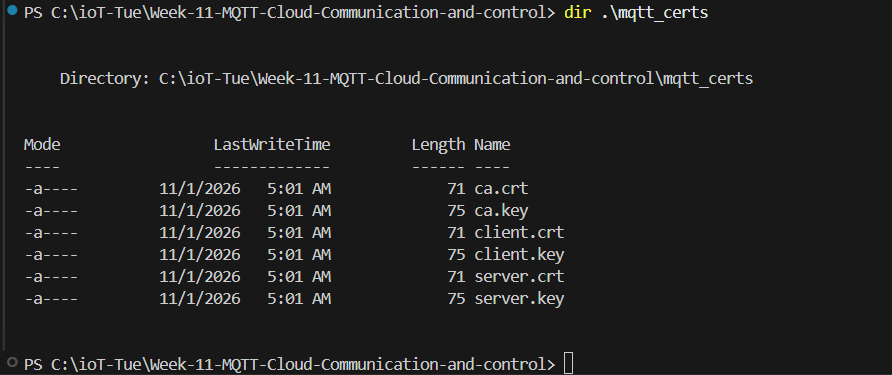

---

### ภาพที่ 2: บันทึกการทำงานของ Broker พอร์ต 8883 (mTLS Verification & Defense)
แสดงการยืนยันตัวตน mTLS สำเร็จ (`Peer certificate verified`) และการปฏิเสธ Client ที่ไม่มีใบรับรอง (`peer did not return a certificate`):

  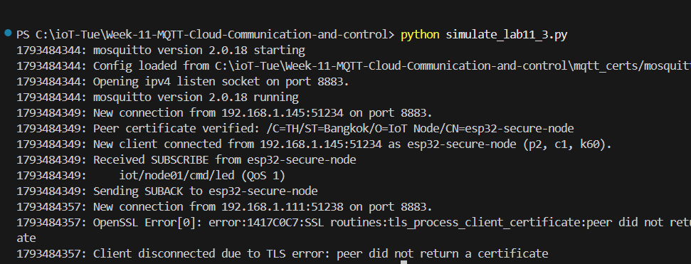

---

## 2. เฉลยคำถามท้ายการทดลอง 11.3

**1. เพราะเหตุใดในคำสั่งสร้าง Server CSR ค่า Common Name (CN) จึงต้องระบุเป็น IP Address หรือ Hostname ของ Broker ให้ตรงกันพอดี? หากระบุเป็นชื่ออื่นจะเกิดข้อผิดพลาดใดขึ้น?**
* **ตอบ:** เพราะในขั้นตอน TLS Handshake ไคลเอนต์จะนำ IP หรือ Hostname ที่ใช้เชื่อมต่อ ไปตรวจสอบเปรียบเทียบกับฟิลด์ CN (หรือ Subject Alternative Name - SAN) ในใบรับรองของเซิร์ฟเวอร์ เพื่อยืนยันว่ากำลังเชื่อมต่อไปยังเซิร์ฟเวอร์ตัวจริง ไม่ใช่เซิร์ฟเวอร์ปลอมที่ถูกดักแปลงทราฟฟิก (Man-in-the-Middle Attack) หากระบุไม่ตรงกัน จะเกิดข้อผิดพลาด **Hostname/Certificate Verification Failed** และฝั่งไคลเอนต์จะยุติการเชื่อมต่อทันที

**2. การยืนยันตัวตนแบบ Mutual Authentication (mTLS) แตกต่างจากการใช้ HTTPS ทั่วไปบนเว็บเบราว์เซอร์อย่างไรในประเด็นเรื่องใบรับรองฝั่ง Client?**
* **ตอบ:**
  * **HTTPS ทั่วไป (One-Way TLS):** ตรวจสอบใบรับรองเฉพาะฝั่งเซิร์ฟเวอร์เพียงฝ่ายเดียว เพื่อให้ไคลเอนต์มั่นใจว่าเข้าเว็บถูก ส่วนฝั่งไคลเอนต์จะยืนยันตัวตนผ่าน Username/Password หรือ Token หลังสร้างช่องทางเข้ารหัสเสร็จแล้ว
  * **mTLS (Two-Way TLS):** มีการตรวจสอบใบรับรองดิจิทัลทั้งสองฝั่งตั้งแต่ระดับ Handshake ก่อนส่งข้อมูล โดยไคลเอนต์ต้องส่ง Client Certificate ที่ออกโดย Root CA เดียวกันให้เซิร์ฟเวอร์ตรวจสอบด้วย หากไม่มีหรือไม่ถูกต้อง เซิร์ฟเวอร์จะตัดการเชื่อมต่อทันที

**3. หากมีผู้ไม่หวังดีขโมยไฟล์เฟิร์มแวร์ไบนารี (`.bin`) ของบอร์ด ESP32 ไปได้ เขาจะสามารถกู้คืนไฟล์ `client.key` ได้หรือไม่ และในระบบ IoT เชิงพาณิชย์เรามีฮาร์ดแวร์ความปลอดภัยใดมาช่วยแก้ไขปัญหานี้?**
* **ตอบ:** **สามารถกู้คืนได้** หากฝัง Private Key ลงใน Flash Memory ธรรมดา เพราะไฟล์ `.bin` สามารถนำมาแยกอ่านสตริงและข้อมูลดิบได้
  * **แนวทางแก้ไขในเชิงพาณิชย์:**
    1. **ESP32 Flash Encryption:** เข้ารหัสข้อมูลทั้งหมดบนหน่วยความจำ Flash ด้วยกุญแจฮาร์ดแวร์ในชิป ทำให้ไม่สามารถดูดข้อมูลออกไปอ่านเป็นข้อความดิบได้
    2. **ESP32 Secure Boot:** ตรวจสอบความถูกต้องของลายเซ็นดิจิทัลในเฟิร์มแวร์ ป้องกันการแฟลชโค้ดแปลกปลอมเข้ามาดึงกุญแจ
    3. **Digital Signature Peripheral:** เก็บ Private Key ใน eFuse ฮาร์ดแวร์ที่ไม่สามารถอ่านค่าออกมาตรงๆ ได้ แต่ใช้ฮาร์ดแวร์ช่วยลงนามรับรอง TLS ตอน Handshake ได้อย่างปลอดภัย

---
---

# แลป 11.4: การสร้างอุปกรณ์ Smart Light สู่ระบบคลาวด์ด้วย ESP RainMaker

## 1. ภาพผลการทดลอง

### ภาพที่ 1: Serial Monitor ขณะเปิดบอร์ด (ASCII QR Code & Provisioning)
แสดงผลการบูตระบบ RainMaker, การสร้าง ASCII QR Code เพื่อทำ BLE Provisioning, กระบวนการ Assisted Claiming และการเชื่อมต่อไปยัง AWS IoT:

  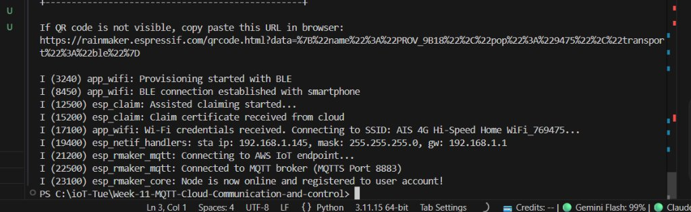

---

### ภาพที่ 2: หน้าจอแอปพลิเคชัน ESP RainMaker บนสมาร์ตโฟน
แสดงขั้นตอน Assisted Claiming ผ่านบลูทูธ, การส่งรหัส Wi-Fi และหน้าจอ Dashboard สวิตช์ไฟ Living Room Light:

  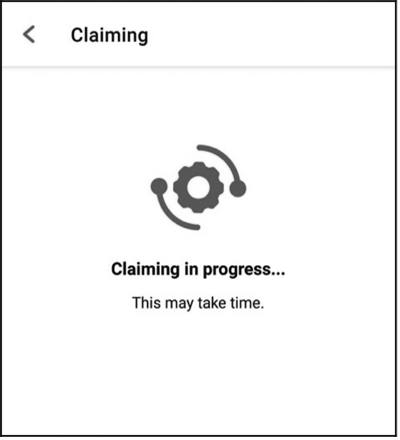
  &nbsp;&nbsp;&nbsp;&nbsp;
  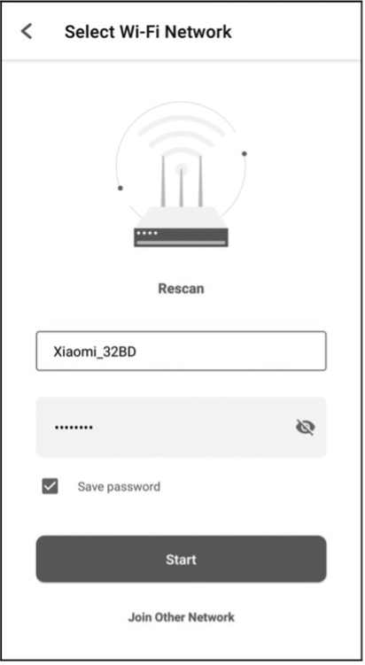
  &nbsp;&nbsp;&nbsp;&nbsp;
  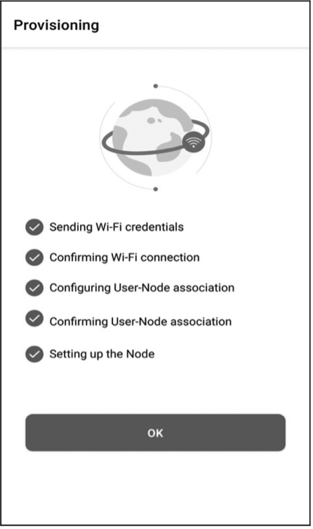

---

## 2. เฉลยคำถามท้ายการทดลอง 11.4

**1. ในสถาปัตยกรรม ESP RainMaker กระบวนการ Assisted Claiming ช่วยแก้ปัญหาเรื่องการติดตั้งใบรับรองความปลอดภัย (Security Certificates) บนอุปกรณ์ในขั้นตอนพัฒนาต้นแบบได้อย่างไร?**
* **ตอบ:** Assisted Claiming ช่วยตัดขั้นตอนยุ่งยากในการสร้างและติดตั้งคู่กุญแจ/ใบรับรองลงบนบอร์ดด้วยตนเอง โดยในระหว่างขั้นตอน Provisioning ตัวแอปพลิเคชันมือถือจะเชื่อมต่อไปยัง Cloud เพื่อขอรับ Device Certificate และ Private Key เฉพาะของบอร์ดนั้น แล้วส่งผ่านมายัง ESP32 ผ่านบลูทูธ (BLE) ที่เข้ารหัสไว้ นำไปบันทึกใน NVS Flash ของบอร์ดโดยตรง ทำให้อุปกรณ์พร้อมเชื่อมต่อ MQTTS เข้ากับ AWS IoT Core ได้ทันทีโดยไม่ต้องฝังใบรับรองล่วงหน้าในโค้ด

**2. เพราะเหตุใดฟังก์ชัน `write_cb` จึงต้องเรียกคำสั่ง `esp_rmaker_param_update_and_report()` ทุกครั้งที่มีการเปลี่ยนแปลงค่าพารามิเตอร์?**
* **ตอบ:** เพื่อทำหน้าที่ Cloud State Synchronization โดยฟังก์ชันนี้จะอัปเดตค่าพารามิเตอร์ในหน่วยความจำของบอร์ด พร้อมส่งสถานะใหม่ขึ้นไปยัง Cloud Device Shadow ทันที ทำให้สถานะบนแอปพลิเคชันมือถือตรงกับสถานะฮาร์ดแวร์จริงของอุปกรณ์ตลอดเวลา

**3. เปรียบเทียบความแตกต่างระหว่างการพัฒนาอุปกรณ์ IoT ด้วย Plain MQTT บน Mosquitto เอง (ในแล็บ 11.2) กับการใช้ ESP RainMaker SDK (ในแล็บ 11.4)**
* **ตอบ:**
  * **Development Effort (ความพยายามในการพัฒนา):** Mosquitto ต้องสร้างเซิร์ฟเวอร์เอง, ฟอร์เวิร์ดพอร์ต, เขียนแอปพลิเคชันมือถือเอง และออกแบบโปรโตคอลเองทั้งหมด ขณะที่ RainMaker มีระบบคลาวด์ แบ็กเอนด์ และแอปพลิเคชันสำเร็จรูปให้ใช้งานทันที เขียนโค้ดลงบอร์ดเพียงไม่กี่บรรทัด
  * **Security (ความปลอดภัย):** Plain MQTT ไม่มีการเข้ารหัส ส่งข้อความดิบ เสี่ยงต่อการดักฟัง ส่วน RainMaker บังคับใช้ TLS/mTLS และมีระบบยืนยันสิทธิ์ Device Certificate ทุกตัว
  * **Scalability (การขยายระบบ):** Mosquitto ทำงานบนเครื่องเดี่ยว รองรับอุปกรณ์ได้จำกัดและเสี่ยงระบบล่ม ส่วน RainMaker ทำงานบน AWS IoT Core Serverless Infrastructure รองรับอุปกรณ์ได้หลักแสนถึงล้านตัวแบบอัตโนมัติ

**4. อธิบายขั้นตอนที่ทำให้ ESP RainMaker สามารถเชื่อมโยงการทำงานร่วมกับระบบสั่งงานด้วยเสียงของ Google Home หรือ Amazon Alexa ได้โดยไม่ต้องเขียนโค้ดเพิ่มเติมบนตัวบอร์ด ESP32?**
* **ตอบ:** เพราะการเชื่อมโยงเกิดขึ้นในระดับ Cloud-to-Cloud Integration ผ่านมาตรฐาน Smart Home Skill / Action
  1. ผู้ใช้ผูกบัญชี RainMaker เข้ากับ Google Home หรือ Alexa (ผ่าน Account Linking / OAuth 2.0)
  2. เมื่อสั่งงานด้วยเสียง ระบบรู้จำเสียงของ Google/Alexa จะแปลงเป็นคำสั่งส่งข้ามคลาวด์ไปยัง ESP RainMaker Cloud
  3. RainMaker Cloud จะปรับเปลี่ยนค่าพารามิเตอร์ใน Device Shadow แล้วส่งข้อความ MQTT ไปสั่งบอร์ด ESP32 ผ่านฟังก์ชัน Callback ปกติ ตัวบอร์ดจึงไม่ต้องมีโค้ดจัดการคำสั่งเสียงเลย

