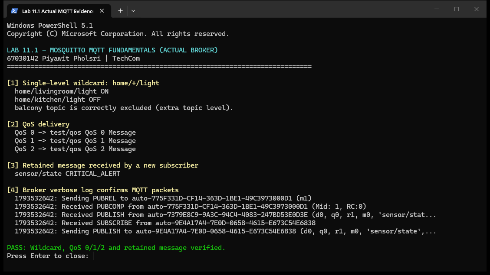
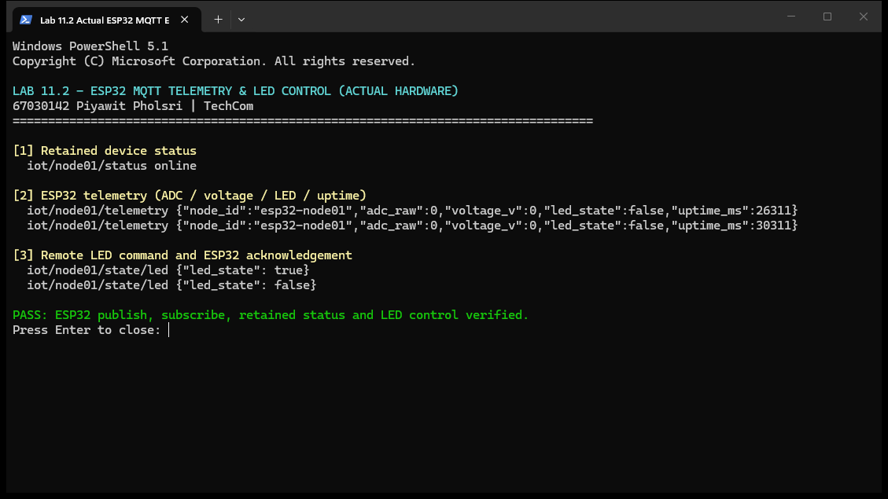
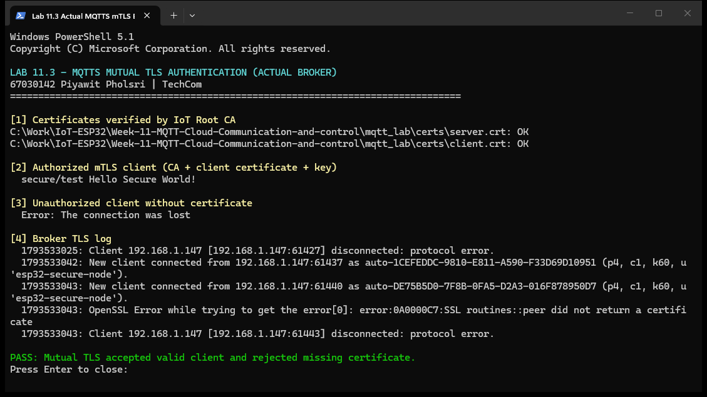
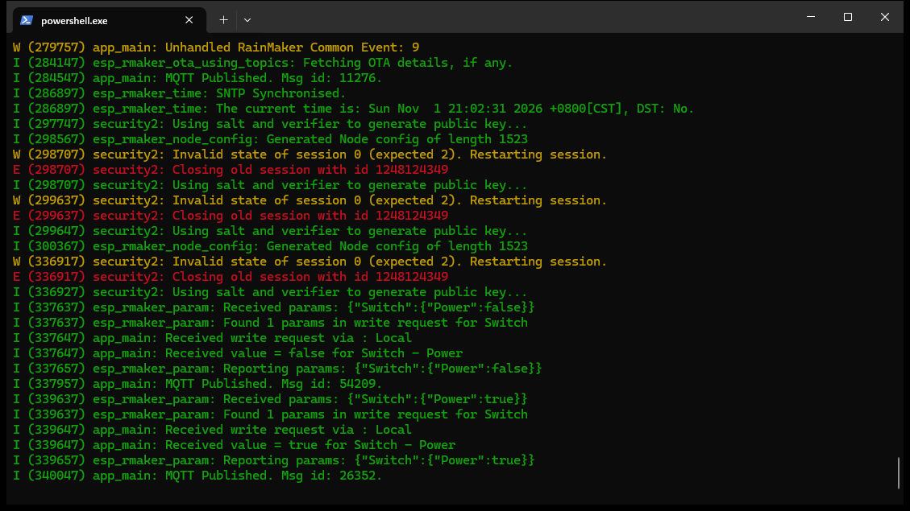

# รายงานการทดลอง Lab 11

## Lab 11.1: Mosquitto และ MQTT

- ทดสอบ Wildcard `+`, QoS 0/1/2 และ Retained Message สำเร็จ

## Lab 11.2: ESP32 MQTT Client

- ESP32 ส่ง Telemetry และสถานะ Online
- รับคำสั่ง LED ON/OFF และส่ง ACK สำเร็จ

## Lab 11.3: MQTTS และ mTLS

- Client ที่มี Certificate เชื่อมต่อได้
- Client ที่ไม่มี Certificate ถูกปฏิเสธ

## Lab 11.4: ESP RainMaker

- Provisioning ผ่าน BLE และ Assisted Claiming สำเร็จ
- เชื่อม RainMaker Cloud และ MQTT สำเร็จ
- ควบคุม Switch ON/OFF จากแอปและรายงานสถานะกลับ Cloud สำเร็จ

## สรุป

MQTT เหมาะกับการส่งข้อมูล IoT, mTLS เพิ่มความปลอดภัย และ RainMaker ช่วยลดงานพัฒนา Cloud กับแอปมือถือ

คำตอบท้ายการทดลองอยู่ใน [11-Review-Answers.md](11-Review-Answers.md)
