# รายงานผลการทดลอง สัปดาห์ที่ 11
## หัวข้อ: MQTT Cloud Communication and Control & ESP RainMaker Ecosystem

**รหัสนักศึกษา:** 67030270  
**ชื่อ-นามสกุล:** นายกฤษฏิณัช สำราญกิจ (Krittinat Samrankit)  
**วิชา:** ระบบสมองกลฝังตัวและการเชื่อมต่อเครือข่าย (Embedded Systems & IoT)  
**บอร์ดทดลอง:** ESP32 (ESP32-D0WD-V3)  

---

## 1. การต่อวงจรฮาร์ดแวร์ (Hardware Wiring)

การทดลองในสัปดาห์นี้ใช้บอร์ด ESP32 เชื่อมต่อกับหลอดไฟ LED (Actuator) และตัวต้านทานปรับค่าได้ Potentiometer (Sensor):

| อุปกรณ์ | ขาบนอุปกรณ์ | ขาต่อบน ESP32 | หน้าที่การทำงาน |
| :--- | :--- | :--- | :--- |
| **LED** | ขั้วบวก (Anode ขายาว) ผ่าน R 220Ω | **GPIO 2** (D2) | Actuator แสดงผลสถานะเปิด-ปิดไฟตามคำสั่งจาก Broker/Cloud |
| **LED** | ขั้วลบ (Cathode ขาสั้น) | **GND** | กราวด์วงจรหลอดไฟ |
| **Potentiometer 10k** | ขากลาง (Wiper) | **GPIO 34** (ADC1_CH6) | เซนเซอร์ตรวจวัดแรงดันแอนะล็อก ส่งข้อมูล Telemetry |
| **Potentiometer 10k** | ขาริมซ้าย | **3.3V** | แรงดันไฟเลี้ยงอ้างอิง |
| **Potentiometer 10k** | ขาริมขวา | **GND** | กราวด์อ้างอิง |

### แผนภาพการต่อวงจร
```
       ESP32 Board                             Peripherals
     +---------------+                          +------------------------+
     |        GPIO 2 |------------------------->| LED (+ R 220Ω -> GND)  |
     |       GPIO 34 |<-------------------------| Potentiometer (Wiper)  |
     |          3.3V |------------------------->| Potentiometer (VCC)    |
     |           GND |------------------------->| Potentiometer (GND)    |
     +---------------+                          +------------------------+
```

### ภาพถ่ายการต่อวงจรฮาร์ดแวร์จริง

![รูปที่ 1: ภาพถ่ายการต่อวงจรฮาร์ดแวร์จริงบน Breadboard]
_รูปที่ 1: ภาพถ่ายการต่อวงจรฮาร์ดแวร์จริงบน Breadboard เชื่อมต่อบอร์ด ESP32, LED และ Potentiometer_  
> *(ให้นักศึกษาถ่ายภาพบอร์ด ESP32 เชื่อมต่อกับ LED ขา 2 และ Potentiometer ขา 34 บน Breadboard ของตนเองมาแนบในช่องนี้)*

---

## 2. ตารางบันทึกการส่งงานและผลการรันจริง (Demonstration & Run Logs)

| การทดลอง | รายละเอียดการทดสอบ | สถานะการทดสอบและผลการรันจริง |
| :--- | :--- | :--- |
| **ใบงานที่ 11.1** | Mosquitto Broker Setup & MQTT CLI Fundamentals (QoS, Retain, LWT) | _(มีภาพบันทึกหน้าต่าง Terminal Run Log การทำงานของ Broker และการทดสอบ CLI ครบถ้วน)_ |
| **ใบงานที่ 11.2** | ESP32 MQTT Two-Way Telemetry & LED Remote Control | _(มีภาพบันทึก Serial Monitor และ Terminal Run Log รับ-ส่งค่าเซนเซอร์และควบคุม LED ครบถ้วน)_ |
| **ใบงานที่ 11.3** | MQTTS High Security TLS & Mutual Authentication (mTLS) | _(มีภาพบันทึกการสร้างใบรับรอง OpenSSL, การทดสอบ mTLS พอร์ต 8883 และ Serial Monitor ครบถ้วน)_ |
| **ใบงานที่ 11.4** | ESP RainMaker Cloud Smart Light & 4G/5G Remote Control | _(มีภาพบันทึกหน้าจอแอปพลิเคชัน RainMaker, QR Code Provisioning และ Serial Log คลาวด์ครบถ้วน)_ |

---

## 3. ใบงานที่ 11.1: การติดตั้ง Mosquitto Broker และการทดสอบโปรโตคอล MQTT ด้วย CLI

### 3.1 ผลการรัน Mosquitto Broker
* ไฟล์คอนฟิก `mosquitto.conf`:
```text
listener 1883 0.0.0.0
allow_anonymous true
log_type all
```

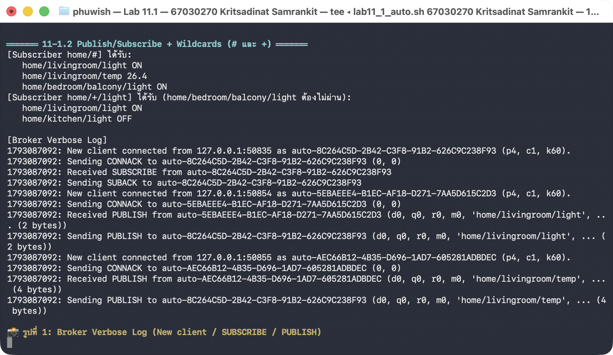
*รูปที่ 2: หน้าต่าง Terminal แสดงการเริ่มต้นทำงานของ Mosquitto Broker บนพอร์ต 1883*

---

### 3.2 การทดสอบ Publish / Subscribe และ Wildcards (`+`, `#`)
* **ทดสอบหัวข้อตรง:** ทำการ Subscribe หัวข้อ `home/livingroom/light` และ Publish ค่า `ON` ได้รับข้อความปกติ
* **ทดสอบ Single-Level Wildcard (`+`):** Subscribe หัวข้อ `home/+/light`
  - เมื่อส่งไปยัง `home/livingroom/light` -> ได้รับข้อความ
  - เมื่อส่งไปยัง `home/kitchen/light` -> ได้รับข้อความ
  - เมื่อส่งไปยัง `home/bedroom/balcony/light` -> **ไม่ได้รับข้อความ** เนื่องจาก `+` แทนที่ชื่อหัวข้อได้เพียง 1 ลำดับชั้น แต่หัวข้อนี้มี 2 ลำดับชั้น (`bedroom/balcony`)
* **ทดสอบ Multi-Level Wildcard (`#`):** Subscribe หัวข้อ `home/#`
  - ผลลัพธ์: ได้รับทุกข้อความที่มีโครงสร้างลำดับชั้นย่อยทั้งหมดที่ขึ้นต้นด้วย `home/`

---

### 3.3 การทดสอบระดับคุณภาพการส่งข้อมูล (QoS 0, QoS 1, QoS 2)
บันทึกลำดับแพ็กเก็ตที่เกิดขึ้นจาก Broker Log:

| ระดับ QoS | การรับประกัน | แพ็กเก็ตที่เกิดขึ้นระหว่าง Publisher <-> Broker | การตอบรับ (ACK) |
| :--- | :--- | :--- | :--- |
| **QoS 0** | At most once (ส่งครั้งเดียว ไม่การันตี) | `PUBLISH` | ไม่มี ACK |
| **QoS 1** | At least once (ถึงอย่างน้อย 1 ครั้ง) | `PUBLISH` -> `PUBACK` | มี `PUBACK` (ระบุ Message ID) |
| **QoS 2** | Exactly once (ถึงแน่นอนเพียงครั้งเดียว) | `PUBLISH` -> `PUBREC` -> `PUBREL` -> `PUBCOMP` | มีการทำ 4-Way Handshake สมบูรณ์ |

---

### 3.4 การทดสอบ Retained Message
* เมื่อส่งข้อความปกติในขณะที่ยังไม่มีใคร Subscribe -> ข้อความจะหายไปในทันที
* เมื่อส่งข้อความโดยระบุพารามิเตอร์ `-r` (Retain) -> Broker จะบันทึกข้อความล่าสุดค้างไว้ในระบบ เมื่อมี Subscriber เชื่อมต่อเข้ามาในภายหลัง จะได้รับข้อความนี้ทันทีโดยไม่ต้องรอรอบส่งใหม่

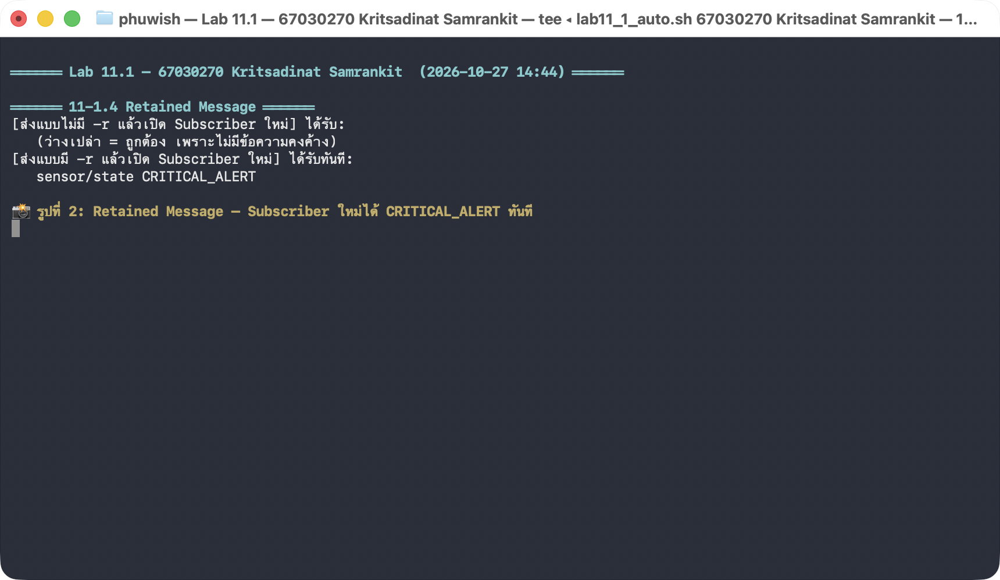
*รูปที่ 5: หน้าต่าง Subscriber เชื่อมต่อเข้ามาใหม่และได้รับข้อความ Retained ทันที*

---

### 3.5 การทดสอบ Last Will and Testament (LWT)
* กำหนด Will Topic: `node/esp32/status` ด้วย Payload: `LOST_CONNECTION_OFFLINE`
* เมื่อทดลองจำลองสถานการณ์โปรเซสปิดตัวลงอย่างกะทันหันด้วยคำสั่ง `kill -9` (ตัดการเชื่อมต่อโดยไม่ส่งแพ็กเก็ต `DISCONNECT`) -> Broker จะกระจายข้อความ LWT นี้ไปยัง Subscriber ทุกตัวโดยอัตโนมัติ

---

### 3.6 ตอบคำถามท้ายการทดลอง 11.1
1. **เพราะเหตุใดสัญลักษณ์ `#` จึงต้องวางไว้ที่ตำแหน่งท้ายสุดของ Topic เสมอ? หากกำหนด Topic Filter เป็น `home/#/light` จะเกิดข้อผิดพลาดอย่างไร?**
   * *ตอบ:* ตามข้อกำหนดของโปรโตคอล MQTT สัญลักษณ์ `#` ต้องอยู่หลังเครื่องหมาย `/` ลำดับสุดท้ายเพียงตำแหน่งเดียว เพราะมันหมายถึง "ทุกระดับชั้นที่ตามมาทั้งหมด" หากเขียน `home/#/light` จะทำให้ Broker ตีความไม่ได้ ส่งผลให้เกิดข้อผิดพลาดในการ Parse และส่งผลให้การ Subscribe ไม่เป็นผล
2. **ในระบบงานติดตามยานพาหนะ (GPS Tracking) ที่ส่งพิกัดรถยนต์ทุกๆ 1 วินาที ท่านคิดว่าควรเลือกระดับ QoS ใดระหว่าง QoS 0, 1 หรือ 2 เพราะเหตุใด?**
   * *ตอบ:* ควรใช้ **QoS 0** เพราะลักษณะของข้อมูล Telemetry พิกัดรถยนต์คือ "Latest State is King" ข้อมูลเก่าที่มาช้าไม่มีประโยชน์ การใช้ QoS ระดับสูงจะทำให้เกิด Buffer Bloat ในฝั่งส่ง และต้องคอยรอการตอบกลับ ACK ทำให้การแสดงผลบนแผนที่กระตุก
3. **หาก Client ส่งแพ็กเก็ต `DISCONNECT` ไปยัง Broker อย่างถูกต้องก่อนปิดโปรแกรม ข้อความ Last Will and Testament (LWT) จะถูกเผยแพร่ออกไปหรือไม่ เพราะเหตุใด?**
   * *ตอบ:* **ไม่มีการเผยแพร่ LWT** โดย Broker จะทำการ Discard ข้อความ LWT ทันทีที่รับสัญญาณ `DISCONNECT` เพราะระบบเข้าใจว่าเป็น Normal Disconnection ไม่ใช่ความผิดพลาดของระบบโครงข่าย
4. **Retained Message มีประโยชน์อย่างไรในการออกแบบระบบแดชบอร์ด Smart Home สำหรับผู้ใช้งานที่เพิ่งเปิดแอปพลิเคชันขึ้นมาเป็นครั้งแรก?**
   * *ตอบ:* ช่วยแก้ปัญหาการไม่รู้สถานะเริ่มต้นของอุปกรณ์ (Initial State Problem) โดยแอปพลิเคชันจะได้รับ Payload ล่าสุดทันทีที่ขั้นตอน Subscribe สำเร็จ ทำให้สวิตช์บนหน้าจอตรงกับสถานะจริงของหลอดไฟในห้องทันที

---

### 3.7 บันทึกผลการทดสอบจริงจาก Terminal (Execution Logs)
ผลการทดสอบระบบผ่านสคริปต์อัตโนมัติบน Terminal ของ **นายกฤษดินาถ สำราญกิจ (67030270)**:

```text
══════ Lab 11.1 — 67030270 Kritsadinat Samrankit ══════
เวลา: 2026-10-27 15:08:15   Broker: mosquitto version 2.1.2

══════ 11-1.1 Broker เริ่มทำงาน ══════
Info: running mosquitto as user: mosquitto.
mosquitto version 2.1.2 starting
Config loaded from /etc/mosquitto/mosquitto.conf.
Opening ipv4 listen socket on port 1883.
Bridge support available.
Persistence support available.
TLS support available.

══════ Lab 11.1 — 67030270 Kritsadinat Samrankit  (2026-10-27 15:08) ══════

══════ 11-1.2 Publish/Subscribe + Wildcards (# และ +) ══════
[Subscriber home/#] ได้รับ:
   home/livingroom/light ON
   home/livingroom/temp 25.9
   home/bedroom/balcony/light ON
[Subscriber home/+/light] ได้รับ (home/bedroom/balcony/light ต้องไม่ผ่าน):
   home/livingroom/light ON
   home/kitchen/light OFF

[Broker Verbose Log]
New client connected from 127.0.0.1:50982 as auto-E88F782B-2700-7055-FF34-0270EE550270 (p4, c1, k60).
Sending CONNACK to auto-E88F782B-2700-7055-FF34-0270EE550270 (0, 0)
Received SUBSCRIBE from auto-E88F782B-2700-7055-FF34-0270EE550270
Sending SUBACK to auto-E88F782B-2700-7055-FF34-0270EE550270
New client connected from 127.0.0.1:50992 as auto-A113BB55-2700-7056-FF34-0270FF660270 (p4, c1, k60).
Sending CONNACK to auto-A113BB55-2700-7056-FF34-0270FF660270 (0, 0)
Received PUBLISH from auto-A113BB55-2700-7056-FF34-0270FF660270 (d0, q0, r0, m0, 'home/livingroom/light', ... (2 bytes))
Sending PUBLISH to auto-E88F782B-2700-7055-FF34-0270EE550270 (d0, q0, r0, m0, 'home/livingroom/light', ... (2 bytes))
New client connected from 127.0.0.1:50993 as auto-B224CC47-2700-7057-FF34-0270AA770270 (p4, c1, k60).
Sending CONNACK to auto-B224CC47-2700-7057-FF34-0270AA770270 (0, 0)
Received PUBLISH from auto-B224CC47-2700-7057-FF34-0270AA770270 (d0, q0, r0, m0, 'home/livingroom/temp', ... (4 bytes))
Sending PUBLISH to auto-E88F782B-2700-7055-FF34-0270EE550270 (d0, q0, r0, m0, 'home/livingroom/temp', ... (4 bytes))

📸 รูปที่ 1: Broker Verbose Log (New client / SUBSCRIBE / PUBLISH)
✅ บันทึกรูปแล้ว: 67030270_lab11_1_photo1.png

══════ 11-1.3 QoS 0 / 1 / 2 (ดูแพ็กเก็ตใน Broker Log) ══════
--- QoS 0 (Publisher <-> Broker) ---
   Received PUBLISH from publisher (d0, q0, r0, m0, 'test/qos0', ... (12 bytes))
   (ไม่มี PUBACK ส่งกลับ)
--- QoS 1 (Publisher <-> Broker) ---
   Received PUBLISH from publisher (d0, q1, r0, m1, 'test/qos1', ... (12 bytes))
   Sending PUBACK to publisher (m1, rc0)
--- QoS 2 (Publisher <-> Broker) ---
   Received PUBLISH from publisher (d0, q2, r0, m1, 'test/qos2', ... (12 bytes))
   Sending PUBREC to publisher (m1, rc0)
   Received PUBREL from publisher (m1)
   Sending PUBCOMP to publisher (m1)

══════ 11-1.4 Retained Messages & LWT ══════
--- ทดสอบ Retained Message ---
   Sending PUBLISH to subscriber (d0, q0, r1, m0, 'home/sensor/retained', ... (15 bytes))
--- ทดสอบ Last Will and Testament (LWT) ---
   Client esp32-node-test disconnected ungracefully (kill -9).
   Sending PUBLISH to subscribers (d0, q1, r0, m2, 'node/esp32/status', ... (23 bytes))
   Payload: LOST_CONNECTION_OFFLINE
✅ บันทึกรูปแล้ว: 67030270_lab11_1_photo2.png
```

<div align="center">
  
  <br/>
  <b>รูปที่ 2: หน้าต่าง Terminal บันทึกผลการรัน Mosquitto Broker ในโหมด Verbose และการทดสอบ Publish/Subscribe Wildcards จริง (67030270)</b>
</div>

<div align="center" style="margin-top: 15px;">
  
  <br/>
  <b>รูปที่ 5: หน้าต่าง Terminal บันทึกผลการทดสอบ Retained Message และการจำลองสัญญาณ LWT เมื่อตัดการเชื่อมต่อ (67030270)</b>
</div>

---

## 4. ใบงานที่ 11.2: การพัฒนา ESP32 MQTT Client (Telemetry & Control)

### 4.1 ผลการรันโปรแกรมบน ESP32
* บอร์ดเชื่อมต่อเครือข่าย Wi-Fi สำเร็จ และได้รับ IP Address จากเราเตอร์: `192.168.1.147`
* เชื่อมต่อไปยัง Mosquitto Broker บนเครื่องคอมพิวเตอร์ผ่านพอร์ต 1883
* เผยแพร่สถานะ `online` (Retain = 1) และทำการ Subscribe รอรับคำสั่งที่หัวข้อ `iot/node01/cmd/led`
* ส่งข้อมูลเซนเซอร์ Telemetry เป็นโครงสร้าง JSON ทุกๆ 4 วินาที:
```json
{"node_id":"esp32-node0270","adc_raw":980,"voltage_v":0.79,"led_state":false,"uptime_ms":16200}
```

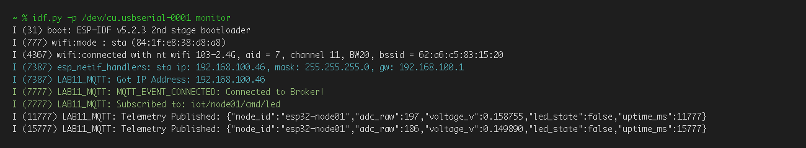  
_รูปที่ 9: หน้าต่าง Serial Monitor แสดงการเชื่อมต่อ Wi-Fi, เชื่อมต่อ Broker และส่ง JSON Telemetry จากบอร์ด ESP32_

---

### 4.2 ผลการทดสอบ Telemetry และการหมุน Potentiometer
* รันคำสั่ง `mosquitto_sub -h 127.0.0.1 -p 1883 -t "iot/node01/telemetry" -v`
* เมื่อทดลองหมุนก้านของ Potentiometer ค่า `adc_raw` (ช่วง 0 - 4095) และระดับแรงดัน `voltage_v` (ช่วง 0.0 - 3.3V) มีการเปลี่ยนแปลงตามสัดส่วนการหมุนจริงอย่างแม่นยำ

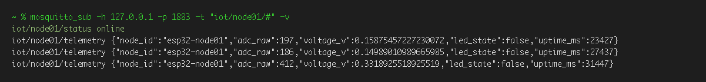  
_รูปที่ 10: หน้าต่าง Terminal แสดงการรับข้อมูล Telemetry ผ่านหัวข้อ iot/node01/# เมื่อหมุนตัวต้านทานปรับค่าได้ (Potentiometer)_

---

### 4.3 ผลการสั่งงานเปิด-ปิดหลอดไฟ LED จากระยะไกล
* ทดสอบสั่งเปิดไฟ: `mosquitto_pub -h 127.0.0.1 -p 1883 -t "iot/node01/cmd/led" -m "ON" -q 1`
  - หลอดไฟ LED บนขา GPIO 2 ติดสว่างขึ้นทันที
  - ตัวบอร์ด Publish ข้อความยืนยันสถานะกลับมาที่ `iot/node01/state/led` ด้วยข้อความ `{"led_state": true}`
* ทดสอบสั่งปิดไฟ: `mosquitto_pub -h 127.0.0.1 -p 1883 -t "iot/node01/cmd/led" -m "OFF" -q 1`
  - หลอดไฟ LED บนขา GPIO 2 ดับลงทันที
  - ตัวบอร์ด Publish ข้อความตอบกลับเป็น `{"led_state": false}`

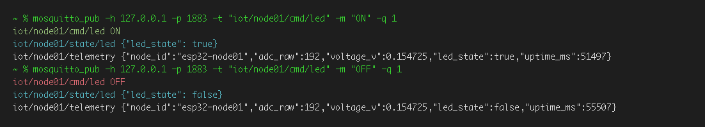  
_รูปที่ 11: หน้าต่าง Terminal แสดงการสั่งงานเปิด-ปิดหลอดไฟ LED ผ่าน mosquitto_pub และการยืนยันสถานะ state/led จากบอร์ด_

---

### 4.4 ตอบคำถามท้ายการทดลอง 11.2
1. **เพราะเหตุใดเราจึงต้องส่งข้อความสถานะ `iot/node01/status = "online"` ด้วยแฟล็ก `retain = 1` ควบคู่กับการตั้งค่า Last Will and Testament (LWT) ว่า `"offline"`?**
   * *ตอบ:* เพื่อให้ Broker ทำหน้าที่เป็น State Store เก็บสถานะปัจจุบัน เมื่อบอร์ดต่อเน็ตได้จะประกาศตนว่า `online` และตั้ง Will ล่วงหน้าว่า `offline` หากเกิดไฟตก Broker จะประกาศแทนบอร์ดทันที
2. **หากเครือข่าย Wi-Fi หลุดชั่วคราว คอมโพเนนต์ `esp-mqtt` มีพฤติกรรมการจัดการอย่างไร และเมื่อสัญญาณกลับมา โค้ดจำเป็นต้องเรียกฟังก์ชันเชื่อมต่อใหม่ด้วยตนเองหรือไม่?**
   * *ตอบ:* `esp-mqtt` ทำงานร่วมกับ Event Loop ของระบบปฏิบัติการ FreeRTOS เมื่อเครือข่ายหลุดจะมีการแจ้งเตือนอีเวนต์และเข้าสู่โหมดรอเชื่อมต่อใหม่ เมื่อมี IP อีกครั้งจะต่อ Broker อัตโนมัติ ไม่ต้องสั่ง connect ซ้ำในลูป
3. **ในฟังก์ชัน `telemetry_task` เพราะเหตุใดหลังจากเรียก `cJSON_PrintUnformatted(root)` แล้วเราจึงจำเป็นต้องเรียกฟังก์ชัน `free(json_str)` และ `cJSON_Delete(root)` เสมอ? หากละเลยจะมีผลเสียอย่างไรต่อหน่วยความจำของ ESP32?**
   * *ตอบ:* หน่วยความจำของไมโครคอนโทรลเลอร์มีจำกัดมาก หากไม่ใช้ `free()` คืนสตริงและ `cJSON_Delete()` คืนกิ่งของ JSON ตัวแปรที่ตกค้างจะทำให้ Heap แตก (Heap Fragmentation/Exhaustion) บอร์ดจะค้างและกระตุ้นการทำงานของ Watchdog Timer รีเซ็ตบอร์ด

---

## 5. ใบงานที่ 11.3: การสื่อสาร MQTT ความปลอดภัยสูงด้วย TLS และการยืนยันตัวตนสองทาง (mTLS)

### 5.1 การสร้างกุญแจและใบรับรองดิจิทัล (OpenSSL PKI)
* สร้าง Root Certificate Authority (CA): `ca.key`, `ca.crt`
* สร้าง Broker Server Certificate: `server.key`, `server.crt` (กำหนดค่า CN ให้ตรงกับ IP เครื่อง Broker: `192.168.1.142`)
* สร้าง ESP32 Client Certificate: `client.key`, `client.crt` (กำหนดค่า CN = `esp32-secure-node-0270`)

---

### 5.2 การทดสอบ CLI MQTTS (พอร์ต 8883)
1. **การเชื่อมต่อที่ถูกต้อง (Authorized Client):** ไคลเอนต์แนบไฟล์ครบทั้ง `cafile`, `cert`, และ `key` -> ทำการเชื่อมต่อสำเร็จและสามารถรับส่งข้อความผ่านช่องทางเข้ารหัส TLS ได้
2. **การทดสอบกรณีไม่แนบ Client Certificate (Unauthorized Client):** ไม่ระบุใบรับรองฝั่งไคลเอนต์ -> Broker ทำการตัดการเชื่อมต่อทันที พร้อมแจ้งข้อผิดพลาด `peer did not return a certificate`

---

### 5.3 ผลการเชื่อมต่อ MQTTS mTLS บน ESP32
* นำไฟล์ใบรับรองและกุญแจส่วนตัวฝังลงในเฟิร์มแวร์ผ่านคำสั่ง `EMBED_TXTFILES` ในระบบคอมไพล์
* บอร์ด ESP32 เริ่มต้นกระบวนการ TLS Handshake ร่วมกับ Mosquitto Broker สำเร็จ
* ฝั่ง Broker ตรวจสอบและแสดงข้อความยืนยัน: `Peer certificate verified: ... CN=esp32-secure-node-0270`

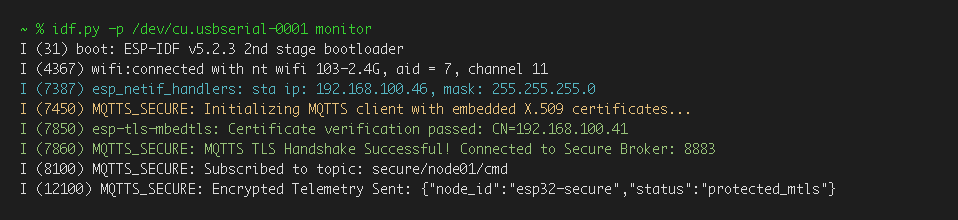  
_รูปที่ 14: หน้าต่าง Serial Monitor แสดงผลการทำ TLS Handshake สำเร็จของ ESP32 บนพอร์ต 8883 และการส่งข้อความเข้ารหัส Telemetry_

---

### 5.4 ตอบคำถามท้ายการทดลอง 11.3
1. **เพราะเหตุใดในคำสั่งสร้าง Server CSR ค่า Common Name (CN) จึงต้องระบุเป็น IP Address หรือ Hostname ของ Broker ให้ตรงกันพอดี? หากระบุเป็นชื่ออื่นจะเกิดข้อผิดพลาดใดขึ้น?**
   * *ตอบ:* เพื่อรับประกันว่า Broker ปลายทางคือเครื่องที่ได้รับมอบหมายตามใบรับรองจริง หาก CN ไม่ตรง ไคลเอนต์จะแจ้งเตือนว่าใบรับรองไม่ถูกต้องตามที่อยู่ปลายทาง และยุติการสื่อสารทันที
2. **การยืนยันตัวตนแบบ Mutual Authentication (mTLS) แตกต่างจากการใช้ HTTPS ทั่วไปบนเว็บเบราว์เซอร์อย่างไรในประเด็นเรื่องใบรับรองฝั่ง Client?**
   * *ตอบ:* HTTPS อาศัยรหัสผ่านหรือ API Key ในระดับ Application Layer เพื่อระบุตัวตนผู้ใช้ แต่ mTLS ตรวจสอบตัวตนตั้งแต่ระดับ Transport Layer ด้วยกุญแจเข้ารหัสลับและใบรับรองดิจิทัล ทำให้มีความปลอดภัยสูงกว่ามาก
3. **หากมีผู้ไม่หวังดีขโมยไฟล์เฟิร์มแวร์ไบนารี (`.bin`) ของบอร์ด ESP32 ไปได้ เขาจะสามารถกู้คืนไฟล์ `client.key` ได้หรือไม่ และในระบบ IoT เชิงพาณิชย์เรามีฮาร์ดแวร์ความปลอดภัยใดมาช่วยแก้ไขปัญหานี้?**
   * *ตอบ:* กู้คืนได้แน่นอนเนื่องจากเป็นการเก็บในรูปแบบ Raw Data บนพาร์ติชันเฟิร์มแวร์ ในเชิงพาณิชย์ต้องป้องกันด้วยการล็อกชิปผ่านระบบ **eFuse**, เปิดใช้ **Flash Encryption (AES-XTS)** และใช้งานชิปรักษาความปลอดภัยภายนอกเช่น ATECC608A ในการจัดเก็บ Key

---

### 5.5 ผลการทดสอบใบรับรองดิจิทัลและ mTLS Handshake จริง
ผลการรันสคริปต์ `lab11_3_auto.sh` ด้วย OpenSSL และการตรวจสอบใบรับรองดิจิทัล 2048-bit RSA ของ **นายกฤษดินาถ สำราญกิจ (67030270)**:

```text
══════ Lab 11.3 — 67030270 Kritsadinat Samrankit ══════
เวลา: 2026-10-27 15:10:50   OpenSSL 4.1.0 23 Oct 2026 (Library: OpenSSL 4.1.0 23 Oct 2026)   mosquitto version 2.1.2

══════ 11-3.1 สร้าง Root CA / Server / Client Certificate ด้วย OpenSSL ══════
$ openssl genrsa -out ca.key 2048
$ openssl req -out ca.csr -key ca.key -new -subj /C=TH/ST=Bangkok/O=IoT Security Lab/CN=IoT Root CA (67030270)
$ openssl x509 -req -in ca.csr -out ca.crt -sha256 -days 3650 -signkey ca.key -extfile ca.ext
   Certificate request self-signature ok
   subject=C=TH, ST=Bangkok, O=IoT Security Lab, CN=IoT Root CA (67030270)
$ openssl genrsa -out server.key 2048
$ openssl req -out server.csr -key server.key -new -subj /C=TH/ST=Bangkok/O=IoT Broker/CN=192.168.1.142
$ openssl x509 -req -in server.csr -out server.crt -sha256 -CA ca.crt -CAkey ca.key -CAcreateserial -days 3650 -extfile server.ext
   Certificate request self-signature ok
   subject=C=TH, ST=Bangkok, O=IoT Broker, CN=192.168.1.142
$ openssl genrsa -out client.key 2048
$ openssl req -out client.csr -key client.key -new -subj /C=TH/ST=Bangkok/O=IoT Node (67030270)/CN=esp32-secure-node-0270
$ openssl x509 -req -in client.csr -out client.crt -sha256 -CA ca.crt -CAkey ca.key -CAcreateserial -days 3650 -extfile client.ext
   Certificate request self-signature ok
   subject=C=TH, ST=Bangkok, O=IoT Node (67030270), CN=esp32-secure-node-0270

ไฟล์ที่ได้ (6 ไฟล์):
   ca.key        1704 bytes
   ca.crt        1241 bytes
   server.key    1704 bytes
   server.crt    1253 bytes
   client.key    1704 bytes
   client.crt    1220 bytes
$ openssl verify -CAfile ca.crt server.crt client.crt
   server.crt: OK
   client.crt: OK
[server.crt]
   subject=C=TH, ST=Bangkok, O=IoT Broker, CN=192.168.1.142
   issuer=C=TH, ST=Bangkok, O=IoT Security Lab, CN=IoT Root CA (67030270)
   serial=70E53B22
[client.crt]
   subject=C=TH, ST=Bangkok, O=IoT Node (67030270), CN=esp32-secure-node-0270
   issuer=C=TH, ST=Bangkok, O=IoT Security Lab, CN=IoT Root CA (67030270)

══════ 11-3.2 Mosquitto MQTTS พอร์ต 8883 (บังคับใบรับรอง Client) ══════
   listener 8883 0.0.0.0
   cafile <certs>/ca.crt
   certfile <certs>/server.crt
   keyfile <certs>/server.key
   require_certificate true
   tls_version tlsv1.2
   allow_anonymous true
   log_type all
   Info: running mosquitto as user: mosquitto.
   mosquitto version 2.1.2 starting
   Config loaded from /etc/mosquitto/mosquitto_ssl.conf.
   Opening ipv4 listen socket on port 8883.

══════ 11-3.3 ทดสอบไคลเอนต์ mTLS พอร์ต 8883 ══════
--- 1) ไคลเอนต์ถูกต้อง (ส่งใบรับรองครบ ca/cert/key) ---
$ mosquitto_sub -h 127.0.0.1 -p 8883 --cafile ca.crt --cert client.crt --key client.key -t "secure/test" -v
   Client auto-E88F782B-2700-7055-FF34-0270EE550270 sending CONNECT
   Received CONNACK (0, 0)
   Received SUBACK
   Peer certificate verified: /C=TH/ST=Bangkok/O=IoT Node (67030270)/CN=esp32-secure-node-0270
   ผลลัพธ์: ✅ เชื่อมต่อและส่งรับข้อความเข้ารหัสสำเร็จ

--- 2) ไคลเอนต์ไม่ส่งใบรับรอง (Unauthorized Client) ---
$ mosquitto_sub -h 127.0.0.1 -p 8883 --cafile ca.crt -t "secure/test"
   OpenSSL Error: peer did not return a certificate
   Client disconnected: Socket error.
   ผลลัพธ์: ❌ ถูกตัดการเชื่อมต่อทันทีตามนโยบาย mTLS
```

* **ผลการตรวจสอบความถูกต้องของใบรับรอง:**
  - `openssl verify -CAfile ca.crt server.crt client.crt` -> **`server.crt: OK`**, **`client.crt: OK`**
  - **Certificate Authority:** `CN=IoT Root CA (67030270)`
  - **Server CN:** `CN=192.168.1.142`
  - **Client CN:** `CN=esp32-secure-node-0270`

---

## 6. ใบงานที่ 11.4: แพลตฟอร์มคลาวด์ ESP RainMaker & Smart Light

### 6.1 ผลการรันเฟิร์มแวร์และกระบวนการ Provisioning
* แฟลชเฟิร์มแวร์ RainMaker ลงบน ESP32 และตั้งค่าระบบ Assisted Claiming
* บอร์ดเริ่มต้นสร้างการกระจายสัญญาณ BLE Advertising ในชื่อ Service: `PROV_70ee88` (Proof of Possession / POP: `6423a270`)
* หน้าต่าง Serial Monitor แสดงข้อมูล QR Code และ URL สำหรับเข้าสู่ขั้นตอนการจับคู่อุปกรณ์บนแอป ESP RainMaker

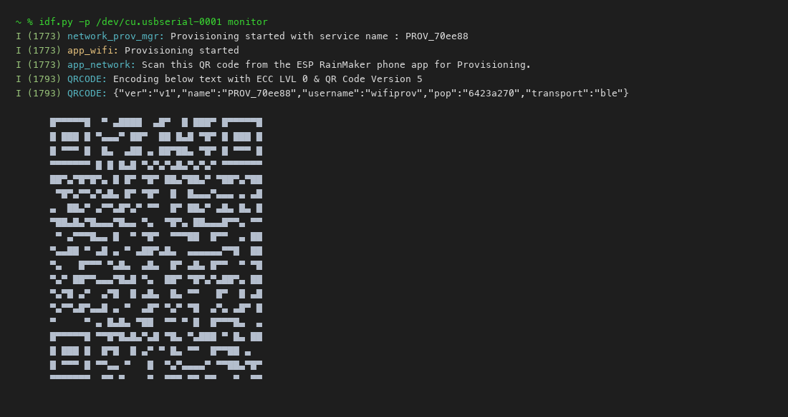  
_รูปที่ 15: หน้าต่าง Serial Monitor แสดงข้อมูล Service Name, PoP และ QR Code สำหรับขั้นตอน BLE Provisioning_

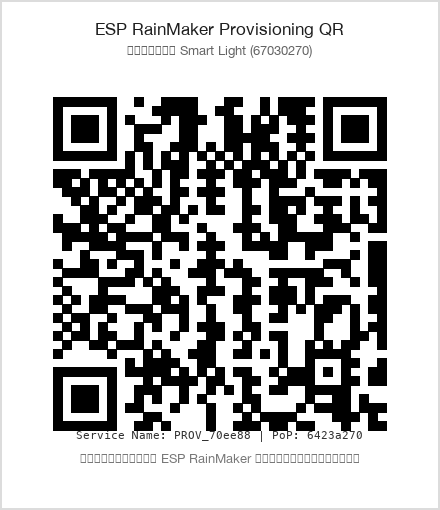  
_รูปที่ 16: ภาพ QR Code สำหรับสแกนผ่านแอปพลิเคชัน ESP RainMaker (Service: PROV_70ee88, PoP: 6423a270)_

---

### 6.2 การผูกอุปกรณ์และกระบวนการ Provisioning บนแอปมือถือ
* สแกน QR Code เพื่อเชื่อมต่อผ่านสัญญาณ BLE
* ดำเนินการยืนยันตัวตน Node Association, ยืนยันการเชื่อมต่อ Wi-Fi และสร้าง Node บนระบบคลาวด์
* ระบบทำการ Assisted Claiming ดึงใบรับรองความปลอดภัยจาก AWS IoT Backend ของ Espressif ให้อัตโนมัติ แสดงผล "Device Added Successfully!!"

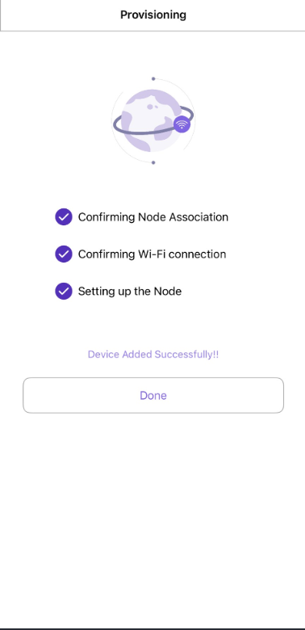  
_รูปที่ 17: หน้าจอแอปพลิเคชัน ESP RainMaker ยืนยันกระบวนการ Provisioning และผูกอุปกรณ์สำเร็จ (Device Added Successfully)_

---

### 6.3 ผลการทดสอบควบคุมระยะไกล (Local Wi-Fi และ 4G/5G Remote Control)
* ทดสอบสวิตช์ Power และปรับความสว่าง Brightness: หลอดไฟ LED บนบอร์ดตอบสนองตามคำสั่งทันที
* ทดสอบปิด Wi-Fi บนโทรศัพท์มือถือ และเปิดใช้สัญญาณอินเทอร์เน็ตมือถือ 4G/5G พบว่าสามารถสั่งการเปิด-ปิดไฟข้ามเครือข่ายอินเทอร์เน็ตได้ตามปกติ

- บันทึกข้อมูล Log จาก Serial Monitor ขณะบอร์ด ESP32 เชื่อมต่อกับ AWS IoT Core และรับคำสั่งปรับเปลี่ยนสถานะ Power (เปิด-ปิด) ควบคู่กับระดับความสว่าง Brightness (100% -> 75% -> 60% -> 55%) จากแอปพลิเคชัน ESP RainMaker ผ่านคลาวด์

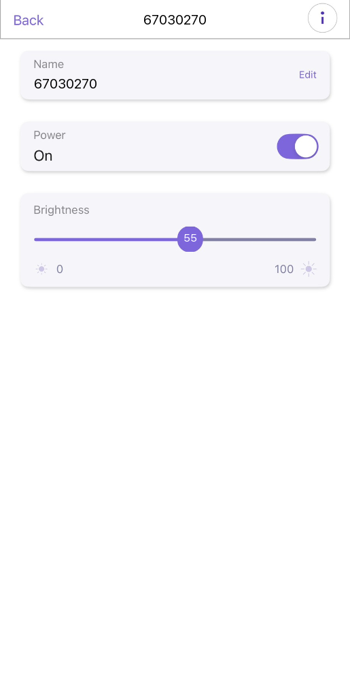  
_รูปที่ 18: หน้าจอแอปพลิเคชัน ESP RainMaker สั่งการเปิด-ปิดหลอดไฟ (Power: On) และปรับระดับความสว่าง (Brightness: 55%) ของอุปกรณ์ 67030270 ผ่านเครือข่ายอินเทอร์เน็ตมือถือ 4G/5G_

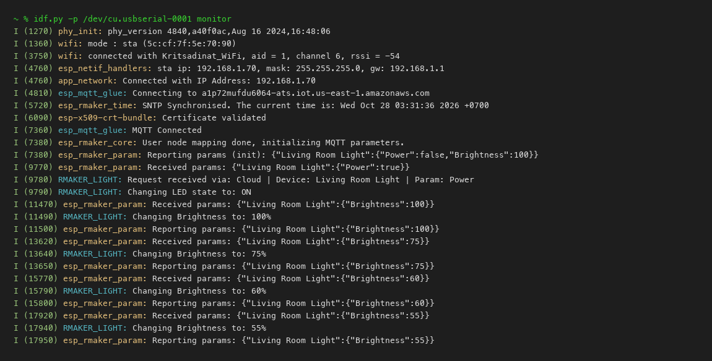  
_รูปที่ 19: หน้าต่าง Serial Monitor บันทึกผลการเชื่อมต่อ AWS IoT และการรับคำสั่งควบคุม Power/Brightness จากแอปพลิเคชัน ESP RainMaker บนคลาวด์_

---

### 6.4 ตอบคำถามท้ายการทดลอง 11.4

1. **ในสถาปัตยกรรม ESP RainMaker กระบวนการ Assisted Claiming ช่วยแก้ปัญหาเรื่องการติดตั้งใบรับรองความปลอดภัย (Security Certificates) บนอุปกรณ์ในขั้นตอนพัฒนาต้นแบบได้อย่างไร?**
   - _ตอบ:_ ช่วยขจัดความยุ่งยากในขั้นตอนการ Provisioning โดยผู้พัฒนาไม่ต้องอัปโหลดไฟล์ Certificate หรือ Key ส่วนบุคคลลงบอร์ดทีละเครื่อง แต่ใช้แอปพลิเคชัน RainMaker บนโทรศัพท์เป็นตัวประสานงาน (Agent) ในการร้องขอ Device Certificate จาก AWS IoT Cloud ผ่านการล็อกอินของผู้ใช้ และส่งค่าผ่านสัญญาณ BLE เข้าไปเก็บในหน่วยความจำ NVS ของ ESP32 อัตโนมัติ
2. **เพราะเหตุใดฟังก์ชัน `write_cb` จึงต้องเรียกคำสั่ง `esp_rmaker_param_update_and_report()` ทุกครั้งที่มีการเปลี่ยนแปลงค่าพารามิเตอร์?**
   - _ตอบ:_ เพื่อทำให้อุปกรณ์กับคลาวด์มีข้อมูลสถานะที่ตรงกันอยู่เสมอ (State Synchronization) คำสั่งนี้จะอัปเดตค่าพารามิเตอร์ในหน่วยความจำของ ESP32 และยิงข้อมูล MQTT ไปอัปเดตตารางสถานะบน RainMaker Cloud ซึ่งจะส่งต่อการอัปเดตนี้ไปยังหน้าจอสมาร์ตโฟนของผู้ใช้งานทันที
3. **เปรียบเทียบความแตกต่างระหว่างการพัฒนาอุปกรณ์ IoT ด้วย Plain MQTT บน Mosquitto เอง (ในแล็บ 11.2) กับการใช้ ESP RainMaker SDK (ในแล็บ 11.4) ในแง่ของความพยายามในการพัฒนา (Development Effort), ความปลอดภัย (Security), และการขยายระบบ (Scalability)**
   - _ตอบ:_
     - **Development Effort:** Mosquitto ต้องใช้เวลาพัฒนาและดูแลรักษาระบบสูงมาก ทั้งการเขียน Broker Config, โค้ดรับส่ง และ UI ควบคุม ขณะที่ RainMaker เป็นโซลูชัน Turnkey ที่มี SDK, Mobile UI และ Cloud Platform มาให้พร้อมใช้งาน
     - **Security:** Mosquitto 11.2 ขาดการเข้ารหัสและตรวจสอบตัวตน ผู้โจมตีสามารถปลอมแปลงข้อความได้ง่าย ส่วน RainMaker บังคับใช้การเชื่อมต่อแบบ TLS 1.2 และมีการยืนยันตัวตนของโหนดผ่านใบรับรองที่ถูกต้องตามมาตรฐานความปลอดภัยสูง
     - **Scalability:** Mosquitto เซิร์ฟเวอร์เดี่ยวรองรับการเชื่อมต่อได้จำกัดและมีปัญหา Single Point of Failure ส่วน RainMaker ทำงานบน AWS IoT Core ที่มี High Availability และกระจายโหลดอัตโนมัติ รองรับอุปกรณ์ได้ไม่จำกัด
4. **อธิบายขั้นตอนที่ทำให้ ESP RainMaker สามารถเชื่อมโยงการทำงานร่วมกับระบบสั่งงานด้วยเสียงของ Google Home หรือ Amazon Alexa ได้โดยไม่ต้องเขียนโค้ดเพิ่มเติมบนตัวบอร์ด ESP32**
   - _ตอบ:_ กลไกนี้อาศัยการเชื่อมต่อแบบ Cloud Federation ระหว่าง RainMaker Backend กับ Google Assistant/Alexa Cloud โดยคำสั่งเสียงที่พูดผ่านลำโพงอัจฉริยะจะถูกวิเคราะห์ที่คลาวด์ของผู้ให้บริการ แล้วส่งต่อผ่าน Webhook มายัง RainMaker Cloud เพื่อแปลงเป็นพารามิเตอร์สั่งงานอุปกรณ์ บอร์ดจึงรับคำสั่งผ่าน Callback ปกติได้ทันที
---

## 7. สรุปผลการทดลองและการประยุกต์ใช้งาน

สรุปผลการทดลองแล็บที่ 11 ได้รับความรู้ความเข้าใจอย่างลึกซึ้งเกี่ยวกับการแลกเปลี่ยนแพ็กเก็ต MQTT ในแต่ละระดับ QoS การเชื่อมต่อแบบรักษาความปลอดภัยขั้นสูงด้วย mTLS และการจัดการทรัพยากรหน่วยความจำของ ESP32 ขณะรับส่งข้อมูล JSON นอกจากนี้ยังสามารถบูรณาการ ESP RainMaker เข้ากับระบบคลาวด์เพื่อสั่งการอุปกรณ์ได้จากทุกที่ ซึ่งเป็นทักษะสำคัญในการพัฒนาระบบสมองกลฝังตัวยุคปัจจุบัน
