# Week 11: MQTT Cloud Communication and Control & ESP RainMaker Ecosystem

## 1. บทนำ (Introduction)

ในสัปดาห์ที่ 10 ที่ผ่านมา เราได้เรียนรู้การสื่อสารและการควบคุมอุปกรณ์ภายในเครือข่ายท้องถิ่น (**Local Control & Edge Discovery**) ผ่านโปรโตคอล HTTP RESTful API, UDP Sockets และ CoAP พร้อมการค้นหาอุปกรณ์ด้วย mDNS ซึ่งมีจุดเด่นในเรื่องความหน่วงเวลาต่ำ (Low Latency) และการทำงานได้แม้ไม่มีอินเทอร์เน็ต อย่างไรก็ตาม Local Control มีข้อจำกัดทางกายภาพที่สำคัญ คือ **"อุปกรณ์สั่งการและอุปกรณ์ควบคุมต้องอยู่ในวงเครือข่ายแลน (LAN) เดียวกันเท่านั้น"**

ในสัปดาห์ที่ 11 นี้ เราจะก้าวข้ามข้อจำกัดของเครือข่ายแลนเข้าสู่ **การควบคุมและสื่อสารผ่านระบบคลาวด์ (Cloud Communication & Control)** โดยอ้างอิงเนื้อหาหลักจากหนังสือ **ESP32-C3 Wireless Adventure: A Comprehensive Guide to IoT (Chapter 9: Cloud Control)** ซึ่งเขียนโดย **Espressif Systems** ผู้พัฒนาชิปและสแตก ESP-IDF โดยตรง

หัวใจสำคัญของการควบคุมระยะไกลข้ามโครงข่ายบริเวณกว้าง (Wide Area Network - WAN) ในระบบ IoT คือ **"การเชื่อมต่ออุปกรณ์และผู้ใช้งานผ่านคลาวด์เซิร์ฟเวอร์ส่วนกลาง (Cloud Server / Broker)"** ทำให้อุปกรณ์สามารถรายงานสถานะ (Telemetry) และรับคำสั่งควบคุม (Control Commands) ได้จากทุกที่ทั่วโลกผ่านอินเทอร์เน็ต โดยในสัปดาห์นี้นักศึกษาจะได้ศึกษาและลงมือปฏิบัติการใน 4 หัวข้อหลัก:

1. **สถาปัตยกรรมโปรโตคอล MQTT (Message Queue Telemetry Transport)**: โปรโตคอลการส่งข้อความแบบ Publish/Subscribe ที่ออกแบบมาสำหรับ IoT โดยเฉพาะ ทำงานบน TCP, มีขนาด Packet Overhead ต่ำ, รองรับการกระจายข้อมูลแบบหนึ่งต่อหลายจุด (One-to-Many), มีระดับคุณภาพการส่งข้อมูล (QoS 0, 1, 2) และระบบแจ้งสถานะการขาดการเชื่อมต่อฉุกเฉิน (Last Will and Testament - LWT)
2. **การพัฒนา ESP-IDF MQTT Client & การติดตั้ง Broker**: การสร้างและปรับแต่ง MQTT Broker ด้วย **Eclipse Mosquitto** บนเครื่องคอมพิวเตอร์ และการเขียนโปรแกรมควบคุม ESP32-C3 ด้วยคอมโพเนนต์ **`esp-mqtt`** บน ESP-IDF เพื่อส่งข้อมูลเซนเซอร์แบบ JSON Payload และการตอบสนองต่อคำสั่งควบคุม
3. **ความปลอดภัยของข้อมูลบน MQTT (TLS/mTLS & Public Key Infrastructure)**: การยกระดับความปลอดภัยจากการส่งข้อความ Plaintext (พอร์ต 1883) สู่ **MQTTS (พอร์ต 8883)** ผ่านการเข้ารหัส Transport Layer Security (TLS), การสร้างใบรับรองดิจิทัล (X.509 Certificates) ด้วย OpenSSL และการยืนยันตัวตนแบบสองทาง (Mutual Authentication / mTLS) บน ESP-IDF
4. **แพลตฟอร์มคลาวด์ ESP RainMaker**: แพลตฟอร์ม Cloud IoT แบบครบวงจรของ Espressif Systems ที่ผสาน Node Firmware, AWS IoT Core Backend, Phone App และ CLI เข้าด้วยกัน ช่วยให้นักศึกษาสามารถสร้างผลิตภัณฑ์ IoT ที่มีระบบ Claiming อัจฉริยะ (Assisted Claiming), การเชื่อมต่อผ่าน BLE Provisioning, การอัปเดตเฟิร์มแวร์ผ่านอากาศ (OTA) และรองรับการสั่งงานด้วยเสียงผ่าน Google Assistant และ Amazon Alexa

---

## 2. แผนผังเนื้อหาการเรียนรู้ประจำสัปดาห์ (Lesson Roadmap)

<p align="center"></p>
<p align="center">  2. แผนผังเนื้อหาการเรียนรู้ประจำสัปดาห์ (Lesson Roadmap)</p>

---

## 3. ตารางเปรียบเทียบรูปแบบการสื่อสารและโปรโตคอล (Comparison Matrix)

| คุณสมบัติ | Local HTTP REST | Local UDP / CoAP | Cloud MQTT (Plain) | Cloud MQTTS (TLS/mTLS) | ESP RainMaker Platform |
| :--- | :--- | :--- | :--- | :--- | :--- |
| **ขอบเขตการทำงาน** | วงแลน (LAN Only) | วงแลน (LAN Only) | ข้ามอินเทอร์เน็ต (WAN) | ข้ามอินเทอร์เน็ต (WAN) | ทั่วโลก (Global Cloud) |
| **เซิร์ฟเวอร์คนกลาง** | ไม่ต้องมี (Device เป็น Server) | ไม่ต้องมี | ต้องมี (MQTT Broker) | ต้องมี (MQTTS Broker) | ระบบจัดการอัตโนมัติ (AWS IoT) |
| **รูปแบบการสื่อสาร** | Request / Response | Request/Response, Datagram | Publish / Subscribe | Publish / Subscribe | Cloud State Sync (Shadow/Params) |
| **พอร์ตมาตรฐาน** | 80 / 8080 (TCP) | Socket Custom / 5683 (UDP) | 1883 (TCP) | 8883 (TCP) | 8883 (MQTTS via TLS 1.2/1.3) |
| **ขนาด Overhead** | ใหญ่ (> 100 ไบต์) | เล็กมาก (4–8 ไบต์) | เล็กมาก (Fixed Header 2 ไบต์) | เล็ก + TLS Wrapper | เล็ก + เข้ารหัส TLS |
| **การรับประกันข้อมูล** | TCP ACK | Best-effort / CoAP CON | QoS 0, 1, 2 | QoS 0, 1, 2 | การันตีผ่าน Cloud Message State |
| **ความปลอดภัย** | มักไม่มี (Plain HTTP) | DTLS (ทางเลือก) | ไม่เข้ารหัส (Plaintext) | เข้ารหัสสมบูรณ์ + ยืนยันสิทธิ์สองทาง | สูงสุด (Hardware Unique Cert) |
| **การเชื่อมต่อมือถือ** | ต้องอยู่ Wi-Fi เดียวกัน | ต้องอยู่ Wi-Fi เดียวกัน | ผ่านแอป/เน็ตมือถือได้ | ผ่านแอป/เน็ตมือถือได้ | ผ่าน iOS/Android App & Voice |

---

## 4. แผนภาพและการต่อสายฮาร์ดแวร์ (Hardware Wiring)

การทดลองในสัปดาห์นี้สามารถประยุกต์ใช้ได้ทั้งกับบอร์ด **ESP32-C3 (RISC-V)** และบอร์ด **ESP32 (Xtensa)** โดยใช้ฮาร์ดแวร์ตัวแทนของ **Actuator (LED)** และ **Sensor (Potentiometer)**:

| อุปกรณ์ | ขาบนอุปกรณ์ | ขาต่อบน ESP32-C3 | ขาต่อบน ESP32 (Classic) | หน้าที่การทำงาน |
| :--- | :--- | :--- | :--- | :--- |
| **Onboard / External LED** | ขั้วบวก (Anode) ผ่าน R 220Ω | **GPIO 8** (หรือ Onboard LED) | **GPIO 2** (หรือ Onboard LED) | ตัวแทน Actuator รับคำสั่งเปิด-ปิด / หรี่ไฟ (PWM) |
| **Potentiometer (10k)** | ขากลาง (Wiper / Output) | **GPIO 0** (ADC1_CH0) | **GPIO 34** (ADC1_CH6) | ตัวแทน Sensor สำหรับอ่านค่าอนาล็อกและส่ง Telemetry |
| **Potentiometer (10k)** | ขาซ้าย/ขวา | **3.3V / GND** | **3.3V / GND** | แรงดันไฟเลี้ยงและกราวด์อ้างอิง |

```
        ESP32-C3 Board                          Peripherals
      +----------------+                          +------------------------+
      |         GPIO 8 |------------------------->| LED (+ 220Ω Resistor)  |
      |         GPIO 0 |<-------------------------| Potentiometer (Wiper)  |
      |           3.3V |------------------------->| VCC (3.3V)             |
      |            GND |------------------------->| GND                    |
      +----------------+                          +------------------------+
```

---

## 5. รายการเอกสารบทเรียนและใบงานประจำสัปดาห์

1. **[01-Cloud-Control-and-MQTT-Architecture.md](01-Cloud-Control-and-MQTT-Architecture.md)** - สถาปัตยกรรม Cloud Control, หลักการทำงาน Publish/Subscribe, โครงสร้าง Topic, ลำดับชั้นแพ็กเก็ต MQTT, ระดับ QoS 0/1/2, และกลไก Last Will and Testament (LWT)
2. **[02-ESP-IDF-MQTT-Client-and-Broker-Setup.md](02-ESP-IDF-MQTT-Client-and-Broker-Setup.md)** - การติดตั้ง Mosquitto Broker บน Windows/Linux, โครงสร้างคอมโพเนนต์ `esp-mqtt` บน ESP-IDF, วงจรการทำงาน Event Loop และการเขียนไคลเอนต์รับส่งข้อมูล JSON
3. **[03-MQTT-Security-and-TLS-mTLS-Infrastructure.md](03-MQTT-Security-and-TLS-mTLS-Infrastructure.md)** - โครงสร้างความปลอดภัย MQTTS, พื้นฐาน Public Key Infrastructure (PKI), การสร้างใบรับรองด้วย OpenSSL, การตั้งค่า Mosquitto TLS (พอร์ต 8883) และการฝัง Certificate บน ESP-IDF เพื่อทำ Mutual Authentication (mTLS)
4. **[04-ESP-RainMaker-Cloud-Platform-and-Ecosystem.md](04-ESP-RainMaker-Cloud-Platform-and-Ecosystem.md)** - สถาปัตยกรรม ESP RainMaker, โครงสร้างข้อมูล Node/Device/Param/Service, กลไก Assisted Claiming, การใช้งาน RainMaker CLI และการผสานระบบสั่งงานด้วยเสียง (Alexa & Google Home)
5. **[05-Glossary.md](05-Glossary.md)** - อภิธานศัพท์และคำย่อทางเทคนิคประจำสัปดาห์ที่ 11
6. **[06-Labsheet-11-1-Mosquitto-Broker-and-MQTT-Fundamentals.md](06-Labsheet-11-1-Mosquitto-Broker-and-MQTT-Fundamentals.md)** - **ใบงานที่ 11.1 การติดตั้ง Mosquitto Broker และการทดสอบโปรโตคอล MQTT ด้วย CLI (Pub/Sub, QoS, Retain, LWT)**
7. **[07-Labsheet-11-2-ESP32-MQTT-Client-Telemetry-and-Control.md](07-Labsheet-11-2-ESP32-MQTT-Client-Telemetry-and-Control.md)** - **ใบงานที่ 11.2 การพัฒนา ESP32 MQTT Client สำหรับส่งข้อมูลเซนเซอร์ Telemetry และรับคำสั่งควบคุมอุปกรณ์ระยะไกล**
8. **[08-Labsheet-11-3-MQTTS-TLS-Mutual-Authentication-Security.md](08-Labsheet-11-3-MQTTS-TLS-Mutual-Authentication-Security.md)** - **ใบงานที่ 11.3 การสื่อสาร MQTT ความปลอดภัยสูงด้วย TLS และการยืนยันตัวตนสองทาง (mTLS) บน Mosquitto และ ESP-IDF**
9. **[09-Labsheet-11-4-ESP-RainMaker-Cloud-IoT-and-Smart-Device.md](09-Labsheet-11-4-ESP-RainMaker-Cloud-IoT-and-Smart-Device.md)** - **ใบงานที่ 11.4 การสร้างอุปกรณ์ Smart Light สู่ระบบคลาวด์ด้วย ESP RainMaker SDK, BLE Provisioning และการควบคุมผ่านสมาร์ตโฟน**
10. **[10-Appendix-1-MQTTExplorer_user_guide.md](10-Appendix-1-MQTTExplorer_user_guide.md)** - **ภาคผนวกที่ 1 คู่มือการติดตั้งและใช้งานโปรแกรม MQTT Explorer สำหรับตรวจสอบและทดสอบระบบ IoT**
11. **[10-Appendix-2-OpenSSL-and-Keys-pair.md](10-Appendix-2-OpenSSL-and-Keys-pair.md)** - **ภาคผนวกที่ 2 พื้นฐานความปลอดภัยไซเบอร์, กลไกคู่กุญแจ (Key-Pairs) และการใช้งาน OpenSSL สำหรับ IoT**

---

## 6. เครื่องมือและอุปกรณ์ที่จำเป็น (Prerequisites)

* **ฮาร์ดแวร์**
  * บอร์ดไมโครคอนโทรลเลอร์ **ESP32-C3** หรือ **ESP32** จำนวน 1 บอร์ด
  * สายเชื่อมต่อ USB Data Cable
  * หลอดไฟ LED พร้อมตัวต้านทาน 220Ω และตัวต้านทานปรับค่าได้ (Potentiometer) 10k
  * เบรดบอร์ดและสายต่อวงจร (Jumper Wires)
* **ซอฟต์แวร์บนคอมพิวเตอร์**
  * สภาพแวดล้อม **ESP-IDF v5.x / v6.x** หรือโปรแกรม Docker Desktop พร้อมอิมเมจ `espressif/idf:release-v6.1`
  * ซอฟต์แวร์ **Eclipse Mosquitto** (พร้อมเครื่องมือ CLI: `mosquitto_sub`, `mosquitto_pub`)
  * เครื่องมือวิทยาการรหัสลับ **OpenSSL** (สำหรับสร้างกุญแจและใบรับรอง X.509)
  * สภาพแวดล้อม **Python 3.10+**
* **แอปพลิเคชันบนสมาร์ตโฟน**
  * แอปพลิเคชัน **ESP RainMaker** (ดาวน์โหลดได้จาก Google Play Store หรือ Apple App Store)
  * บัญชีผู้ใช้งาน ESP RainMaker (สมัครฟรีผ่านอีเมล หรือผสานกับ Google/Apple ID)
* **โครงข่ายเครือข่าย**
  * เราเตอร์ Wi-Fi (คลื่นความถี่ 2.4 GHz) ที่เชื่อมต่ออินเทอร์เน็ตได้

---

## 7. แผนภาพความเชื่อมโยงสู่บทเรียนถัดไป (Weeks 12 & 13)

บทเรียนในสัปดาห์ที่ 11 นี้เป็นหมุดหมายสำคัญที่เชื่อมโยงระบบสมองกลฝังตัวเข้าสู่โลกอินเทอร์เน็ตและคลาวด์ ซึ่งจะนำไปสู่การพัฒนาที่ครอบคลุมในอีก 2 สัปดาห์สุดท้ายของภาคการศึกษา

<p align="center"></p>
<p align="center">  7. แผนภาพความเชื่อมโยงสู่บทเรียนถัดไป (Weeks 12 &amp; 13)</p>

* **[สัปดาห์ที่ 12: Cross-Platform Mobile IoT Application with Flutter](../Week-12-Flutter-Mobile-IoT-and-MQTT-Dashboard/Readme.md)**  
  นักศึกษาจะได้สร้างโมบายล์แอปพลิเคชันด้วย **Flutter** เพื่อทำหน้าที่เป็น Mobile Client สำหรับเชื่อมต่อตรงเข้ากับ MQTT Broker เพื่อแสดงผลแดชบอร์ดเกจวัดและควบคุมสวิตช์ไฟจากหน้าจอมือถือจริง
* **[สัปดาห์ที่ 13: The Ultimate Converged Edge Gateway & System Integration](../Week-13-Kestrel-Edge-Gateway-and-Protocol-Integration/Readme.md)**  
  นำความรู้จากสัปดาห์ที่ 8 (**Kestrel Web Server**) และสัปดาห์ที่ 11 (**MQTT Protocol**) มารวมร่างกันเป็น **"All-in-One Multi-Protocol Edge Gateway"** บน .NET 8 ตัวเดียวที่สามารถรับส่งทั้ง MQTT, REST API, WebSockets และ Serial Bridge อย่างสมบูรณ์แบบ


